# 02. Use case

Viết ngày 17/11/2026, theo mã nguồn hiện tại.
- Mã yêu cầu (YC-...) lấy từ [01-dac-ta-yeu-cau.md](01-dac-ta-yeu-cau.md).
- Luật chuyển trạng thái (L2–L15) lấy từ [04-trang-thai.md](04-trang-thai.md) và `src/lib/order-flow.ts`.
- Quyền lấy từ `src/lib/permissions.ts`.
- Sơ đồ viết bằng Mermaid, hiện thẳng trên GitHub và VS Code; muốn chèn vào Word thì xuất ra ảnh.

## 1. Tác nhân

| Tác nhân | Mô tả | Trong mã |
|---|---|---|
| Khách vãng lai | Chưa đăng nhập. Xem, tìm, dùng giỏ hàng, xem 3D, tìm bằng ảnh. Mã hiện **vẫn cho đặt hàng** (khác YC-GH-03, chờ chủ dự án quyết) | không có phiên |
| Khách hàng | Đã đăng nhập. Mọi việc của khách vãng lai, cộng với tài khoản, đánh giá, yêu thích, xu, gacha, cộng đồng | `customer` |
| Quản trị viên | Toàn quyền, gồm cả quản lý nhân viên | `admin` |
| Quản lý sản phẩm | Sản phẩm, biến thể, danh mục, thương hiệu, series, đợt đặt trước, mô hình nhận dạng | `product_manager` |
| Quản lý kho | Ghi sổ phiếu kho, thiết lập kho, xem giá vốn, đóng gói | `warehouse_manager` |
| Nhân viên kho | Lập phiếu kho, lấy hàng, đóng gói, bàn giao | `warehouse` |
| Nhân viên đơn hàng | Xác nhận đơn, đóng gói, bàn giao, cập nhật giao hàng, huỷ đơn, duyệt trả hàng | `order_staff` |
| Chăm sóc khách hàng | Khách hàng, chat, duyệt đánh giá, hỏi đáp, bài cộng đồng | `support` |
| Marketing và nội dung | Banner, menu, trang, tin tức, mã giảm giá, flash sale, combo, duyệt bài cộng đồng | `marketing` |
| Kế toán | Ghi nhận thu tiền, nhận cọc, đối chiếu chuyển khoản, hoàn tiền, hoá đơn VAT | `accountant` |
| Chỉ xem | Xem tổng quan, kho, đơn, báo cáo, nhật ký; thông tin cá nhân bị che | `viewer` |
| Cổng VNPay | Hệ thống ngoài: nhận thanh toán, gọi IPN báo kết quả, trả lời tra cứu và hoàn tiền | `src/server/payments/` |
| Việc định kỳ | Netlify Scheduled Function, 15 phút một lần | `netlify/functions/dinh-ky.mts` |
| Dịch vụ email | Máy chủ SMTP nhận thư cần gửi | `src/server/email/mailer.ts` |
| Google, Facebook | Nhà cung cấp đăng nhập OAuth | `src/server/auth/oauth.ts` |

**Quan hệ kế thừa:**
- Khách hàng kế thừa Khách vãng lai.
- Mọi vai trò nhân viên kế thừa tác nhân trừu tượng "Nhân viên" (đăng nhập quản trị, xem tổng quan, nhận thông báo việc đang chờ).
- Quản trị viên làm được mọi use case của nhân viên.

## 2. Sơ đồ use case

Quy ước vẽ: hình thang là tác nhân, hình bo tròn là use case, khung là ranh giới hệ thống.

### 2.1. Phía khách

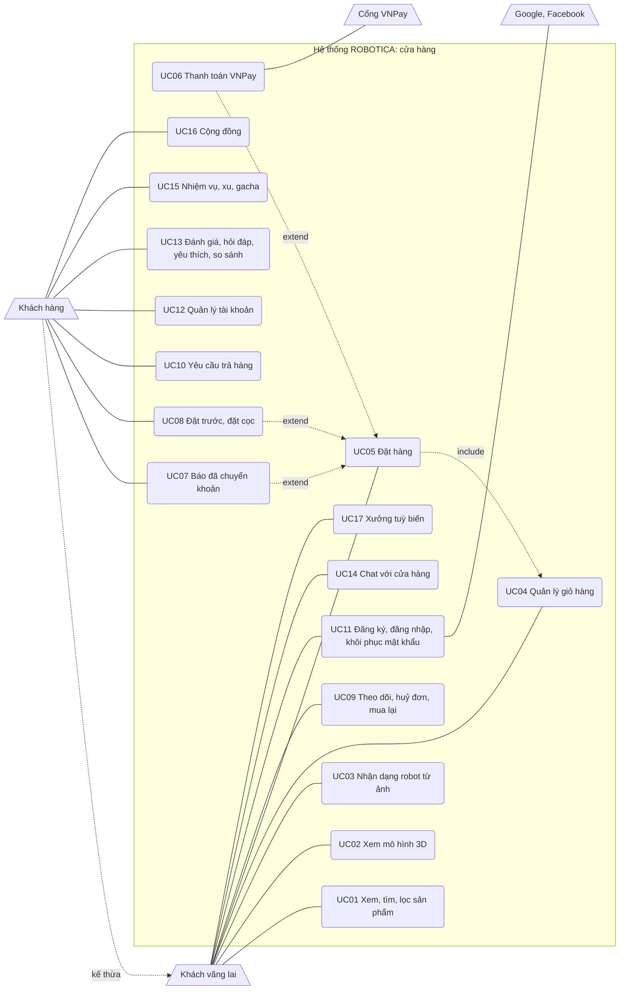

### 2.2. Phía nhân viên: hàng hoá, đơn hàng, kho

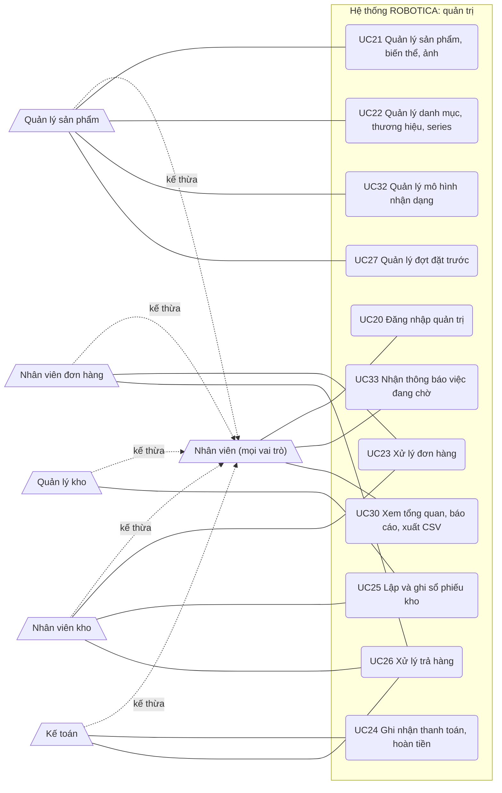

### 2.3. Phía nhân viên: khách hàng, nội dung, hệ thống

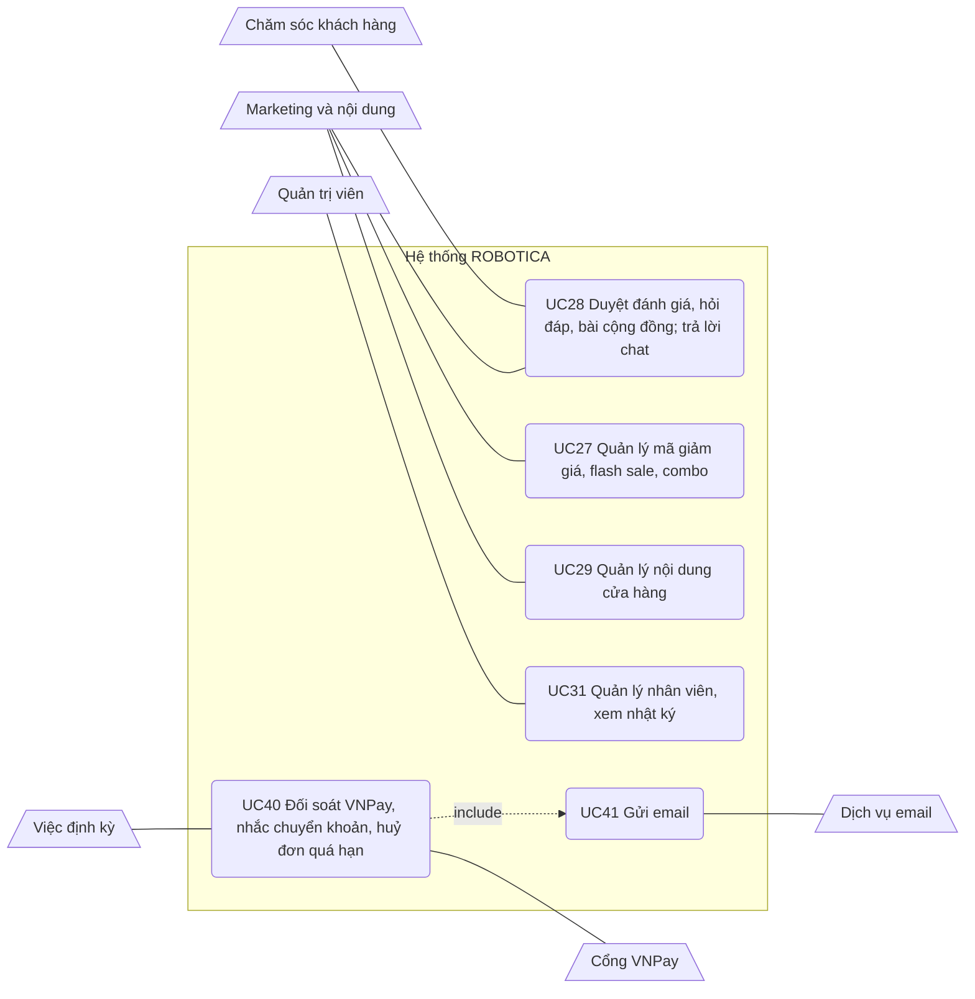

## 3. Danh sách use case

| Mã | Tên | Tác nhân chính | Yêu cầu | Nơi cài đặt |
|---|---|---|---|---|
| UC01 | Xem, tìm, lọc, sắp xếp sản phẩm | Khách | YC-DM-03 – 06, YC-TK-01 – 04 | `/`, `/san-pham`, `/san-pham/[slug]`; `queryProducts` |
| UC02 | Xem mô hình 3D: xoay, phóng, biến hình, dáng, góc nhìn cố định, toàn màn hình | Khách | YC-3D-01 – 05 | `RobotViewer`, `src/lib/model-features.ts` |
| UC03 | Nhận dạng robot từ ảnh, gợi ý sản phẩm | Khách | [08](08-tich-hop-ai.md) | `/tim-bang-anh`, `POST /api/nhan-dien` |
| UC04 | Quản lý giỏ hàng | Khách | YC-GH-01, 02 | `/gio-hang`, `src/lib/cart.ts`, `GET /api/cart` |
| UC05 | Đặt hàng | Khách | YC-GH-03 – 08 | `/thanh-toan`, `placeOrderAction` → `createOrder` |
| UC06 | Thanh toán VNPay | Khách, Cổng VNPay | nghiệp vụ mục 5 | `createAttempt`, `/api/thanh-toan/vnpay/ipn`, `/tra-ve` |
| UC07 | Báo đã chuyển khoản | Khách hàng | YC-DH-04 | Trang đơn, `claimTransferAction` |
| UC08 | Đặt trước, đặt cọc | Khách hàng | nghiệp vụ mục 10 | `/hang-sap-ve`, `src/lib/preorder.ts` |
| UC09 | Theo dõi, tra cứu, huỷ đơn, mua lại | Khách | YC-DH-01 – 03 | `/don-hang/[token]`, `/tra-cuu-don-hang`, `cancelOrderAction` (L12) |
| UC10 | Yêu cầu trả hàng sau khi nhận | Khách hàng | nghiệp vụ mục 4 | `POST /api/don-hang/[token]/tra-hang` |
| UC11 | Đăng ký, đăng nhập (mật khẩu, Google, Facebook), quên mật khẩu, xác thực email | Khách | YC-TKH-01; nghiệp vụ mục 2, 14, 15 | `src/app/actions/auth.ts`, `/api/dang-nhap/[provider]` |
| UC12 | Quản lý tài khoản: hồ sơ, sổ địa chỉ, bảo mật, thông báo, tải dữ liệu, xoá tài khoản | Khách hàng | YC-TKH-02, 03 | `/tai-khoan/cai-dat`, `src/app/actions/account.ts` |
| UC13 | Đánh giá, hỏi đáp, yêu thích, so sánh, báo khi có hàng | Khách | YC-DG-01 – 03; nghiệp vụ mục 11, 19 | Trang sản phẩm, `/so-sanh` |
| UC14 | Chat với cửa hàng | Khách, Chăm sóc KH | nghiệp vụ mục 16 | `ChatWidget`, `/api/chat` |
| UC15 | Nhiệm vụ nhận xu, gacha | Khách hàng | `mo-rong-cua-hang.md` | `/nhiem-vu`, `/gacha` |
| UC16 | Cộng đồng: đăng bài, bình luận, thích, báo cáo | Khách hàng | `mo-rong-cua-hang.md` | `/cong-dong`, `POST /api/cong-dong/bai-viet` |
| UC17 | Xưởng tuỳ biến (sơn, đế, LED, decal, hộp quà) | Khách | `mo-rong-cua-hang.md` | `/san-pham/[slug]/xuong` |
| UC20 | Đăng nhập quản trị | Nhân viên | YC-QT-01 | `admin.<tên miền>/admin/dang-nhap`, cookie `rs_admin` |
| UC21 | Quản lý sản phẩm, biến thể, ảnh, chụp ảnh từ 3D | Quản lý sản phẩm | YC-QT-02, 04 | `/admin/san-pham` (`catalog.edit`) |
| UC22 | Quản lý danh mục, thương hiệu, series | Quản lý sản phẩm | YC-QT-03 | `/admin/danh-muc`, `/thuong-hieu`, `/series` |
| UC23 | Xử lý đơn: xác nhận, đóng gói, bàn giao, giao, giao lại, nhận hàng hoàn, huỷ | NV đơn hàng, NV kho | YC-QT-06; L3 – L13 | `/admin/don-hang`, `/admin/kho/lay-hang`; `orderAction` → `applyOrderAction` |
| UC24 | Ghi nhận thu tiền, nhận cọc, đối chiếu chuyển khoản, hoàn tiền, hoá đơn VAT | Kế toán | YC-QT-07; L2, L14, L15 | `/admin/don-hang/chuyen-khoan`, `/cho-hoan-tien`, `/admin/hoa-don` (`payments.manage`) |
| UC25 | Lập, gửi, ghi sổ phiếu kho: nhập, xuất, điều chỉnh, kiểm kê | NV kho, Quản lý kho | YC-QT-05 | `/admin/kho/phieu` (`inventory.draft`, `inventory.post`) |
| UC26 | Xử lý trả hàng: duyệt, nhận hàng, hoàn tiền | NV đơn hàng, NV kho, Kế toán | nghiệp vụ mục 4 | `/admin/don-hang/tra-hang` |
| UC27 | Quản lý mã giảm giá, flash sale, combo, đợt đặt trước | Marketing, Quản lý sản phẩm | nghiệp vụ mục 9, 10, 12 | `/admin/ma-giam-gia`, `/flash-sale`, `/combo`, `/dat-truoc` |
| UC28 | Duyệt đánh giá, hỏi đáp, bài cộng đồng; trả lời chat; khách chờ hàng | Chăm sóc KH, Marketing | YC-QT-08, 09 | `/admin/danh-gia`, `/hoi-dap`, `/cong-dong`, `/chat`, `/khach-hang` |
| UC29 | Quản lý nội dung: banner, menu, trang thông tin, tin tức, cài đặt, hộp thư | Marketing | `10-quan-tri-va-kho.md` | `/admin/noi-dung/*`, `/admin/hop-thu` |
| UC30 | Xem tổng quan, báo cáo bán hàng và tồn kho, xuất CSV | Nhân viên có quyền | YC-QT-11 | `/admin`, `/admin/bao-cao`, `/admin/xuat/[loai]` |
| UC31 | Quản lý tài khoản nhân viên, xem nhật ký thao tác | Quản trị viên | YC-QT-10, 12 | `/admin/nhan-vien`, `/admin/nhat-ky` |
| UC32 | Quản lý mô hình nhận dạng: nhập danh mục robot, bật mô hình, ghép robot với sản phẩm | Quản lý sản phẩm | [08](08-tich-hop-ai.md) | `/admin/nhan-dien` |
| UC33 | Nhận thông báo việc đang chờ | Nhân viên | `10-quan-tri-va-kho.md` | `AdminAlerts`, `GET /admin/api/thong-bao` |
| UC40 | Đối soát VNPay, nhắc chuyển khoản, tự huỷ đơn trả trước quá hạn | Việc định kỳ | nghiệp vụ mục 5 | `GET /api/cron/dinh-ky` |
| UC41 | Gửi email (xác nhận đơn, đổi trạng thái, đặt lại mật khẩu, OTP, nhắc chuyển khoản) | Hệ thống, Dịch vụ email | nghiệp vụ mục 1 – 3 | `sendMail`, bảng `email_outbox` |

## 4. Đặc tả use case chính

### UC05. Đặt hàng

| Mục | Nội dung |
|---|---|
| Tác nhân | Khách (đã hoặc chưa đăng nhập) |
| Tiền điều kiện | Giỏ có ít nhất một biến thể đang bán |
| Hậu điều kiện | Có một đơn `pending` / `unpaid` (hoặc chờ cọc) / `not_created`; số lượng đặt được **giữ** trong sổ kho (dòng `reserve`); khách nhận thư xác nhận |
| Kích hoạt | Bấm "Đặt hàng" ở `/thanh-toan` |

**Luồng chính**
1. Khách nhập họ tên, điện thoại, địa chỉ (hoặc chọn từ sổ địa chỉ), chọn phương thức (COD, chuyển khoản, VNPay), có thể nhập mã giảm giá và yêu cầu hoá đơn VAT.
2. Trình duyệt gửi danh sách dòng giỏ (mã biến thể, số lượng, cấu hình Xưởng) và một khoá chống trùng (`idempotency_key`).
3. Máy chủ kiểm tra giới hạn tần suất (20 đơn mỗi giờ mỗi IP) và dữ liệu đầu vào.
4. Máy chủ tính lại toàn bộ giá: giá bán lúc đó (kể cả flash sale), combo, mã giảm giá, phí vận chuyển. Số tiền do trình duyệt gửi không được dùng (YC-GH-05).
5. Trong **một giao dịch**: khoá dòng tồn và suất flash sale, kiểm tra còn đủ hàng, ghi đơn, các dòng đơn, dòng sổ kho giữ hàng, sự kiện đơn.
6. Máy chủ gửi thư xác nhận và chuyển khách tới trang đơn `/don-hang/<token>`.

**Luồng rẽ**
- **4a. Giá đổi hoặc hết hàng** (YC-GH-08): không tạo đơn, báo rõ sản phẩm nào.
- **4b. Mã giảm giá không hợp lệ:** báo lý do (hết hạn, chưa đủ giá trị tối thiểu...).
- **5a. Hai khách cùng đặt món cuối cùng** (YC-GH-06): khoá dòng tồn bảo đảm chỉ một đơn thành công, người còn lại nhận thông báo hết hàng.
- **5b. Bấm đặt nhiều lần** (YC-GH-07): cùng khoá chống trùng thì trả lại đơn đã tạo.
- **3a. Đơn COD từ mức `site.codOtpFrom`:** phải nhập mã OTP gửi tới email.
- **6a. Chọn VNPay:** chuyển sang UC06. **Chọn chuyển khoản:** trang đơn hiện mã VietQR và hạn giữ hàng 48 giờ (UC07).
- **1a. Giỏ có hàng đặt trước:** chuyển sang UC08.

### UC06. Thanh toán VNPay

| Mục | Nội dung |
|---|---|
| Tác nhân | Khách, Cổng VNPay |
| Tiền điều kiện | Đơn VNPay đang `pending`, còn khoản phải trả (`amountDue`) |
| Hậu điều kiện | Tiền về thì đơn sang `paid` (L2), có dòng `payments`; không trả thì lượt thanh toán hết hạn |

**Luồng chính**
1. Máy chủ tạo một lượt thanh toán (`payment_attempts`) và dựng URL có chữ ký SHA-512, rồi chuyển khách sang VNPay.
2. Khách trả bằng thẻ ATM, QR ngân hàng hoặc thẻ quốc tế.
3. VNPay gọi **IPN** `/api/thanh-toan/vnpay/ipn`. Máy chủ ghi nguyên văn lời gọi (`payment_callbacks`), kiểm chữ ký, kiểm số tiền, kiểm lượt thanh toán, rồi ghi nhận tiền qua L2 `mark_paid` và trả `RspCode` đúng chuẩn.
4. VNPay đưa khách về `/api/thanh-toan/vnpay/tra-ve`. Trang này **không tin tham số URL**: nó đọc trạng thái trong CSDL, cần thì tra cứu `querydr`, rồi chuyển khách về trang đơn.

**Luồng rẽ**
- **3a. Sai chữ ký hoặc sai số tiền:** không ghi nhận tiền, trả mã lỗi cho VNPay.
- **3b. IPN lặp lại:** trả "đã xử lý", không ghi nhận hai lần.
- **3c. Đơn đã huỷ trước khi tiền về:** vẫn ghi nhận tiền, đơn vào danh sách chờ hoàn tiền (UC24).
- **3d. IPN bị lỡ:** việc định kỳ (UC40) tra cứu các lượt còn "pending" đã quá hạn thanh toán (IPN lẽ ra đã về) và chưa quá 7 ngày (`src/server/payments/vnpay-ops.ts`).
- **2a. Khách không trả:** lượt hết hạn sau 24 giờ; đơn tự huỷ (UC40), trừ khi có lượt khác còn hạn.

### UC07 và UC24. Chuyển khoản: báo đã chuyển và đối chiếu

| Mục | Nội dung |
|---|---|
| Tác nhân | Khách hàng; Kế toán |
| Tiền điều kiện | Đơn chuyển khoản `pending` / `unpaid`; cửa hàng đã cấu hình `BANK_*` |
| Hậu điều kiện | Kế toán ghi nhận thì đơn sang `paid` (L2); quá hạn mà chưa báo thì đơn tự huỷ (L13) |

**Luồng chính**
1. Trang đơn hiện mã VietQR có sẵn số tiền và nội dung chuyển khoản (mã đơn), cùng hạn giữ hàng.
2. Khách chuyển tiền rồi bấm "Tôi đã chuyển khoản". Hệ thống ghi một dòng `transfer_claims`; đây **chỉ là lời báo**, không đổi trạng thái đơn.
3. Kế toán nhận thông báo, mở `/admin/don-hang/chuyen-khoan`, đối chiếu với sổ ngân hàng, rồi bấm ghi nhận (L2).

**Luồng rẽ**
- **2a. Khách chưa báo:** ở mốc 24 giờ, việc định kỳ gửi thư nhắc một lần; quá 48 giờ thì huỷ đơn và trả hàng về kho.
- **3a. Không thấy tiền:** kế toán liên hệ khách hoặc huỷ đơn (L13).

### UC23. Xử lý đơn hàng

| Mục | Nội dung |
|---|---|
| Tác nhân | Nhân viên đơn hàng (L3, L7, L9, L10, L13); nhân viên kho, quản lý kho (L4, L5, L6, L11) |
| Tiền điều kiện | Đơn đúng trạng thái mà luật đòi hỏi; nhân viên có quyền của luật đó |
| Hậu điều kiện | Trạng thái đổi theo luật, có dòng `order_events` và nhật ký `audit_logs`; luật có động tới kho thì ghi sổ kho trong cùng giao dịch |

**Luồng chính** (đơn COD hoặc đã trả trước)
1. **L3 Xác nhận:** chỉ được bấm khi đơn là COD không cọc, hoặc đã thu tiền.
2. **L4 Bắt đầu đóng gói:** bị chặn nếu đơn còn chờ hàng đặt trước.
3. **L5 Đóng gói xong**, rồi **L6 Bàn giao vận chuyển:** nhập hãng và mã vận đơn. Lúc này hàng mới **xuất kho** (dòng `ship`).
4. **L7 Giao thành công.** Nếu đã thu đủ tiền, đơn tự sang `completed` (L8). Với COD, kế toán ghi nhận tiền (L2) khi hãng vận chuyển chuyển tiền về.

**Luồng rẽ**
- **L9 Giao thất bại**, sau đó **L10 Giao lại** hoặc **L11 Nhận hàng hoàn:** hàng vào khu cách ly, đơn sang `cancelled`.
- **L12:** khách tự huỷ khi đơn còn `pending`. **L13:** nhân viên huỷ trước khi bàn giao. Cả hai đều trả phần hàng đang giữ về kho.
- **L14:** đơn huỷ mà đã thu tiền thì kế toán hoàn tiền (UC24).

### UC25. Lập và ghi sổ phiếu kho

| Mục | Nội dung |
|---|---|
| Tác nhân | Nhân viên kho (lập, gửi); Quản lý kho (ghi sổ) |
| Hậu điều kiện | Mỗi dòng phiếu thành một dòng sổ kho (`stock_movements`); `stock_levels` và `inventory` được cập nhật trong cùng giao dịch; phiếu nhập cập nhật giá vốn bình quân gia quyền |

**Luồng chính**
1. Lập phiếu nháp: nhập hàng (chọn nhà cung cấp), xuất hàng, điều chỉnh (có lý do) hoặc kiểm kê; chọn vị trí, biến thể, số lượng, giá.
2. Gửi phiếu, phiếu chuyển sang trạng thái `submitted`. Quản lý kho nhận thông báo "phiếu chờ ghi sổ".
3. Quản lý kho kiểm tra rồi ghi sổ (`postDocument`).

**Luồng rẽ**
- **3a. Phiếu không hợp lệ:** từ chối ghi sổ và báo lý do. Ví dụ: phiếu kiểm kê có vị trí đã biến động sau lúc chụp số sổ sách; phiếu hàng trả vượt số đã giao (`returnProblem`).
- **1a. Kiểm kê:** một vị trí không được nằm trong hai phiếu kiểm kê đang mở cùng lúc.
- **3b. Trả phiếu về nháp** để sửa (`submitted` → `draft`). Phiếu đã ghi sổ không sửa được; muốn sửa phải lập phiếu điều chỉnh.

### UC10 và UC26. Trả hàng sau khi nhận

| Mục | Nội dung |
|---|---|
| Tác nhân | Khách hàng; Nhân viên đơn hàng; Nhân viên kho; Kế toán |
| Tiền điều kiện | Đơn đã giao trong vòng `site.policy.returnDays` ngày (mốc lấy từ `order_events`); đơn chưa có yêu cầu đang mở |
| Hậu điều kiện | Hàng trả nằm ở khu cách ly; có dòng `payments` loại hoàn tiền; hoàn đủ tổng đơn thì `payment_status = refunded` |

**Luồng chính**
1. Khách chọn dòng hàng, số lượng, lý do, kèm ảnh (lưu ở Storage `returns/`).
2. Nhân viên đơn hàng duyệt yêu cầu.
3. Nhân viên kho lập phiếu hàng trả gắn với đơn. Phiếu được ghi sổ như mọi phiếu, hàng vào khu cách ly.
4. Kế toán hoàn tiền theo số tiền tính bởi `src/lib/returns.ts`.

**Luồng rẽ**
- **2a. Từ chối:** ghi lý do. Khách được gửi yêu cầu mới.
- **1a. Khách huỷ yêu cầu** trước khi được duyệt.

### UC08. Đặt trước, đặt cọc

| Mục | Nội dung |
|---|---|
| Tác nhân | Khách hàng; Quản lý sản phẩm (mở đợt); NV kho (phân bổ); Kế toán (nhận cọc) |
| Tiền điều kiện | Biến thể có đợt đặt trước (`preorder_offers`) chưa kết thúc, còn suất |
| Hậu điều kiện | Đơn có dòng đặt trước, chưa giữ tồn; `preorder_status = waiting` cho tới khi được phân bổ hàng |

**Luồng chính**
1. Khách đặt hàng đặt trước, trả cọc (chuyển khoản hoặc VNPay) hoặc trả đủ.
2. Kế toán ghi nhận cọc (L15): `payment_status = deposit_paid`.
3. Hàng về: nhân viên kho phân bổ cho các đơn theo thứ tự đặt. Hệ thống ghi dòng sổ kho `reserve`, đơn sang `ready`.
4. Đơn đi tiếp như UC23. Phần tiền còn lại thu ở L2.

**Luồng rẽ**
- **1a. Hết suất:** không đặt được.
- **3a. Lịch về thay đổi:** khách được báo qua email.

### UC03. Nhận dạng robot từ ảnh

| Mục | Nội dung |
|---|---|
| Tác nhân | Khách |
| Tiền điều kiện | Có một mô hình nhận dạng đang bật (`recognition_models.is_active`) |
| Hậu điều kiện | Khách thấy bảng 5 robot kèm phần trăm và sản phẩm đang bán của các robot đó; hệ thống ghi một dòng `recognition_logs` (không lưu ảnh) |

**Luồng chính**
1. Khách chọn hoặc chụp ảnh ở `/tim-bang-anh`.
2. Lần đầu, trình duyệt tải mô hình ONNX (fp16, 164 MB, chia phần 20 MB) và lưu vào bộ nhớ đệm.
3. Web Worker tiền xử lý ảnh, cho kết quả trùng từng byte với Python: thu cạnh ngắn về 256, cắt giữa 224 × 224, chuẩn hoá màu.
4. Worker chạy mô hình rồi tính xác suất `softmax(z / T)` cho 195 lớp.
5. Trình duyệt gửi `POST /api/nhan-dien` gồm mã mô hình, 195 xác suất và thời gian xử lý. **Ảnh không rời máy khách.**
6. Máy chủ kiểm tra (giới hạn 30 lượt mỗi phút, kích thước dữ liệu, đúng mô hình đang bật), dựng bảng xếp hạng kèm sản phẩm, rồi ghi nhật ký sau khi trả lời.

**Luồng rẽ**
- **Không có mô hình đang bật:** trang dùng cách tìm bằng ảnh cũ (08 phụ lục A).
- **Trang đang mở là của mô hình cũ:** máy chủ trả `model-mismatch`, khách tải lại trang.
- **Thiết bị không chạy được WebAssembly hoặc thiếu bộ nhớ:** báo lỗi, không gửi gì lên máy chủ.

## 5. Sơ đồ hoạt động

### 5.1. Đặt hàng và thanh toán

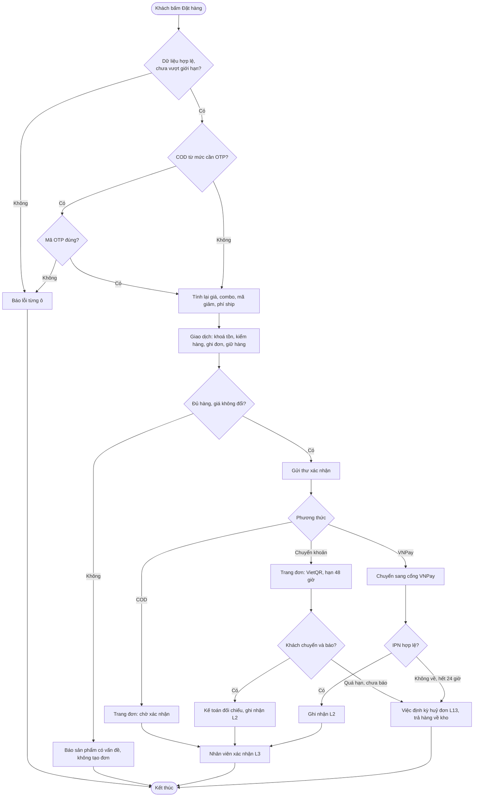

### 5.2. Xử lý đơn và giao hàng

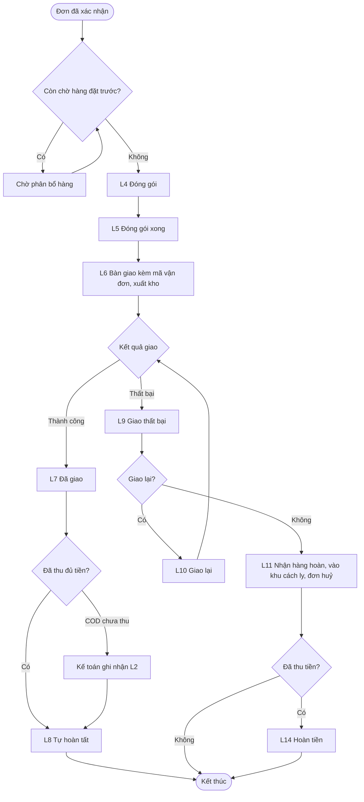

### 5.3. Trả hàng sau khi nhận

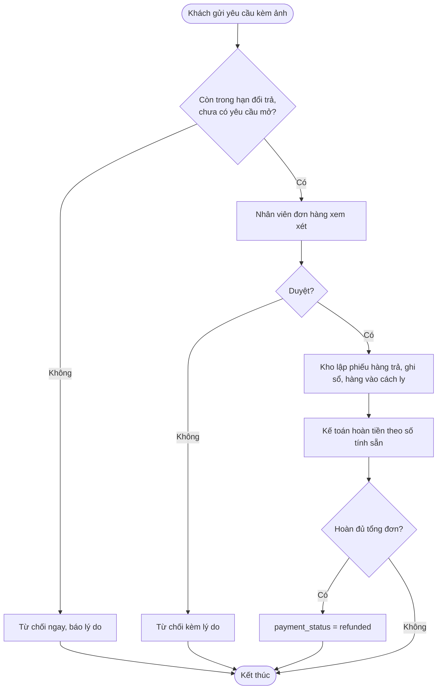

### 5.4. Nhận dạng robot từ ảnh

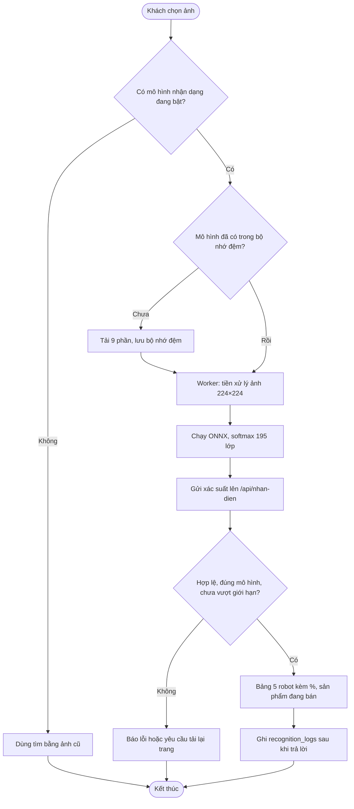

## 6. Sơ đồ tuần tự

### 6.1. Đặt hàng

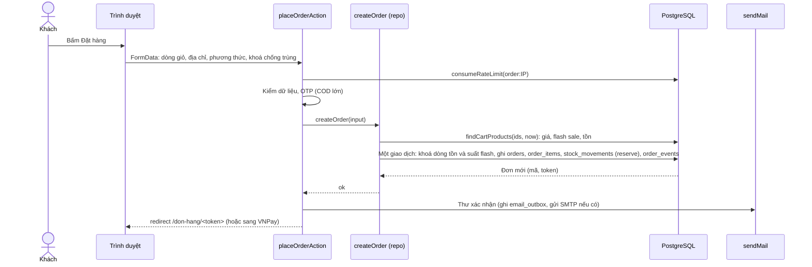

### 6.2. Thanh toán VNPay và IPN

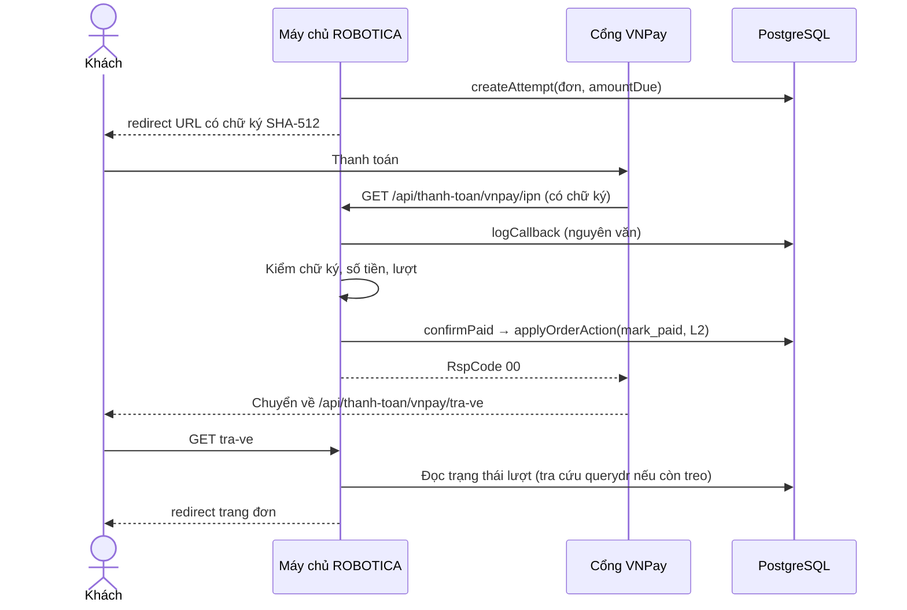

### 6.3. Nhận dạng robot

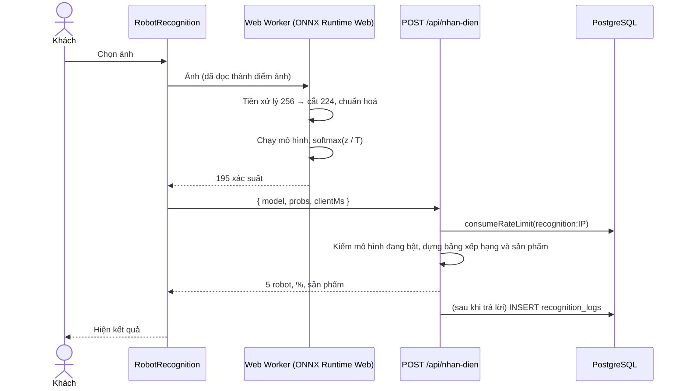

### 6.4. Việc định kỳ

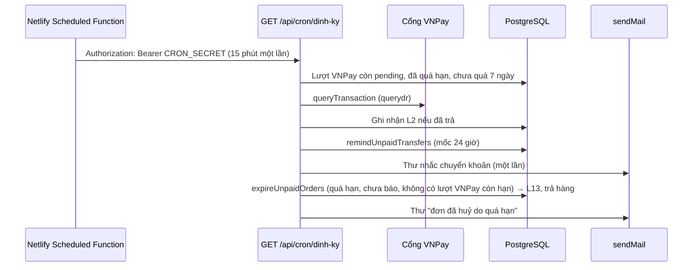
