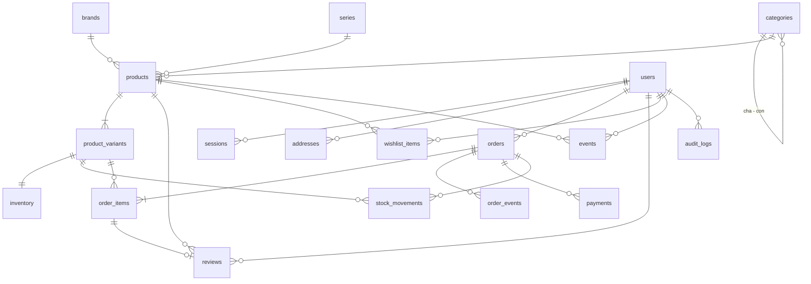

# 03. Thiết kế cơ sở dữ liệu

Thiết kế đích cho **bước 1** (trang thương mại điện tử cốt lõi). Hệ quản trị: PostgreSQL trên Supabase. Trạng thái và luật chuyển trạng thái nằm ở [04-trang-thai.md](04-trang-thai.md).

**Tình trạng:** bản thiết kế, chưa cài đặt. Mã nguồn hiện tại vẫn dùng cấu trúc cũ (bảng `products` không có biến thể).

**Cập nhật 15/10/2026** cho giai đoạn quản trị và kho ([10-quan-tri-va-kho.md](10-quan-tri-va-kho.md)): nhóm kho viết lại theo vị trí và phiếu kho (mục 4); thêm vai trò, nhật ký, nhà cung cấp, nội dung cửa hàng, mã giảm giá (mục 12). Phần nào ở mục 12 khác với các mục trước thì mục 12 đúng.

## 1. Quy ước chung

| Mục | Quy ước | Lý do |
| --- | --- | --- |
| Khoá chính | `TEXT`, chuỗi hex ngẫu nhiên 20 ký tự | Không lộ số lượng bản ghi; đang dùng sẵn |
| Tiền | `BIGINT`, đơn vị đồng (VND), không có phần lẻ | Tránh sai số của số thực |
| Thời gian | `BIGINT`, mili giây từ 1970 (UTC) | Đang dùng sẵn; hiển thị theo giờ Việt Nam ở tầng giao diện |
| Cờ đúng/sai | `BOOLEAN` | |
| Giá trị liệt kê | `TEXT` kèm ràng buộc `CHECK` | Dễ thêm giá trị bằng migration |
| Bảo mật | Mọi bảng bật RLS, không khai báo policy | Khoá API công khai của Supabase không đọc ghi được; chỉ ứng dụng truy cập |
| Xoá | Sản phẩm và biến thể không xoá cứng khi đã có đơn; chuyển sang `archived` | Giữ lịch sử đơn hàng |

## 2. Sơ đồ quan hệ

## 3. Nhóm danh mục

### `categories` — danh mục cha con

| Cột | Kiểu | Ràng buộc | Ghi chú |
| --- | --- | --- | --- |
| id | TEXT | PK | |
| slug | TEXT | UNIQUE, NOT NULL | Dùng trên URL |
| name | TEXT | NOT NULL | |
| description | TEXT | NOT NULL, mặc định rỗng | |
| parent_id | TEXT | FK → categories.id, NULL | NULL là danh mục gốc. Tối đa 2 cấp |
| sort_order | INTEGER | NOT NULL, mặc định 0 | |

### `brands` — thương hiệu, hãng sản xuất

| Cột | Kiểu | Ràng buộc |
| --- | --- | --- |
| id | TEXT | PK |
| slug | TEXT | UNIQUE, NOT NULL |
| name | TEXT | NOT NULL |

### `series` — dòng phim, dòng sản phẩm

Cùng cấu trúc với `brands` (`id`, `slug`, `name`). Tách riêng vì một series có thể được nhiều hãng sản xuất.

### `products` — sản phẩm chung

Mô tả thứ khách nhìn thấy trên một trang sản phẩm. Giá và tồn kho **không** nằm ở đây mà ở biến thể.

| Cột | Kiểu | Ràng buộc | Ghi chú |
| --- | --- | --- | --- |
| id | TEXT | PK | |
| slug | TEXT | UNIQUE, NOT NULL | |
| name | TEXT | NOT NULL | |
| tagline | TEXT | NOT NULL, mặc định rỗng | Mô tả ngắn |
| description | TEXT | NOT NULL, mặc định rỗng | |
| category_id | TEXT | FK → categories.id, NOT NULL | Danh mục chính |
| brand_id | TEXT | FK → brands.id, NULL | |
| series_id | TEXT | FK → series.id, NULL | |
| product_type | TEXT | CHECK: `figure`, `model_kit`, `combiner`, `accessory` | Loại sản phẩm |
| scale | TEXT | NULL | Ví dụ `1/144` |
| grade | TEXT | NULL | Ví dụ `HG`, `RG`, `MG` |
| specs | TEXT (JSON) | NOT NULL, mặc định `[]` | Danh sách `{label, value}` hiển thị ở bảng thông số |
| model | TEXT | NOT NULL | Khoá mô hình 3D dựng sẵn |
| model_url | TEXT | NULL | Đường dẫn file `.glb` nếu có |
| image | TEXT | NULL | Ảnh đại diện |
| search_text | TEXT | NOT NULL | Tên, mô tả, thương hiệu, series đã bỏ dấu; dùng cho tìm kiếm |
| is_featured | BOOLEAN | NOT NULL, mặc định false | |
| status | TEXT | CHECK: `draft`, `published`, `archived` | Chỉ `published` hiện cho khách |
| created_at, updated_at | BIGINT | NOT NULL | |

Chỉ mục: `(status, created_at)`, `category_id`, `brand_id`, `series_id`.

### `product_variants` — phiên bản bán được

Mỗi dòng là một thứ có thể cho vào giỏ: có SKU, giá và tồn kho riêng. Mọi sản phẩm có ít nhất một biến thể.

| Cột | Kiểu | Ràng buộc | Ghi chú |
| --- | --- | --- | --- |
| id | TEXT | PK | |
| product_id | TEXT | FK → products.id, NOT NULL | |
| sku | TEXT | UNIQUE, NOT NULL | Mã quản lý kho |
| name | TEXT | NOT NULL | Ví dụ "Bản thường", "Bản mạ vàng", "Đã qua sử dụng, hộp móp" |
| condition | TEXT | CHECK: `new`, `used` | |
| condition_note | TEXT | NOT NULL, mặc định rỗng | Mô tả tình trạng hàng cũ |
| price | BIGINT | NOT NULL, CHECK ≥ 0 | |
| color_primary, color_secondary, color_accent | TEXT | NOT NULL | Màu của mô hình 3D dựng sẵn cho phiên bản này |
| image | TEXT | NULL | NULL thì dùng ảnh của sản phẩm |
| is_default | BOOLEAN | NOT NULL | Biến thể hiện sẵn khi mở trang. Mỗi sản phẩm đúng một |
| is_active | BOOLEAN | NOT NULL, mặc định true | |
| sort_order | INTEGER | NOT NULL, mặc định 0 | |
| created_at, updated_at | BIGINT | NOT NULL | |

Ràng buộc: chỉ mục duy nhất trên `product_id` với điều kiện `is_default = true`.

## 4. Nhóm kho

Viết lại ngày 15/10/2026 theo [10-quan-tri-va-kho.md](10-quan-tri-va-kho.md) (Q2 đến Q4, Q8, Q11, Q16).

### `warehouses` — kho

| Cột | Kiểu | Ràng buộc | Ghi chú |
| --- | --- | --- | --- |
| id | TEXT | PK | |
| code | TEXT | UNIQUE, NOT NULL | Migration tạo sẵn `KHO-01` |
| name, address | TEXT | NOT NULL | |
| is_active | BOOLEAN | NOT NULL, mặc định true | |
| created_at | BIGINT | NOT NULL | |

### `locations` — vị trí trong kho

| Cột | Kiểu | Ràng buộc | Ghi chú |
| --- | --- | --- | --- |
| id | TEXT | PK | |
| warehouse_id | TEXT | FK → warehouses.id, NOT NULL | |
| code | TEXT | NOT NULL; UNIQUE `(warehouse_id, code)` | Ví dụ `A-01-02-03` |
| name | TEXT | NOT NULL, mặc định rỗng | |
| type | TEXT | CHECK: `storage`, `quarantine` | Hàng ở `quarantine` không bán được |
| is_active | BOOLEAN | NOT NULL, mặc định true | Không tắt được khi còn hàng |
| created_at | BIGINT | NOT NULL | |

Migration tạo sẵn vị trí `A-01` (`storage`) và `CACH-LY` (`quarantine`).

### `stock_levels` — tồn theo vị trí

| Cột | Kiểu | Ràng buộc |
| --- | --- | --- |
| variant_id | TEXT | FK → product_variants.id; PK `(variant_id, location_id)` |
| location_id | TEXT | FK → locations.id |
| on_hand | INTEGER | NOT NULL, CHECK ≥ 0 |
| updated_at | BIGINT | NOT NULL |

### `inventory` — số dư tổng theo biến thể và kho

| Cột | Kiểu | Ràng buộc | Ghi chú |
| --- | --- | --- | --- |
| variant_id | TEXT | FK; PK `(variant_id, warehouse_id)` | |
| warehouse_id | TEXT | FK → warehouses.id | |
| on_hand | INTEGER | NOT NULL, CHECK ≥ 0 | Tổng `stock_levels` ở các vị trí `storage` |
| quarantined | INTEGER | NOT NULL, CHECK ≥ 0 | Tổng ở các vị trí `quarantine` |
| reserved | INTEGER | NOT NULL, CHECK ≥ 0 và ≤ on_hand | Đã giữ cho đơn chưa xuất kho |
| low_stock_threshold | INTEGER | NOT NULL, mặc định 3 | |
| avg_cost | BIGINT | NOT NULL, mặc định 0 | Giá vốn bình quân gia quyền (Q11) |
| last_received_at | BIGINT | NULL | Dùng cho tuổi tồn |

**Số có thể bán = `on_hand` − `reserved`.** Ràng buộc `reserved ≤ on_hand` là thứ chặn bán vượt tồn khi hai khách đặt cùng lúc: lệnh giữ hàng thứ hai sẽ vi phạm ràng buộc và cả giao dịch bị huỷ.

### `stock_documents` — phiếu kho

| Cột | Kiểu | Ràng buộc | Ghi chú |
| --- | --- | --- | --- |
| id | TEXT | PK | |
| code | TEXT | UNIQUE, NOT NULL | Theo QT-18 |
| type | TEXT | CHECK: `receipt`, `issue`, `adjustment`, `transfer`, `stocktake`, `return` | |
| status | TEXT | CHECK: `draft`, `submitted`, `posted`, `cancelled` | |
| warehouse_id | TEXT | FK, NOT NULL | |
| supplier_id | TEXT | FK → suppliers.id, NULL | Phiếu nhập mua |
| order_id | TEXT | FK → orders.id, NULL | Phiếu hàng trả |
| reason_code | TEXT | NOT NULL, mặc định rỗng | Danh sách mã lý do nằm trong mã nguồn, theo loại phiếu |
| reference | TEXT | NOT NULL, mặc định rỗng | Số hoá đơn, phiếu giao của nhà cung cấp |
| note | TEXT | NOT NULL, mặc định rỗng | |
| expected_at | BIGINT | NULL | |
| created_by | TEXT | FK → users.id, NOT NULL | |
| submitted_at | BIGINT | NULL | |
| posted_by | TEXT | FK → users.id, NULL | |
| posted_at | BIGINT | NULL | |
| cancelled_by, cancelled_at | | NULL | |
| created_at, updated_at | BIGINT | NOT NULL | |

Chỉ mục: `(status, type, created_at)`.

### `stock_document_lines` — dòng phiếu

| Cột | Kiểu | Ràng buộc | Ghi chú |
| --- | --- | --- | --- |
| id | BIGINT | PK, tự tăng | |
| document_id | TEXT | FK, NOT NULL | |
| variant_id | TEXT | FK, NOT NULL | |
| location_id | TEXT | FK → locations.id, NOT NULL | Vị trí nhận, xuất, nguồn chuyển, hoặc vị trí đếm |
| to_location_id | TEXT | FK, NULL | Chỉ phiếu chuyển |
| qty_expected | INTEGER | NULL | Nhập: SL dự kiến |
| qty | INTEGER | NULL | SL thực: thực nhận, xuất, chuyển, điều chỉnh (có dấu), số đếm |
| qty_quarantined | INTEGER | NULL | Nhập: phần thực nhận đưa vào cách ly |
| system_qty | INTEGER | NULL | Kiểm kê: số sổ sách lúc tạo phiếu |
| unit_cost | BIGINT | NULL | Nhập: đơn giá |
| note | TEXT | NOT NULL, mặc định rỗng | |

Ràng buộc: UNIQUE `(document_id, variant_id, location_id)`.

### `stock_movements` — sổ kho

Chỉ thêm, không sửa, không xoá. Mỗi dòng thay đổi `stock_levels` của một vị trí (`qty_delta`) và/hoặc `inventory.reserved` (`reserved_delta`), cùng giao dịch với thay đổi số dư.

| Cột | Kiểu | Ràng buộc | Ghi chú |
| --- | --- | --- | --- |
| id | BIGINT | PK, tự tăng | |
| variant_id | TEXT | FK, NOT NULL | |
| warehouse_id | TEXT | FK, NOT NULL | |
| location_id | TEXT | FK, NULL | NULL với `reserve`, `release` |
| type | TEXT | CHECK (bảng dưới) | |
| qty_delta | INTEGER | NOT NULL | Có dấu |
| reserved_delta | INTEGER | NOT NULL, mặc định 0 | Có dấu |
| unit_cost | BIGINT | NULL | Giá vốn áp cho dòng này |
| document_id | TEXT | FK → stock_documents.id, NULL | |
| order_id | TEXT | FK → orders.id, NULL | |
| reason | TEXT | NOT NULL, mặc định rỗng | |
| actor_id | TEXT | FK → users.id, NULL | NULL khi do hệ thống |
| created_at | BIGINT | NOT NULL | |

Ràng buộc: CHECK `qty_delta <> 0 OR reserved_delta <> 0`; UNIQUE NULLS NOT DISTINCT `(document_id, order_id, variant_id, location_id, type)` để chặn ghi trùng ở mức CSDL (Q16).

Chỉ mục: `(variant_id, created_at)`, `(location_id, created_at)`, `document_id`, `order_id`.

| type | `qty_delta` | `reserved_delta` | Khi nào |
| --- | --- | --- | --- |
| `receive` | + | | Ghi sổ phiếu nhập (vị trí nhận hoặc vị trí cách ly) |
| `reserve` | | + | L1 đặt hàng |
| `release` | | − | L12, L13 huỷ đơn trước khi xuất |
| `ship` | − | − | L6 bàn giao vận chuyển |
| `return_in` | + | | L11 hàng hoàn, phiếu hàng trả (vào vị trí cách ly) |
| `issue` | − | | Phiếu xuất khác |
| `transfer_out`, `transfer_in` | −, + | | Phiếu chuyển vị trí: hai dòng |
| `adjust_in`, `adjust_out` | +, − | | Phiếu điều chỉnh, kiểm kê |

**Bất biến** (kiểm bằng hàm đối soát và test WH-10):
- `stock_levels.on_hand` = tổng `qty_delta` theo `(variant_id, location_id)`.
- `inventory.on_hand` = tổng `stock_levels` ở vị trí `storage`; `inventory.quarantined` = tổng ở vị trí `quarantine`.
- `inventory.reserved` = tổng `reserved_delta` theo biến thể = tổng số lượng của các đơn đã giữ mà chưa xuất, chưa huỷ.

## 5. Nhóm người dùng

### `users`

| Cột | Kiểu | Ràng buộc | Ghi chú |
| --- | --- | --- | --- |
| id | TEXT | PK | |
| email | TEXT | UNIQUE, NOT NULL | Lưu dạng chữ thường |
| name | TEXT | NOT NULL | |
| phone | TEXT | NOT NULL, mặc định rỗng | |
| password_hash | TEXT | NOT NULL | scrypt |
| role | TEXT | CHECK: `customer`, `admin`, `product_manager`, `warehouse`, `order_staff`, `support`, `marketing`, `accountant` | Mỗi người một vai trò |
| is_active | BOOLEAN | NOT NULL, mặc định true | false là tài khoản bị khoá |
| created_at | BIGINT | NOT NULL | |

### `sessions`

Giữ nguyên như hiện tại: `id` (SHA-256 của token trong cookie), `user_id`, `expires_at`, `created_at`.

### `addresses` — sổ địa chỉ giao hàng

| Cột | Kiểu | Ràng buộc |
| --- | --- | --- |
| id | TEXT | PK |
| user_id | TEXT | FK → users.id, NOT NULL |
| recipient_name | TEXT | NOT NULL |
| phone | TEXT | NOT NULL |
| line | TEXT | NOT NULL (số nhà, đường, phường/xã) |
| city | TEXT | NOT NULL (tỉnh, thành phố) |
| is_default | BOOLEAN | NOT NULL |

## 6. Nhóm đơn hàng

### `orders`

| Cột | Kiểu | Ràng buộc | Ghi chú |
| --- | --- | --- | --- |
| id | TEXT | PK | |
| code | TEXT | UNIQUE, NOT NULL | Mã đọc được, ví dụ `RB7K3M9QXT` |
| user_id | TEXT | FK → users.id, **NOT NULL** | Bắt buộc đăng nhập |
| status | TEXT | CHECK | Trạng thái đơn |
| payment_method | TEXT | CHECK: `cod`, `bank` | |
| payment_status | TEXT | CHECK | Trạng thái thanh toán |
| shipping_status | TEXT | CHECK | Trạng thái vận chuyển |
| recipient_name, recipient_phone, shipping_line, shipping_city | TEXT | NOT NULL | Bản chụp địa chỉ lúc đặt |
| note | TEXT | NOT NULL, mặc định rỗng | |
| subtotal, shipping_fee, total | BIGINT | NOT NULL | |
| tracking_carrier, tracking_code | TEXT | NULL | Nhân viên nhập tay |
| created_at, updated_at | BIGINT | NOT NULL | |

Chỉ mục: `(user_id, created_at)`, `(status, created_at)`.

### `order_items`

Lưu bản chụp tại thời điểm đặt, để đơn cũ không đổi khi sản phẩm bị sửa.

| Cột | Kiểu | Ràng buộc |
| --- | --- | --- |
| id | BIGINT | PK, tự tăng |
| order_id | TEXT | FK → orders.id, NOT NULL |
| variant_id | TEXT | FK → product_variants.id, NOT NULL |
| product_id | TEXT | NOT NULL |
| product_name, variant_name, sku, product_slug | TEXT | NOT NULL |
| image | TEXT | NULL |
| unit_price | BIGINT | NOT NULL |
| quantity | INTEGER | NOT NULL, CHECK > 0 |

### `order_events` — lịch sử đơn hàng

| Cột | Kiểu | Ghi chú |
| --- | --- | --- |
| id | BIGINT | PK, tự tăng |
| order_id | TEXT | FK |
| field | TEXT | `status`, `payment_status` hoặc `shipping_status` |
| from_value, to_value | TEXT | |
| note | TEXT | |
| actor_id | TEXT | NULL khi do hệ thống |
| created_at | BIGINT | |

### `payments` — giao dịch thanh toán

Một đơn có thể có nhiều dòng (thu tiền, hoàn tiền). `orders.payment_status` là kết quả tổng hợp từ bảng này.

| Cột | Kiểu | Ràng buộc | Ghi chú |
| --- | --- | --- | --- |
| id | TEXT | PK | |
| order_id | TEXT | FK, NOT NULL | |
| kind | TEXT | CHECK: `charge`, `refund` | |
| method | TEXT | CHECK: `cod`, `bank` | |
| amount | BIGINT | NOT NULL, CHECK > 0 | |
| reference | TEXT | NOT NULL, mặc định rỗng | Mã giao dịch ngân hàng, ghi chú đối soát |
| confirmed_by | TEXT | FK → users.id | Nhân viên xác nhận |
| created_at | BIGINT | NOT NULL | |

## 7. Nhóm tương tác

### `reviews` — đánh giá

| Cột | Kiểu | Ràng buộc | Ghi chú |
| --- | --- | --- | --- |
| id | TEXT | PK | |
| product_id | TEXT | FK, NOT NULL | |
| user_id | TEXT | FK, NOT NULL | |
| order_item_id | BIGINT | FK → order_items.id, UNIQUE, NOT NULL | Bằng chứng đã mua; mỗi dòng đơn chỉ đánh giá một lần |
| rating | INTEGER | CHECK 1 đến 5 | |
| comment | TEXT | NOT NULL, mặc định rỗng | |
| status | TEXT | CHECK: `pending`, `approved`, `hidden` | Chỉ `approved` hiện cho khách |
| created_at | BIGINT | NOT NULL | |

### `wishlist_items` — yêu thích

Khoá chính ghép `(user_id, product_id)`, kèm `created_at`.

### `events` — hành vi người dùng (dữ liệu cho AI)

Chỉ thêm. Đây là nguồn dữ liệu huấn luyện cho phần AI; phải ghi từ ngày đầu vì không bù lại được.

| Cột | Kiểu | Ràng buộc | Ghi chú |
| --- | --- | --- | --- |
| id | BIGINT | PK, tự tăng | |
| user_id | TEXT | FK, NULL | NULL khi chưa đăng nhập |
| visitor_id | TEXT | NOT NULL | Mã ngẫu nhiên lưu ở trình duyệt, nối hành vi trước và sau đăng nhập |
| type | TEXT | CHECK (xem bảng dưới) | |
| product_id | TEXT | NULL | |
| variant_id | TEXT | NULL | |
| query | TEXT | NULL | Từ khoá tìm kiếm |
| value | INTEGER | NULL | Số lượng, hoặc số mili giây tương tác |
| created_at | BIGINT | NOT NULL | |

| type | Ý nghĩa | `value` |
| --- | --- | --- |
| `view_product` | Mở trang sản phẩm | |
| `search` | Tìm kiếm | Số kết quả |
| `add_to_cart` | Thêm vào giỏ | Số lượng |
| `remove_from_cart` | Bỏ khỏi giỏ | |
| `wishlist_add` | Thêm vào yêu thích | |
| `purchase` | Đặt hàng thành công (một dòng cho mỗi sản phẩm) | Số lượng |
| `viewer_interact` | Xoay, phóng mô hình 3D | Mili giây tương tác |

Chỉ mục: `(user_id, created_at)`, `(product_id, type)`, `(visitor_id, created_at)`.

Lưu ý về quyền riêng tư: bảng này chứa hành vi cá nhân. Luận văn và chính sách của trang phải nêu rõ dữ liệu nào được thu và dùng để làm gì.

## 8. Nhóm hệ thống

| Bảng | Vai trò | Thay đổi |
| --- | --- | --- |
| `audit_logs` | Nhật ký thao tác quản trị: `actor_id`, `action`, `entity`, `entity_id`, `detail` (JSON), `created_at`. Chỉ thêm | Mới |
| `product_images` | Ảnh đại diện lưu trong CSDL | Giữ nguyên |
| `rate_limits` | Bộ đếm giới hạn tần suất | Giữ nguyên |
| `meta` | Dấu migration và dữ liệu mẫu | Giữ nguyên |

## 9. Chuyển từ cấu trúc hiện tại

CSDL trên Supabase hiện chỉ có 12 sản phẩm mẫu và một tài khoản mẫu, chưa có dữ liệu thật. Vì vậy:

- Viết migration `003` xoá các bảng `products`, `orders`, `order_items` cũ và tạo lại theo thiết kế này. Không cần chuyển đổi dữ liệu.
- Bảng `users` thêm cột `is_active`, mở rộng `role`; bỏ cột `address`, `city` (chuyển sang `addresses`).
- Dữ liệu mẫu viết lại: mỗi sản phẩm hiện có trở thành một sản phẩm với một biến thể mặc định.

## 10. Bảng để dành cho bước 3

Chưa thiết kế chi tiết: `coupons`, `return_requests`, `return_items`, `suppliers`, `purchase_orders`, `questions`, `answers`, `banners`, `pages`.

## 11. Các điểm đã chốt (13/10/2026)

1. **Danh mục tối đa 2 cấp** (ví dụ Transformers > Masterpiece). Sâu hơn thì truy vấn và giao diện phức tạp hơn nhiều.
2. **Mỗi sản phẩm một danh mục chính.** Tài liệu tham khảo muốn gán nhiều danh mục; thương hiệu và series đã đảm nhận phần lớn nhu cầu đó.
3. **Đánh giá gắn với sản phẩm**, không gắn với biến thể.
4. **Giỏ hàng vẫn lưu ở trình duyệt**, không có bảng giỏ hàng. Hành vi thêm, bỏ giỏ được ghi vào `events`.
5. **Bỏ trang tra cứu đơn bằng mã và số điện thoại**, vì mọi đơn đều thuộc một tài khoản.

## 12. Bổ sung cho giai đoạn quản trị và kho (15/10/2026)

Căn cứ: [10-quan-tri-va-kho.md](10-quan-tri-va-kho.md). Mọi bảng mới đều bật RLS, không khai báo policy (như mục 1).

### 12.1. Thay đổi ở bảng đã thiết kế

| Bảng | Thay đổi |
| --- | --- |
| `users` | `role` CHECK: `customer`, `admin`, `product_manager`, `warehouse_manager`, `warehouse`, `order_staff`, `support`, `marketing`, `accountant`, `viewer`. Thêm `is_active` BOOLEAN NOT NULL mặc định true; `marketing_consent` BOOLEAN NOT NULL mặc định false; `marketing_consent_at` BIGINT NULL. **Giữ** `address`, `city` cho tới giai đoạn cửa hàng (chưa tạo `addresses`) |
| `products` | Thêm `box_contents` TEXT NOT NULL mặc định rỗng; `meta_title`, `meta_description` TEXT NOT NULL mặc định rỗng; `published_at` BIGINT NULL |
| `product_variants` | Thêm `barcode` TEXT NULL, UNIQUE khi khác NULL; `compare_at_price` BIGINT NULL; `weight_grams`, `length_mm`, `width_mm`, `height_mm` INTEGER NULL |
| `orders` | `user_id` **tạm cho phép NULL** và giữ `token` (trang tra cứu đơn còn dùng) cho tới giai đoạn cửa hàng. Thêm `idempotency_key` TEXT NULL UNIQUE; `coupon_code` TEXT NULL; `discount` BIGINT NOT NULL mặc định 0. `total = subtotal − discount + shipping_fee` |
| `order_items` | Như mục 6 (có `variant_id`, `variant_name`, `sku`) |

### 12.2. Danh mục hàng

#### `product_media` — ảnh và mô hình của sản phẩm

| Cột | Kiểu | Ràng buộc | Ghi chú |
| --- | --- | --- | --- |
| id | TEXT | PK | |
| product_id | TEXT | FK, NOT NULL | |
| variant_id | TEXT | FK, NULL | Ảnh riêng của một biến thể |
| kind | TEXT | CHECK: `image`, `model` | |
| url | TEXT | NOT NULL | Đường dẫn đầy đủ theo `MEDIA_BASE_URL` |
| alt | TEXT | NOT NULL, mặc định rỗng | |
| sort_order | INTEGER | NOT NULL, mặc định 0 | |
| created_at | BIGINT | NOT NULL | |

`products.image` và `products.model_url` vẫn là ảnh đại diện và mô hình chính (để truy vấn danh sách nhanh); lưu media thì cập nhật hai cột này theo dòng đầu tiên.

#### `slug_redirects` — slug cũ của sản phẩm (P1)

`old_slug` TEXT PK, `product_id` TEXT FK NOT NULL, `created_at` BIGINT.

#### `suppliers` — nhà cung cấp

| Cột | Kiểu | Ràng buộc |
| --- | --- | --- |
| id | TEXT | PK |
| code | TEXT | UNIQUE, NOT NULL |
| name | TEXT | NOT NULL |
| contact_name, phone, email, address, note | TEXT | NOT NULL, mặc định rỗng |
| is_active | BOOLEAN | NOT NULL, mặc định true |
| created_at | BIGINT | NOT NULL |

### 12.3. Nội dung cửa hàng

#### `banners`

| Cột | Kiểu | Ràng buộc |
| --- | --- | --- |
| id | TEXT | PK |
| title | TEXT | NOT NULL |
| subtitle | TEXT | NOT NULL, mặc định rỗng |
| image_url | TEXT | NOT NULL |
| image_mobile_url | TEXT | NULL |
| link_url | TEXT | NOT NULL, mặc định rỗng |
| placement | TEXT | CHECK: `home_hero`, `home_strip` |
| sort_order | INTEGER | NOT NULL, mặc định 0 |
| starts_at, ends_at | BIGINT | NULL; CHECK `ends_at > starts_at` khi cả hai khác NULL |
| status | TEXT | CHECK: `draft`, `published` |
| created_at, updated_at | BIGINT | NOT NULL |

#### `nav_items` — menu

`id` TEXT PK; `menu` TEXT CHECK `header`, `footer`; `label` TEXT NOT NULL; `url` TEXT NOT NULL; `sort_order` INTEGER NOT NULL mặc định 0; `is_active` BOOLEAN NOT NULL mặc định true.

#### `pages` và `page_revisions` — trang thông tin

| Bảng | Cột |
| --- | --- |
| `pages` | `id` TEXT PK; `slug` TEXT UNIQUE NOT NULL; `title` TEXT NOT NULL; `body` TEXT NOT NULL (văn bản thuần); `meta_description` TEXT NOT NULL mặc định rỗng; `status` CHECK `draft`, `published`; `published_at` BIGINT NULL; `created_at`, `updated_at` BIGINT NOT NULL |
| `page_revisions` | `id` BIGINT PK tự tăng; `page_id` FK NOT NULL; `title`, `body` TEXT NOT NULL; `created_by` FK → users.id; `created_at` BIGINT NOT NULL. Mỗi lần xuất bản thêm một dòng |

#### `site_settings` — cài đặt hiển thị

`key` TEXT PK; `value` TEXT NOT NULL (JSON); `updated_by` TEXT NULL; `updated_at` BIGINT NOT NULL. Các khoá: `contact` (điện thoại, email, địa chỉ, giờ làm việc), `announcement` (nội dung, liên kết, bắt đầu, kết thúc, bật), `policy` (số ngày đổi trả, số tháng bảo hành). Không có dòng thì dùng giá trị trong `src/config/site.ts`.

### 12.4. Khuyến mãi

#### `coupons`

| Cột | Kiểu | Ràng buộc |
| --- | --- | --- |
| id | TEXT | PK |
| code | TEXT | UNIQUE, NOT NULL, chữ in hoa |
| kind | TEXT | CHECK: `fixed`, `percent` |
| value | BIGINT | NOT NULL, CHECK > 0; với `percent` từ 1 đến 100 |
| max_discount | BIGINT | NULL |
| min_subtotal | BIGINT | NOT NULL, mặc định 0 |
| category_id | TEXT | FK → categories.id, NULL (NULL là toàn bộ) |
| starts_at, ends_at | BIGINT | NULL |
| usage_limit | INTEGER | NULL (NULL là không giới hạn) |
| used_count | INTEGER | NOT NULL, mặc định 0, CHECK ≤ usage_limit khi có giới hạn |
| is_active | BOOLEAN | NOT NULL, mặc định true |
| created_at, updated_at | BIGINT | NOT NULL |

#### `coupon_redemptions`

`id` BIGINT PK tự tăng; `coupon_id` FK NOT NULL; `order_id` FK UNIQUE NOT NULL; `amount` BIGINT NOT NULL; `released_at` BIGINT NULL (đơn bị huỷ, đã trả lượt); `created_at` BIGINT NOT NULL.

### 12.5. Hệ thống

#### `audit_logs` — nhật ký thao tác

| Cột | Kiểu | Ràng buộc | Ghi chú |
| --- | --- | --- | --- |
| id | BIGINT | PK, tự tăng | |
| actor_id | TEXT | FK → users.id, NULL | NULL khi đăng nhập thất bại |
| actor_role | TEXT | NOT NULL, mặc định rỗng | Vai trò lúc thao tác |
| action | TEXT | NOT NULL | Ví dụ `product.price_change`, `stock_document.post`, `order.ship`, `auth.admin_login_failed` |
| entity | TEXT | NOT NULL | Tên bảng |
| entity_id | TEXT | NOT NULL, mặc định rỗng | |
| summary | TEXT | NOT NULL | Một câu tiếng Việt, hiện ở trang nhật ký |
| detail | TEXT (JSON) | NOT NULL, mặc định `{}` | `{ before, after }` các trường đã đổi, lý do |
| created_at | BIGINT | NOT NULL | |

Chỉ mục: `(entity, entity_id)`, `(actor_id, created_at)`, `created_at`. Chỉ thêm (QT-19).

`reviews`, `wishlist_items`, `payments`, `order_events` dùng thiết kế ở mục 6 và 7.

### 12.6. Chuyển đổi

Theo quyết định Q1, migration được xoá và tạo lại các bảng danh mục, đơn hàng, kho, rồi nạp lại dữ liệu mẫu. Tồn ban đầu của dữ liệu mẫu phải đi qua một phiếu nhập đã ghi sổ (mã `PN-SEED`) để sổ kho và số dư khớp nhau ngay từ đầu. Không sửa migration đã commit; mỗi thay đổi là một migration mới ở cuối mảng.
