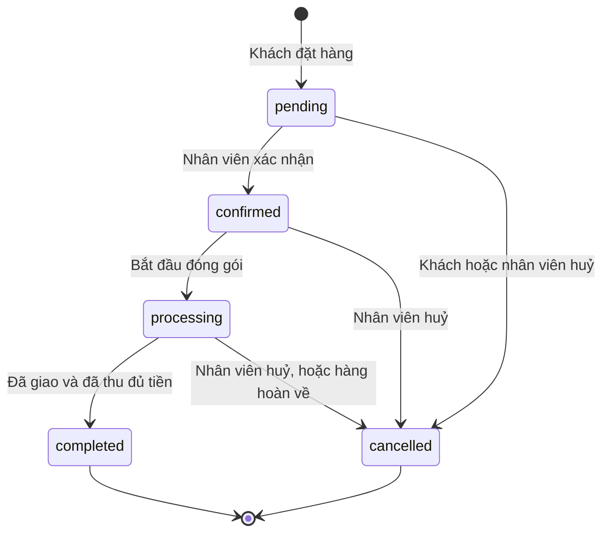
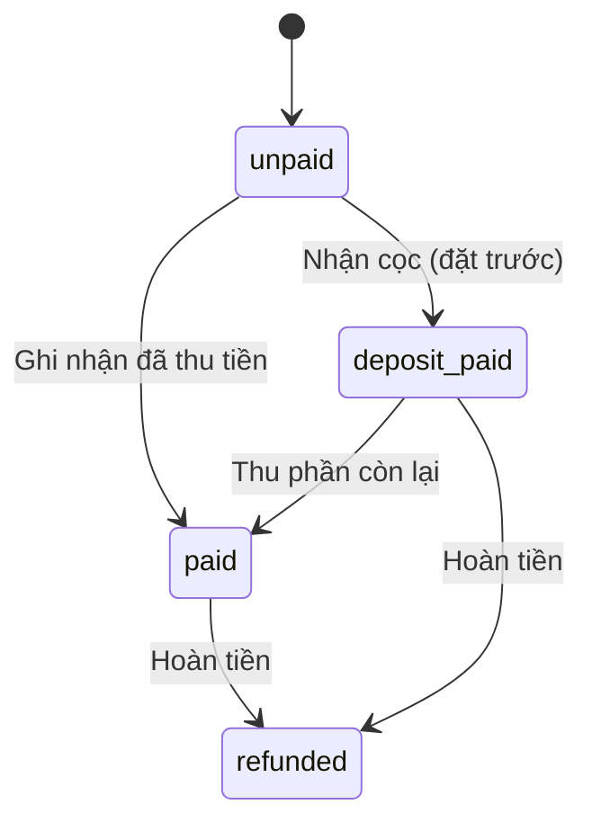
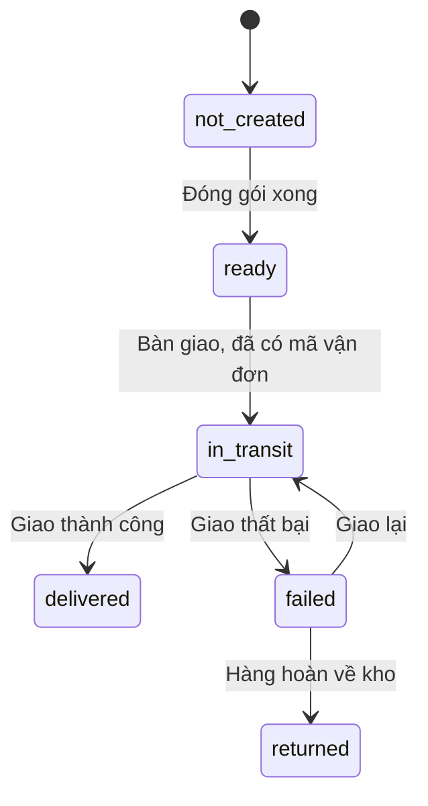
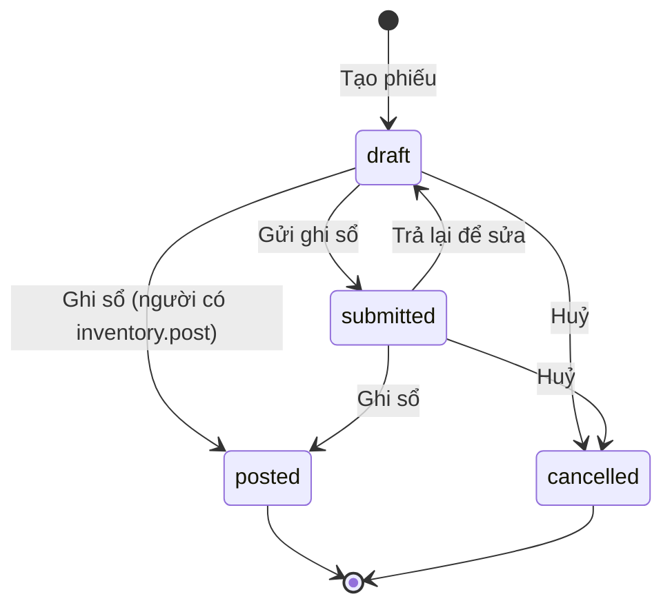

# 04. Trạng thái và luật chuyển trạng thái

Áp dụng cho bước 1. Cấu trúc bảng nằm ở [03-co-so-du-lieu.md](03-co-so-du-lieu.md).

**Tình trạng:** bản thiết kế, chưa cài đặt. Mã nguồn hiện dùng một dãy trạng thái đơn giản hơn (`pending`, `confirmed`, `shipping`, `completed`, `cancelled`).

## 1. Nguyên tắc

- Một đơn hàng có **ba trạng thái độc lập**: đơn (`status`), thanh toán (`payment_status`), vận chuyển (`shipping_status`). Chúng liên kết bằng các luật ở mục 5, không tự đổi cùng nhau.
- Chỉ các bước chuyển liệt kê ở đây là hợp lệ. Mọi bước khác bị từ chối.
- Điều kiện của trạng thái hiện tại nằm ngay trong câu lệnh `UPDATE`, để hai người thao tác cùng lúc không thể làm đơn nhảy sai bước.
- Mỗi lần chuyển ghi một dòng vào `order_events` (ai, lúc nào, từ đâu sang đâu).
- Mọi thay đổi tồn kho đi kèm một dòng `stock_movements` trong cùng giao dịch.

## 2. Trạng thái đơn hàng (`orders.status`)

| Trạng thái | Ý nghĩa |
| --- | --- |
| `pending` | Chờ cửa hàng xác nhận. Hàng đã được giữ |
| `confirmed` | Cửa hàng nhận đơn |
| `processing` | Đang đóng gói hoặc đang giao |
| `completed` | Đã giao thành công và đã thu đủ tiền. Trạng thái cuối |
| `cancelled` | Đã huỷ. Trạng thái cuối |

## 3. Trạng thái thanh toán (`orders.payment_status`)

| Trạng thái | Ý nghĩa |
| --- | --- |
| `unpaid` | Chưa thu tiền |
| `deposit_paid` | Đơn có hàng đặt trước đã nhận tiền cọc (`orders.deposit_amount`), còn phần còn lại. Có một dòng `payments` loại `deposit` (thêm 08/11/2026, mục 5.1) |
| `paid` | Đã thu đủ. Có một dòng `payments` loại `charge` (đã cọc thì thêm dòng `deposit`) |
| `refunded` | Đã hoàn tiền. Có một dòng `payments` loại `refund` |

Hoàn tiền một phần để dành cho bước 3.

## 4. Trạng thái vận chuyển (`orders.shipping_status`)

| Trạng thái | Ý nghĩa |
| --- | --- |
| `not_created` | Chưa đóng gói |
| `ready` | Đã đóng gói, chờ bàn giao |
| `in_transit` | Đơn vị vận chuyển đang giữ hàng |
| `delivered` | Khách đã nhận |
| `failed` | Giao không thành công |
| `returned` | Hàng đã về lại kho |

## 5. Luật liên kết

Mỗi dòng là một thao tác. Cả dòng xảy ra trong một giao dịch: hoặc tất cả, hoặc không gì cả.

| # | Thao tác | Ai được làm | Điều kiện | Kết quả |
| --- | --- | --- | --- | --- |
| L1 | Đặt hàng | Khách (tạm thời cả khách vãng lai, xem [10](10-quan-tri-va-kho.md) mục 1) | Mọi dòng: biến thể đang bán, giá khớp, số lượng ≤ số có thể bán (dòng đặt trước: ≤ số suất còn lại của đợt đang mở, mục 5.1); `idempotency_key` chưa dùng | Tạo đơn `pending` / `unpaid` / `not_created`. Kho: `reserve` (trừ dòng đặt trước). Có mã giảm giá thì thêm `coupon_redemptions`, tăng `used_count`. Có dòng đặt trước thì `preorder_status = waiting`, ghi `deposit_amount` |
| L2 | Ghi nhận đã thu tiền | Kế toán, quản trị viên | `payment_status` là `unpaid` hoặc `deposit_paid`; đơn chưa `cancelled` | `payment_status → paid`; thêm `payments` loại `charge` (đã cọc thì số tiền là tổng − cọc) |
| L3 | Xác nhận đơn | Nhân viên đơn hàng, quản trị viên | `status = pending`. Đơn chuyển khoản phải `paid` trước; đơn có cọc phải `deposit_paid` hoặc `paid` trước | `status → confirmed` |
| L4 | Bắt đầu đóng gói | Nhân viên đơn hàng, nhân viên kho | `status = confirmed`; `preorder_status` không phải `waiting` | `status → processing` |
| L5 | Đóng gói xong | Nhân viên kho, nhân viên đơn hàng | `status = processing`; `shipping_status = not_created` | `shipping_status → ready` |
| L6 | Bàn giao vận chuyển | Nhân viên đơn hàng, nhân viên kho | `shipping_status = ready`; đã nhập hãng và mã vận đơn; đủ hàng ở các vị trí `storage` | `shipping_status → in_transit`. Kho: `ship` từ các vị trí chọn theo Q7 của [10](10-quan-tri-va-kho.md) |
| L7 | Giao thành công | Nhân viên đơn hàng | `shipping_status = in_transit` | `shipping_status → delivered` |
| L8 | Hoàn tất đơn | Hệ thống, tự động | `shipping_status = delivered` và `payment_status = paid` | `status → completed` |
| L9 | Giao thất bại | Nhân viên đơn hàng | `shipping_status = in_transit` | `shipping_status → failed` |
| L10 | Giao lại | Nhân viên đơn hàng | `shipping_status = failed` | `shipping_status → in_transit` |
| L11 | Nhận hàng hoàn | Nhân viên kho | `shipping_status = failed` | `shipping_status → returned`; `status → cancelled`. Kho: `return_in` vào vị trí cách ly |
| L12 | Khách huỷ đơn | Chủ đơn | `status = pending` | `status → cancelled`. Kho: `release`. Trả lượt mã giảm giá |
| L13 | Nhân viên huỷ đơn | Nhân viên đơn hàng, quản trị viên | `status` là `pending`, `confirmed` hoặc `processing`; `shipping_status` là `not_created` hoặc `ready` | `status → cancelled`. Kho: `release`. Trả lượt mã giảm giá |
| L14 | Hoàn tiền | Kế toán, quản trị viên | `status = cancelled`; `payment_status` là `paid` hoặc `deposit_paid` | `payment_status → refunded`; thêm `payments` loại `refund` bằng mọi khoản đã thu (cọc + thu) |
| L15 | Ghi nhận đã nhận cọc | Kế toán, quản trị viên; VNPay (IPN) | `status = pending`; `payment_status = unpaid`; `deposit_amount > 0` | `payment_status → deposit_paid`; thêm `payments` loại `deposit` |

Ghi chú:
- **L8 chạy ngay sau L2 và L7.** Đơn COD thường đi theo thứ tự L7 rồi L2 (giao xong mới thu được tiền); đơn chuyển khoản đi L2 rồi mới tới L7.
- **Sau L6 không huỷ trực tiếp được.** Hàng đã rời kho, nên chỉ có thể đi qua L9 rồi L11.
- **Đơn huỷ khi đã thu tiền** (đơn chuyển khoản, đơn đã cọc) nằm ở trạng thái `cancelled` / `paid` hoặc `cancelled` / `deposit_paid` cho tới khi kế toán thực hiện L14. Trang quản trị phải liệt kê riêng các đơn này.
- **L12, L13 với đơn đặt trước** chỉ trả lại phần đang giữ theo sổ kho: dòng đặt trước chưa phân bổ không giữ gì.

### 5.1. Đặt trước (thêm 08/11/2026, `src/lib/preorder.ts`)

- **Đợt đặt trước** (`preorder_offers`): một phiên bản, ngày dự kiến về, % cọc (0–100), số suất (không bắt buộc), trạng thái `open` (nhận đặt) → `closed` (ngừng nhận) ⇄ `open` → `ended` (kết thúc). Mỗi phiên bản tối đa một đợt chưa kết thúc. Khi đợt chưa kết thúc, phiên bản chỉ bán dạng đặt trước, không bán thường, để hàng về được chia cho người đã đặt trước.
- **Dòng đặt trước** (`order_items.preorder_offer_id`) không giữ tồn lúc đặt, chỉ chiếm suất (đơn chưa huỷ). Hai khách đặt suất cuối cùng lúc: đơn sau khoá dòng đợt và đếm lại.
- **Cọc**: mỗi dòng đặt trước cọc `đơn giá × số lượng × %`, làm tròn lên tới nghìn đồng. Khách chọn đặt cọc hoặc trả đủ. Cọc từ tổng đơn trở lên thì phải trả đủ. Trả đủ trước thì không nhận COD; COD đi với cọc (cọc chuyển khoản, phần còn lại trả khi nhận). Đơn huỷ được hoàn mọi khoản đã thu.
- **Phân bổ** (hàng đã nhập kho bằng phiếu nhập): giữ hàng (`reserve`) cho từng đơn theo thứ tự đặt, không nhảy cóc; chỉ đơn đã cọc, đã trả hoặc COD không cọc. Đơn đủ mọi dòng đặt trước chuyển `preorder_status: waiting → ready` (ghi `order_events`), khách nhận thư.
- **Kết thúc đợt** chỉ khi không còn đơn chờ hàng (đã phân bổ hoặc huỷ hết).
- **Trạng thái đặt trước của đơn** (`orders.preorder_status`): `none` (không có hàng đặt trước), `waiting` (còn dòng chưa phân bổ), `ready` (đã phân bổ đủ).

## 6. Tồn kho

Loại biến động, dấu và bất biến nằm ở [03](03-co-so-du-lieu.md) mục 4 (viết lại 15/10/2026 theo vị trí). Tóm tắt: `on_hand` là hàng bán được ở vị trí `storage`, `quarantined` là hàng ở vị trí cách ly, `reserved` là hàng đã giữ cho đơn. Bất biến luôn đúng: `0 ≤ reserved ≤ on_hand`. Số có thể bán là `on_hand − reserved`.

Kiểm tra chéo: số dư mỗi vị trí bằng tổng `qty_delta` trong `stock_movements`; số tổng của biến thể bằng tổng các vị trí theo loại; `reserved` bằng tổng `reserved_delta`. Hàm đối soát (YC-KHO-18) và test WH-10 kiểm điều này.

### 6.1. Phiếu kho (`stock_documents.status`)

| # | Thao tác | Quyền | Điều kiện | Kết quả |
| --- | --- | --- | --- | --- |
| K1 | Tạo, sửa phiếu | `inventory.draft` | `status = draft`; người tạo, hoặc có `inventory.post` | Lưu dòng phiếu; chưa tác động tồn |
| K2 | Gửi ghi sổ | `inventory.draft` | `status = draft`; có ít nhất một dòng hợp lệ | `status → submitted` |
| K3 | Trả lại | `inventory.post` | `status = submitted` | `status → draft` |
| K4 | Ghi sổ | `inventory.post` | `status` là `draft` hoặc `submitted`; kiểm soát kép theo Q10 với điều chỉnh, kiểm kê; mọi kiểm tra tồn qua; kiểm kê: vị trí không có biến động sau lúc chụp | `status → posted`; thêm `stock_movements`, cập nhật `stock_levels`, `inventory`, giá vốn; nhật ký |
| K5 | Huỷ | Người tạo (`inventory.draft`) hoặc `inventory.post` | `status` là `draft` hoặc `submitted` | `status → cancelled` |

Tác động khi ghi sổ (K4):

| Loại phiếu | Biến động |
| --- | --- |
| `receipt` | `receive` SL tốt vào vị trí nhận, `receive` SL cách ly vào vị trí cách ly; cập nhật `avg_cost`, `last_received_at` |
| `issue` | `issue` từ vị trí trên dòng |
| `transfer` | `transfer_out` ở vị trí nguồn, `transfer_in` ở vị trí đích |
| `adjustment` | `adjust_in` hoặc `adjust_out` theo dấu của `qty` |
| `stocktake` | Với mỗi dòng có `qty ≠ system_qty`: `adjust_in` hoặc `adjust_out` phần chênh |
| `return` | `return_in` vào vị trí cách ly |

## 7. Sản phẩm và đánh giá

| Đối tượng | Trạng thái | Luật |
| --- | --- | --- |
| Sản phẩm | `draft` → `published` ⇄ `archived` | Chỉ `published` hiện cho khách. Sản phẩm đã có đơn không xoá, chỉ `archived` |
| Biến thể | `is_active` đúng hoặc sai | Tắt thì không thêm được vào giỏ; đơn cũ không đổi |
| Đánh giá | `pending` → `approved` hoặc `hidden`; `approved` ⇄ `hidden` | Chỉ khách có dòng đơn thuộc đơn `completed` mới được gửi. Chăm sóc khách hàng và quản trị viên duyệt |
| Banner, trang thông tin | `draft` ⇄ `published` | Chỉ `published` hiện cho khách; banner còn phải trong khung thời gian. Xuất bản trang thì thêm một `page_revisions` |
| Mã giảm giá | `is_active`; khung thời gian; lượt dùng | Hết hạn, hết lượt hoặc tắt thì không áp được; đơn đã áp không đổi |
| Tài khoản | `is_active` | Khoá thì xoá mọi phiên, không đăng nhập được |

## 8. Các điểm đã chốt (13/10/2026)

1. **Đơn chuyển khoản phải thu tiền trước khi xác nhận** (L3). Cách khác: cho xác nhận trước, thu sau.
2. **Khách chỉ tự huỷ được khi đơn còn `pending`** (L12).
3. **Hàng hoàn về thì đơn chuyển thành `cancelled`** (L11). *Đổi ngày 15/10/2026:* hàng hoàn vào vị trí cách ly, không cộng thẳng vào hàng bán được; nhân viên kho kiểm tra rồi chuyển sang vị trí `storage` hoặc huỷ bằng phiếu điều chỉnh ([10](10-quan-tri-va-kho.md) Q15).
4. **Đánh giá phải được duyệt trước khi hiện.** Cách khác: hiện ngay, ẩn khi vi phạm.
