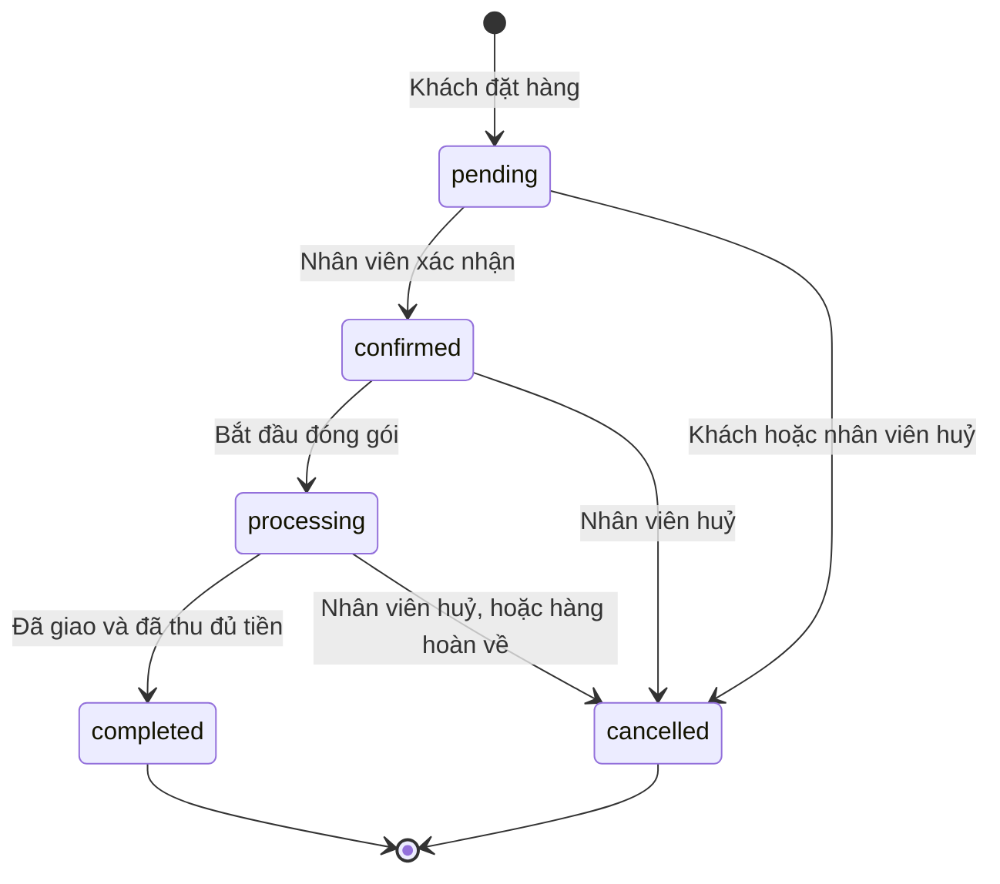
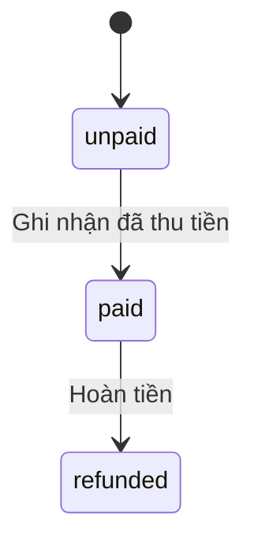
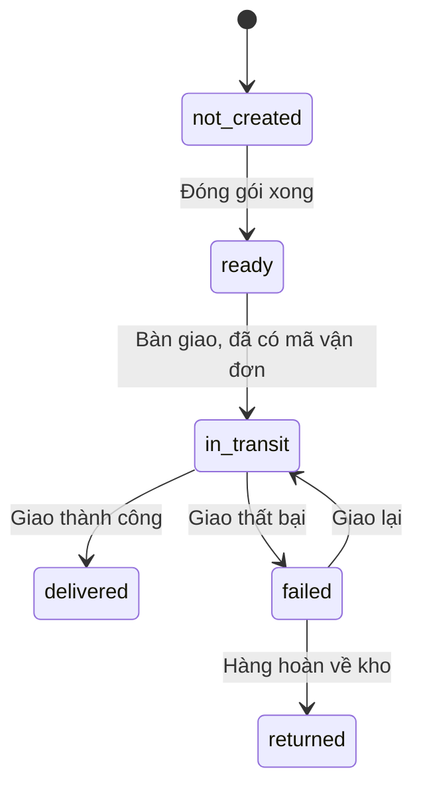

# 04. Trạng thái và luật chuyển trạng thái

Áp dụng cho bước 1. Cấu trúc bảng nằm ở [03-co-so-du-lieu.md](03-co-so-du-lieu.md).

**Tình trạng:** bản thiết kế, chưa cài đặt. Mã nguồn hiện dùng một dãy trạng thái đơn giản hơn (`pending`, `confirmed`, `shipping`, `completed`, `cancelled`).

## 1. Nguyên tắc

- Một đơn hàng có **ba trạng thái độc lập**: đơn (`status`), thanh toán (`payment_status`), vận chuyển (`shipping_status`). Chúng liên kết bằng các luật ở mục 5, không tự đổi cùng nhau.
- Chỉ các bước chuyển liệt kê ở đây là hợp lệ. Mọi bước khác bị từ chối.
- Điều kiện của trạng thái hiện tại nằm ngay trong câu lệnh `UPDATE`, để hai người thao tác cùng lúc không thể làm đơn nhảy sai bước.
- Mỗi lần chuyển ghi một dòng vào `order_events` (ai, lúc nào, từ đâu sang đâu).
- Mọi thay đổi tồn kho đi kèm một dòng `stock_movements` trong cùng giao dịch.

## 2. Trạng thái đơn hàng (`orders.status`)

| Trạng thái | Ý nghĩa |
| --- | --- |
| `pending` | Chờ cửa hàng xác nhận. Hàng đã được giữ |
| `confirmed` | Cửa hàng nhận đơn |
| `processing` | Đang đóng gói hoặc đang giao |
| `completed` | Đã giao thành công và đã thu đủ tiền. Trạng thái cuối |
| `cancelled` | Đã huỷ. Trạng thái cuối |

## 3. Trạng thái thanh toán (`orders.payment_status`)

| Trạng thái | Ý nghĩa |
| --- | --- |
| `unpaid` | Chưa thu tiền |
| `paid` | Đã thu đủ. Có một dòng `payments` loại `charge` |
| `refunded` | Đã hoàn tiền. Có một dòng `payments` loại `refund` |

Hoàn tiền một phần để dành cho bước 3.

## 4. Trạng thái vận chuyển (`orders.shipping_status`)

| Trạng thái | Ý nghĩa |
| --- | --- |
| `not_created` | Chưa đóng gói |
| `ready` | Đã đóng gói, chờ bàn giao |
| `in_transit` | Đơn vị vận chuyển đang giữ hàng |
| `delivered` | Khách đã nhận |
| `failed` | Giao không thành công |
| `returned` | Hàng đã về lại kho |

## 5. Luật liên kết

Mỗi dòng là một thao tác. Cả dòng xảy ra trong một giao dịch: hoặc tất cả, hoặc không gì cả.

| # | Thao tác | Ai được làm | Điều kiện | Kết quả |
| --- | --- | --- | --- | --- |
| L1 | Đặt hàng | Khách đã đăng nhập | Mọi dòng: biến thể đang bán, giá khớp, số lượng ≤ số có thể bán | Tạo đơn `pending` / `unpaid` / `not_created`. Kho: `reserve` |
| L2 | Ghi nhận đã thu tiền | Kế toán, quản trị viên | `payment_status = unpaid`; đơn chưa `cancelled` | `payment_status → paid`; thêm `payments` loại `charge` |
| L3 | Xác nhận đơn | Nhân viên đơn hàng, quản trị viên | `status = pending`. Đơn chuyển khoản phải `paid` trước | `status → confirmed` |
| L4 | Bắt đầu đóng gói | Nhân viên đơn hàng, nhân viên kho | `status = confirmed` | `status → processing` |
| L5 | Đóng gói xong | Nhân viên kho, nhân viên đơn hàng | `status = processing`; `shipping_status = not_created` | `shipping_status → ready` |
| L6 | Bàn giao vận chuyển | Nhân viên đơn hàng, nhân viên kho | `shipping_status = ready`; đã nhập hãng và mã vận đơn | `shipping_status → in_transit`. Kho: `ship` |
| L7 | Giao thành công | Nhân viên đơn hàng | `shipping_status = in_transit` | `shipping_status → delivered` |
| L8 | Hoàn tất đơn | Hệ thống, tự động | `shipping_status = delivered` và `payment_status = paid` | `status → completed` |
| L9 | Giao thất bại | Nhân viên đơn hàng | `shipping_status = in_transit` | `shipping_status → failed` |
| L10 | Giao lại | Nhân viên đơn hàng | `shipping_status = failed` | `shipping_status → in_transit` |
| L11 | Nhận hàng hoàn | Nhân viên kho | `shipping_status = failed` | `shipping_status → returned`; `status → cancelled`. Kho: `return_in` |
| L12 | Khách huỷ đơn | Chủ đơn | `status = pending` | `status → cancelled`. Kho: `release` |
| L13 | Nhân viên huỷ đơn | Nhân viên đơn hàng, quản trị viên | `status` là `pending`, `confirmed` hoặc `processing`; `shipping_status` là `not_created` hoặc `ready` | `status → cancelled`. Kho: `release` |
| L14 | Hoàn tiền | Kế toán, quản trị viên | `status = cancelled`; `payment_status = paid` | `payment_status → refunded`; thêm `payments` loại `refund` |

Ghi chú:
- **L8 chạy ngay sau L2 và L7.** Đơn COD thường đi theo thứ tự L7 rồi L2 (giao xong mới thu được tiền); đơn chuyển khoản đi L2 rồi mới tới L7.
- **Sau L6 không huỷ trực tiếp được.** Hàng đã rời kho, nên chỉ có thể đi qua L9 rồi L11.
- **Đơn huỷ khi đã thu tiền** (đơn chuyển khoản) nằm ở trạng thái `cancelled` / `paid` cho tới khi kế toán thực hiện L14. Trang quản trị phải liệt kê riêng các đơn này.

## 6. Tồn kho

| Biến động | `on_hand` | `reserved` | Xảy ra ở |
| --- | --- | --- | --- |
| `receive` | + | | Nhập kho (ngoài luồng đơn hàng) |
| `reserve` | | + | L1 |
| `release` | | − | L12, L13 |
| `ship` | − | − | L6 |
| `return_in` | + | | L11 |
| `adjust_in` | + | | Kiểm kê (bắt buộc ghi lý do) |
| `adjust_out` | − | | Kiểm kê, hàng hỏng (bắt buộc ghi lý do) |

Bất biến luôn đúng: `0 ≤ reserved ≤ on_hand`. Số có thể bán là `on_hand − reserved`.

Kiểm tra chéo: với mỗi biến thể, `on_hand` phải bằng tổng các biến động cộng trừ tổng các biến động trừ trong `stock_movements`. Có test tự động cho điều này.

## 7. Sản phẩm và đánh giá

| Đối tượng | Trạng thái | Luật |
| --- | --- | --- |
| Sản phẩm | `draft` → `published` ⇄ `archived` | Chỉ `published` hiện cho khách. Sản phẩm đã có đơn không xoá, chỉ `archived` |
| Biến thể | `is_active` đúng hoặc sai | Tắt thì không thêm được vào giỏ; đơn cũ không đổi |
| Đánh giá | `pending` → `approved` hoặc `hidden`; `approved` ⇄ `hidden` | Chỉ khách có dòng đơn thuộc đơn `completed` mới được gửi. Chăm sóc khách hàng và quản trị viên duyệt |

## 8. Các điểm đã chốt (13/10/2026)

1. **Đơn chuyển khoản phải thu tiền trước khi xác nhận** (L3). Cách khác: cho xác nhận trước, thu sau.
2. **Khách chỉ tự huỷ được khi đơn còn `pending`** (L12).
3. **Hàng hoàn về thì đơn chuyển thành `cancelled`** (L11), và hàng được cộng lại vào kho như hàng bán được. Hàng hoàn bị hỏng do nhân viên kho xử lý bằng `adjust_out`.
4. **Đánh giá phải được duyệt trước khi hiện.** Cách khác: hiện ngay, ẩn khi vi phạm.
