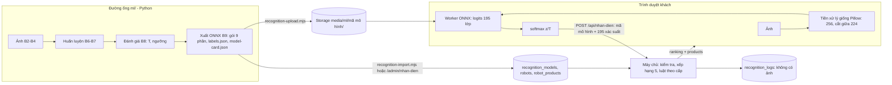
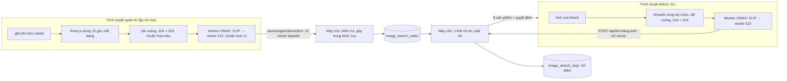

# 08. Tích hợp AI: nhận dạng robot từ ảnh

Khách đưa vào một ảnh robot. Mô hình học có giám sát chạy ngay trong trình duyệt và cho biết robot đó là ai (230 robot Transformers, Gundam, Super Sentai/Power Rangers), rồi cửa hàng gợi ý sản phẩm của các robot đó. Đây là đề tài luận văn. Kế hoạch: [../nhan-dang-robot/00-ke-hoach.md](../nhan-dang-robot/00-ke-hoach.md). Tổng hợp kết quả: [../nhan-dang-robot/README.md](../nhan-dang-robot/README.md). Quyết định nền: [00](00-quyet-dinh-nen-tang.md) mục 8.

Viết lại ngày 15/11/2026 (B14), thay bản ngày 04/11/2026. Cách cũ (so ảnh với ảnh dựng từ mô hình 3D bằng CLIP đóng băng) **vẫn còn trong mã**. Trang `/tim-bang-anh` dùng nó khi không có mô hình nhận dạng nào đang bật. Đặc tả của cách cũ chuyển nguyên văn xuống [Phụ lục A](#phụ-lục-a-cách-cũ-tìm-sản-phẩm-bằng-ảnh-dựng-từ-mô-hình-3d). Hướng dẫn gỡ: [../nhan-dang-robot/huong-dan-go-cach-cu.md](../nhan-dang-robot/huong-dan-go-cach-cu.md). Chủ dự án quyết định chưa gỡ.

Trạng thái: mô hình `robotrec-vit-b16-clip-dff6fdbb-s44` đang bật từ 15/11/2026 20:57. Chưa làm: thử nghiệm thực địa với ảnh chụp thật (B13), tìm theo mô tả chữ.

## 1. Bài toán

| Mục | Nội dung |
| --- | --- |
| Đầu vào | Một ảnh do khách chụp, tải trên mạng hoặc chụp màn hình; có thể khoanh vùng con robot |
| Đầu ra | Bảng xếp hạng 5 robot kèm xác suất, và sản phẩm đang bán của các robot đó theo thứ hạng |
| Nhãn | 195 lớp robot đã biết, xếp theo cây ba cấp: lớp (một phiên bản cụ thể, ví dụ Optimus Prime G1) → nhân vật → franchise. 35 lớp khác chỉ dùng để thử "robot lạ" |
| Loại bài toán | Phân loại ảnh có giám sát, nhiều lớp, có nhận biết ảnh lạ (tập mở) |
| Mô hình | ViT-B/16 khởi tạo từ CLIP, tinh chỉnh toàn bộ trên bộ dữ liệu tự thu thập |
| Khác cách cũ | Cách cũ không huấn luyện: so ảnh với ảnh dựng 3D bằng CLIP đóng băng, nên chỉ nhận ra sản phẩm có file 3D. Cách mới học từ ảnh thật của robot, nhận ra cả robot cửa hàng chưa bán |

## 2. Yêu cầu

| Mã | Yêu cầu | Hiện trạng |
| --- | --- | --- |
| YC-AI-01 | Trang `/tim-bang-anh`: chọn ảnh, kéo thả, dán, chụp trên điện thoại, khoanh vùng | Có (dùng chung giao diện với cách cũ) |
| YC-AI-02 | Mô hình chạy trong trình duyệt (ONNX Runtime Web, Web Worker, WASM). **Ảnh không gửi lên máy chủ**, chỉ gửi xác suất của 195 lớp | Có |
| YC-AI-03 | Tiền xử lý trong trình duyệt cho đúng từng điểm ảnh như lúc huấn luyện (Pillow, torchvision) | Có, trùng từng byte trên 7 ca mẫu |
| YC-AI-04 | `POST /api/nhan-dien` nhận xác suất, trả `{ model, ranking, products }`. Giới hạn 30 lượt/phút/IP, thân tối đa 32 KB | Có |
| YC-AI-05 | Luật trả lời theo cấp (lớp, nhân vật, franchise, "chưa nhận ra") theo ngưỡng chọn trên tập val | Có ở máy chủ, chỉ để ghi nhật ký. Giao diện tạm thời chỉ hiện bảng 5 robot (quyết định 15/11/2026) |
| YC-AI-06 | Quản trị `/admin/nhan-dien`: nhập `robots.json`, gói mô hình (model card), bật một mô hình, ghép robot với sản phẩm | Có |
| YC-AI-07 | Nhật ký lượt nhận dạng chỉ ghi mô hình, robot hạng 1, xác suất, cấp trả lời, thời gian chạy; không lưu ảnh, không lưu người dùng | Có (`recognition_logs`) |
| YC-AI-08 | Đổi mô hình không làm hỏng trang: mỗi lượt gửi kèm mã mô hình; máy chủ từ chối khi mã không khớp mô hình đang bật | Có |

Quyền: xem `/admin/nhan-dien` cần `catalog.view`; nhập, bật, ghép sản phẩm cần `catalog.edit`; mọi thay đổi ghi `audit_logs`.

## 3. Bộ dữ liệu (B1–B4)

| Mục | Giá trị |
| --- | --- |
| Danh mục | 230 robot (B1), chủ dự án duyệt |
| Ảnh thô | 75.792 ảnh từ wiki người hâm mộ và tìm ảnh (B2) |
| Sau làm sạch | 53.523 ảnh (lọc trùng, lọc tự động bằng CLIP; B3) |
| Chia tập | train 29.513 / val 6.325 / test 6.310 ảnh của 195 lớp; robot lạ: unknown_val 3.794, unknown_test 3.413 ảnh của 35 lớp; tập âm (không phải robot) 2.898 ảnh; không có ảnh trùng giữa các tập (B4) |
| Độ đúng của nhãn | Khoảng 73% ảnh tải về đúng nhãn (sau lọc 76,8%), đo bằng 500 ảnh do AI chấm và 50 ảnh do người kiểm (B3, mục 6.5 của báo cáo B01-B04). Nhãn có nhiễu khoảng 10–25%; luận văn ghi rõ |

Ảnh chỉ dùng cho nghiên cứu: không vào git, không phát tán (Kaggle dataset để riêng tư).

## 4. Mô hình và huấn luyện (B5–B7)

| Bước | Nội dung | Kết quả chính |
| --- | --- | --- |
| B5 mốc so sánh | Đặc trưng đóng băng (CLIP, DINOv2) + linear probe, zero-shot, k-NN | Tốt nhất CLIP ViT-L/14 + linear probe: top-1 test 65,6% |
| B6 huấn luyện chính | 3 kiến trúc × 3 hạt giống: ConvNeXt-Tiny, EfficientNetV2-S, ViT-B/16 (CLIP) | Chọn ViT-B/16 (CLIP): val top-1 78,85 ± 0,39%, hơn ConvNeXt 2,7–3,6 điểm |
| B7 thí nghiệm phụ | 14 lần chạy: khởi tạo, tăng cường, Mixup/CutMix, TTA, lượng dữ liệu | Chỉ Mixup/CutMix cải tiến có ý nghĩa (+1,34 điểm val) |
| Cấu hình cuối F | Công thức B6 + Mixup (α 0,2) và CutMix (α 1,0), hạt giống 42, 43, 44 | Xem mục 5 |

Công thức B6: hai pha (2 epoch chỉ đầu phân loại, rồi tinh chỉnh toàn bộ), tối đa 30 epoch, AdamW, lr 3·10⁻⁵ với giảm theo tầng 0,75, khởi động 1 epoch rồi cosine, batch 64, làm trơn nhãn 0,1, dừng sớm theo val. Cấu hình: `ml/configs/b06_huan_luyen.yaml`, `ml/configs/b07_thi_nghiem_phu.yaml`. Huấn luyện trên Colab, Kaggle và máy nhà qua bộ điều phối `ml/scripts/dieu_phoi.py`.

## 5. Kết quả (B8, tập test, mô hình cuối)

| Chỉ số | Hạt giống 42 / 43 / 44 |
| --- | --- |
| Top-1 (đúng lớp) | 79,56 / 79,67 / 79,98% |
| So với B6 cùng hạt giống | +2,19 / +0,84 / +1,30 điểm, McNemar, p sau Holm ≤ 0,006 |
| Đúng nhân vật / franchise | 81,4–81,8% / 97,7–97,8% |
| Nhiệt độ T, ECE sau hiệu chỉnh | 0,763–0,776; 1,2–1,8% (trước 14–16%) |
| AUROC robot lạ / không phải robot (MSP) | 0,82 / 0,93 |
| Luật α = 5%: trả lời đúng ở một cấp / trả lời sai / nhận nhầm robot lạ / nhận nhầm ảnh âm | 81,7–82,3% / 1,0–1,1% / 3,8–4,1% / 3,5–4,4% |

Bản đưa lên web: hạt giống 44, fp16 164,1 MB (9 phần 20 MB), top-1 79,97%, trùng PyTorch 99,98% (B9). Bản int8 nhỏ hơn một nửa nhưng chỉ trùng 91% nên không đạt tiêu chí. Trình duyệt (B11): 20/20 ảnh trùng top-1 với Python, khoảng 0,8–1,5 s một ảnh trên CPU một luồng.

Outlier exposure (E7, chỉ một hạt giống, công thức B6): AUROC ảnh âm 0,931 → 0,994. Chưa dùng cho mô hình cuối; là hướng tiếp (mục 11).

## 6. Luật trả lời và tập mở

- Xác suất: `softmax(logits / T)`, T chọn trên val (hiệu chỉnh nhiệt độ).
- Xác suất của nhân vật và franchise là tổng xác suất các lớp con, nên trình duyệt gửi đủ 195 số, không gửi top-k.
- Luật: trả lời ở cấp sâu nhất có xác suất ≥ ngưỡng của cấp đó (t₁ lớp, t₂ nhân vật, t₃ franchise); không cấp nào đạt thì "chưa nhận ra". Ngưỡng chọn trên val sao cho tỉ lệ nhận nhầm robot lạ và ảnh âm ≤ α = 5%. Mô hình đang bật: (0,96; 0,96; 0,88).
- Viết một lần trong `src/lib/recognition.ts`, khớp mã Python của B8 trên 48 ca mẫu (`test/fixtures/recognition-golden.json`).
- Từ 15/11/2026 giao diện không hiện cấp trả lời: ngưỡng 0,96 khiến chỉ khoảng 40% ảnh được trả lời tới tên robot, chủ dự án thấy khó hiểu. Luật vẫn chạy để ghi `level` vào nhật ký cho B13 và luận văn.

## 7. Kiến trúc và luồng

| Quyết định | Lý do |
| --- | --- |
| Chạy mô hình ở trình duyệt | Ảnh không rời máy khách; Netlify chạy hàm serverless, không hợp với mô hình 164 MB; máy chủ không tốn CPU |
| fp16, chia phần 20 MB | Nhỏ bằng nửa fp32 mà không mất độ chính xác; lượt tải lên Storage từ 40 MB trở lên bị ngắt |
| Máy chủ nhận xác suất, không nhận logits hay ảnh | Đủ để xếp hạng và chạy luật; không lộ ảnh |
| Ghép robot với sản phẩm bằng bảng `robot_products` | Một robot có thể có nhiều sản phẩm, nhiều robot chưa có sản phẩm; quản trị sửa được |

## 8. Mã nguồn

| Phần | File |
| --- | --- |
| Đường ống học máy | `ml/` (xem [ml/README.md](../../ml/README.md)) |
| Tiền xử lý trong trình duyệt | `src/lib/recognition-preprocess.ts` |
| Cây nhãn, softmax, luật theo cấp | `src/lib/recognition.ts` |
| Dựng câu trả lời của API | `src/lib/recognition-api.ts` |
| Kiểm tra gói khi nhập | `src/lib/recognition-import.ts` |
| Worker suy luận | `public/image-search/worker.js` (dùng chung với cách cũ) |
| Giao diện khách | `src/components/recognition/` (`RobotRecognition.tsx`, `classifier.ts`); trang `src/app/(store)/tim-bang-anh/page.tsx` |
| API | `src/app/api/nhan-dien/route.ts` |
| Quản trị | `src/app/admin/(panel)/nhan-dien/page.tsx`, `src/app/actions/recognition.ts` |
| Truy vấn | `src/server/repo/recognition.ts` |
| CSDL | migration `nd_01_nhan_dang_robot`: `robots`, `robot_products`, `recognition_models`, `recognition_logs` |
| Script | `scripts/recognition-upload.mjs`, `scripts/recognition-import.mjs` |

## 9. Dữ liệu và quyền riêng tư

- Ảnh của khách xử lý trong trình duyệt, không gửi đi, không lưu.
- `recognition_logs` không có cột người dùng hay ảnh.
- Ảnh huấn luyện lấy từ mạng, chỉ dùng nghiên cứu, không công bố lại.

## 10. Vận hành: thay mô hình

1. `ml/scripts/b09_xuat_onnx.py --run <lần chạy>` → gói ở `<ROBOTREC_DATA>/b09/<mã>/goi/`.
2. `ml/scripts/b11_kiem_tra_khop.py` rồi `RECOGNITION_PARITY_DIR=... npx vitest run test/recognition-parity.test.ts`: top-1 phải trùng 20/20.
3. `node --env-file-if-exists=.env.local scripts/recognition-upload.mjs <goi/>`. Nếu `fetch` lỗi HTTP/2 (đã gặp với Node 26), tải từng phần bằng `curl --http1.1` với `x-upsert: true` (xem nhật ký 15/11/2026).
4. `node --env-file-if-exists=.env.local scripts/recognition-import.mjs <goi/> --activate`. Script không làm mới cache của máy chủ đang chạy: khởi động lại, hoặc bấm bật lại ở `/admin/nhan-dien`.
5. Mô hình cũ giữ trên CSDL và Storage để quay lại; xoá bằng `recognition-import.mjs --delete <mã>` khi không còn bật.

## 11. Kiểm thử

| Test | Nội dung |
| --- | --- |
| `test/recognition.test.ts` | Luật theo cấp, softmax, cây nhãn khớp Python trên 48 ca mẫu |
| `test/recognition-preprocess*.test.ts` | Tiền xử lý trùng từng byte với Pillow/torchvision |
| `test/recognition-parity.test.ts` | Chạy ONNX Runtime Web trên 20 ảnh thật (bật bằng `RECOGNITION_PARITY_DIR`) |
| Test API, repo, nhập gói | Trong bộ Vitest chung (PGlite) |
| `ml/tests/` | pytest cho `robotrec` (thống kê, chia tập, Mixup) |

## 12. Hạn chế, hướng tiếp

- **Chưa đo trên ảnh chụp thật của khách** (B13). Ảnh dựng 3D và ảnh chụp màn hình khác miền ảnh huấn luyện, mô hình kém chắc chắn.
- **Nhãn có nhiễu** khoảng 10–25% (B3); làm sạch thêm có thể nâng độ chính xác.
- **Nhận biết ảnh không phải robot còn yếu** (AUROC 0,93); outlier exposure (E7) cho 0,994, nên huấn luyện lại cấu hình cuối với E7 và đủ 3 hạt giống.
- **Tải 164 MB lần đầu, khoảng 1 s mỗi ảnh**; chưa bật WebGPU; int8 chưa đạt tiêu chí (có thể thử lượng tử hoá có huấn luyện).
- Tìm theo mô tả chữ: chưa làm.

---

## Phụ lục A. Cách cũ: tìm sản phẩm bằng ảnh dựng từ mô hình 3D

Nguyên văn đặc tả ngày 04/11/2026 (đánh số lại A.1–A.11). Mã vẫn còn và đang chạy khi không có mô hình nhận dạng nào bật.

Tìm sản phẩm bằng ảnh dựa trên biểu diễn đa góc nhìn từ mô hình 3D. Khách gửi ảnh một robot; hệ thống so với ảnh dựng từ mô hình 3D của từng sản phẩm rồi trả về đúng mẫu cửa hàng đang bán, hoặc nói rõ là chưa có. Đã cài đặt ngày 04/11/2026 trên nhánh `feat/tim-bang-anh`.

### A.1. Bài toán

| Mục | Nội dung |
| --- | --- |
| Đầu vào | Một ảnh do khách chụp, tải trên mạng hoặc chụp màn hình; có thể khoanh vùng con robot |
| Đầu ra | Sản phẩm giống nhất cùng 7 mẫu gần giống, hoặc **từ chối** khi ảnh không đủ giống mẫu nào (hàng cửa hàng không bán) hay quá sát giữa hai mẫu |
| Nhãn | Mỗi sản phẩm là một lớp. Không có lớp "khác": hàng không bán được nhận ra bằng luật từ chối (tập mở) |
| Dữ liệu | Không có ảnh chụp thật để huấn luyện. Thư viện (gallery) dựng từ chính file `.glb` của sản phẩm: 12 góc nhìn mỗi dạng |
| Loại bài toán | Truy vấn ảnh theo nội dung (CBIR), chéo miền (ảnh dựng ↔ ảnh chụp), không cần huấn luyện (zero-shot), tập mở |
| Đặc trưng | Bộ mã hoá ảnh CLIP ViT-B/32 đã huấn luyện sẵn, đóng băng, cho vector 512 chiều |
| So khớp | 1-NN theo cô-sin với vector đại diện của từng sản phẩm |

### A.2. Yêu cầu

| Mã | Yêu cầu | Hiện trạng |
| --- | --- | --- |
| YC-AI-01 | Trang `/tim-bang-anh`: chọn ảnh, kéo thả, dán (Ctrl + V), chụp ảnh trên điện thoại; khoanh vùng rồi tìm lại. Ô tìm kiếm ở đầu trang có nút máy ảnh khi đã có ít nhất một sản phẩm tìm được bằng ảnh | Có |
| YC-AI-02 | Trích đặc trưng ngay trong trình duyệt của khách (ONNX Runtime Web trong Web Worker). Mô hình tải một lần, lưu trong bộ nhớ đệm của trình duyệt. **Ảnh không gửi lên máy chủ**, chỉ gửi vector 512 số | Có |
| YC-AI-03 | `POST /api/tim-bang-anh` nhận vector, xếp hạng 1-NN theo cô-sin, áp luật từ chối, trả tối đa 8 sản phẩm đang bán. Giới hạn 30 lượt/phút/IP | Có |
| YC-AI-04 | Từ chối có lý do (chưa đủ giống, lưỡng lự) và gợi ý chụp lại. Mục "Hệ thống quyết định thế nào?" cho thấy từng bước: ảnh đưa vào mô hình, vài số đầu của vector, điểm 5 sản phẩm đầu so với τ, hai điều kiện, thời gian | Có |
| YC-AI-05 | Quản trị lập chỉ mục ở `/admin/tim-bang-anh`: trình duyệt của quản trị dựng 12 góc cho mỗi dạng của mô hình và trích đặc trưng; máy chủ kiểm tra từng vector, tự gộp, lưu. Báo khi mô hình 3D đã đổi và cần lập lại; xoá chỉ mục của một sản phẩm | Có |
| YC-AI-06 | Hiệu chỉnh τ, δ bằng ảnh thử giả lập và cách bỏ một sản phẩm khỏi thư viện (mục A.6); chia tập chọn ngưỡng và tập kiểm tra; so sánh gộp trung bình với maxview; tải số liệu CSV; đặt ngưỡng tay | Có |
| YC-AI-07 | Nhật ký lượt tìm chỉ ghi điểm và quyết định, không lưu ảnh. Trang quản trị thống kê 30 ngày: số lượt, tỉ lệ có kết quả, lý do từ chối, thời gian trích đặc trưng | Có |
| YC-AI-08 | Đổi mô hình trích đặc trưng không làm hỏng tìm kiếm: mỗi vector và bộ ngưỡng gắn mã mô hình; chỉ dùng vector và ngưỡng của mô hình đang dùng; trình duyệt giữ bản trang cũ thì API báo tải lại trang | Có |

Quyền: xem trang quản trị cần `catalog.view`; lập chỉ mục, hiệu chỉnh, đặt ngưỡng cần `catalog.edit` (vai trò `product_manager` và `admin`). Ma trận quyền không đổi.

### A.3. Kiến trúc và luồng

| Quyết định | Lý do |
| --- | --- |
| Chạy mô hình ở trình duyệt | Ảnh của khách không rời máy; Netlify chạy máy chủ dạng hàm serverless, không hợp với mô hình khoảng 90 MB và thư viện suy luận; máy chủ không tốn CPU cho mỗi lượt tìm |
| Dựng ảnh thư viện ở trình duyệt quản trị | Cùng bộ dựng three.js với khung xem 3D của cửa hàng nên dáng, ánh sáng nhất quán; không cần máy chủ có GPU |
| Xếp hạng ở máy chủ, không ở trình duyệt | Thư viện vector và ngưỡng không phải gửi xuống khách; chỉ trả sản phẩm đang bán, kèm giá và tồn mới |
| Duyệt toàn bộ (brute force), chưa dùng pgvector | Vài trăm sản phẩm × 2 dạng × 512 số chưa tới 1 MB, đọc qua cache và tính trong khoảng 1 ms; giữ được PGlite cho test. Khi danh mục lên hàng chục nghìn sản phẩm thì chuyển sang pgvector với chỉ mục HNSW |

Mã nguồn:

| Phần | File |
| --- | --- |
| Phép tính dùng chung (tiền xử lý, gộp, xếp hạng, quyết định, hiệu chỉnh) | `src/lib/image-search.ts` |
| Đánh giá (bỏ một sản phẩm, Recall@K, MRR, maxview, CSV) | `src/lib/image-search-eval.ts` |
| Worker suy luận | `public/image-search/worker.js`; thư viện ONNX Runtime do `scripts/copy-ort.mjs` chép vào `public/image-search/ort/` (không nằm trong git) |
| Trình duyệt: gọi worker, chuyển ảnh thành điểm ảnh, dựng góc nhìn, lập chỉ mục | `src/components/image-search/` (`embedder.ts`, `pixels.ts`, `view-renderer.ts`, `indexer.ts`) |
| Trang khách | `src/app/(store)/tim-bang-anh/page.tsx`, `src/components/image-search/ImageSearch.tsx`, `SearchResults.tsx`, `RegionPicker.tsx` |
| Trang quản trị | `src/app/admin/(panel)/tim-bang-anh/page.tsx`, `src/components/admin/ImageSearchWorkbench.tsx` |
| Máy chủ | `src/app/api/tim-bang-anh/route.ts`, `src/app/actions/image-search.ts`, `src/server/image-search.ts` (cache), `src/server/repo/image-search.ts` |

### A.4. Mô hình trích đặc trưng

| Mục | Giá trị |
| --- | --- |
| Mặc định | CLIP ViT-B/32 của OpenAI, bản ONNX nén 8 bit do Xenova chuyển đổi, tải từ Hugging Face: `Xenova/clip-vit-base-patch32/onnx/vision_model_quantized.onnx`, khoảng 89 MB |
| Mã mô hình | `clip-vit-b32-openai-q8` |
| Vào, ra | `pixel_values` [n, 3, 224, 224] float32 → `image_embeds` [n, 512] |
| Tiền xử lý | Lấy hình vuông lớn nhất ở giữa vùng chọn, thu về 224 × 224, chia 255, trừ trung bình (0,4815; 0,4578; 0,4082), chia độ lệch chuẩn (0,2686; 0,2613; 0,2758) theo từng kênh |
| Thư viện suy luận | ONNX Runtime Web 1.30, WebAssembly một luồng (đa luồng cần trang cách ly nguồn gốc COOP/COEP, cửa hàng chưa bật) |
| Tự lưu mô hình ở nơi khác | Đặt `NEXT_PUBLIC_IMAGE_SEARCH_MODEL_URL` (nhiều phần thì cách nhau bằng dấu phẩy, ví dụ khi kho file giới hạn 50 MB mỗi file), `_ID`, `_LABEL`, `_MB` rồi build lại. **Đổi mô hình phải đổi ID và lập chỉ mục lại** |

Bản chạy thử trên máy (mục A.9) dùng CLIP ViT-B/32 của OpenCLIP huấn luyện trên LAION-400M, tự xuất sang ONNX với cùng tên vào/ra và nén 8 bit. Bản này không đưa lên git.

### A.5. Biểu diễn đa góc nhìn

**Góc nhìn thư viện.** Mô hình đặt ở tâm, camera trên mặt cầu bao mô hình, góc nhìn 30°, ảnh 256 × 256. Có 12 góc với phương vị φ = 0°, 30°, …, 330°, góc ngẩng θ = 15° (như MVCNN), nền trắng, ánh sáng chuẩn.

**Dạng.** Dạng chính lấy theo khung xem 3D của cửa hàng: dáng đầu tiên trong `src/lib/model-features.ts`, không có thì khung cuối của clip biến hình. Robot biến hình (`kind: "transform"`) có thêm **dạng biến hình** (ví dụ dạng xe), lấy ở khung đầu của clip. Bộ hợp thể chỉ dùng dạng đã hợp, vì các thành viên đã là sản phẩm riêng.

**Gộp.** Với ảnh góc v, đặt z_v = f(I_v) / ‖f(I_v)‖. Vector đại diện của một dạng là

  z̄ = (1/V) Σ_v z_v,  g = z̄ / ‖z̄‖.

‖z̄‖ là **độ nhất quán** giữa các góc, lưu ở cột `consistency`. Vì mọi z_v có độ dài 1 nên ‖z̄‖² bằng trung bình cô-sin của mọi cặp góc (kể cả với chính nó). Test kiểm tra đúng hệ thức này.

**Điểm của sản phẩm** là cô-sin lớn nhất giữa vector truy vấn q và vector đại diện các dạng: s = max_dạng ⟨q, g_dạng⟩. Hiệu chỉnh so sánh thêm cách **maxview**: s = max trên mọi góc ⟨q, z_v⟩.

Máy chủ không tin vector đại diện do trình duyệt tính. Nó nhận vector từng góc, kiểm tra từng vector (đủ 512 số, hữu hạn, độ dài 1 ± 0,01, từ 1 đến 24 góc, dạng hợp lệ, không trùng, đúng mã mô hình, `products.model_url` chưa đổi so với lúc dựng) rồi tự gộp.

### A.6. Luật từ chối và hiệu chỉnh

**Luật.** Chấp nhận khi s₁ ≥ τ (đủ giống) **và** s₁ − s₂ ≥ δ (không lưỡng lự giữa hai mẫu). Nếu chỉ có một sản phẩm thì s₂ = −1. Lý do từ chối: `low-score` hoặc `ambiguous`. Chưa hiệu chỉnh thì dùng τ = 0,6, δ = 0,02.

**Ảnh thử giả lập.** Mỗi sản phẩm N ảnh (mặc định 8), điều kiện khác hẳn thư viện:

| Yếu tố | Phân bố |
| --- | --- |
| Phương vị, góc ngẩng | φ ~ U(0°, 360°), θ ~ U(−5°, 40°) |
| Nền | Màu HSL ngẫu nhiên (độ bão hoà 10–60%, độ sáng 35–85%) |
| Ánh sáng, khoảng cách | × U(0,5; 1,5), × U(0,9; 1,35) |
| Dạng | Một phần ba số ảnh ở dạng biến hình (nếu có) |
| Làm "xấu" | Cắt lệch ≤ 15%, làm mờ ≤ 1,5 px, độ sáng và tương phản × U(0,7; 1,3), nén JPEG chất lượng 0,35–0,8 |

Sinh số dùng mulberry32 với hạt giống riêng cho từng sản phẩm, nên chạy lại cho cùng ảnh, và thêm sản phẩm không làm đổi ảnh của sản phẩm khác.

**Mẫu có bán và mẫu không bán.** Mỗi ảnh thử được chấm hai lần:

- Với thư viện đầy đủ: cho mẫu "có bán", đúng khi hạng 1 là chính sản phẩm.
- Với thư viện đã **bỏ chính sản phẩm đó** (leave-one-out): cho mẫu "không bán", vì ảnh của một robot cửa hàng không có.

Cách này tạo đúng ca khó của tập mở: hàng không bán trông giống hàng đang bán, ví dụ hai phiên bản Bumblebee.

**Chọn ngưỡng.** Ảnh chẵn vào tập chọn ngưỡng, ảnh lẻ vào tập kiểm tra. Dò lưới τ ∈ [0; 1] (bước 0,005) và δ ∈ [0; 0,2] (bước 0,0025) trên tập chọn:

- Giữ tỉ lệ chấp nhận nhầm (FAR) trên mẫu không bán ≤ mức cho phép (mặc định 5%).
- Lấy cặp có tỉ lệ trả đúng sản phẩm cao nhất; hoà thì lấy FAR thấp hơn; vẫn còn nhiều cặp thì lấy cặp gần trung vị của chúng (ít nhạy với dữ liệu mới).
- Không cặp nào giữ được FAR thì từ chối mọi ảnh (τ = 1, δ = 2).

Báo kết quả trên cả hai tập; con số trung thực là của tập kiểm tra. Báo thêm Recall@1, Recall@5, MRR trên tập đóng (chưa áp ngưỡng) cho cả hai cách gộp. "Tải số liệu (CSV)" xuất mỗi dòng một ảnh và một cách gộp, gồm các cột `san_pham, dang, anh, tap, cach_gop, hang_dung, s1, s2, hang_1, loo_s1, loo_s2, loo_hang_1`.

**Giới hạn.**

- Ảnh thử dựng lại từ chính mô hình 3D nên dễ hơn ảnh chụp thật; kết quả là cận trên.
- Mẫu "không bán" lấy bằng cách bỏ một sản phẩm, chỉ giống một phần hàng không bán thật.
- Tập nhỏ làm ngưỡng dao động giữa tập chọn và tập kiểm tra (mục A.9).
- Hiệu chỉnh dùng `filter` của canvas 2D, Safari chưa hỗ trợ đủ, nên chạy bằng Chrome, Edge hoặc Firefox.

### A.7. Dữ liệu và quyền riêng tư

- Bảng `image_search_index` và `image_search_logs`: [03](03-co-so-du-lieu.md) mục 13.
- Ngưỡng lưu ở `site_settings`, khoá `image_search`, dạng JSON `{ tau, delta, model, source, calibration }`.
  - `source`: `calibrated` (từ hiệu chỉnh), `manual` (tự nhập) hoặc thiếu (mặc định).
  - `calibration`: kết quả hiệu chỉnh, máy chủ chỉ giữ các trường đã biết, đúng miền giá trị.
- Không lưu ảnh của khách ở đâu cả. Nhật ký chỉ có điểm hạng 1, hạng 2, quyết định, ngưỡng lúc đó, số sản phẩm so sánh và `client_ms`.
- `client_ms` là thời gian tiền xử lý cộng trích đặc trưng ở trình duyệt, không tính lần tải mô hình đầu tiên.

### A.8. Giao diện

| Trang | Nội dung |
| --- | --- |
| `/tim-bang-anh` | Khung kéo thả, chọn ảnh, chụp ảnh (chỉ hiện ở màn hình cảm ứng); xem trước và khoanh vùng. Tiến độ tải mô hình lần đầu (MB), báo trước khi mô hình đã có sẵn trên máy. Kết quả: mẫu giống nhất (ảnh, giá, độ giống, thêm vào giỏ), mẫu gần giống, hoặc thông báo từ chối kèm gợi ý; mục giải thích 4 bước |
| Đầu trang cửa hàng | Nút máy ảnh trong ô tìm kiếm (máy tính và trình đơn điện thoại), chỉ khi có sản phẩm tìm được |
| `/admin/tim-bang-anh` (menu "Tìm bằng ảnh (AI)") | Thẻ tình trạng (mô hình, số sản phẩm khách tìm được, ngưỡng, 30 ngày). Mục 1, bảng chỉ mục từng sản phẩm: dạng, số góc, độ nhất quán, lúc lập, cần lập lại; lập những sản phẩm chưa có hoặc đã cũ, lập lại tất cả, xem trước 12 góc đang dựng, dừng giữa chừng. Mục 2, hiệu chỉnh: số ảnh thử, FAR tối đa, hạt giống; bảng kết quả, biểu đồ phân bố s₁, áp dụng ngưỡng, tải CSV, ngưỡng tự nhập. Mục 3: lượt tìm gần đây |

### A.9. Kết quả chạy thử trên máy (04/11/2026)

**Đây không phải số liệu của ROBOTICA.** Chỉ dùng để kiểm tra phần mềm chạy đúng từ đầu tới cuối; không đưa vào bảng kết quả thực nghiệm của luận văn.

**Thiết lập.**

- Thư viện 10 mô hình công khai, mỗi mô hình gắn vào một sản phẩm của CSDL thử: RobotExpressive, Xbot, BrainStem, Soldier, Michelle, CesiumMan, Fox, Horse, Parrot, ToyCar, lấy từ kho ví dụ three.js và Khronos.
- Hai mô hình không bán: Flamingo, RiggedFigure.
- Mô hình: OpenCLIP LAION-400M nén 8 bit.
- Chạy trong Chromium không giao diện, WebGL bằng phần mềm (SwiftShader).

**Kết quả từng bước.**

| Bước | Kết quả |
| --- | --- |
| Lập chỉ mục | 10 sản phẩm × 12 góc trong 68 giây (gồm lần tải mô hình đầu tiên); độ nhất quán 0,908–0,950 |
| Hiệu chỉnh | 10 × 8 ảnh thử, hạt giống 2026, FAR ≤ 5%, trong 49 giây; τ = 0,595, δ = 0,06 |
| Tập chọn ngưỡng (gộp trung bình) | Trả đúng 90%, FAR 5% |
| Tập kiểm tra, gộp trung bình | Trả đúng 77,5%, trả sai 0%, từ chối oan 22,5%, FAR 12,5% |
| Tập kiểm tra, maxview | Trả đúng 82,5%, FAR 10% |
| Tập đóng, kiểm tra | Trung bình: Recall@1 92,5%, Recall@5 100%, MRR 0,963. Maxview: Recall@1 100%, MRR 1,000 |
| Tìm 5 ảnh kiểu ảnh chụp (robot ở dáng khác dáng thư viện, nền có vân, nghiêng, nhiễu, JPEG) | RobotExpressive vẫy tay: đúng, s₁ = 0,597, s₁ − s₂ = 0,088. Xbot: đúng, s₁ = 0,735. Hồng hạc và người gỗ (không bán): từ chối, s₁ = 0,521 và 0,518. RobotExpressive ngồi, robot nhỏ trong khung: hạng 1 đúng nhưng s₁ = 0,570 < τ nên từ chối oan; khoanh vùng con robot thì s₁ = 0,720, cách biệt 0,186, trả đúng |

**Nhận xét.**

- FAR trên tập kiểm tra (12,5%) vượt mức 5% đã giữ trên tập chọn, vì mỗi tập chỉ có 40 mẫu không bán. Với dữ liệu thật cần nhiều ảnh hơn.
- Khoanh vùng tăng điểm rõ rệt khi robot nhỏ trong ảnh.
- Trên thư viện thử này maxview tốt hơn gộp trung bình. Trên dữ liệu ROBOTICA phải đo lại bằng chính trang quản trị.

### A.10. Kiểm thử

- `test/image-search.test.ts`, 28 test, gồm:
  - Phép tính vector và hệ thức của ‖z̄‖.
  - Tiền xử lý ảnh, góc nhìn và ảnh thử có hạt giống.
  - Xếp hạng nhiều dạng; luật τ/δ.
  - Hiệu chỉnh: giữ FAR, xác định, trường hợp không cặp nào đạt.
  - Bỏ một sản phẩm, Recall@K, MRR, maxview, CSV.
  - Lưu chỉ mục, máy chủ tự gộp, ghi nhật ký; từ chối vector sai; CSDL chặn số byte sai.
  - Sản phẩm ngừng bán không hiện, đếm sản phẩm tìm được.
  - Ngưỡng và làm sạch kết quả hiệu chỉnh; quyền.
  - API: đầu vào, kết quả, nhật ký, giới hạn 30 lượt/phút.
  - Xoá theo sản phẩm.
- Chạy thử đầu-cuối trong trình duyệt thật như mục A.9: CSDL PGlite qua cổng PostgreSQL, `next dev`, Playwright. Các bước: lập chỉ mục, lập lại một sản phẩm, hiệu chỉnh, áp dụng ngưỡng, tìm 5 ảnh, khoanh vùng, nút máy ảnh ở đầu trang, giao diện điện thoại.

### A.11. Chưa làm, hướng tiếp

- Bộ ảnh chụp thật của khách (chụp mô hình thật hoặc ảnh có giấy phép) để đo lại và hiệu chỉnh lại τ, δ. Đây là việc phải làm trước khi viết kết quả luận văn.
- Tự khoanh vùng (phát hiện vật thể) hoặc lấy nhiều vùng cắt khi robot nhỏ trong khung.
- Thích nghi ít mẫu (CLIP-Adapter, Tip-Adapter) khi có vài ảnh thật mỗi sản phẩm.
- Chọn cách gộp (trung bình hay maxview) theo kết quả hiệu chỉnh trên dữ liệu thật.
- pgvector và chỉ mục HNSW khi danh mục lớn; WebGPU hoặc đa luồng WebAssembly để trích đặc trưng nhanh hơn.
- Tìm theo mô tả chữ và kết hợp với tìm bằng ảnh.
