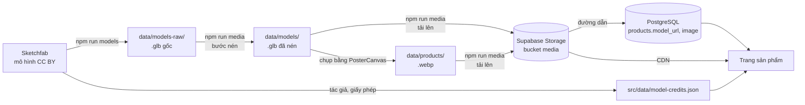

# 09. Dữ liệu mô hình 3D: nguồn, xử lý, lưu trữ và hiển thị

Mô tả cách 28 mô hình 3D của danh mục mẫu được lấy về, nén, lưu trữ và hiển thị trên trang. Cập nhật 13/10/2026.

## 1. Tóm tắt

| Câu hỏi | Trả lời |
| --- | --- |
| File mô hình đang nằm ở đâu? | **Supabase Storage**, bucket công khai `media`, thư mục `models/`. Ảnh sản phẩm ở thư mục `products/` của cùng bucket |
| Địa chỉ | `https://wfharbhshdccjkblpraw.supabase.co/storage/v1/object/public/media/models/<slug>.glb` |
| CSDL lưu gì? | Chỉ lưu **đường dẫn**: cột `products.model_url` (mô hình) và `products.image` (ảnh). Không lưu nội dung file |
| Có trong git không? | Không. Bản gốc và bản nén nằm ở `data/` trên máy phát triển; git bỏ qua thư mục này |
| Định dạng | glTF nhị phân (`.glb`), lưới nén meshopt, texture WebP tối đa 1024 px |
| Nguồn | 28 mô hình do cộng đồng đăng trên Sketchfab, đều giấy phép **CC Attribution 4.0** |
| Dung lượng | Mô hình: 91,8 MB gốc → 15,2 MB sau nén (khoảng 0,04–1,4 MB mỗi file). Ảnh: 28 file, tổng 0,8 MB |

## 2. Quy trình tổng thể

## 3. Các bước chi tiết

### 3.1. Chọn nguồn mô hình

- Tìm qua API tìm kiếm công khai của Sketchfab (`/v3/search`), chỉ lấy mô hình **cho phép tải về** và có giấy phép **CC Attribution**. Loại các mô hình giấy phép NonCommercial.
- Lọc thêm theo dung lượng (dưới 25 MB) và số mặt đa giác (dưới 400.000) để chạy được trên trình duyệt.
- Danh sách được chọn ghi trong `scripts/sketchfab-models.json`, mỗi dòng gồm mã mô hình trên Sketchfab (`uid`) và `slug` của sản phẩm tương ứng.
- Mô hình là tác phẩm fan làm về Gundam, Transformers, Super Sentai, Evangelion, Mazinger, Getter Robo. Dự án chỉ dùng cho mục đích học thuật.

### 3.2. Tải về: `npm run models` (`scripts/sketchfab.mjs`)

1. Đọc danh sách trong `scripts/sketchfab-models.json`.
2. Với mỗi mô hình, gọi `GET /v3/models/{uid}` để lấy tên, tác giả, giấy phép và đường dẫn gốc, ghi vào `src/data/model-credits.json`.
3. Gọi `GET /v3/models/{uid}/download` kèm khoá `SKETCHFAB_API_TOKEN`. Sketchfab trả về đường dẫn tải tạm thời, script tải bản `.glb` về `data/models-raw/<slug>.glb`.
4. File đã có thì bỏ qua; thêm `--force` để tải lại.

### 3.3. Kiểm tra chất lượng

Mỗi file được kiểm tra trước khi đưa vào danh mục:

- Đọc phần đầu file `.glb` để xác nhận đúng định dạng và không cần phần mở rộng đặc biệt (`extensionsRequired`).
- Mở từng mô hình trong khung xem 3D bằng trình duyệt tự động và chụp màn hình để kiểm tra bằng mắt.

Kết quả kiểm tra dẫn tới hai lần thay mô hình:

| Mô hình ban đầu | Lỗi | Cách xử lý |
| --- | --- | --- |
| "Barbatos Lupus" | File thực ra chỉ chứa cây chuỳ, không có thân robot | Đổi sản phẩm sang HG Acguy |
| Sazabi (bản đầu) | Phần lớn vật liệu có độ trong suốt bằng 0 nên thân robot vô hình | Thay bằng bản Sazabi của tác giả khác |

### 3.4. Nén: bước đầu của `npm run media` (`scripts/media.mjs`)

Dùng công cụ `gltf-transform` (lệnh `optimize`) với các tuỳ chọn:

- `--compress meshopt`: nén dữ liệu lưới (toạ độ đỉnh, chỉ số tam giác) bằng meshoptimizer.
- `--texture-compress webp`: chuyển texture sang WebP.
- `--texture-size 1024`: thu nhỏ texture lớn hơn 1024 px.
- Lệnh `optimize` còn gộp và loại bỏ dữ liệu trùng lặp hoặc không dùng tới.

| Mô hình | Gốc | Sau nén |
| --- | --- | --- |
| Zeta Gundam | 10,0 MB | 1,42 MB |
| Sazabi | 12,3 MB | 1,20 MB |
| Megatron 2007 | 6,4 MB | 0,77 MB |
| RX-78-2 Gundam | 1,0 MB | 0,16 MB |
| **Tổng 28 mô hình** | **91,8 MB** | **15,2 MB** |

Mô hình sau nén được kiểm tra lại bằng ảnh chụp: hình dáng và màu không khác bản gốc.

### 3.5. Ảnh đại diện sản phẩm

- Ảnh không lấy từ Sketchfab, vì ảnh ở đó mỗi cái một nền và một góc chụp. Mỗi ảnh được **chụp từ chính mô hình 3D** bằng thành phần `PosterCanvas` (`src/components/three/PosterCanvas.tsx`).
- Mọi ảnh dùng chung góc nhìn 3/4, cùng ánh sáng studio và nền trong suốt. Khi hiển thị, ảnh nằm trên nền sáng chung của thẻ sản phẩm, nên toàn bộ danh mục đồng bộ.
- Ảnh có kích thước 640 × 640, định dạng WebP, 11–44 KB mỗi ảnh, lưu ở `data/products/<slug>.webp`.

### 3.6. Tải lên Supabase Storage: bước sau của `npm run media`

1. Tạo bucket `media` ở chế độ công khai (chỉ đọc với mọi người) nếu chưa có.
2. Tải lên `data/models/*.glb` vào `media/models/` và `data/products/*.webp` vào `media/products/`, ghi đè file cùng tên.
3. Mỗi file được gắn đúng loại nội dung (`model/gltf-binary`, `image/webp`) và thời hạn lưu đệm `Cache-Control: max-age=86400`, tức trình duyệt giữ lại 1 ngày.
4. Script dùng khoá bí mật `SUPABASE_SECRET_KEY`. Khoá chỉ nằm trong `.env.local` trên máy phát triển, không có trong mã chạy ở trình duyệt.

### 3.7. Ghi đường dẫn vào CSDL

- Khi nạp dữ liệu mẫu (`src/server/db/index.ts`), mỗi sản phẩm được ghi:
  - `model_url = <MEDIA_BASE_URL>/models/<slug>.glb`
  - `image = <MEDIA_BASE_URL>/products/<slug>.webp`
- `MEDIA_BASE_URL` là biến môi trường, hiện bằng `https://wfharbhshdccjkblpraw.supabase.co/storage/v1/object/public/media`. Đổi nơi lưu trữ chỉ cần đổi biến này và cập nhật đường dẫn, không phải sửa mã.
- Danh mục mẫu có phiên bản (`seed:catalog-v2` trong bảng `meta`). Khi chuyển từ danh mục cũ sang mới, 12 sản phẩm cũ được **ẩn** (`is_active = 0`) chứ không xoá, để các đơn hàng cũ vẫn trỏ được tới sản phẩm.
- Trang quản trị chấp nhận `model_url` dạng `/models/<ten>.glb` (file trong `public/`) hoặc cùng đường dẫn đó trên kho media (`src/app/actions/admin.ts`).

## 4. Hiển thị trên trang

### 4.1. Ảnh trong danh sách sản phẩm

Thẻ sản phẩm (`src/components/product/ProductCard.tsx`) hiển thị `products.image`. Trình duyệt tải ảnh thẳng từ CDN của Supabase, không đi qua máy chủ web.

### 4.2. Khung xem 3D trên trang chi tiết

Trang `src/app/san-pham/[slug]/page.tsx` truyền `model_url` cho khung xem 3D:

1. **Chỉ chạy ở trình duyệt.** `RobotViewerLoader` nạp `RobotViewer` bằng `next/dynamic` với `ssr: false`. Thư viện Three.js chỉ được tải khi người dùng mở trang có khung 3D, nên trang danh sách không phải tải nó.
2. **Tải và giải nén.** `GlbModel` trong `src/components/three/Stage.tsx` gọi `useGLTF(url, false, true)`: tham số thứ ba bật bộ giải nén meshopt, tương ứng với bước nén ở mục 3.4.
3. **Sao chép đúng khung xương.** Nhiều mô hình có khung xương (skinned mesh). Mô hình được sao chép bằng `SkeletonUtils.clone` thay cho `clone()` thông thường. Cách thông thường làm lưới vẫn bám vào xương của bản gốc, khiến mô hình bị phóng sai hoặc lệch chỗ.
4. **Chuẩn hoá kích thước.** Mô hình từ nhiều tác giả có đơn vị và vị trí rất khác nhau. Hệ thống tính hộp bao theo đỉnh thật (`Box3.setFromObject(…, true)`), thu phóng để cạnh lớn nhất bằng 2 đơn vị, đặt chân mô hình chạm sàn và căn giữa. Nhờ vậy mọi mô hình hiện cùng cỡ dưới cùng một camera.
5. **Ánh sáng và bóng.** Mọi mô hình dùng chung một bộ đèn studio (`StudioLights`) và bóng đổ mềm (`ContactShadows`).
6. **Điều khiển.** `OrbitControls` cho kéo để xoay; phóng to bằng nút hoặc Ctrl + cuộn chuột, để cuộn thường vẫn cuộn được trang. Không tự xoay khi mới mở.
7. **Dự phòng khi lỗi.** Nếu file không tải được hoặc hỏng, `ModelBoundary` bắt lỗi và hiện robot dựng bằng hình học (cột `model` và các cột màu của sản phẩm) thay vì làm hỏng cả trang.
8. **Ghi công tác giả.** Dưới khung 3D có dòng "Mô hình 3D: <tên> của <tác giả>, giấy phép CC Attribution", lấy từ `src/data/model-credits.json`, có liên kết tới trang gốc. Đây là yêu cầu bắt buộc của giấy phép CC BY.

### 4.3. Giải nén trong trình duyệt

File sau nén khai báo ba phần mở rộng glTF bắt buộc. Mỗi phần được giải theo một cách:

| Phần mở rộng | Nén cái gì | Giải nén ở đâu, bằng gì |
| --- | --- | --- |
| `EXT_meshopt_compression` | Dữ liệu lưới: đỉnh, pháp tuyến, toạ độ texture, chỉ số tam giác | CPU, bộ giải mã meshoptimizer viết bằng WebAssembly |
| `KHR_mesh_quantization` | Toạ độ lưu bằng số nguyên 8/16 bit thay cho số thực 32 bit | **Không giải ở CPU**: GPU tự đổi sang số thực khi đọc |
| `EXT_texture_webp` | Ảnh texture | Bộ giải mã WebP có sẵn của trình duyệt (`createImageBitmap`) |

Trình tự khi mở trang sản phẩm:

1. `useGLTF(url, false, true)` của thư viện drei tạo `GLTFLoader` (thư viện three-stdlib) và gắn `MeshoptDecoder` (tham số thứ ba là `true`).
2. Trình duyệt tải file `.glb` từ CDN.
3. Với mỗi vùng dữ liệu (bufferView) có `EXT_meshopt_compression`, loader gọi `MeshoptDecoder.decodeGltfBuffer` theo chế độ khai báo trong file:
   - `ATTRIBUTES`: thuộc tính đỉnh. Khi nén, các byte của những đỉnh liền nhau được nhóm lại và chỉ lưu độ chênh lệch, nên nén được rất nhỏ; khi giải, quá trình này được làm ngược lại.
   - `TRIANGLES`: chỉ số tam giác, mã hoá dựa trên các cạnh dùng chung giữa những tam giác liền kề.
   - Bộ lọc `OCTAHEDRAL`: pháp tuyến chỉ lưu 2 thành phần; bộ giải mã dựng lại vector đơn vị 3 chiều.
4. Bộ giải mã WebAssembly được nhúng sẵn trong mã JavaScript, không tải thêm file. Nếu trình duyệt hỗ trợ lệnh SIMD (kiểm tra bằng `WebAssembly.validate`), thư viện dùng bản SIMD nhanh hơn.
5. Dữ liệu đã giải mã (vẫn ở dạng số nguyên lượng tử hoá) được đưa thẳng lên GPU dưới dạng thuộc tính chuẩn hoá. Hệ số đổi về kích thước thật nằm sẵn trong ma trận biến đổi của node.
6. Texture WebP được trình duyệt giải mã rồi tải lên GPU như ảnh thường.

Đo bằng chính bộ giải mã của trang web (three-stdlib, có SIMD), trên máy phát triển, trung bình 20 lần chạy:

| Chỉ số | Giá trị |
| --- | --- |
| Dữ liệu lưới nén của cả 28 file | 8,91 MB, giải ra 25,97 MB |
| Thời gian giải nén cả 28 file | 27,9 ms (khoảng 930 MB/s) |
| File chậm nhất (Sazabi) | 1,20 MB → 5,05 MB trong 4,9 ms |
| Zeta Gundam | 0,92 MB → 2,65 MB trong 2,4 ms |

Thời gian giải nén nhỏ hơn rất nhiều so với thời gian tải được tiết kiệm. Ví dụ, trên đường truyền 20 Mbit/s, Zeta Gundam giảm từ khoảng 4 giây (10 MB) xuống khoảng 0,6 giây (1,4 MB), trong khi giải nén chỉ thêm khoảng 2 ms.

**Vì sao dùng meshopt thay cho Draco.** Draco thường nén lưới nhỏ hơn đôi chút, nhưng giải nén chậm hơn nhiều và cần tải thêm một bộ giải mã riêng. Meshopt giải gần như tức thì, bộ giải mã nhỏ và nhúng sẵn, lại kết hợp được với lượng tử hoá để GPU dùng trực tiếp dữ liệu số nguyên.

**Giới hạn:**
- Bản giải mã trong three-stdlib chạy đồng bộ trên luồng chính, không dùng Web Worker. Với khoảng 5 ms mỗi file thì không thấy được.
- WebP chỉ giảm dung lượng **tải về**. Trên GPU, texture vẫn chiếm bộ nhớ như ảnh chưa nén. Muốn giảm cả bộ nhớ GPU thì phải dùng KTX2/Basis Universal (`KHR_texture_basisu`).

### 4.4. Biến hình, hợp thể và chọn dáng (cập nhật 15/10/2026)

Các tính năng đều dựa trên **hoạt ảnh có sẵn trong file `.glb`**, không dựng lại mô hình. Người xem chỉ có một nút đổi dạng và vài dáng cố định để chọn. Bản đầu từng có thanh kéo và chế độ chỉnh từng khớp, nhưng đã bỏ để giao diện đơn giản và không ai làm "gãy" mô hình.

**Nguồn mô hình.** Bộ Transformers Earth Wars G2 và Transformers Alliance (người đăng `orangesauceu`, CC BY). Mỗi file có sẵn clip biến hình. Bản hợp thể Bruticus có clip 5 xe bay vào ghép thành robot. Bộ Alliance có thêm khoảng 20 động tác (vui, giận, tấn công…).

| Sản phẩm | Tính năng |
| --- | --- |
| Bruticus (bộ 5) | Nút "Hợp thể" / "Tách ra"; liên kết tới 5 thành viên |
| Onslaught, Brawl, Swindle, Vortex, Blast Off | Nút "Biến thành robot" / "Về dạng xe"; liên kết về Bruticus |
| Optimus Prime, Bumblebee (G1) | Nút đổi dạng; dáng Đứng, Thủ thế, Tấn công, Chiến thắng |
| Megatron, Starscream (G1) | Nút đổi dạng; dáng Đứng, Tấn công, Chiến thắng (file không có clip thủ thế) |
| Soundwave (G1) | Dáng Đứng, Chiến thắng, Giận dữ (clip biến hình trong file bị lỗi xoay nên không dùng) |

**Khai báo.** `src/lib/model-features.ts` ghi cho từng file: clip biến hình (tên clip, dạng đầu, dạng cuối, loại "biến hình" hay "hợp thể"), các dáng có sẵn (tên clip và vị trí 0–1 trong clip), quan hệ thành viên ↔ dạng hợp thể. Tra theo tên file trong `model_url`, nên không phải đổi CSDL.

**Cách hoạt động** (`src/components/three/Stage.tsx`, `RobotViewer.tsx`):

- **Nút đổi dạng**: chạy clip biến hình về dạng còn lại theo đúng thời lượng thật của clip. Mỗi khung hình, tiến trình 0–1 được đổi thành thời điểm trong clip rồi đặt bằng `AnimationMixer.setTime`. Bấm lại khi đang chạy thì quay ngược từ đúng vị trí đó. Nếu hệ điều hành bật "giảm chuyển động" thì mô hình nhảy thẳng sang dạng đích.
- **Căn khung khi biến hình**: lúc tải, clip được đo hộp bao ở 13 mốc đều nhau. Với biến hình, vị trí được nội suy giữa các mốc để mô hình luôn ở giữa khung và chạm sàn (máy bay không lơ lửng). Với hợp thể, khung giữ cố định theo dạng đã ghép, vì có mảnh phụ chờ sẵn dưới sàn. Tỉ lệ được thu nhỏ vừa đủ để cả quá trình nằm trong khung, nhưng không dưới 55%.
- **Dáng cố định**: mỗi dáng là một khung đã chọn sẵn trong một clip động tác của file (ví dụ "Tấn công" là khung ở 45% clip `attack01`). Khi chọn, mô hình về tư thế gốc rồi đặt vào khung đó. Vị trí từng dáng được đo trước lúc tải để mô hình luôn ở giữa khung và chạm sàn. Trang mở ra ở dáng đầu tiên (Đứng). Chọn dáng khi đang ở dạng xe thì mô hình chuyển ngay về dạng robot.
- **Ảnh đại diện** của các mẫu này chụp ở dáng Đứng.

**Giới hạn:** chuyển giữa các dáng là đổi tức thì, không có chuyển động chuyển tiếp; các mô hình cũ (Gundam…) không có clip động tác nên không có dáng để chọn; mô hình Earth Wars là đồ hoạ game, kém chi tiết hơn bộ Gundam.

## 5. Vì sao chọn cách lưu này

| Phương án | Ưu điểm | Nhược điểm | Kết luận |
| --- | --- | --- | --- |
| File trong `public/` của mã nguồn | Đơn giản | Làm kho git nặng (~90 MB); file đi qua máy chủ web; đổi mô hình phải triển khai lại | Bỏ |
| Lưu nội dung file trong bảng PostgreSQL (BYTEA) | Một nơi lưu duy nhất | CSDL phình to, mỗi lượt xem tốn một truy vấn lớn, không có CDN, tốn kết nối của pooler | Bỏ |
| **Kho đối tượng (Supabase Storage) + đường dẫn trong CSDL** | Có CDN, trình duyệt lưu đệm được, không đi qua máy chủ web, không vào git, cùng nhà cung cấp với CSDL | Cần một bước tải lên (`npm run media`) | **Chọn** |

Đây là cách làm phổ biến cho file media: CSDL quản lý dữ liệu có cấu trúc và đường dẫn, kho đối tượng giữ file nhị phân.

## 6. Hiệu quả đo được

- Dung lượng tải một mô hình giảm khoảng 6 lần (ví dụ Zeta Gundam 10 MB → 1,4 MB).
- File trả về với `Content-Type` đúng và `Cache-Control: public, max-age=86400`, qua CDN Cloudflare của Supabase. Lần mở thứ hai trong ngày không phải tải lại.
- Kiểm tra tự động trên trình duyệt: trang danh sách và trang chi tiết tải ảnh và mô hình từ Storage với mã 200, không có lỗi.

## 7. Thêm một mô hình mới

1. Tìm mô hình CC BY cho phép tải trên Sketchfab, thêm `{ "uid": "...", "slug": "..." }` vào `scripts/sketchfab-models.json`.
2. Chạy `npm run models` để tải bản gốc và cập nhật thông tin ghi công.
3. Chụp ảnh đại diện bằng `PosterCanvas`, lưu vào `data/products/<slug>.webp`.
4. Chạy `npm run media` để nén và tải lên Storage.
5. Tạo hoặc sửa sản phẩm với `model_url` và `image` theo `MEDIA_BASE_URL`.
6. Mở trang sản phẩm để kiểm tra mô hình hiển thị đúng.

## 8. Hạn chế hiện tại

- **Chụp ảnh chưa có lệnh riêng** (vẫn đúng sau đợt 15/10). Bước 3.5 hiện làm bằng một trang và script tạm khi phát triển, chưa có `npm run`.
- **Hai mô hình không có màu.** Sazabi và Mazinger Z Jet Scrander hiện màu trắng, vì file gốc không chứa vật liệu màu.
- **Thời hạn lưu đệm cố định 1 ngày.** Thay mô hình mà giữ tên file thì khách quen có thể thấy bản cũ tối đa 1 ngày. Muốn lưu đệm lâu hơn thì đặt tên file kèm phiên bản (ví dụ `zeta-gundam-v2.glb`).
- **Bản quyền nhân vật.** Mô hình là fan art về các thương hiệu có bản quyền (Bandai/Sunrise, Hasbro/Takara Tomy…), chỉ phù hợp cho mục đích học thuật. Bán hàng thật cần thay bằng mô hình do cửa hàng sở hữu hoặc được cấp phép.
