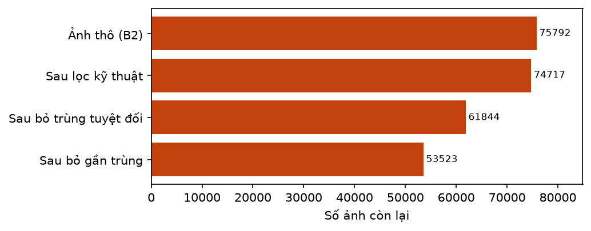

# Bộ dữ liệu nhận dạng robot: tổng hợp B1–B4

Tài liệu tổng hợp mọi thông tin về bộ dữ liệu ảnh của đề tài: gồm những gì, lấy từ đâu, làm sạch thế nào, trùng lặp bao nhiêu, nhãn sai bao nhiêu, và tin được tới mức nào. Viết ngày 15/11/2026 cho chủ dự án đọc. Số liệu lấy từ các báo cáo B01, B02, B02b, B03a, B04, B04b và đo lại trực tiếp trên file dữ liệu; riêng mục 6 (độ sai của nhãn) là phép đo mới làm hôm nay.

**Bản dữ liệu đang dùng** có mã `dff6fdbb77c0`. Phần chấm tay của B3 được thay bằng AI chấm 500 ảnh, có người kiểm lại 50 ảnh (mục 6.5, quyết định của chủ dự án ngày 15/11/2026). Vì vậy các số về độ sai của nhãn là **ước lượng**, không phải nhãn tay chính thức.

## 1. Tóm tắt nhanh

| Mục | Số liệu |
| --- | --- |
| Số robot (lớp) | 230: Transformers 110, Gundam 70, Super Sentai / Power Rangers 50 |
| Ảnh tải về (B2) | 75.792 ảnh, 3,03 GB, từ 3.099 tên miền khác nhau |
| Ảnh còn lại sau làm sạch | 49.355 (65,1% ảnh tải về) |
| Chia tập (lớp đã biết, 195 lớp) | train 29.513 · val 6.325 · test 6.310 (70 / 15 / 15) |
| Robot giấu đi (lớp "không biết") | 35 lớp, 7.207 ảnh (lạ-val 3.794 · lạ-test 3.413) |
| Ảnh không phải robot (tập âm) | 2.898 (COCO 2.000, đồ chơi và xe khác 898) |
| Trùng hệt trong ảnh tải về | 12,3% bản thừa; 16,9% ảnh có nhãn mâu thuẫn, đã loại hết |
| Gần trùng trong ảnh tải về | 13.619 ảnh nằm trong 5.618 cụm, mỗi cụm giữ 1 ảnh |
| Rò rỉ giữa train và val/test | 0 cặp cùng lớp có độ giống ≥ 0,95 |
| Ảnh máy đánh dấu nghi ngờ | 4.168 (7,8%), đã bỏ ở bản tạm |
| **Ước lượng nhãn sai còn lại** (mục 6) | **khoảng 10%** [KTC 95%: 4,5%; 22,2%], chắc chắn tối thiểu 1,1% |
| Miền ảnh | 62,9% ảnh chụp đồ chơi, 13,5% hoạt hình, 12,5% hộp, 10,1% CGI/phim, 0,9% tranh vẽ |

## 2. Bộ dữ liệu gồm những gì

### 2.1. Danh sách robot (B1)

- **230 lớp**, mỗi lớp là một **dòng robot**, xếp vào 3 cấp:

| Cấp | Ví dụ | Số lượng |
| --- | --- | --- |
| Thương hiệu (franchise) | Transformers | 3 |
| Nhân vật | Ironhide | ít hơn 230, vì một nhân vật có nhiều dòng |
| Dòng (lớp) | Ironhide (G1), Ironhide (Movie) | 230 |

- **Cách chọn lớp:**
  - 73 lớp là robot cửa hàng đang bán, ghép từ 76 sản phẩm.
  - 157 lớp còn lại chọn theo độ nổi tiếng: độ dài bài và số liên kết trỏ tới trên wiki của người hâm mộ.
- **Mỗi lớp có kèm thông tin:** tên, nhân vật, dòng, phe, dạng biến hình, mô tả, ảnh đại diện, trang nguồn. File `ml/data/manifests/robots.json`; đây cũng là dữ liệu trang web hiện cho khách.

### 2.2. Các tập ảnh sau khi chia (B4, B4b)

| Tập | Số ảnh | Số lớp | Dùng để |
| --- | --- | --- | --- |
| train | 29.513 | 195 | dạy mô hình |
| val | 6.325 | 195 | chọn cấu hình, chọn epoch, hiệu chỉnh nhiệt độ, chọn ngưỡng |
| test | 6.310 | 195 | chấm điểm cuối, dùng một lần |
| lạ-val | 3.794 | 18 | chọn ngưỡng từ chối robot lạ |
| lạ-test | 3.413 | 17 | đo khả năng nhận ra robot lạ |
| âm-train / âm-val / âm-test | 1.451 / 723 / 724 | — | ảnh không phải robot (E7 và đo từ chối) |

- **Số ảnh mỗi lớp trong train:** ít nhất 64, trung vị 141, nhiều nhất 274. Lớp nhiều ảnh nhất gấp 4,3 lần lớp ít ảnh nhất. Lúc huấn luyện có lấy mẫu cân bằng lớp để bù.
- **35 lớp "không biết"** chọn ngẫu nhiên (hạt giống 42) trong các lớp cửa hàng **không** bán, vì web phải nhận ra hàng của cửa hàng. Lớp King-Ohger ZERO chỉ còn 89 ảnh, dưới mức tối thiểu 100, nên vào nhóm này thay vì bị bỏ.
- Ví dụ lớp bị giấu: Ironhide (Movie), Optimus Prime (Animated), Strike Gundam, Zaku I, Dino Megazord. Mô hình chưa từng thấy ảnh của các lớp này.

## 3. Ảnh lấy từ đâu (B2)

| Nguồn | Ảnh tải về | Ảnh còn trong bản cuối | Ghi chú |
| --- | --- | --- | --- |
| Wiki của người hâm mộ (fandom, TFWiki) | 9.856 | 7.508 (15,2%) | ảnh đã được người hâm mộ gắn đúng trang robot, ít rác |
| Tìm ảnh (DuckDuckGo + Bing qua thư viện ddgs) | 65.936 | 41.847 (84,8%) | nhiều nguồn: eBay, YouTube, cửa hàng, diễn đàn, nhiều rác hơn |

- **Truy vấn tìm ảnh:** tên robot kèm từ khoá như "toy", "figure", "anime". Ví dụ: "Ironhide G1 toy", "Ironhide G1 cartoon". Mỗi lớp lấy 201–650 ảnh.
- **Tên miền nhiều ảnh nhất trong bản cuối:**

| Tên miền | Số ảnh |
| --- | --- |
| gundam.fandom.com | 4.884 |
| youtube.com (ảnh bìa video) | 2.765 |
| seibertron.com | 2.110 |
| transformerland.com | 2.090 |
| ebay.com | 1.954 |
| powerrangers.fandom.com | 1.730 |
| deviantart.com | 1.727 |
| reddit.com | 1.413 |

- **Độ phân giải:** cạnh ngắn trung vị 780 điểm ảnh (10% ảnh dưới 375, 10% ảnh trên 1.379). Chỉ 1,6% ảnh có cạnh ngắn dưới 224, cỡ mô hình nhìn, nên gần như mọi ảnh đủ nét.
- **Bản quyền:** ảnh thuộc chủ sở hữu, chỉ dùng cho nghiên cứu, không phân phối lại.
  - Ảnh không nằm trong git, không đưa lên Drive.
  - Bản trên Kaggle để riêng tư.
  - Ảnh COCO của tập âm có giấy phép Creative Commons, đã ghi lại theo từng ảnh.

## 4. Làm sạch (B3, phần máy)

Phễu lọc chạy theo thứ tự; ảnh bị loại ở bước trước không vào bước sau.

| Bước | Còn lại | Bị loại | Lý do chính |
| --- | --- | --- | --- |
| Ảnh tải về | 75.792 | — | |
| Lọc kỹ thuật | 74.717 | 1.075 | ảnh quá nhỏ (cạnh ngắn < 128 px): 893; quá dài hoặc dẹt (tỉ lệ > 3): 182 |
| Bỏ trùng hệt | 61.844 | 12.873 | cùng file ở ≥ 2 lớp: 12.234 (loại hết); lặp trong một lớp: 639 (giữ 1 bản) |
| Bỏ gần trùng | 53.523 | 8.321 | cụm gần giống trong một lớp: 7.455 (giữ ảnh nét nhất); cụm lẫn ≥ 2 lớp: 866 (loại hết) |
| Bỏ ảnh nghi ngờ (bản tạm) | 49.355 | 4.168 | giống "không phải robot" (điểm liên quan < 0,5): 2.959; lệch hẳn khỏi các ảnh khác của lớp: 2.101; cả hai: 892 |

**Giải thích bằng lời thường:**
- **Điểm liên quan:** mô hình CLIP được hỏi "ảnh này giống ảnh robot hay giống thứ khác (chữ, người, logo, trang web)?". Câu trả lời đổi thành số từ 0 tới 1.
- **Ảnh lệch khỏi lớp (ngoại lai):** ảnh nằm xa "trung tâm" của các ảnh cùng lớp. Ví dụ: một ảnh ô tô đỏ giữa các ảnh khủng long máy của Grimlock.
- **Vì sao bỏ ảnh nghi ngờ mà chưa chấm:** bản tạm chọn cách an toàn. Cái giá là mất một số ảnh tốt mà máy chấm nhầm, như ảnh hộp, tranh vẽ, dạng xe của Transformers.
- **Ngưỡng 0,5 chỉ là tạm.** Ngưỡng chính thức sẽ chọn trên 500 ảnh có nhãn tay của B3.

## 5. Độ trùng lặp

### 5.1. Trùng hệt (giống từng byte, B2b)

| Chỉ số | Số | Tỉ lệ |
| --- | --- | --- |
| Ảnh tải về | 75.792 | 100% |
| Ảnh khác nhau thật sự | 66.462 | 87,7% |
| Bản thừa | 9.330 | 12,3% |
| Ảnh nằm ở ≥ 2 lớp (nhãn mâu thuẫn) | 12.822 dòng, 4.131 ảnh gốc | 16,9% |

- **Một ảnh nằm ở nhiều lớp:**
  - Có ảnh nằm ở tới 48 lớp; các ảnh này đều là logo wiki, biểu tượng trang, hoặc ảnh rao bán cả lô đồ chơi.
  - Phần lớn (2.740 ảnh) chỉ nằm ở 2 lớp. Lý do thường gặp: ảnh có thật cả hai robot (robot hợp thể và thành viên), hoặc hai robot trùng tên.
- **Theo thương hiệu:** Transformers trùng nhiều nhất (16,6% bản thừa), Super Sentai 16,8%, Gundam ít nhất (4,1%).
- **Xử lý:** loại toàn bộ ảnh có nhãn mâu thuẫn, vì máy không biết nhãn nào đúng.

### 5.2. Gần trùng (cùng ảnh nhưng đổi cỡ, cắt, nén lại, B3)

- **Cách đo:** hai ảnh coi là gần trùng khi một trong hai điều kiện đúng:
  - độ giống CLIP ≥ 0,98;
  - mã pHash lệch ≤ 6 bit và độ giống CLIP ≥ 0,90.

  pHash là một "bản phác thảo 64 nét" của ảnh.
- **Kết quả:** 5.618 cụm chứa 13.619 ảnh; mỗi cụm một lớp chỉ giữ 1 ảnh. Cụm lớn nhất 24 ảnh.
- **Luật gốc của kế hoạch đã được sửa.** Luật gốc (độ giống ≥ 0,95) gom nhầm thành một cụm 2.701 ảnh của 134 lớp. Mở ảnh ra xem thì ở mức 0,95–0,97, phần lớn cặp là **hai robot khác nhau vẽ cùng phong cách**, ví dụ tranh hồ sơ Gundam nền trắng, chứ không phải bản sao.

### 5.3. Ảnh giống nhau còn lại sau làm sạch và rò rỉ (B4)

- Sau làm sạch vẫn còn nhiều ảnh **giống nhau nhưng không phải bản sao**, như nhiều góc chụp của cùng một món đồ chơi trong một tin rao bán. 40,3% ảnh của lớp đã biết nằm trong nhóm từ 2 ảnh trở lên.
- **Cách tránh rò rỉ:** cả nhóm luôn vào cùng một tập. Nhóm được nối khi hai ảnh cùng lớp thoả một trong ba điều kiện:
  - độ giống ≥ 0,95;
  - pHash lệch ≤ 10 bit;
  - cùng trang nguồn.

| Kiểm tra rò rỉ | val | test |
| --- | --- | --- |
| Ảnh có ảnh train **cùng lớp** giống ≥ 0,95 | **0** | **0** |
| Ảnh có ảnh train **bất kỳ lớp** giống ≥ 0,95 | 114 (1,80%) | 118 (1,87%) |
| Ảnh có ảnh train bất kỳ lớp giống ≥ 0,98 | 0 | 0 |
| Độ giống lớn nhất với train, trung vị | 0,899 | 0,899 |

Các cặp khác lớp giống ≥ 0,95 là hai robot khác nhau trông giống nhau, không phải rò rỉ. **Kết luận: không có rò rỉ cùng lớp, nên điểm test không bị thổi phồng do mô hình "thuộc bài".**

## 6. Độ sai của nhãn

### 6.1. Nhãn sai đến từ đâu

Ảnh tìm trên mạng theo tên robot, nên nhãn của ảnh là "tên robot đã dùng để tìm". Nhãn sai khi:

| Nguyên nhân | Ví dụ thật trong dữ liệu |
| --- | --- |
| **Robot hợp thể và thành viên** (nguyên nhân lớn nhất) | Ảnh xe Long Haul mang nhãn Devastator; ảnh xe cứu hoả Hot Spot mang nhãn Defensor; ảnh Defensor ghép đủ mang nhãn Streetwise; Breakdown mang nhãn Menasor |
| **Hai robot trùng hoặc gần trùng tên** | Thunder Megazord của Mighty Morphin và của Ninja Storm; Lfrith và Lfrith Thorn |
| **Ảnh có nhiều robot** | Tượng Megatron (BW) đứng cạnh một tượng nhỏ, mang nhãn Optimus Primal |
| **Công cụ tìm kiếm trả ảnh robot khác** | Ảnh Zeta Gundam mang nhãn GuAIZ; Dom mang nhãn Virgo II; Bumblebee (phim) mang nhãn Bumblebee (One) |
| **Ảnh không có robot** | Ảnh khẩu súng của GM, ảnh buồng lái CGI không thấy robot, ảnh hộp của robot khác |

Robot hợp thể là khó nhất. Ảnh một thành viên đứng riêng đúng là thành viên đó, nhưng cũng là "một phần của Devastator", nên đến người chấm cũng cần một luật thống nhất.

### 6.2. Ước lượng bằng mô hình đã huấn luyện (mới, 15/11/2026)

- **Cách làm:** dùng 3 mô hình ViT của B6 (3 hạt giống) đoán toàn bộ 12.635 ảnh val và test. Mô hình chưa từng học các ảnh này.
- **Ảnh "nghi sai nhãn":** cả 3 mô hình cùng chọn một robot **khác** nhãn, và mỗi mô hình đều chắc từ mức ngưỡng trở lên.

| Ngưỡng chắc chắn | Ảnh nghi sai, val | Ảnh nghi sai, test | Tỉ lệ chung |
| --- | --- | --- | --- |
| ≥ 0,5 | 278 | 242 | 4,1% |
| ≥ 0,8 | 141 | 113 | 2,0% |
| ≥ 0,9 | 87 | 67 | 1,2% |

- Ở ngưỡng 0,9 có 154 ảnh. 99,4% trong số đó, mô hình chọn robot **cùng thương hiệu**: nhầm giữa các robot gần nhau, không phải nhầm Gundam thành Transformers.
- **Lớp có nhiều ảnh nghi sai nhất:**

| Lớp | Số ảnh nghi sai | Nhận xét |
| --- | --- | --- |
| Devastator (G1) | 12 | robot hợp thể |
| Tor the Shuttlezord | 8 | trùng tên Thunderzord |
| Storm Megazord | 6 | trùng tên Thunder Megazord |
| 0 Gundam | 5 | |
| Rescue Megazord | 5 | |
| Megatron (BW) | 5 | |

### 6.3. Kiểm tra bằng mắt hai mẫu ảnh

Claude mở và xem từng ảnh. Đây **chưa phải chấm tay chính thức** của B3: một người xem, cỡ mẫu nhỏ, một số robot rất khó phân biệt bằng mắt.

**Mẫu 1: 24 ảnh trong số 154 ảnh nghi sai** (chọn ngẫu nhiên, hạt giống 7)

| Kết luận | Số ảnh |
| --- | --- |
| Nhãn sai, mô hình đúng | **21** (87,5%, KTC 95% Wilson: 69,0%; 95,7%) |
| Không chắc | 3 |
| Nhãn đúng, mô hình sai | 0 |

- Trong 21 ảnh nhãn sai: 5 ảnh là robot hợp thể và thành viên; 6 ảnh là nhầm Thunder Megazord hay Thunderzord; còn lại là ảnh robot khác do tìm kiếm trả về (Zeta Gundam, Dom, Sazabi, Wing Gundam…).
- **Ý nghĩa:** khi cả 3 mô hình cùng chắc ≥ 0,9 rằng nhãn sai, thì gần như chắc là nhãn sai. Vì vậy **ít nhất khoảng 1,1% ảnh val/test mang nhãn sai** (154 ảnh × 87,5% ÷ 12.635). Đây là cận dưới, vì phép lọc này chỉ bắt được ca mô hình rất chắc.

**Mẫu 2: 48 ảnh ngẫu nhiên của val và test** (hạt giống 2026)

| Kết luận | Số ảnh | Tỉ lệ (KTC 95% Wilson) |
| --- | --- | --- |
| Nhãn đúng | 35 | 72,9% |
| Nhãn sai rõ ràng | **5** | **10,4%** (4,5%; 22,2%) |
| Không chắc (robot khó nhận bằng mắt, ảnh tối, ảnh linh kiện) | 8 | 16,7% |

- **5 ảnh sai:**
  - ảnh Bumblebee phim mang nhãn Bumblebee (One);
  - hộp Headmaster Hardhead mang nhãn Motormaster;
  - xe trộn bê tông Mixmaster mang nhãn Devastator;
  - ảnh khẩu súng mang nhãn GM;
  - ảnh buồng lái CGI không thấy robot, mang nhãn Drivemax Megazord.
- **Ước lượng tốt nhất:** khoảng **10% ảnh mang nhãn sai**. Cận dưới chắc chắn là 1,1% (mẫu 1). Nếu mọi ảnh "không chắc" đều sai thì tối đa khoảng 27%.
- Thêm 2 ảnh trong mẫu chỉ là khung nhựa linh kiện (runner) của bộ kit. Nhãn không sai, nhưng ảnh gần như không giúp nhận robot.

### 6.4. Nhãn sai ảnh hưởng thế nào

- **Lúc học:** mô hình bị dạy một phần đáp án sai. Mô hình học sâu chịu được nhiễu nhãn khoảng 10% nhưng kém đi. Làm trơn nhãn và Mixup/CutMix (B6, B7) giúp mô hình bớt tin vào nhãn sai.
- **Lúc chấm điểm:** ảnh test nhãn sai mà mô hình đoán đúng robot thật vẫn bị tính là sai. Vì vậy **độ chính xác đo được (78,8%) có thể thấp hơn độ chính xác thật** vài điểm. Ngược lại, ảnh mà nhãn và mô hình cùng sai giống nhau thì được tính đúng; trường hợp này hiếm.
- **Lớp hợp thể** (Devastator, Defensor, Menasor, Bruticus…) và **họ Thunder Megazord** là nơi nhãn kém nhất. Đây là nơi nên chấm tay trước.

### 6.5. Kiểm định 500 ảnh: AI chấm, người kiểm 50 ảnh (thêm 15/11/2026)

Chủ dự án quyết định không chấm tay 500 ảnh kiểm định của B3. Thay vào đó Claude chấm cả 500 ảnh, rồi chủ dự án chấm lại 50 ảnh ngẫu nhiên mà không thấy đáp án của Claude, để đo hai bên khớp nhau tới đâu.

- **Mẫu:** 500 ảnh lấy ngẫu nhiên sau bước bỏ trùng của B3, **trước** bước lọc ảnh nghi ngờ (trang `kiem-dinh-truoc-loc.html`).
- **Cách chấm:** mỗi ảnh chọn một trong ba đáp án (đúng robot ghi trên / robot khác / không phải robot), kèm mức chắc chắn.
- **Quy ước của Claude:**
  - tính "robot khác" khi ảnh là bản khác của cùng nhân vật (Jazz bản phim với Jazz G1), một thành viên đứng riêng hay cả nhóm chưa ghép của robot hợp thể, hoặc nhiều robot đứng ngang nhau;
  - tính "đúng" khi ảnh là hộp, sách hướng dẫn hay thẻ tiểu sử có hình đúng robot.

| Kết quả | Số liệu |
| --- | --- |
| Claude chấm 500 ảnh | 366 đúng, 86 robot khác, 48 không phải robot |
| **Độ đúng nhãn trước lọc** | **73,2%** [Wilson 69,2%; 76,9%] |
| Chỉ tính 272 ảnh Claude chắc chắn | 82,0% [77,0%; 86,1%] |
| Ảnh qua được bộ lọc (không bị gắn cờ nghi ngờ) | 76,8% [72,8%; 80,4%] |
| Cờ "nghi ngờ" của bộ lọc | precision 83,3% [66,4; 92,7], **recall 18,7%** [13,0; 26,1] |
| Ngưỡng điểm "là robot" t_rel (bắt ảnh không phải robot) | F1 0,54 ở ngưỡng 0,5 đang dùng; cao nhất 0,58 ở 0,8 |
| Người và Claude trên cùng 50 ảnh | trùng 74%, κ Cohen 0,36; gộp đúng/sai: trùng 80%, κ 0,45 (mức trung bình) |
| Tỉ lệ nhãn đúng trên 50 ảnh đó | người 74% [60,4; 84,1], Claude 78% [64,8; 87,2] |

**Đọc kết quả:**

- **Khoảng một phần tư ảnh tải về mang nhãn sai** theo cách chấm chặt này. Con số cao hơn ước lượng khoảng 10% ở mục 6.3 vì hai lý do:
  - mẫu lấy trước bước lọc ảnh nghi ngờ;
  - ảnh bản khác của cùng nhân vật và ảnh nhiều robot đều tính là sai.
- **Bộ lọc tự động gắn cờ thì thường đúng, nhưng bỏ sót hơn 80% ảnh sai.** Phần lớn lỗi là "robot khác" giống robot thật (bản phim, thành viên của robot hợp thể, ảnh nhiều robot), mà bộ lọc CLIP chỉ biết ảnh có phải robot hay không.
- **Con số tổng đáng tin, nhãn từng ảnh của AI chỉ tin được ở mức trung bình.**
  - Người và Claude cho tỉ lệ nhãn đúng gần như nhau (74% và 78%).
  - Nhưng ở từng ảnh khó thì lệch nhau: 8/13 ảnh lệch là người chọn "không phải robot" cho tranh, ảnh mờ, ảnh dạng xe hay vỉ đồ chơi mà Claude tính "đúng".
- **Không đổi dữ liệu, không đổi ngưỡng** (theo quyết định của chủ dự án). Mô hình đã học trên bộ dữ liệu có nhãn nhiễu này. Đây là một lý do độ chính xác dừng ở khoảng 79–80%.
- File (không vào git):
  - `ml/data/store/b03/ai-cham/ai.csv` (đáp án của Claude), `ai-kem-diem.csv` (kèm điểm của bộ lọc);
  - `nguoi-50.csv` (đáp án của chủ dự án), `so-sanh-50.csv` (so sánh hai bên).

## 7. Phân bố miền ảnh và cân bằng giữa các tập

| Miền ảnh (CLIP gán, chưa kiểm định) | train | val | test |
| --- | --- | --- | --- |
| ảnh chụp đồ chơi / mô hình | 62,7% | 62,7% | 63,2% |
| ảnh chụp màn hình hoạt hình / anime | 13,6% | 13,4% | 13,4% |
| hộp sản phẩm | 12,7% | 13,0% | 12,7% |
| ảnh CGI / phim | 10,2% | 9,8% | 9,9% |
| tranh vẽ | 0,8% | 1,1% | 0,8% |

- **Ba tập có cùng tỉ lệ miền ảnh:** kiểm định χ², p = 0,62; Cramér V = 0,009, khác biệt gần bằng 0. Điểm val và test vì vậy đại diện đúng cho train.
- **Tỉ lệ ảnh wiki** giữa ba tập (15,6% / 14,9% / 16,9%) khác nhau có ý nghĩa thống kê (p = 0,007) nhưng rất nhỏ (Cramér V = 0,015).
- **Chưa có:** ảnh dựng từ mô hình 3D, ảnh chụp màn hình trang web, ảnh chụp bằng điện thoại trong nhà. Lần thử Ironhide trên web cho thấy với loại ảnh này % thấp rõ rệt (báo cáo B11–B12).

## 8. Độ tin cậy của bộ dữ liệu

| Mặt | Mức tin | Lý do |
| --- | --- | --- |
| Số lượng ảnh | **Cao** | 49.355 ảnh, mỗi lớp train 64–274 ảnh; B7 cho thấy thêm ảnh vẫn còn giúp |
| Không trùng, không rò rỉ | **Cao** | trùng hệt và gần trùng đã loại; 0 cặp cùng lớp ≥ 0,95 giữa train và val/test; chia theo nhóm |
| Cân bằng giữa các tập | **Cao** | cùng tỉ lệ lớp (chia phân tầng) và cùng tỉ lệ miền ảnh |
| Tái lập được | **Cao** | mọi bước có script, cấu hình và mã phiên bản (`dff6fdbb77c0` cho tập chia, `488bd3a0c832` cho tập âm) |
| Độ đúng của nhãn | **Trung bình đến thấp** | 500 ảnh AI chấm: 73,2% nhãn đúng trước lọc, 76,8% sau lọc (mục 6.5); người kiểm 50 ảnh cho con số tương tự (74%); sai tập trung ở bản khác của cùng nhân vật, robot hợp thể, ảnh nhiều robot |
| Ngưỡng làm sạch | **Trung bình** | bộ lọc bắt đúng 83% ảnh nó gắn cờ nhưng chỉ bắt được 19% ảnh sai; ngưỡng 0,5 gần tối ưu (F1 0,54, tốt nhất 0,58) |
| Đại diện cho ảnh khách gửi | **Thấp đến trung bình** | ảnh lấy từ mạng, 63% ảnh đồ chơi chụp đẹp; thiếu ảnh điện thoại, ảnh dựng 3D; miền ảnh do máy gán, chưa kiểm |
| Lớp "không biết" và tập âm | **Khá** | 35 lớp chọn ngẫu nhiên, đủ cả 3 thương hiệu; tập âm có đồ chơi khó (xe điều khiển, hiệp sĩ áo giáp) chứ không chỉ ảnh dễ |

**Nhìn chung:** bộ dữ liệu đủ lớn và sạch về trùng lặp, chia tập đúng cách nên điểm đo được là trung thực. Điểm yếu chính là **nhãn còn sai nhiều** (khoảng 10–25% tuỳ cách tính, mục 6.3 và 6.5) và **thiếu ảnh giống ảnh khách thật gửi**. Chủ dự án quyết định không làm sạch thêm bằng tay; ảnh thực địa thuộc B13.

## 9. Hạn chế và việc nên làm

1. **Làm sạch nhãn thêm (nếu sau này có thời gian; chủ dự án đã quyết định không chấm tay 500 ảnh kiểm định, thay bằng AI chấm ở mục 6.5)**, theo thứ tự ưu tiên:
   - các lớp robot hợp thể và họ Thunder Megazord;
   - 154 ảnh val/test mà 3 mô hình cùng nghi sai (danh sách ở `ml/data/store/thu-anh/nghi-nhan-sai.csv`, không vào git);
   - 4.168 ảnh nghi ngờ.
2. **Quy ước cho robot hợp thể** trước khi chấm. Ví dụ: ảnh một thành viên đứng riêng mang nhãn thành viên; ảnh đủ bộ ghép xong mang nhãn robot hợp thể; ảnh cả bộ chưa ghép thì bỏ.
3. **Sau khi chấm:** chạy lại B4 với danh sách loại chính thức. Mã phiên bản dữ liệu sẽ đổi; B6–B9 cần chạy lại trên bản mới để có số liệu chính thức cho luận văn.
4. **Thêm ảnh khác loại:** ảnh điện thoại (B13), và có thể ảnh dựng 3D của 76 sản phẩm, nếu muốn web nhận được loại ảnh đó. Việc này đổi bộ dữ liệu nên cần chủ dự án quyết.
5. **Kiểm định miền ảnh:** miền ảnh hiện do CLIP gán, chưa ai kiểm. Chấm 500 ảnh ở B3 có thể ghi thêm miền ảnh để đo độ đúng của phần này.

## 10. Tái lập và file

| File | Nội dung |
| --- | --- |
| `ml/data/manifests/robots.json` | 230 lớp và thông tin robot |
| `ml/data/manifests/b02_manifest.csv.gz` | mọi ảnh tải về: lớp, nguồn, URL, kích thước, sha1 |
| `ml/data/manifests/b04_splits.csv.gz` | 49.355 ảnh của bản tạm: lớp, nguồn, miền, nhóm, tập |
| `ml/data/manifests/b04b_negatives.csv.gz` | 2.898 ảnh âm |
| Báo cáo chi tiết | B01-danh-muc-robot, B02-thu-anh, B02b-trung-lap, B03a-lam-sach-tu-dong, B04-chia-tap, B04b-tap-am |

Phép ước lượng nhãn sai ở mục 6.2 dùng logits đã lưu của 3 lần chạy ViT-B/16 (CLIP) ở B6, nhiệt độ của từng lần chạy (0,771 / 0,758 / 0,755); hai mẫu xem bằng mắt chọn bằng `pandas.DataFrame.sample` với hạt giống 7 và 2026.
