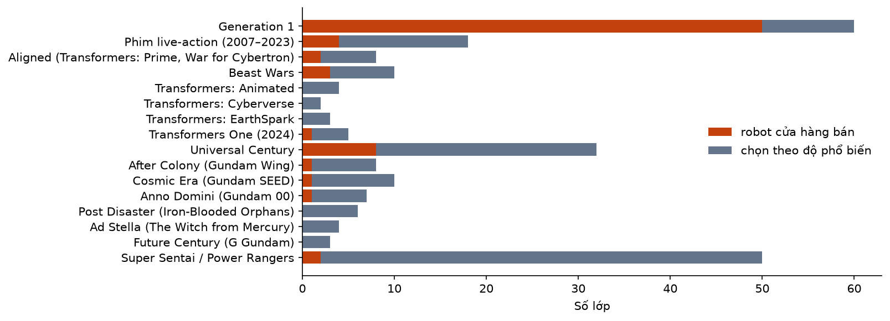
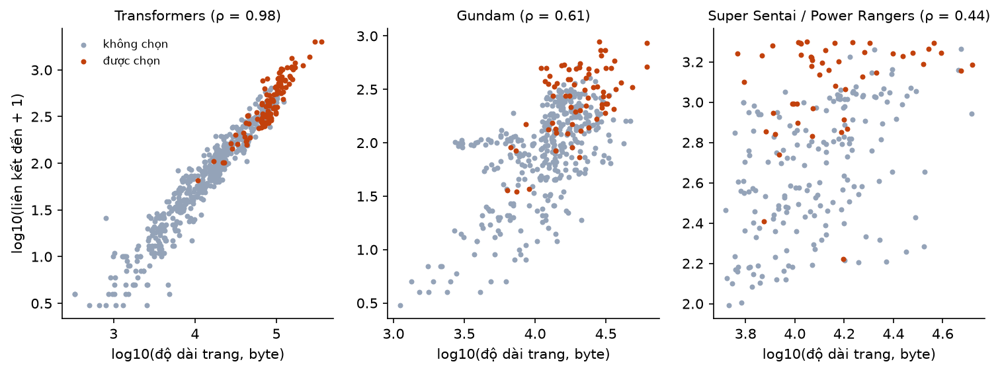

# B01. Danh mục robot và kho thông tin

Báo cáo sinh tự động bởi `ml/` (mẫu ở `docs/nhan-dang-robot/00-ke-hoach.md` mục 6). Thời gian chạy: 0.9 giây. Số liệu máy đọc: `ml/reports/B01/summary.json`.

## 1. Mục tiêu

Chốt danh sách lớp của bài toán phân loại và thông tin hiển thị cho từng lớp (tên, dòng, phe, mô tả, ảnh, nguồn). Mỗi lớp là **một robot ở một dòng** (kế hoạch mục 3). Danh mục là nền của mọi bước sau: B2 thu ảnh theo từng lớp, B6 huấn luyện với số lớp này, web hiển thị thông tin lấy từ đây. Đóng góp vào RQ1 (bộ dữ liệu).

## 2. Đầu vào, đầu ra

- Đầu vào: MediaWiki API của TFWiki, The Gundam Wiki và RangerWiki; danh sách sản phẩm cửa hàng (Supabase (bảng products, status = published), 76 sản phẩm); bảng ghép tay `ml/configs/store_robot_map.yaml`.
- Đầu ra: `ml/data/manifests/robots.json` (230 lớp, sha256 `000da3c769a5`), `b01_candidates.csv` (1450 ứng viên đã đọc), `store_products.csv`, `store_robot_map.csv`.
- Ảnh đại diện của mỗi lớp chỉ lưu tên file và URL trên wiki, không tải về ở bước này.

## 3. Công cụ và môi trường

**Môi trường**

| Mục | Giá trị |
| --- | --- |
| Thời điểm chạy (UTC) | 2026-11-07T14:30:01+00:00 |
| Hệ điều hành | Windows 11 (build 10.0.26200, AMD64) |
| Python | 3.11.9 |
| CPU | 12th Gen Intel(R) Core(TM) i7-12800H (20 luồng) |
| RAM | 31.7 GB |
| GPU (PyTorch) | NVIDIA RTX A2000 Laptop GPU (4.0 GB) |
| CUDA của PyTorch | 12.8 |
| Driver (nvidia-smi) | NVIDIA RTX A2000 Laptop GPU, 4096 MiB, 596.52 |
| Google Colab | không |
| Commit git | c56347e (có thay đổi chưa commit) |

**Phiên bản thư viện**

| Thư viện | Phiên bản |
| --- | --- |
| ImageHash | 4.3.2 |
| Pillow | 13.0.0 |
| ddgs | 9.16.1 |
| matplotlib | 3.11.2 |
| mwparserfromhell | 0.7.2 |
| numpy | 2.4.6 |
| open_clip_torch | 4.2.1 |
| pandas | 3.1.1 |
| rapidfuzz | 3.14.6 |
| requests | 2.34.2 |
| scipy | 1.17.1 |
| timm | 1.0.31 |
| torch | 2.11.0+cu128 |
| torchvision | 0.26.0+cu128 |

**Truy vấn MediaWiki API**

| Wiki | API | Yêu cầu đã gửi | Lấy từ cache | Thử lại | Thời gian mạng (giây) |
| --- | --- | --- | --- | --- | --- |
| TFWiki | https://tfwiki.net/mediawiki/api.php | 0 | 722 | 0 | 0 |
| The Gundam Wiki (fandom) | https://gundam.fandom.com/api.php | 0 | 613 | 0 | 0 |
| RangerWiki (fandom) | https://powerrangers.fandom.com/api.php | 0 | 527 | 0 | 0 |

## 4. Phương pháp

- **Ứng viên:** thành viên các category theo dòng (`list=categorymembers`): với Transformers là category phe theo dòng (ví dụ *Generation 1 cartoon Autobots*), với Gundam là category theo kỷ nguyên (*Universal Century Mobile Weapons*), với Super Sentai / Power Rangers là *Megazord* và *Giant Robo* (bảng 1).
- **Lọc tên:** bỏ trang con (có dấu /); với Transformers bỏ trang có hậu tố thuộc dòng khác, ví dụ trang (WFC) nằm trong category của G1. TFWiki đặt Transformers: Prime chung dòng *Aligned* với hậu tố (WFC).
- **Tầng 1, độ dài trang:** lấy độ dài (byte) của mọi ứng viên (`prop=info`), xếp giảm dần. **Tầng 2:** đọc wikitext theo thứ tự đó, 50 trang một lần, cho tới khi đủ 4 × hạn mức trang qua bộ lọc cấu trúc.
- **Lọc cấu trúc:** bỏ trang chuyển hướng (kể cả khi có template đứng trước lệnh `#REDIRECT`); Transformers phải có thẻ phe `{{factions|…}}` ở đầu trang (trang nhân vật của TFWiki luôn có; trang nhóm, vật, địa danh thì không); Gundam phải có `Infobox/Mobile Weapon` với `type` là robot hình người: *Suit* ở mọi kỷ nguyên, thêm *Fighter* (Mobile Fighter) ở Future Century và *Doll* (Mobile Doll) ở After Colony, vì ở kỷ nguyên khác *Fighter* là máy bay; Super Sentai / Power Rangers phải có infobox robot `MegazordInfo` hoặc `SentaiMegazordInfo`.
- **Loại tay:** trang qua được bộ lọc nhưng không phải một robot cụ thể (trang về phe, sinh vật) bị loại sau khi duyệt lần chạy đầu, có ghi lý do (bảng 10).
- **Gộp biến thể Gundam:** họ của một mobile suit = số hiệu gốc bỏ chữ cái cuối + từ đầu của tên chính (bỏ tên chủ sở hữu như *Char's* và chữ *Gundam*). Ví dụ *MS-06F Zaku II*, *MS-06J Zaku II Ground Type*, *MS-06S Char's Zaku II* cùng họ `ms-06|zaku`; *XXXG-01W Wing Gundam* và *XXXG-01D Gundam Deathscythe* khác họ dù chung số hiệu gốc. Mỗi họ giữ một lớp (robot cửa hàng, nếu không thì trang phổ biến nhất); robot cửa hàng luôn được giữ dù cùng họ (bảng 9).
- **Độ phổ biến:** số trang ở không gian chính liên kết tới trang của robot, kể cả qua trang chuyển hướng (`list=backlinks`, `blredirect=1`), dừng ở 2000 liên kết. Đây là đại lượng thay thế cho mức độ được nhắc tới trong cộng đồng; wiki fandom không công bố lượt xem.
- **Gộp Power Rangers với Super Sentai:** bản Power Rangers dùng lại cảnh quay Super Sentai nên ảnh trong infobox mang tên robot Super Sentai, ví dụ *Dino Megazord* dùng `KSZ-Daizyuzin.png` (KSZ = Kyōryū Sentai Zyuranger). Khoá của trang Super Sentai: tên trong infobox, tên trong ảnh, tên trang, tên trang bỏ phần *"… Gattai"* (ví dụ *Tensou Gattai Gosei Great* → *gosei great*). Khoá của trang Power Rangers, xét theo thứ tự: (1) tên ảnh có tiền tố viết tắt series, bỏ tiền tố; (2) tên ảnh không tiền tố; (3) tên Megazord bỏ chữ *Megazord/Zord*. Mọi khoá đều chuẩn hoá (bỏ dấu, viết thường). Khớp thì gộp thành một lớp, độ phổ biến = tổng liên kết đến của hai trang (bảng 8 ghi luật đã khớp của từng cặp).
- **Tên hiển thị trùng** (hai robot khác nhau cùng tên, ví dụ hai *Thunder Megazord*) được thêm dòng vào sau tên (bảng 11). Ảnh đại diện lấy từ infobox hoặc ảnh đầu trang; không tìm được thì dùng ảnh do PageImages của fandom chọn.
- **Chọn lớp:** trong mỗi nhóm, lấy mọi robot cửa hàng đang bán (bảng ghép tay), rồi lấy thêm theo độ phổ biến giảm dần (hoà thì theo độ dài trang) cho đủ hạn mức. Hạn mức của nhóm đặt theo mức phổ biến và độ khác biệt về thiết kế của dòng.
- **Thông tin lớp:** Transformers lấy dòng tóm tắt in nghiêng đầu trang và đoạn văn đầu; Gundam lấy infobox (tên tiếng Anh, tên khác, kỷ nguyên, series đầu tiên, phe dùng, nhà thiết kế, phi công) và đoạn văn đầu; Sentai lấy infobox (tên, series, các zord hợp thành). Gundam Wiki ghi số tập sau dấu ~ ("Mobile Suit Zeta Gundam~1~50" là tập 1–50): phần này được bỏ khỏi dòng và phe (lần chạy đầu sót lỗi này ở 36 lớp, đã sửa ngày 07/11/2026). Đoạn mô tả bỏ template, file, chú thích, cắt ở ranh giới câu, tối đa 600 ký tự.
- **Ghép tự động (để đối chứng):** chuẩn hoá tên sản phẩm, bỏ từ nhiễu (cấp mô hình HG/MG/RG, dòng sản phẩm như Masterpiece, Studio Series, tên phe), so với tên trang bằng `rapidfuzz.token_set_ratio`; cộng 5 điểm nếu tên sản phẩm có gợi ý dòng (Beast Wars, Prime, Studio Series...) khớp với nhóm của trang. So với bảng ghép tay để đo tỉ lệ ghép tự động đúng.

## 5. Kết quả

**Bảng 1. Ứng viên, lọc và số lớp được chọn theo từng nhóm**

| Franchise | Nhóm (dòng) | Ứng viên từ category | Sau lọc tên | Đã đọc nội dung | Qua lọc cấu trúc | Hạn mức | Chọn: cửa hàng | Chọn: phổ biến | Tổng lớp | Liên kết đến (trung vị) | Liên kết đến (nhỏ nhất) |
| --- | --- | --- | --- | --- | --- | --- | --- | --- | --- | --- | --- |
| Transformers | Generation 1 | 263 | 252 | 252 | 234 | 60 | 50 | 10 | 60 | 548 | 101 |
| Transformers | Phim live-action (2007–2023) | 148 | 132 | 104 | 102 | 18 | 4 | 14 | 18 | 312 | 172 |
| Transformers | Aligned (Transformers: Prime, War for Cybertron) | 191 | 169 | 102 | 35 | 8 | 2 | 6 | 8 | 344 | 201 |
| Transformers | Beast Wars | 229 | 182 | 53 | 47 | 10 | 3 | 7 | 10 | 571 | 363 |
| Transformers | Transformers: Animated | 277 | 271 | 50 | 41 | 4 | 0 | 4 | 4 | 431 | 403 |
| Transformers | Transformers: Cyberverse | 76 | 74 | 50 | 46 | 2 | 0 | 2 | 2 | 256 | 248 |
| Transformers | Transformers: EarthSpark | 44 | 44 | 44 | 41 | 3 | 0 | 3 | 3 | 162 | 160 |
| Transformers | Transformers One (2024) | 34 | 34 | 34 | 33 | 5 | 1 | 4 | 5 | 104 | 65 |
| Gundam | Universal Century | 1879 | 1823 | 208 | 169 | 32 | 8 | 24 | 32 | 461 | 123 |
| Gundam | After Colony (Gundam Wing) | 95 | 94 | 51 | 47 | 8 | 1 | 7 | 8 | 150 | 133 |
| Gundam | Cosmic Era (Gundam SEED) | 382 | 308 | 51 | 44 | 10 | 1 | 9 | 10 | 358 | 312 |
| Gundam | Anno Domini (Gundam 00) | 199 | 158 | 51 | 44 | 7 | 1 | 6 | 7 | 229 | 194 |
| Gundam | Post Disaster (Iron-Blooded Orphans) | 114 | 98 | 50 | 47 | 6 | 0 | 6 | 6 | 89 | 83 |
| Gundam | Ad Stella (The Witch from Mercury) | 51 | 48 | 48 | 43 | 4 | 0 | 4 | 4 | 35 | 34 |
| Gundam | Future Century (G Gundam) | 122 | 122 | 50 | 49 | 3 | 0 | 3 | 3 | 262 | 214 |
| Super Sentai / Power Rangers | Super Sentai / Power Rangers | 466 | 465 | 252 | 229 | 50 | 2 | 48 | 50 | 1760 | 432 |

Tổng cộng **230 lớp**: Transformers 110, Gundam 70, Super Sentai / Power Rangers 50. Chọn vì cửa hàng bán: 73; chọn theo độ phổ biến: 157. Gộp Power Rangers với Super Sentai: 56 cặp.



*Hình: Số lớp theo nhóm (dòng), tách theo lý do được chọn*



*Hình: Độ dài trang so với số liên kết đến (của riêng trang đó) của các ứng viên tầng 2. Lớp được chọn theo hạn mức của từng nhóm và, với Super Sentai / Power Rangers, theo tổng liên kết đến của cặp đã gộp, nên có điểm được chọn nằm thấp*

**Bảng 2. Tương quan hạng Spearman giữa độ dài trang và số liên kết đến (ứng viên tầng 2)**

| Franchise | Số trang | Spearman ρ | p |
| --- | --- | --- | --- |
| Transformers | 581 | 0.977 | 0.0e+00 |
| Gundam | 443 | 0.613 | 5.0e-47 |
| Super Sentai / Power Rangers | 229 | 0.437 | 4.3e-12 |

**Bảng 3. Lý do loại ứng viên (lọc tên và lọc cấu trúc)**

| Franchise | Lý do loại | Số trang |
| --- | --- | --- |
| gundam | trang con | 191 |
| gundam | type = Ship (không phải robot hình người) | 31 |
| gundam | type = Armor (không phải robot hình người) | 19 |
| gundam | type = Vehicle (không phải robot hình người) | 7 |
| gundam | type = Weapon (không phải robot hình người) | 5 |
| gundam | không có infobox Infobox/Mobile Weapon | 3 |
| gundam | type = Pod (không phải robot hình người) | 1 |
| sentai | không có infobox MegazordInfo / SentaiMegazordInfo | 23 |
| sentai | trang con | 1 |
| transformers | không có thẻ phe {{factions}} (không phải trang nhân vật) | 107 |
| transformers | trang con | 71 |
| transformers | hậu tố | 39 |
| transformers | đã thuộc nhóm trước | 14 |
| transformers | loại tay: trang về phe Predacon của Beast Wars, không phải một robot | 1 |
| transformers | loại tay: nhân vật của Transformers: Cybertron, trang chung nhiều dòng, không mang thiết kế Animated | 1 |
| transformers | loại tay: sinh vật ký sinh dạng bầy, không phải một robot | 1 |

**Bảng 4. Ba trang ngay dưới ngưỡng chọn của mỗi nhóm (để thấy ranh giới)**

| Nhóm | Trang | Hạng | Liên kết đến | Ghi chú |
| --- | --- | --- | --- | --- |
| Generation 1 | Blitzwing (G1) | 11 | 640 | ngay dưới ngưỡng chọn |
| Generation 1 | Sixshot (G1) | 12 | 639 | ngay dưới ngưỡng chọn |
| Generation 1 | Omega Supreme (G1) | 13 | 614 | ngay dưới ngưỡng chọn |
| Phim live-action (2007–2023) | Wheeljack (Movie) | 15 | 172 | ngay dưới ngưỡng chọn |
| Phim live-action (2007–2023) | Dropkick (Movie) | 16 | 156 | ngay dưới ngưỡng chọn |
| Phim live-action (2007–2023) | Dino | 17 | 150 | ngay dưới ngưỡng chọn |
| Aligned (Transformers: Prime, War for Cybertron) | Jazz (WFC) | 7 | 187 | ngay dưới ngưỡng chọn |
| Aligned (Transformers: Prime, War for Cybertron) | Skyquake (Prime) | 8 | 136 | ngay dưới ngưỡng chọn |
| Aligned (Transformers: Prime, War for Cybertron) | Sentinel Zeta Prime | 9 | 122 | ngay dưới ngưỡng chọn |
| Beast Wars | Magmatron (BW) | 8 | 331 | ngay dưới ngưỡng chọn |
| Beast Wars | Terrorsaur (BW) | 9 | 315 | ngay dưới ngưỡng chọn |
| Beast Wars | Inferno (BW) | 10 | 313 | ngay dưới ngưỡng chọn |
| Transformers: Animated | Ratchet (Animated) | 5 | 365 | ngay dưới ngưỡng chọn |
| Transformers: Animated | Prowl (Animated) | 6 | 354 | ngay dưới ngưỡng chọn |
| Transformers: Animated | Sari Sumdac (Animated) | 7 | 325 | ngay dưới ngưỡng chọn |
| Transformers: Cyberverse | Windblade (Cyberverse) | 3 | 220 | ngay dưới ngưỡng chọn |
| Transformers: Cyberverse | Megatron (Cyberverse) | 4 | 199 | ngay dưới ngưỡng chọn |
| Transformers: Cyberverse | Grimlock (Cyberverse) | 5 | 184 | ngay dưới ngưỡng chọn |
| Transformers: EarthSpark | Thrash (ES) | 4 | 145 | ngay dưới ngưỡng chọn |
| Transformers: EarthSpark | Megatron (ES) | 5 | 138 | ngay dưới ngưỡng chọn |
| Transformers: EarthSpark | Hashtag (ES) | 6 | 133 | ngay dưới ngưỡng chọn |
| Transformers One (2024) | Soundwave (One) | 5 | 38 | ngay dưới ngưỡng chọn |
| Transformers One (2024) | Shockwave (One) | 6 | 36 | ngay dưới ngưỡng chọn |
| Transformers One (2024) | Jazz (One) | 7 | 26 | ngay dưới ngưỡng chọn |
| Universal Century | PMX-003 The-O | 25 | 272 | ngay dưới ngưỡng chọn |
| Universal Century | AMX-009 Dreissen | 26 | 271 | ngay dưới ngưỡng chọn |
| Universal Century | MS-14J ReGelgu | 27 | 268 | ngay dưới ngưỡng chọn |
| After Colony (Gundam Wing) | XXXG-01D Gundam Deathscythe | 8 | 133 | ngay dưới ngưỡng chọn |
| After Colony (Gundam Wing) | OZ-12SMS Taurus | 9 | 128 | ngay dưới ngưỡng chọn |
| After Colony (Gundam Wing) | OZ-00MS Tallgeese | 10 | 127 | ngay dưới ngưỡng chọn |
| Cosmic Era (Gundam SEED) | ZGMF-1000 ZAKU Warrior | 10 | 310 | ngay dưới ngưỡng chọn |
| Cosmic Era (Gundam SEED) | GAT-01 Strike Dagger | 11 | 307 | ngay dưới ngưỡng chọn |
| Cosmic Era (Gundam SEED) | MBF-02 Strike Rouge | 12 | 301 | ngay dưới ngưỡng chọn |
| Anno Domini (Gundam 00) | SVMS-01 Union Flag | 7 | 191 | ngay dưới ngưỡng chọn |
| Anno Domini (Gundam 00) | MSJ-06II-A Tieren Ground Type | 8 | 189 | ngay dưới ngưỡng chọn |
| Anno Domini (Gundam 00) | GN-004 Gundam Nadleeh | 9 | 188 | ngay dưới ngưỡng chọn |
| Post Disaster (Iron-Blooded Orphans) | ASW-G-11 Gundam Gusion Rebake Full City | 7 | 81 | ngay dưới ngưỡng chọn |
| Post Disaster (Iron-Blooded Orphans) | EB-08 Reginlaze | 8 | 79 | ngay dưới ngưỡng chọn |
| Post Disaster (Iron-Blooded Orphans) | STH-14s Hyakuri | 9 | 79 | ngay dưới ngưỡng chọn |
| Ad Stella (The Witch from Mercury) | X-EX01 Gundam Calibarn | 5 | 31 | ngay dưới ngưỡng chọn |
| Ad Stella (The Witch from Mercury) | MD-0064 Darilbalde | 6 | 30 | ngay dưới ngưỡng chọn |
| Ad Stella (The Witch from Mercury) | XGF-02 Gundam Lfrith | 7 | 28 | ngay dưới ngưỡng chọn |
| Future Century (G Gundam) | JMF1336R Rising Gundam | 4 | 190 | ngay dưới ngưỡng chọn |
| Future Century (G Gundam) | GF13-001NHII Master Gundam | 5 | 173 | ngay dưới ngưỡng chọn |
| Future Century (G Gundam) | GF13-011NC Dragon Gundam | 6 | 151 | ngay dưới ngưỡng chọn |
| Super Sentai / Power Rangers | Mach Megazord | 49 | 1241 | ngay dưới ngưỡng chọn |
| Super Sentai / Power Rangers | Doubutsu Gattai ZyuohWild | 50 | 1175 | ngay dưới ngưỡng chọn |
| Super Sentai / Power Rangers | LT-06 | 51 | 1167 | ngay dưới ngưỡng chọn |

### Ghép sản phẩm cửa hàng

76 dòng ghép tay cho 76 sản phẩm; 73 lớp khác nhau (một lớp có thể ứng với nhiều sản phẩm, ví dụ hai mẫu Optimus Prime G1). Mọi sản phẩm đều có trong bảng ghép. Ghép tự động đúng **71/76** = 93.4% [85.5; 97.2] (khoảng tin cậy Wilson 95%).

**Bảng 5. Sản phẩm cửa hàng → trang wiki → lớp, kèm kết quả ghép tự động**

| Sản phẩm | Trang wiki (ghép tay) | Lớp | Ghép tự động | Tự động đúng | Ghi chú |
| --- | --- | --- | --- | --- | --- |
| Arcee G1 The Movie | Arcee (G1) | transformers-arcee-g1 | Arcee (G1) | có |  |
| Arcee Transformers Prime Deluxe | Arcee (WFC) | transformers-arcee-wfc | Arcee (WFC) | có | TFWiki gộp Transformers: Prime vào dòng Aligned, hậu tố (WFC) |
| B-127 Transformers One Deluxe | Bumblebee (One) | transformers-bumblebee-one | B.B. (Prime) | không | B-127 là tên của Bumblebee trong Transformers One; trang B-127 (One) chỉ chuyển hướng tới Bumblebee (One) |
| Blades Protectobot | Blades (G1) | transformers-blades-g1 | Blades (G1) | có |  |
| Blast Off Combaticon | Blast Off (G1) | transformers-blast-off-g1 | Blast Off (G1) | có |  |
| Bộ pháo tay Bumblebee | Bumblebee (Movie) | transformers-bumblebee-movie | Bumblebee (G1) | không | phụ kiện (pháo tay) của Bumblebee phim live-action, không phải robot |
| Bonecrusher Constructicon | Bonecrusher (G1) | transformers-bonecrusher-g1 | Bonecrusher (G1) | có |  |
| Brawl Combaticon | Brawl (G1) | transformers-brawl-g1 | Brawl (G1) | có |  |
| Breakdown Stunticon | Breakdown (G1) | transformers-breakdown-g1 | Breakdown (G1) | có |  |
| Bruticus Combaticons (bộ 5 hợp thể) | Bruticus (G1) | transformers-bruticus-g1 | Bruticus (G1) | có |  |
| Bumblebee G1 Masterpiece | Bumblebee (G1) | transformers-bumblebee-g1 | Bumblebee (G1) | có |  |
| Bumblebee Studio Series Deluxe | Bumblebee (Movie) | transformers-bumblebee-movie | Bumblebee (Movie) | có |  |
| Cliffjumper Autobot | Cliffjumper (G1) | transformers-cliffjumper-g1 | Cliffjumper (G1) | có |  |
| Dead End Stunticon | Dead End (G1) | transformers-dead-end-g1 | Dead End (G1) | có |  |
| Defensor Protectobots (bộ 5 hợp thể) | Defensor (G1) | transformers-defensor-g1 | Defensor (G1) | có |  |
| Devastator Constructicons (bộ 6 hợp thể) | Devastator (G1) | transformers-devastator-g1 | Devastator (G1) | có |  |
| Drag Strip Stunticon | Drag Strip (G1) | transformers-drag-strip-g1 | Drag Strip (G1) | có |  |
| First Aid Protectobot | First Aid (G1) | transformers-first-aid-g1 | First Aid (G1) | có |  |
| Galvatron Decepticon | Galvatron (G1) | transformers-galvatron-g1 | Galvatron (G1) | có |  |
| Grimlock Dinobot | Grimlock (G1) | transformers-grimlock-g1 | Grimlock (G1) | có |  |
| Grimlock Dinobot Leader | Grimlock (G1) | transformers-grimlock-g1 | Grimlock (G1) | có |  |
| Groove Protectobot | Groove (G1) | transformers-groove-g1 | Groove (G1) | có |  |
| HG MS-06S Char's Zaku II | MS-06S Char's Zaku II | gundam-ms-06s-char-s-zaku-ii | MS-06S Char's Zaku II | có |  |
| HG MSM-04 Acguy | MSM-04 Acguy | gundam-msm-04-acguy | MSM-04 Acguy | có |  |
| HG XXXG-01W Wing Gundam | XXXG-01W Wing Gundam | gundam-xxxg-01w-wing-gundam | XXXG-01W Wing Gundam | có |  |
| Hook Constructicon | Hook (G1) | transformers-hook-g1 | Hook (G1) | có |  |
| Hot Spot Protectobot | Hot Spot (G1) | transformers-hot-spot-g1 | Hot Spot (G1) | có |  |
| Hound Autobot | Hound (G1) | transformers-hound-g1 | Hound (G1) | có |  |
| Ironhide Autobot | Ironhide (G1) | transformers-ironhide-g1 | Ironhide (Movie) | không |  |
| Jazz Autobot | Jazz (G1) | transformers-jazz-g1 | Jazz (G1) | có |  |
| Jetfire Autobot | Jetfire (G1) | transformers-jetfire-g1 | Jetfire (G1) | có |  |
| Long Haul Constructicon | Long Haul (G1) | transformers-long-haul-g1 | Long Haul (G1) | có |  |
| Megatron Beast Wars | Megatron (BW) | transformers-megatron-bw | Megatron (BW) | có |  |
| Megatron G1 Masterpiece | Megatron (G1) | transformers-megatron-g1 | Megatron (G1) | có |  |
| Megatron Studio Series Leader | Megatron (Movie) | transformers-megatron-movie | Megatron (Movie) | có |  |
| Menasor Stunticons (bộ 5 hợp thể) | Menasor (G1) | transformers-menasor-g1 | Menasor (G1) | có |  |
| MG GN-001 Gundam Exia | GN-001 Gundam Exia | gundam-gn-001-gundam-exia | GN-001 Gundam Exia | có |  |
| MG MSZ-006 Zeta Gundam Ver. Ka | MSZ-006 Zeta Gundam | gundam-msz-006-zeta-gundam | MSZ-006 Zeta Gundam | có |  |
| MG RX-78-2 Gundam Ver. 3.0 | RX-78-2 Gundam | gundam-rx-78-2-gundam | RX-78-2 Gundam | có |  |
| Mixmaster Constructicon | Mixmaster (G1) | transformers-mixmaster-g1 | Mixmaster (G1) | có |  |
| Motormaster Stunticon | Motormaster (G1) | transformers-motormaster-g1 | Motormaster (G1) | có |  |
| Muteki Shogun Ninja Sentai Kakuranger | Ninja Gattai Muteki Shogun | sentai-shogun-megazord | Ninja Gattai Muteki Shogun | có |  |
| Onslaught Combaticon | Onslaught (G1) | transformers-onslaught-g1 | Onslaught (G1) | có |  |
| Optimus Primal Beast Wars | Optimus Primal (BW) | transformers-optimus-primal-bw | Optimus Primal (BW) | có |  |
| Optimus Prime G1 Commander Class | Optimus Prime (G1) | transformers-optimus-prime-g1 | Optimus Prime (G1) | có |  |
| Optimus Prime G1 Masterpiece | Optimus Prime (G1) | transformers-optimus-prime-g1 | Optimus Prime (G1) | có |  |
| Optimus Prime Rise of the Beasts Voyager | Optimus Prime (Movie) | transformers-optimus-prime-movie | Optimus Prime (Movie) | có | Rise of the Beasts thuộc dòng phim live-action |
| RG MSN-04 Sazabi | MSN-04 Sazabi | gundam-msn-04-sazabi | MSN-04 Sazabi | có |  |
| RG RX-0 Full Armor Unicorn Gundam | RX-0 Unicorn Gundam | gundam-rx-0-unicorn-gundam | RX-0 Full Armor Unicorn Gundam | không | Full Armor là cấu hình trang bị thêm của RX-0 Unicorn Gundam; gộp vào lớp gốc |
| RG ZGMF-X20A Strike Freedom Gundam | ZGMF-X20A Strike Freedom Gundam | gundam-zgmf-x20a-strike-freedom-gundam | ZGMF-X20A Strike Freedom Gundam | có |  |
| Rodimus Prime Autobot | Hot Rod (G1) | transformers-hot-rod-g1 | Optimus Prime (WFC) | không | TFWiki đặt Rodimus Prime ở trang Hot Rod (G1) |
| RX-0 Unicorn Gundam 03 Phenex | RX-0 Unicorn Gundam 03 Phenex | gundam-rx-0-unicorn-gundam-03-phenex | RX-0 Unicorn Gundam 03 Phenex | có |  |
| Scavenger Constructicon | Scavenger (G1) | transformers-scavenger-g1 | Scavenger (G1) | có |  |
| Scrapper Constructicon | Scrapper (G1) | transformers-scrapper-g1 | Scrapper (G1) | có |  |
| Shockwave Decepticon | Shockwave (G1) | transformers-shockwave-g1 | Shockwave (G1) | có |  |
| Skywarp Decepticon | Skywarp (G1) | transformers-skywarp-g1 | Skywarp (G1) | có |  |
| Slag Dinobot | Slag (G1) | transformers-slag-g1 | Slag (G1) | có |  |
| Sludge Dinobot | Sludge (G1) | transformers-sludge-g1 | Sludge (G1) | có |  |
| Snarl Dinobot | Snarl (G1) | transformers-snarl-g1 | Snarl (G1) | có |  |
| Soundwave G1 Masterpiece | Soundwave (G1) | transformers-soundwave-g1 | Soundwave (G1) | có |  |
| Soundwave Transformers Prime Voyager | Soundwave (WFC) | transformers-soundwave-wfc | Soundwave (WFC) | có | TFWiki gộp Transformers: Prime vào dòng Aligned, hậu tố (WFC) |
| Star Saber Victory | Star Saber (G1) | transformers-star-saber-g1 | Star Saber (G1) | có | Victory thuộc họ Generation 1 |
| Starscream G1 Masterpiece | Starscream (G1) | transformers-starscream-g1 | Starscream (G1) | có |  |
| Starscream Transformers 2007 Voyager | Starscream (Movie) | transformers-starscream-movie | Starscream (Movie) | có |  |
| Streetwise Protectobot | Streetwise (G1) | transformers-streetwise-g1 | Streetwise (G1) | có |  |
| Súng máy Zaku 1/100 | MS-06F Zaku II | gundam-ms-06f-zaku-ii | MS-06F Zaku II | có | phụ kiện (súng máy) của Zaku II, không phải robot |
| Swindle Combaticon | Swindle (G1) | transformers-swindle-g1 | Swindle (G1) | có |  |
| Swoop Dinobot | Swoop (G1) | transformers-swoop-g1 | Swoop (G1) | có |  |
| Thundercracker Decepticon | Thundercracker (G1) | transformers-thundercracker-g1 | Thundercracker (G1) | có |  |
| Ultra Magnus Autobot | Ultra Magnus (G1) | transformers-ultra-magnus-g1 | Ultra Magnus (G1) | có |  |
| Volcanicus Dinobots (bộ 5 hợp thể) | Volcanicus (POTP) | transformers-volcanicus-potp | Volcanicus (POTP) | có | hợp thể Dinobot của Power of the Primes, thiết kế kiểu G1 |
| Vortex Combaticon | Vortex (G1) | transformers-vortex-g1 | Vortex (G1) | có |  |
| Waspinator Beast Wars | Waspinator (BW) | transformers-waspinator-bw | Waspinator (BW) | có |  |
| Wheeljack Autobot | Wheeljack (G1) | transformers-wheeljack-g1 | Wheeljack (G1) | có |  |
| Wild Force Megazord | Wild Force Megazord | sentai-wild-force-megazord | Wild Force Megazord | có | bản Power Rangers của Hyakuju Gattai GaoKing (Gaoranger) |
| Wildrider Stunticon | Wildrider (G1) | transformers-wildrider-g1 | Wildrider (G1) | có |  |

**Bảng 6. Trường thông tin bị thiếu**

| Trường | Số lớp thiếu | Tỉ lệ |
| --- | --- | --- |
| mô tả | 0 | 0.0% |
| ảnh đại diện (URL) | 0 | 0.0% |
| phe | 1 | 0.4% |
| dòng | 1 | 0.4% |

### Danh sách lớp

**Bảng 7. 230 lớp**

| # | Lớp | Franchise | Dòng | Phe | Liên kết đến | Lý do chọn |
| --- | --- | --- | --- | --- | --- | --- |
| 1 | Arcee (G1) | Transformers | Generation 1 | Autobot | 651 | cửa hàng |
| 2 | Blades (G1) | Transformers | Generation 1 | Autobot | 272 | cửa hàng |
| 3 | Blast Off (G1) | Transformers | Generation 1 | Decepticon | 396 | cửa hàng |
| 4 | Bonecrusher (G1) | Transformers | Generation 1 | Decepticon | 293 | cửa hàng |
| 5 | Brawl (G1) | Transformers | Generation 1 | Decepticon | 387 | cửa hàng |
| 6 | Breakdown (G1) | Transformers | Generation 1 | Decepticon | 342 | cửa hàng |
| 7 | Bruticus (G1) | Transformers | Generation 1 | Decepticon | 544 | cửa hàng |
| 8 | Bumblebee (G1) | Transformers | Generation 1 | Autobot | 1112 | cửa hàng |
| 9 | Cliffjumper (G1) | Transformers | Generation 1 | Autobot | 776 | cửa hàng |
| 10 | Dead End (G1) | Transformers | Generation 1 | Decepticon | 311 | cửa hàng |
| 11 | Defensor (G1) | Transformers | Generation 1 | Autobot | 323 | cửa hàng |
| 12 | Devastator (G1) | Transformers | Generation 1 | Decepticon | 806 | cửa hàng |
| 13 | Drag Strip (G1) | Transformers | Generation 1 | Decepticon | 269 | cửa hàng |
| 14 | First Aid (G1) | Transformers | Generation 1 | Autobot | 386 | cửa hàng |
| 15 | Galvatron (G1) | Transformers | Generation 1 | Decepticon | 850 | cửa hàng |
| 16 | Grimlock (G1) | Transformers | Generation 1 | Autobot | 822 | cửa hàng |
| 17 | Groove (G1) | Transformers | Generation 1 | Autobot | 235 | cửa hàng |
| 18 | Hook (G1) | Transformers | Generation 1 | Decepticon | 312 | cửa hàng |
| 19 | Hot Spot (G1) | Transformers | Generation 1 | Autobot | 312 | cửa hàng |
| 20 | Hound (G1) | Transformers | Generation 1 | Autobot | 829 | cửa hàng |
| 21 | Ironhide (G1) | Transformers | Generation 1 | Autobot | 489 | cửa hàng |
| 22 | Jazz (G1) | Transformers | Generation 1 | Autobot | 599 | cửa hàng |
| 23 | Jetfire (G1) | Transformers | Generation 1 | Autobot | 721 | cửa hàng |
| 24 | Long Haul (G1) | Transformers | Generation 1 | Decepticon | 275 | cửa hàng |
| 25 | Megatron (G1) | Transformers | Generation 1 | Decepticon | ≥ 2000 | cửa hàng |
| 26 | Menasor (G1) | Transformers | Generation 1 | Decepticon | 482 | cửa hàng |
| 27 | Mixmaster (G1) | Transformers | Generation 1 | Decepticon | 247 | cửa hàng |
| 28 | Motormaster (G1) | Transformers | Generation 1 | Decepticon | 348 | cửa hàng |
| 29 | Onslaught (G1) | Transformers | Generation 1 | Decepticon | 487 | cửa hàng |
| 30 | Optimus Prime (G1) | Transformers | Generation 1 | Autobot | ≥ 1996 | cửa hàng |
| 31 | Hot Rod (G1) | Transformers | Generation 1 | Autobot | 854 | cửa hàng |
| 32 | Scavenger (G1) | Transformers | Generation 1 | Decepticon | 290 | cửa hàng |
| 33 | Scrapper (G1) | Transformers | Generation 1 | Decepticon | 332 | cửa hàng |
| 34 | Shockwave (G1) | Transformers | Generation 1 | Decepticon | 1011 | cửa hàng |
| 35 | Skywarp (G1) | Transformers | Generation 1 | Decepticon | 552 | cửa hàng |
| 36 | Slag (G1) | Transformers | Generation 1 | Autobot | 433 | cửa hàng |
| 37 | Sludge (G1) | Transformers | Generation 1 | Autobot | 401 | cửa hàng |
| 38 | Snarl (G1) | Transformers | Generation 1 | Autobot | 401 | cửa hàng |
| 39 | Soundwave (G1) | Transformers | Generation 1 | Decepticon | 1006 | cửa hàng |
| 40 | Star Saber (G1) | Transformers | Generation 1 | Autobot | 587 | cửa hàng |
| 41 | Starscream (G1) | Transformers | Generation 1 | Decepticon | 1376 | cửa hàng |
| 42 | Streetwise (G1) | Transformers | Generation 1 | Autobot | 279 | cửa hàng |
| 43 | Swindle (G1) | Transformers | Generation 1 | Decepticon | 650 | cửa hàng |
| 44 | Swoop (G1) | Transformers | Generation 1 | Autobot | 427 | cửa hàng |
| 45 | Thundercracker (G1) | Transformers | Generation 1 | Decepticon | 464 | cửa hàng |
| 46 | Ultra Magnus (G1) | Transformers | Generation 1 | Autobot | 772 | cửa hàng |
| 47 | Volcanicus (POTP) | Transformers | Generation 1 | — | 101 | cửa hàng |
| 48 | Vortex (G1) | Transformers | Generation 1 | Decepticon | 342 | cửa hàng |
| 49 | Wheeljack (G1) | Transformers | Generation 1 | Autobot | 800 | cửa hàng |
| 50 | Wildrider (G1) | Transformers | Generation 1 | Decepticon | 242 | cửa hàng |
| 51 | Scorponok (G1) | Transformers | Generation 1 | Decepticon | 1330 | phổ biến |
| 52 | Fortress Maximus (G1) | Transformers | Generation 1 | Autobot | 1084 | phổ biến |
| 53 | Alpha Trion | Transformers | Generation 1 | Autobot | 1059 | phổ biến |
| 54 | Metroplex (G1) | Transformers | Generation 1 | Autobot | 1029 | phổ biến |
| 55 | Trypticon (G1) | Transformers | Generation 1 | Decepticon | 927 | phổ biến |
| 56 | Mirage (G1) | Transformers | Generation 1 | Autobot | 764 | phổ biến |
| 57 | Astrotrain (G1) | Transformers | Generation 1 | Decepticon | 711 | phổ biến |
| 58 | Rumble (G1) | Transformers | Generation 1 | Decepticon | 710 | phổ biến |
| 59 | Blurr (G1) | Transformers | Generation 1 | Autobot | 664 | phổ biến |
| 60 | Skids (G1) | Transformers | Generation 1 | Autobot | 653 | phổ biến |
| 61 | Bumblebee (Movie) | Transformers | Phim live-action (2007–2023) | Autobot | 1064 | cửa hàng |
| 62 | Megatron (Movie) | Transformers | Phim live-action (2007–2023) | Decepticon | 966 | cửa hàng |
| 63 | Optimus Prime (Movie) | Transformers | Phim live-action (2007–2023) | Autobot | 1199 | cửa hàng |
| 64 | Starscream (Movie) | Transformers | Phim live-action (2007–2023) | Decepticon | 587 | cửa hàng |
| 65 | Ironhide (Movie) | Transformers | Phim live-action (2007–2023) | Autobot | 546 | phổ biến |
| 66 | Ratchet (Movie) | Transformers | Phim live-action (2007–2023) | Autobot | 470 | phổ biến |
| 67 | Barricade (Movie) | Transformers | Phim live-action (2007–2023) | Decepticon | 323 | phổ biến |
| 68 | Sideswipe (Movie) | Transformers | Phim live-action (2007–2023) | Autobot | 323 | phổ biến |
| 69 | Jazz (Movie) | Transformers | Phim live-action (2007–2023) | Autobot | 321 | phổ biến |
| 70 | Arcee (Movie) | Transformers | Phim live-action (2007–2023) | Autobot | 304 | phổ biến |
| 71 | Shockwave (Movie) | Transformers | Phim live-action (2007–2023) | Decepticon | 302 | phổ biến |
| 72 | Jetfire (Movie) | Transformers | Phim live-action (2007–2023) | Autobot | 299 | phổ biến |
| 73 | Blackout (Movie) | Transformers | Phim live-action (2007–2023) | Decepticon | 280 | phổ biến |
| 74 | Brawl (Movie) | Transformers | Phim live-action (2007–2023) | Decepticon | 246 | phổ biến |
| 75 | Frenzy (Movie) | Transformers | Phim live-action (2007–2023) | Decepticon | 212 | phổ biến |
| 76 | Hound (Movie) | Transformers | Phim live-action (2007–2023) | Autobot | 187 | phổ biến |
| 77 | Scorponok (Movie) | Transformers | Phim live-action (2007–2023) | Decepticon | 175 | phổ biến |
| 78 | Bonecrusher (Movie) | Transformers | Phim live-action (2007–2023) | Decepticon | 172 | phổ biến |
| 79 | Arcee (WFC) | Transformers | Aligned (Transformers: Prime, War for Cybertron) | Autobot | 446 | cửa hàng |
| 80 | Soundwave (WFC) | Transformers | Aligned (Transformers: Prime, War for Cybertron) | Decepticon | 340 | cửa hàng |
| 81 | Optimus Prime (WFC) | Transformers | Aligned (Transformers: Prime, War for Cybertron) | Autobot | 1071 | phổ biến |
| 82 | Megatron (WFC) | Transformers | Aligned (Transformers: Prime, War for Cybertron) | Decepticon | 676 | phổ biến |
| 83 | Shockwave (WFC) | Transformers | Aligned (Transformers: Prime, War for Cybertron) | Decepticon | 349 | phổ biến |
| 84 | Wheeljack (Prime) | Transformers | Aligned (Transformers: Prime, War for Cybertron) | Autobot | 269 | phổ biến |
| 85 | Breakdown (WFC) | Transformers | Aligned (Transformers: Prime, War for Cybertron) | Decepticon | 267 | phổ biến |
| 86 | Smokescreen (Prime) | Transformers | Aligned (Transformers: Prime, War for Cybertron) | Autobot | 201 | phổ biến |
| 87 | Megatron (BW) | Transformers | Beast Wars | Predacon | 762 | cửa hàng |
| 88 | Optimus Primal (BW) | Transformers | Beast Wars | Maximal | 626 | cửa hàng |
| 89 | Waspinator (BW) | Transformers | Beast Wars | Predacon | 538 | cửa hàng |
| 90 | Lio Convoy (BW) | Transformers | Beast Wars | Maximal | 788 | phổ biến |
| 91 | Blackarachnia (BW) | Transformers | Beast Wars | Maximal | 709 | phổ biến |
| 92 | Cheetor (BW) | Transformers | Beast Wars | Maximal | 579 | phổ biến |
| 93 | Tarantulas (BW) | Transformers | Beast Wars | Predacon | 564 | phổ biến |
| 94 | Rhinox (BW) | Transformers | Beast Wars | Maximal | 467 | phổ biến |
| 95 | Dinobot (BW) | Transformers | Beast Wars | Maximal | 415 | phổ biến |
| 96 | Airazor (BW) | Transformers | Beast Wars | Maximal | 363 | phổ biến |
| 97 | Optimus Prime (Animated) | Transformers | Transformers: Animated | Autobot | 476 | phổ biến |
| 98 | Megatron (Animated) | Transformers | Transformers: Animated | Decepticon | 438 | phổ biến |
| 99 | Bumblebee (Animated) | Transformers | Transformers: Animated | Autobot | 424 | phổ biến |
| 100 | Bulkhead (Animated) | Transformers | Transformers: Animated | Autobot | 403 | phổ biến |
| 101 | Bumblebee (Cyberverse) | Transformers | Transformers: Cyberverse | Autobot | 265 | phổ biến |
| 102 | Optimus Prime (Cyberverse) | Transformers | Transformers: Cyberverse | Autobot | 248 | phổ biến |
| 103 | Optimus Prime (ES) | Transformers | Transformers: EarthSpark | Autobot | 191 | phổ biến |
| 104 | Bumblebee (ES) | Transformers | Transformers: EarthSpark | Autobot | 162 | phổ biến |
| 105 | Twitch | Transformers | Transformers: EarthSpark | Autobot | 160 | phổ biến |
| 106 | Bumblebee (One) | Transformers | Transformers One (2024) | Autobot | 101 | cửa hàng |
| 107 | Optimus Prime (One) | Transformers | Transformers One (2024) | Autobot | 157 | phổ biến |
| 108 | Megatron (One) | Transformers | Transformers One (2024) | Decepticon | 142 | phổ biến |
| 109 | Elita-1 (One) | Transformers | Transformers One (2024) | Autobot | 104 | phổ biến |
| 110 | Starscream (One) | Transformers | Transformers One (2024) | Decepticon | 65 | phổ biến |
| 111 | MS-06S Char's Zaku II | Gundam | Universal Century · Mobile Suit Gundam: The Origin (Manga) | Principality of Zeon (Origin) | 123 | cửa hàng |
| 112 | MSM-04 Acguy | Gundam | Universal Century · Mobile Suit Gundam | Principality of Zeon | 418 | cửa hàng |
| 113 | MSZ-006 Zeta Gundam | Gundam | Universal Century · Mobile Suit Zeta Gundam | Anti Earth Union Group | 514 | cửa hàng |
| 114 | RX-78-2 Gundam | Gundam | Universal Century · Mobile Suit Gundam I | Earth Federation Space Force | 855 | cửa hàng |
| 115 | MSN-04 Sazabi | Gundam | Universal Century · Mobile Suit Gundam: Char's Counterattack | Neo Zeon | 213 | cửa hàng |
| 116 | RX-0 Unicorn Gundam | Gundam | Universal Century · Mobile Suit Gundam Unicorn RE:0096 | Vist Foundation | 328 | cửa hàng |
| 117 | RX-0 Unicorn Gundam 03 Phenex | Gundam | Universal Century · Mobile Suit Gundam UC: One of Seventy Two | Earth Federation Forces | 129 | cửa hàng |
| 118 | MS-06F Zaku II | Gundam | Universal Century · Mobile Suit Gundam I | Principality of Zeon | 880 | cửa hàng |
| 119 | MS-09 Dom | Gundam | Universal Century · Mobile Suit Gundam | Principality of Zeon | 738 | phổ biến |
| 120 | RGM-79 GM | Gundam | Universal Century · Mobile Suit Gundam | Earth Federation Forces | 737 | phổ biến |
| 121 | MS-14A Gelgoog | Gundam | Universal Century · Mobile Suit Gundam | Principality of Zeon | 659 | phổ biến |
| 122 | RX-178 Gundam Mk-II | Gundam | Universal Century · Mobile Suit Zeta Gundam | Earth Federation Forces | 582 | phổ biến |
| 123 | MSA-003 Nemo | Gundam | Universal Century · Mobile Suit Zeta Gundam | Anti Earth Union Group | 537 | phổ biến |
| 124 | RMS-108 Marasai | Gundam | Universal Century · Mobile Suit Zeta Gundam | Titans | 531 | phổ biến |
| 125 | RMS-179 GM II | Gundam | Universal Century · Mobile Suit Zeta Gundam | Earth Federation Forces | 506 | phổ biến |
| 126 | MSM-07 Z'Gok | Gundam | Universal Century · Mobile Suit Gundam | Principality of Zeon | 500 | phổ biến |
| 127 | RX-75 Guntank | Gundam | Universal Century · Mobile Suit Gundam | Earth Federation Forces | 500 | phổ biến |
| 128 | RX-77-2 Guncannon | Gundam | Universal Century · Mobile Suit Gundam | Earth Federation Forces | 497 | phổ biến |
| 129 | RMS-106 Hizack | Gundam | Universal Century · Mobile Suit Zeta Gundam | Earth Federation Forces | 492 | phổ biến |
| 130 | MS-05B Zaku I | Gundam | Universal Century · Mobile Suit Gundam | Principality of Zeon | 489 | phổ biến |
| 131 | RMS-099 Rick Dias | Gundam | Universal Century · Mobile Suit Zeta Gundam | Anti-Earth Union Group | 485 | phổ biến |
| 132 | MSN-00100 Hyaku Shiki | Gundam | Universal Century · Mobile Suit Zeta Gundam | Anti Earth Union Group | 437 | phổ biến |
| 133 | MS-07B Gouf | Gundam | Universal Century · Mobile Suit Gundam | Principality of Zeon | 406 | phổ biến |
| 134 | MSN-02 Zeong | Gundam | Universal Century · Mobile Suit Gundam III: Encounters in Space | Principality of Zeon | 390 | phổ biến |
| 135 | RGM-86R GM III | Gundam | Universal Century · Mobile Suit Gundam ZZ | Earth Federation Forces | 375 | phổ biến |
| 136 | RX-93 ν Gundam | Gundam | Universal Century | Earth Federation Forces | 366 | phổ biến |
| 137 | AMS-119 Geara Doga | Gundam | Universal Century · Mobile Suit Gundam Unicorn | Newborn Neo Zeon | 352 | phổ biến |
| 138 | YMS-15 Gyan | Gundam | Universal Century · Mobile Suit Gundam | Principality of Zeon | 337 | phổ biến |
| 139 | MSZ-010 ΖΖ Gundam | Gundam | Universal Century · Mobile Suit Gundam in UC 0099: Moon Crisis | Anti Earth Union Group;AEUG | 297 | phổ biến |
| 140 | AMX-107 Bawoo | Gundam | Universal Century · Mobile Suit Gundam Unicorn | Neo Zeon | 275 | phổ biến |
| 141 | RGM-89 Jegan | Gundam | Universal Century | Earth Federation Forces | 275 | phổ biến |
| 142 | RGC-80 GM Cannon | Gundam | Universal Century · Mobile Suit Variation | Earth Federation Forces | 274 | phổ biến |
| 143 | XXXG-01W Wing Gundam | Gundam | After Colony · Mobile Suit Gundam Wing | Colony Liberation Organizaton | 190 | cửa hàng |
| 144 | XXXG-00W0 Wing Gundam Zero | Gundam | After Colony · Mobile Suit Gundam Wing | OZ | 200 | phổ biến |
| 145 | OZ-06MS Leo | Gundam | After Colony · Mobile Suit Gundam Wing | Organization of the Zodiac;OZ | 165 | phổ biến |
| 146 | XXXG-01S Shenlong Gundam | Gundam | After Colony · Mobile Suit Gundam Wing | Colony Liberation Organization | 152 | phổ biến |
| 147 | WF-02MD Virgo II | Gundam | After Colony · Mobile Suit Gundam Wing | White Fang | 149 | phổ biến |
| 148 | OZ-13MS Gundam Epyon | Gundam | After Colony · Mobile Suit Gundam Wing | Sanc Kingdom | 148 | phổ biến |
| 149 | XXXG-01SR Gundam Sandrock | Gundam | After Colony · Mobile Suit Gundam Wing | Colony Liberation Organizaton | 134 | phổ biến |
| 150 | XXXG-01H Gundam Heavyarms | Gundam | After Colony · Mobile Suit Gundam Wing | Colony Liberation Organizaton | 133 | phổ biến |
| 151 | ZGMF-X20A Strike Freedom Gundam | Gundam | Cosmic Era · Mobile Suit Gundam SEED Destiny | Clyne Faction | 316 | cửa hàng |
| 152 | ZGMF-1017 GINN | Gundam | Cosmic Era · Mobile Suit Gundam SEED | ZAFT | 552 | phổ biến |
| 153 | ZGMF-X10A Freedom Gundam | Gundam | Cosmic Era · Mobile Suit Gundam SEED | ZAFT | 499 | phổ biến |
| 154 | GAT-X105 Strike Gundam | Gundam | Cosmic Era · Mobile Suit Gundam SEED | Earth Alliance | 475 | phổ biến |
| 155 | MBF-M1 M1 Astray | Gundam | Cosmic Era · Mobile Suit Gundam SEED | Orb National Defense Force | 390 | phổ biến |
| 156 | ZGMF-600 GuAIZ | Gundam | Cosmic Era · Mobile Suit Gundam SEED | ZAFT | 361 | phổ biến |
| 157 | ZGMF-515 CGUE | Gundam | Cosmic Era | ZAFT | 355 | phổ biến |
| 158 | GAT-X102 Duel Gundam | Gundam | Cosmic Era · Mobile Suit Gundam SEED | Earth Alliance | 334 | phổ biến |
| 159 | MBF-P02 Gundam Astray Red Frame | Gundam | Cosmic Era · Mobile Suit Gundam SEED Astray | Junk Guild | 329 | phổ biến |
| 160 | GAT-X103 Buster Gundam | Gundam | Cosmic Era · Mobile Suit Gundam SEED | Earth Alliance | 312 | phổ biến |
| 161 | GN-001 Gundam Exia | Gundam | Anno Domini · Mobile Suit Gundam 00 | Celestial Being | 272 | cửa hàng |
| 162 | GN-003 Gundam Kyrios | Gundam | Anno Domini · Mobile Suit Gundam 00 | Celestial Being | 232 | phổ biến |
| 163 | GN-002 Gundam Dynames | Gundam | Anno Domini · Mobile Suit Gundam 00 | Celestial Being | 231 | phổ biến |
| 164 | GN-0000 00 Gundam | Gundam | Anno Domini · Mobile Suit Gundam 00 | Celestial Being | 229 | phổ biến |
| 165 | GN-000 0 Gundam | Gundam | Anno Domini · Mobile Suit Gundam 00 | Celestial Being | 221 | phổ biến |
| 166 | GNX-603T GN-X | Gundam | Anno Domini · Mobile Suit Gundam 00 | United Nation Forces | 205 | phổ biến |
| 167 | AEU-09 AEU Enact | Gundam | Anno Domini · Mobile Suit Gundam 00 | Advanced European Union | 194 | phổ biến |
| 168 | ASW-G-08 Gundam Barbatos | Gundam | Post Disaster | Gjallarhorn | 137 | phổ biến |
| 169 | EB-06 Graze | Gundam | Post Disaster · Mobile Suit Gundam IRON-BLOODED ORPHANS | Gjallarhorn | 122 | phổ biến |
| 170 | ASW-G-01 Gundam Bael | Gundam | Post Disaster · Mobile Suit Gundam IRON-BLOODED ORPHANS | Gjallarhorn | 90 | phổ biến |
| 171 | UGY-R38 Spinner Rodi | Gundam | Post Disaster · Mobile Suit Gundam IRON-BLOODED ORPHANS | African Union | 89 | phổ biến |
| 172 | EB-05s Schwalbe Graze | Gundam | Post Disaster · Mobile Suit Gundam IRON-BLOODED ORPHANS | Gjallarhorn | 83 | phổ biến |
| 173 | STH-05 Hyakuren | Gundam | Post Disaster · Mobile Suit Gundam IRON-BLOODED ORPHANS | Teiwaz | 83 | phổ biến |
| 174 | XVX-016 Gundam Aerial | Gundam | Ad Stella · Mobile Suit Gundam the Witch from Mercury | Earth House | 72 | phổ biến |
| 175 | XGF-01 Gundam Lfrith Pre-Production Model | Gundam | Ad Stella | Vanadis Institute | 36 | phổ biến |
| 176 | EDM-GA-02 Gundam Lfrith Thorn | Gundam | Ad Stella | Dawn of Fold | 35 | phổ biến |
| 177 | EDM-GA-01 Gundam Lfrith Ur | Gundam | Ad Stella | Dawn of Fold | 34 | phổ biến |
| 178 | GF13-017NJII God Gundam | Gundam | Future Century · Mobile Fighter G Gundam | Neo Japan | 275 | phổ biến |
| 179 | JDG-00X Devil Gundam | Gundam | Future Century · Mobile Fighter G Gundam | Neo Japan | 262 | phổ biến |
| 180 | GF13-017NJ Shining Gundam | Gundam | Future Century · Mobile Fighter G Gundam | Neo Japan | 214 | phổ biến |
| 181 | Wild Force Megazord | Super Sentai / Power Rangers | Hyakuju Sentai Gaoranger / Power Rangers Wild Force | Super Sentai / Power Rangers | 432 | cửa hàng |
| 182 | Shogun Megazord | Super Sentai / Power Rangers | Ninja Sentai Kakuranger / Power Rangers Mighty Morphin | Super Sentai / Power Rangers | ≥ 3799 | cửa hàng |
| 183 | Dino Megazord | Super Sentai / Power Rangers | Kyoryu Sentai Zyuranger / Power Rangers Mighty Morphin | Super Sentai / Power Rangers | ≥ 3799 | phổ biến |
| 184 | Ninja Megazord | Super Sentai / Power Rangers | Ninja Sentai Kakuranger / Power Rangers Mighty Morphin | Super Sentai / Power Rangers | ≥ 3653 | phổ biến |
| 185 | Legendary Megazord | Super Sentai / Power Rangers | Kaizoku Sentai Gokaiger / Power Rangers Super Megaforce | Super Sentai / Power Rangers | ≥ 3264 | phổ biến |
| 186 | Ninja Steel Megazord | Super Sentai / Power Rangers | Shuriken Sentai Ninninger / Power Rangers | Super Sentai / Power Rangers | ≥ 3200 | phổ biến |
| 187 | Mega Voyager | Super Sentai / Power Rangers | Denji Sentai Megaranger / Power Rangers In Space | Super Sentai / Power Rangers | ≥ 3129 | phổ biến |
| 188 | Gosei Great Megazord | Super Sentai / Power Rangers | Tensou Sentai Goseiger / Power Rangers Megaforce | Super Sentai / Power Rangers | 3087 | phổ biến |
| 189 | Turbo Megazord | Super Sentai / Power Rangers | Gekiso Sentai Carranger / Power Rangers Turbo | Super Sentai / Power Rangers | ≥ 3026 | phổ biến |
| 190 | Rescue Megazord | Super Sentai / Power Rangers | Gekiso Sentai Carranger / Power Rangers Turbo | Super Sentai / Power Rangers | ≥ 3002 | phổ biến |
| 191 | Zeo Megazord | Super Sentai / Power Rangers | Choriki Sentai Ohranger / Power Rangers Zeo | Super Sentai / Power Rangers | ≥ 2905 | phổ biến |
| 192 | Super Zeo Megazord | Super Sentai / Power Rangers | Choriki Sentai Ohranger / Power Rangers Zeo | Super Sentai / Power Rangers | ≥ 2829 | phổ biến |
| 193 | Ninja Blaze Megazord | Super Sentai / Power Rangers | Shuriken Sentai Ninninger / Power Rangers | Super Sentai / Power Rangers | 2800 | phổ biến |
| 194 | Galaxy Megazord | Super Sentai / Power Rangers | Seiju Sentai Gingaman / Power Rangers Lost Galaxy | Super Sentai / Power Rangers | 2313 | phổ biến |
| 195 | Samurai Megazord | Super Sentai / Power Rangers | Samurai Sentai Shinkenger / Power Rangers | Super Sentai / Power Rangers | 2304 | phổ biến |
| 196 | DriveMax Megazord | Super Sentai / Power Rangers | GoGo Sentai Boukenger / Power Rangers Operation Overdrive | Super Sentai / Power Rangers | 2286 | phổ biến |
| 197 | Delta Squad Megazord | Super Sentai / Power Rangers | Tokuso Sentai Dekaranger / Power Rangers S.P.D. | Super Sentai / Power Rangers | ≥ 2273 | phổ biến |
| 198 | S.W.A.T. Megazord | Super Sentai / Power Rangers | Tokuso Sentai Dekaranger / Power Rangers S.P.D. | Super Sentai / Power Rangers | ≥ 2197 | phổ biến |
| 199 | Lightspeed Megazord | Super Sentai / Power Rangers | Kyukyu Sentai GoGoFive / Power Rangers Lightspeed Rescue | Super Sentai / Power Rangers | 2103 | phổ biến |
| 200 | Astro Megazord | Super Sentai / Power Rangers | Denji Sentai Megaranger / Power Rangers In Space | Super Sentai / Power Rangers | ≥ 2084 | phổ biến |
| 201 | Omega Megazord | Super Sentai / Power Rangers | Kyukyu Sentai GoGoFive / Power Rangers Lightspeed Rescue | Super Sentai / Power Rangers | 2025 | phổ biến |
| 202 | Thunder Ultrazord | Super Sentai / Power Rangers | Power Rangers | Power Rangers | ≥ 1992 | phổ biến |
| 203 | Supertrain Megazord | Super Sentai / Power Rangers | Kyukyu Sentai GoGoFive / Power Rangers Lightspeed Rescue | Super Sentai / Power Rangers | 1983 | phổ biến |
| 204 | BattleFleet Battleship | Super Sentai / Power Rangers | Power Rangers Operation Overdrive | Super Sentai / Power Rangers | 1897 | phổ biến |
| 205 | Ressha Gattai ToQ-Oh | Super Sentai / Power Rangers | Ressha Sentai ToQger | Super Sentai | ≥ 1832 | phổ biến |
| 206 | Battleship CrocoDaiOh | Super Sentai / Power Rangers | Kikai Sentai Zenkaiger | Super Sentai | ≥ 1764 | phổ biến |
| 207 | Ohsama Gattai King-Ohger | Super Sentai / Power Rangers | Ohsama Sentai King-Ohger | Super Sentai | ≥ 1756 | phổ biến |
| 208 | Zenkai Gattai ZenkaiOh | Super Sentai / Power Rangers | Kikai Sentai Zenkaiger | Super Sentai | ≥ 1748 | phổ biến |
| 209 | Gravezord | Super Sentai / Power Rangers | Power Rangers | Power Rangers | ≥ 1747 | phổ biến |
| 210 | X Emperor Slash | Super Sentai / Power Rangers |  | Super Sentai | ≥ 1688 | phổ biến |
| 211 | Cosmic Dragon Megazord | Super Sentai / Power Rangers | Uchu Sentai Kyuranger / Power Rangers Cosmic Fury | Super Sentai / Power Rangers | 1631 | phổ biến |
| 212 | Ptera Freeze Zord Battle Mode | Super Sentai / Power Rangers | Kishiryu Sentai Ryusoulger / Power Rangers | Super Sentai / Power Rangers | 1623 | phổ biến |
| 213 | Ohsama Gattai King-Ohger ZERO | Super Sentai / Power Rangers | Ohsama Sentai King-Ohger | Super Sentai | ≥ 1620 | phổ biến |
| 214 | DualDrive Megazord | Super Sentai / Power Rangers | Power Rangers Operation Overdrive | Power Rangers | 1594 | phổ biến |
| 215 | Dai Gattai Don Onitaijin | Super Sentai / Power Rangers | Avataro Sentai Donbrothers | Super Sentai | 1567 | phổ biến |
| 216 | Jungle Master Megazord | Super Sentai / Power Rangers | Juken Sentai Gekiranger / Power Rangers Jungle Fury | Super Sentai / Power Rangers | 1560 | phổ biến |
| 217 | Thunder Megazord (Power Rangers Mighty Morphin 2) | Super Sentai / Power Rangers | Power Rangers Mighty Morphin 2 | Power Rangers | ≥ 1545 | phổ biến |
| 218 | Storm Megazord | Super Sentai / Power Rangers | Ninpu Sentai Hurricaneger / Power Rangers Ninja Storm | Super Sentai / Power Rangers | 1532 | phổ biến |
| 219 | Kyutama Gattai 01*03*05*07*09 KyurenOh | Super Sentai / Power Rangers | Uchu Sentai Kyuranger | Super Sentai | 1531 | phổ biến |
| 220 | Bull Rider Megazord | Super Sentai / Power Rangers | Shuriken Sentai Ninninger / Power Rangers | Super Sentai / Power Rangers | 1475 | phổ biến |
| 221 | Thunder Megazord (Ninpu Sentai Hurricaneger / Power Rangers Ninja Storm) | Super Sentai / Power Rangers | Ninpu Sentai Hurricaneger / Power Rangers Ninja Storm | Super Sentai / Power Rangers | 1461 | phổ biến |
| 222 | Titan Megazord | Super Sentai / Power Rangers | Power Rangers Mystic Force | Power Rangers | 1438 | phổ biến |
| 223 | Giant God TegaSword | Super Sentai / Power Rangers | No.1 Sentai Gozyuger | Super Sentai | 1435 | phổ biến |
| 224 | Doubutsu Gattai Tousai Zyuoh | Super Sentai / Power Rangers | Doubutsu Sentai Zyuohger | Super Sentai | 1400 | phổ biến |
| 225 | Jungle Pride Megazord | Super Sentai / Power Rangers | Juken Sentai Gekiranger / Power Rangers Jungle Fury | Super Sentai / Power Rangers | 1394 | phổ biến |
| 226 | Goggle Robo | Super Sentai / Power Rangers | Dai Sentai Goggle-V | Super Sentai | 1370 | phổ biến |
| 227 | Flash Point Megazord | Super Sentai / Power Rangers | GoGo Sentai Boukenger / Power Rangers Operation Overdrive | Super Sentai / Power Rangers | 1350 | phổ biến |
| 228 | ValveMax Megazord | Super Sentai / Power Rangers | Engine Sentai Go-Onger / Power Rangers RPM | Super Sentai / Power Rangers | 1349 | phổ biến |
| 229 | High Octane Megazord | Super Sentai / Power Rangers | Engine Sentai Go-Onger / Power Rangers RPM | Super Sentai / Power Rangers | 1301 | phổ biến |
| 230 | Zeo Mega Battlezord | Super Sentai / Power Rangers | Power Rangers | Power Rangers | 1264 | phổ biến |

Số cặp gộp theo từng luật: ảnh có tiền tố series: 53, tên ảnh: 3.

**Bảng 8. Các cặp Power Rangers – Super Sentai đã gộp**

| Power Rangers | Super Sentai | Luật khớp |
| --- | --- | --- |
| Wild Force Megazord | Hyakuju Gattai GaoKing | ảnh có tiền tố series |
| Dino Megazord | Shinka Gattai Daizyuzin | ảnh có tiền tố series |
| Ninja Steel Megazord | Shuriken Gattai Shurikenjin | ảnh có tiền tố series |
| Shogun Megazord | Ninja Gattai Muteki Shogun | ảnh có tiền tố series |
| Galaxy Megazord | Seiju Gattai GingaiOh | ảnh có tiền tố series |
| Ninja Megazord | Goshin Gattai Kakure Daishogun | ảnh có tiền tố series |
| Jungle Pride Megazord | Juken Gattai GekiTouja | ảnh có tiền tố series |
| DriveMax Megazord | GoGo Gattai DaiBouken | ảnh có tiền tố series |
| Bull Rider Megazord | Bison Change BisonKing | ảnh có tiền tố series |
| Storm Megazord | Ninpu Gattai Senpujin | ảnh có tiền tố series |
| Samurai Megazord | Samurai Gattai ShinkenOh | ảnh có tiền tố series |
| Turbo Megazord | Gekiso Gattai RV Robo | ảnh có tiền tố series |
| Thundersaurus Megazord | Bakuryu Gattai AbarenOh | ảnh có tiền tố series |
| Legendary Megazord | Kaizoku Gattai GokaiOh | ảnh có tiền tố series |
| Beast-X Megazord | Tokumei Gattai Go-Buster Oh | ảnh có tiền tố series |
| Dino Charge Megazord | Kamitsuki Gattai Kyoryuzin | ảnh có tiền tố series |
| Lion Fire Zord | Sky OtomoNin Lion Ha-Ojo | ảnh có tiền tố series |
| Mach Megazord | Engine Gattai Seikuu-O | ảnh có tiền tố series |
| Plesio Zord | Zyudenryu Plezuon | ảnh có tiền tố series |
| Supertrain Megazord | Renketsu Gattai Grand Liner | ảnh có tiền tố series |
| High Octane Megazord | Engine Gattai Engine-O | ảnh có tiền tố series |
| Ninja Blaze Megazord | Gekiatsu Shuriken Gattai Gekiatsu Dai-Oh | ảnh có tiền tố series |
| Astro Megazord | Denji Gattai GalaxyMega | ảnh có tiền tố series |
| Gosei Great Megazord | Tensou Gattai Gosei Great | tên ảnh |
| Delta Squad Megazord | Tokuso Gattai DekarangerRobo | ảnh có tiền tố series |
| Zeo Megazord | Choriki Gattai Ohranger Robo | ảnh có tiền tố series |
| Rescue Megazord | Hissho Gattai VRV Robo | ảnh có tiền tố series |
| Mega Voyager (In Space) | Ginga Gattai Mega Voyager | ảnh có tiền tố series |
| ValveMax Megazord | Engine Gattai GunBir-O | ảnh có tiền tố series |
| Lightspeed Megazord | Kinkyu Gattai Victory Robo | ảnh có tiền tố series |
| BullZord | Ushi Origami | ảnh có tiền tố series |
| Jungle Master Megazord | Juken Gattai GekiFire | ảnh có tiền tố series |
| Omega Megazord | Ryusei Gattai Victory Mars | ảnh có tiền tố series |
| Cosmic Combo Raptor Zords | Kishiryu CosmoRaptor | ảnh có tiền tố series |
| PaleoMax Megazord | Engine Gattai Kyoretsu-O | ảnh có tiền tố series |
| Ptera Freeze Zord | Kishiryu Pterardon | ảnh có tiền tố series |
| DinoStegazord | Bakuryu Gattai KillerOh | ảnh có tiền tố series |
| Thunder Megazord (Ninja Storm) | Ikazuchi Gattai Gouraijin | ảnh có tiền tố series |
| Mezodon Megazord | Bakuryu Gattai MaxOhJa | ảnh có tiền tố series |
| BattleFleet Battleship | GoGo Voyager | ảnh có tiền tố series |
| S.W.A.T. Megazord | Tokuso Gattai DekaWingRobo | ảnh có tiền tố series |
| Flash Point Megazord | Kinkyu GoGo Gattai SirenBuilder | ảnh có tiền tố series |
| Cosmic Dragon Zord | Kyutama Gattai RyuteiOh | ảnh có tiền tố series |
| Super Zeo Megazord | Choju Gattai OhBlocker | ảnh có tiền tố series |
| Kongazord | Hyakuju Gattai GaoMuscle | ảnh có tiền tố series |
| Sky Brothers Zords | Skick Brothers | tên ảnh |
| Gosei Grand Megazord | Tensou Gattai Gosei Ground | ảnh có tiền tố series |
| Manticore Megazord | Densetsu Gasshin Magilegend | ảnh có tiền tố series |
| Land Brothers Zords | Landick Brothers | tên ảnh |
| Gosei Jet | Gosei Wonder | ảnh có tiền tố series |
| Minizord | Karakuri Warrior Fūraimaru | ảnh có tiền tố series |
| Sea Brothers Zords | Seaick Brothers | ảnh có tiền tố series |
| Dino Fury Megazord | Ryusoul Gattai KishiRyuOh Three Knights | ảnh có tiền tố series |
| Striker Megazord | Buster Hercules | ảnh có tiền tố series |
| Blizzard Force Megazord | BakurenOh | ảnh có tiền tố series |
| Isis Megazord | Hyakuju Gattai GaoIcarus | ảnh có tiền tố series |

**Bảng 9. Biến thể Gundam bị bỏ (thuộc họ đã có lớp) trong vùng chọn**

| Nhóm | Biến thể bỏ | Giữ lớp | Họ | Liên kết đến |
| --- | --- | --- | --- | --- |
| Universal Century | MS-09R Rick Dom | MS-09 Dom | ms-09\|dom | 512 |
| Universal Century | MS-06S Zaku II Commander Type | MS-06S Char's Zaku II | ms-06\|zaku | 403 |
| Universal Century | RGM-79C GM Type C | RGM-79 GM | rgm-79\|gm | 377 |
| Universal Century | MS-06J Zaku II Ground Type | MS-06S Char's Zaku II | ms-06\|zaku | 374 |
| Universal Century | RGM-79Q GM Quel | RGM-79 GM | rgm-79\|gm | 362 |
| Universal Century | MS-06FZ Zaku II FZ | MS-06S Char's Zaku II | ms-06\|zaku | 350 |
| Universal Century | MS-06F-2 Zaku II F2 Type | MS-06S Char's Zaku II | ms-06\|zaku | 315 |
| Universal Century | MS-14S Gelgoog Commander Type | MS-14A Gelgoog | ms-14\|gelgoog | 309 |
| Universal Century | MS-14F Gelgoog Marine | MS-14A Gelgoog | ms-14\|gelgoog | 300 |
| Universal Century | RGM-79SC GM Sniper Custom | RGM-79 GM | rgm-79\|gm | 290 |
| Universal Century | MS-06R-1A Zaku II High Mobility Type | MS-06S Char's Zaku II | ms-06\|zaku | 276 |
| After Colony (Gundam Wing) | XXXG-00W0 Wing Gundam Zero EW | XXXG-00W0 Wing Gundam Zero | xxxg-00\|wing | 154 |
| Post Disaster (Iron-Blooded Orphans) | ASW-G-08 Gundam Barbatos Lupus | ASW-G-08 Gundam Barbatos | asw-g-08\|barbatos | 97 |
| Post Disaster (Iron-Blooded Orphans) | EB-06rs Graze Ritter Commander Type | EB-06 Graze | eb-06\|graze | 94 |
| Post Disaster (Iron-Blooded Orphans) | EB-06s Graze Commander Type | EB-06 Graze | eb-06\|graze | 92 |
| Post Disaster (Iron-Blooded Orphans) | ASW-G-08 Gundam Barbatos Lupus Rex | ASW-G-08 Gundam Barbatos | asw-g-08\|barbatos | 90 |
| Ad Stella (The Witch from Mercury) | XVX-016RN Gundam Aerial Rebuild | XVX-016 Gundam Aerial | xvx-016\|aerial | 55 |

**Bảng 10. Trang loại bằng tay sau khi duyệt lần chạy đầu**

| Trang | Lý do loại tay |
| --- | --- |
| Predacon (BW) | trang về phe Predacon của Beast Wars, không phải một robot |
| Scraplet | sinh vật ký sinh dạng bầy, không phải một robot |
| Vector Prime | nhân vật của Transformers: Cybertron, trang chung nhiều dòng, không mang thiết kế Animated |

**Bảng 11. Tên hiển thị bị trùng, đã thêm dòng để phân biệt**

| Tên cũ | Tên hiển thị mới |
| --- | --- |
| Thunder Megazord | Thunder Megazord (Power Rangers Mighty Morphin 2) |
| Thunder Megazord | Thunder Megazord (Ninpu Sentai Hurricaneger / Power Rangers Ninja Storm) |

## 6. Phân tích

- Danh mục có 230 lớp, nằm trong khoảng 150–250 của kế hoạch.
- Ghép tự động đúng 71/76 sản phẩm (93.4% [85.5; 97.2]). Các ca sai: B-127 Transformers One Deluxe → B.B. (Prime) (đúng: Bumblebee (One)); Bộ pháo tay Bumblebee → Bumblebee (G1) (đúng: Bumblebee (Movie)); Ironhide Autobot → Ironhide (Movie) (đúng: Ironhide (G1)); RG RX-0 Full Armor Unicorn Gundam → RX-0 Full Armor Unicorn Gundam (đúng: RX-0 Unicorn Gundam); Rodimus Prime Autobot → Optimus Prime (WFC) (đúng: Hot Rod (G1)). Lỗi rơi vào ba kiểu: tên sản phẩm không nói dòng (Ironhide, pháo tay Bumblebee), tên khác với tên trang wiki (B-127 là Bumblebee của Transformers One, Rodimus Prime nằm ở trang Hot Rod (G1)), và cấu hình trang bị thêm có trang riêng (Full Armor Unicorn). Với hơn 5% số sản phẩm bị ghép sai, bảng ghép tay vẫn cần thiết; máy chỉ kiểm tra trang có thật.
- Transformers: độ dài trang và số liên kết đến tương quan hạng ρ = 0.977 (p = 0.0e+00). Tương quan dương cho thấy lọc trước theo độ dài trang (tầng 1) ít có nguy cơ bỏ sót trang phổ biến, nhưng không loại trừ được hoàn toàn.
- Gundam: độ dài trang và số liên kết đến tương quan hạng ρ = 0.613 (p = 5.0e-47). Tương quan dương cho thấy lọc trước theo độ dài trang (tầng 1) ít có nguy cơ bỏ sót trang phổ biến, nhưng không loại trừ được hoàn toàn.
- Super Sentai / Power Rangers: độ dài trang và số liên kết đến tương quan hạng ρ = 0.437 (p = 4.3e-12). Tương quan dương cho thấy lọc trước theo độ dài trang (tầng 1) ít có nguy cơ bỏ sót trang phổ biến, nhưng không loại trừ được hoàn toàn.
- 24 lớp chạm trần đếm 2000 liên kết (ví dụ Megatron (G1), Optimus Prime (G1), Shogun Megazord, Dino Megazord, Ninja Megazord); thứ hạng giữa chúng không phân biệt được, nhưng mọi trang chạm trần đều đã được chọn.

## 7. Hạn chế và rủi ro

- Độ phổ biến đo trên wiki của người hâm mộ, thiên về nhân vật được viết nhiều (G1, phim) và không phản ánh trực tiếp mức độ khách hàng Việt Nam biết tới. Các robot cửa hàng bán được thêm bắt buộc để bù phần này.
- Số liệu liên kết đến của ba wiki không so sánh được với nhau (quy mô wiki khác nhau), nên chỉ dùng để xếp hạng trong từng nhóm.
- Category của wiki có lẫn trang không phải robot; bộ lọc cấu trúc loại phần lớn nhưng danh sách vẫn cần chủ dự án duyệt (mục 12 kế hoạch).
- Lọc trước theo độ dài trang có thể bỏ sót trang ngắn nhưng phổ biến; mức độ rủi ro đánh giá qua tương quan ở bảng 2.
- Một lớp "nhân vật + dòng" có thể vẫn gồm nhiều thiết kế (ví dụ đồ chơi G1 năm 1984 và bản Masterpiece); B3 sẽ đo độ phân tán trong lớp.
- Hai sản phẩm là phụ kiện (pháo tay Bumblebee, súng máy Zaku) được gắn với robot sở hữu; web sẽ gợi ý chúng dưới robot đó.
- Nội dung wiki thay đổi theo thời gian; cache ghi thời điểm lấy từng yêu cầu, chạy lại dùng đúng nội dung đã lấy.

## 8. Tái lập

| Mục | Giá trị |
| --- | --- |
| Cấu hình | ml/configs/b01_danh_muc.yaml, ml/configs/store_robot_map.yaml |
| Mã cấu hình | 26b9b1859433 |
| Phiên bản dữ liệu | robots.json sha256 000da3c769a5 |

```bash
ml/.venv/Scripts/python ml/scripts/b01_danh_muc.py
```

Cache MediaWiki: `C:\Users\THINKPAD\WEB_MO_HINH\ml\data\store\cache\mediawiki` (không vào git). Xoá cache thì lần chạy sau lấy nội dung wiki mới nhất.
