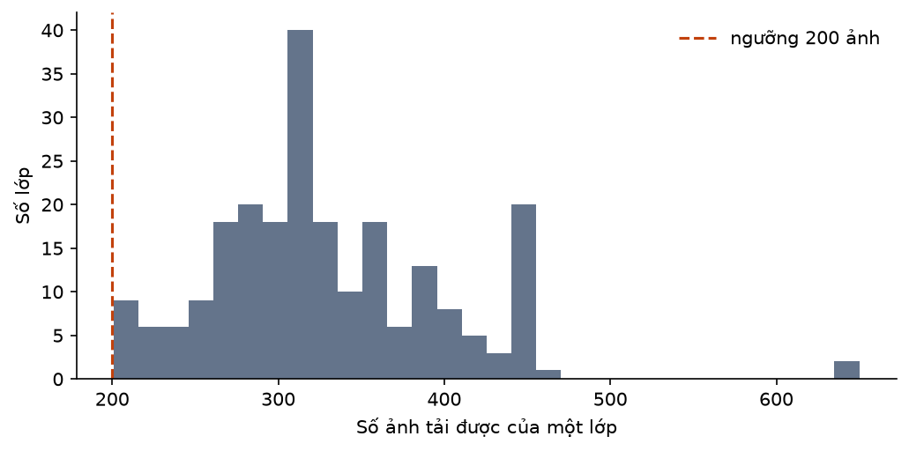
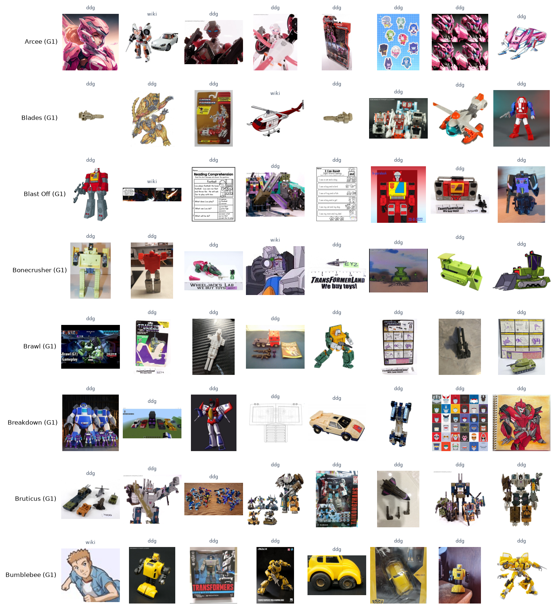

# B02. Thu thập ảnh

Báo cáo sinh tự động bởi `ml/` (mẫu ở `docs/nhan-dang-robot/00-ke-hoach.md` mục 6). Thời gian chạy: 4.8 giây. Số liệu máy đọc: `ml/reports/B02/summary.json`.

## 1. Mục tiêu

Thu ảnh thô cho từng lớp của danh mục B1 từ nguồn công khai, đa dạng miền (ảnh chụp đồ chơi và mô hình, ảnh chụp màn hình phim và hoạt hình, ảnh CGI, tranh vẽ). Ảnh thô còn lẫn ảnh sai và trùng; B3 làm sạch và đo chất lượng nhãn. Đóng góp vào RQ1.

## 2. Đầu vào, đầu ra

- Đầu vào: `ml/data/manifests/robots.json` (230 lớp); chạy trên 230 lớp.
- Đầu ra: ảnh JPEG tại `C:\Users\THINKPAD\WEB_MO_HINH\ml\data\store\images\raw` (không vào git, chỉ dùng cho nghiên cứu); `manifest.csv` mỗi ảnh một dòng (lớp, nguồn, truy vấn, URL ảnh, trang chứa ảnh, sha1 của byte gốc, kích thước gốc); `attempts.csv` mọi lần thử kèm kết quả. Bản nén của manifest: `ml/data/manifests/b02_manifest.csv.gz`.

## 3. Công cụ và môi trường

**Môi trường**

| Mục | Giá trị |
| --- | --- |
| Thời điểm chạy (UTC) | 2026-11-11T06:43:05+00:00 |
| Hệ điều hành | Windows 11 (build 10.0.26300, AMD64) |
| Python | 3.11.9 |
| CPU | 12th Gen Intel(R) Core(TM) i7-12800H (20 luồng) |
| RAM | 31.7 GB |
| GPU (PyTorch) | NVIDIA RTX A2000 Laptop GPU (4.0 GB) |
| CUDA của PyTorch | 12.8 |
| Driver (nvidia-smi) | NVIDIA RTX A2000 Laptop GPU, 4096 MiB, 596.52 |
| Google Colab | không |
| Commit git | c56347e (có thay đổi chưa commit) |

**Phiên bản thư viện**

| Thư viện | Phiên bản |
| --- | --- |
| ImageHash | 4.3.2 |
| Pillow | 13.0.0 |
| ddgs | 9.16.1 |
| matplotlib | 3.11.2 |
| mwparserfromhell | 0.7.2 |
| numpy | 2.4.6 |
| open_clip_torch | 4.2.1 |
| pandas | 3.1.1 |
| rapidfuzz | 3.14.6 |
| requests | 2.34.2 |
| scipy | 1.17.1 |
| timm | 1.0.31 |
| torch | 2.11.0+cu128 |
| torchvision | 0.26.0+cu128 |

## 4. Phương pháp

- **Nguồn 1, wiki:** ảnh của trang robot (`prop=images`): Gundam lấy từ The Gundam Wiki, Super Sentai / Power Rangers từ RangerWiki (cả hai trang của cặp đã gộp), Transformers từ **Teletraan I** (transformers.fandom.com) vì TFWiki không dùng được (xem dưới); tên trang của B1 được giải theo chuyển hướng của Teletraan I, ví dụ *Optimus Prime (G1)* → *Optimus Prime (Primax)*. Chỉ lấy file jpg, jpeg, png, webp, gif (bỏ video, tài liệu); tối đa 250 ảnh mỗi lớp.
- **Không dùng TFWiki để lấy ảnh:** robots.txt của TFWiki không cho tải thư mục ảnh (lần chạy thử bị chặn 286 URL), và chiều 07/11/2026 máy chủ trả trang *"Access Denied: temporarily blocked due to excessive traffic"* sau khoảng 1.500 yêu cầu API của B1 và lần chạy thử. TFWiki được đưa vào danh sách host không truy cập (`blocked_hosts`); danh mục B1 dùng nội dung đã cache.
- **Nguồn 2, tìm ảnh qua thư viện `ddgs`** ở chế độ `auto`: thư viện gọi đồng thời **DuckDuckGo Images và Bing Images** rồi gộp kết quả (phát hiện khi kiểm tra mã nguồn thư viện; báo cáo gọi chung là "DuckDuckGo" nhưng thực chất là hai công cụ). Kết quả Bing qua `ddgs` khớp truy vấn (ví dụ trang seibertron.com, transformerland.com), khác với lần gọi Bing trực tiếp bị loại ở trên. Công cụ của từng URL suy ra từ trường `source`: DuckDuckGo để trống, Bing ghi tên miền. Mỗi lớp 6–8 mẫu truy vấn theo franchise (bảng 1), 4 trang kết quả mỗi truy vấn (khoảng 35 ảnh mỗi trang), SafeSearch moderate, cách nhau 3.5 giây; tối đa 400 URL mỗi lớp: đủ số này thì dừng, không gửi các truy vấn còn lại (lớp phổ biến chỉ dùng vài mẫu đầu, lớp ít ảnh dùng hết). Kết quả tìm kiếm được cache trên đĩa. Lần chạy đủ đầu tiên dùng nhịp 1,5 giây và tìm hết mọi mẫu nên bị giới hạn tốc độ 5–7 lần mỗi lớp (khoảng 3 phút mỗi lớp); đã dừng và chạy tiếp với cấu hình này.
- **Bing Images bị loại** sau khi thử: truy vấn *Optimus Prime transformers G1 toy* trả về ảnh robot Tesla Optimus ở cả trang tìm kiếm lẫn API nội bộ, và tham số lật trang không đổi kết quả (105 kết quả nhưng chỉ 35 URL khác nhau). Dùng nguồn này sẽ gắn nhãn sai hàng loạt. **Flickr** không dùng vì cần khoá API; hai nguồn còn lại đủ số lượng.
- **Thứ tự tải:** xen kẽ wiki và DuckDuckGo, bỏ URL trùng trong lớp; dừng khi có 450 ảnh tải được hoặc đã thử 700 URL. Tải liên tục: luôn giữ 24 yêu cầu đang chạy, lấy URL xen kẽ từ 4 lớp đang mở; một luồng riêng tìm ứng viên của các lớp kế tiếp. (Lần chạy thử đầu tải theo đợt, mỗi đợt chờ ảnh chậm nhất, nên mất 16,7 phút cho 6 lớp.)
- **Tải lịch sự:** 12 luồng; mỗi host cách nhau tối thiểu 1.0 giây (CDN ảnh fandom 0,25 giây); tôn trọng robots.txt; User-Agent ghi rõ mục đích nghiên cứu (`Mozilla/5.0 (compatible; RoboticaThesisResearch/0.1; +https://github.com/ledoankhoi/WEB_MO_HINH)`); thời gian chờ 8 giây kết nối, 15 giây đọc; thử lại 2 lần khi lỗi mạng, HTTP 429 hoặc 5xx (backoff mũ), không thử lại khi hết thời gian; bỏ file quá 20 MB.
- **Chuẩn hoá:** Pillow đọc ảnh, lấy khung đầu của ảnh động, ghép nền trắng cho ảnh trong suốt, chuyển RGB, thu cạnh dài về 512 px (LANCZOS), lưu JPEG chất lượng 90. Tên file là 16 ký tự đầu sha1 của byte gốc. Ảnh có cạnh ngắn dưới 32 px bị bỏ ngay; ngưỡng 128 px của kế hoạch áp ở B3 để phễu lọc đầy đủ.
- **Cùng một URL ở hai lớp:** tải một lần, ghi cho cả hai lớp; B3 loại ảnh có nhãn mâu thuẫn.

**Bảng 1. Ví dụ truy vấn của vài lớp**

| Lớp | Truy vấn DuckDuckGo |
| --- | --- |
| Arcee (G1) | Arcee transformers G1; Arcee transformers G1 toy; Arcee transformers G1 figure; Arcee transformers G1 cartoon; Arcee transformers G1 robot mode; Arcee transformers G1 review |
| Blades (G1) | Blades transformers G1; Blades transformers G1 toy; Blades transformers G1 figure; Blades transformers G1 cartoon; Blades transformers G1 robot mode; Blades transformers G1 review |
| Blast Off (G1) | Blast Off transformers G1; Blast Off transformers G1 toy; Blast Off transformers G1 figure; Blast Off transformers G1 cartoon; Blast Off transformers G1 robot mode; Blast Off transformers G1 review |

**Thu bổ sung (11/11/2026).** Sau lần thu đầu, 5 lớp có dưới 200 ảnh thô và hai lớp cùng tên *Thunder Megazord* dùng chung 4 trong 5 truy vấn (khoảng 80% ảnh của mỗi lớp nằm ở cả hai lớp, sẽ bị B3 loại vì nhãn mâu thuẫn). Các lớp này được tìm thêm bằng truy vấn riêng (bảng 1b): tên ngắn không kèm mã hiệu, tên dòng phim, tên bản Super Sentai. Truy vấn riêng được gửi trước truy vấn theo mẫu; giới hạn URL của các lớp này tăng thêm 400; ảnh đã tải ở lần đầu được giữ nguyên.

**Bảng 1b. Truy vấn bổ sung của 7 lớp**

| Lớp | Truy vấn bổ sung | Mục tiêu ảnh |
| --- | --- | --- |
| EDM-GA-01 Gundam Lfrith Ur | Gundam Lfrith Ur; HG Gundam Lfrith Ur; Gundam Lfrith Ur gunpla; Gundam Lfrith Ur Witch from Mercury; Lfrith Ur model kit review | 450 |
| XGF-01 Gundam Lfrith Pre-Production Model | Gundam Lfrith Pre-Production Model; Lfrith Pre-Production Model gunpla; Gundam Lfrith Pre-Production Witch from Mercury Prologue; XGF-01 Lfrith Pre-Production | 450 |
| JDG-00X Devil Gundam | Devil Gundam; Devil Gundam G Gundam; Devil Gundam figure; Devil Gundam model kit; Dark Gundam G Gundam | 450 |
| EDM-GA-02 Gundam Lfrith Thorn | Gundam Lfrith Thorn; HG Gundam Lfrith Thorn; Gundam Lfrith Thorn gunpla; Gundam Lfrith Thorn Witch from Mercury; Lfrith Thorn model kit review | 450 |
| Streetwise (G1) | Streetwise Protectobot; Streetwise Protectobot G1 toy; Protectobot Streetwise robot mode; Streetwise Transformers Combiner Wars; Streetwise Transformers Legacy | 450 |
| Thunder Megazord (Power Rangers Mighty Morphin 2) | Mighty Morphin Thunder Megazord; Mighty Morphin Power Rangers Thunder Megazord toy; Legacy Thunder Megazord Mighty Morphin; Red Dragon Thunderzord Megazord; Dairen'oh Dairanger; DX Dairenoh | 650 |
| Thunder Megazord (Ninpu Sentai Hurricaneger / Power Rangers Ninja Storm) | Ninja Storm Thunder Megazord; Power Rangers Ninja Storm Thunder Megazord toy; Gouraijin Hurricaneger; DX Gouraijin; Ikazuchi Gattai Gouraijin; Thunder Megazord Crimson Navy Ninja Storm | 650 |

## 5. Kết quả

**Bảng 2. Tổng quan**

| Chỉ số | Giá trị |
| --- | --- |
| Số lớp | 230 |
| Ảnh tải được | 75792 |
| Ảnh mỗi lớp: nhỏ nhất | 201 |
| Ảnh mỗi lớp: trung vị | 317 |
| Ảnh mỗi lớp: trung bình ± độ lệch chuẩn | 329.5 ± 70.8 |
| Ảnh mỗi lớp: lớn nhất | 650 |
| Lớp dưới 200 ảnh | 0 |
| Lượt thử | 95869 |
| Thời gian có tải, cộng mọi lần chạy (phút) | 381.9 |
| Dung lượng ảnh (MB) | 3034 |

**Bảng 3. Kết quả tải theo nguồn**

| Nguồn | URL đã thử | Tải được | Tỉ lệ tải được | HTTP 4xx (bị từ chối, không còn) | HTTP 5xx / 429 (máy chủ lỗi, quá tải) | hết thời gian | lỗi mạng | không phải ảnh | không đọc được ảnh | quá 20 MB | cạnh ngắn < 32 px | robots.txt không cho phép | host trong danh sách không truy cập |
| --- | --- | --- | --- | --- | --- | --- | --- | --- | --- | --- | --- | --- | --- |
| Wiki | 10254 | 9856 | 96.1% | 0 | 0 | 11 | 0 | 0 | 0 | 0 | 101 | 286 | 0 |
| DuckDuckGo | 85615 | 65936 | 77.0% | 8664 | 52 | 468 | 508 | 498 | 1 | 0 | 161 | 9135 | 192 |

Tỉ lệ ảnh từ wiki trong mỗi lớp: trung vị 8%, từ 0% tới 54%.

**Bảng 4. Theo franchise**

| Franchise | Số lớp | Ảnh | Trung vị mỗi lớp | Nhỏ nhất | Lớn nhất |
| --- | --- | --- | --- | --- | --- |
| Transformers | 110 | 32038 | 298.5 | 206 | 450 |
| Gundam | 70 | 26358 | 388.5 | 203 | 460 |
| Super Sentai / Power Rangers | 50 | 17396 | 338.5 | 201 | 650 |



*Hình: Phân bố số ảnh tải được của các lớp*

URL xuất hiện ở hơn một lớp: 4090. Ảnh giống hệt (cùng sha1) nằm ở hơn một lớp: 4131; B3 sẽ loại các ảnh này vì nhãn mâu thuẫn.



*Hình: Ảnh thô ngẫu nhiên của vài lớp (chưa làm sạch; nhãn nhỏ phía trên là nguồn)*

**Bảng 6. Số ảnh của 230 lớp**

| Lớp | Franchise | Ảnh | Từ wiki | Từ DuckDuckGo |
| --- | --- | --- | --- | --- |
| Arcee (G1) | Transformers | 286 | 17 | 269 |
| Blades (G1) | Transformers | 286 | 13 | 273 |
| Blast Off (G1) | Transformers | 309 | 10 | 299 |
| Bonecrusher (G1) | Transformers | 220 | 7 | 213 |
| Brawl (G1) | Transformers | 265 | 9 | 256 |
| Breakdown (G1) | Transformers | 270 | 8 | 262 |
| Bruticus (G1) | Transformers | 310 | 18 | 292 |
| Bumblebee (G1) | Transformers | 288 | 25 | 263 |
| Cliffjumper (G1) | Transformers | 281 | 9 | 272 |
| Dead End (G1) | Transformers | 275 | 9 | 266 |
| Defensor (G1) | Transformers | 278 | 8 | 270 |
| Devastator (G1) | Transformers | 294 | 28 | 266 |
| Drag Strip (G1) | Transformers | 206 | 10 | 196 |
| First Aid (G1) | Transformers | 230 | 9 | 221 |
| Galvatron (G1) | Transformers | 318 | 27 | 291 |
| Grimlock (G1) | Transformers | 331 | 29 | 302 |
| Groove (G1) | Transformers | 273 | 10 | 263 |
| Hook (G1) | Transformers | 267 | 8 | 259 |
| Hot Spot (G1) | Transformers | 260 | 19 | 241 |
| Hound (G1) | Transformers | 260 | 17 | 243 |
| Ironhide (G1) | Transformers | 297 | 23 | 274 |
| Jazz (G1) | Transformers | 284 | 20 | 264 |
| Jetfire (G1) | Transformers | 300 | 28 | 272 |
| Long Haul (G1) | Transformers | 210 | 12 | 198 |
| Megatron (G1) | Transformers | 331 | 50 | 281 |
| Menasor (G1) | Transformers | 302 | 13 | 289 |
| Mixmaster (G1) | Transformers | 231 | 8 | 223 |
| Motormaster (G1) | Transformers | 284 | 11 | 273 |
| Onslaught (G1) | Transformers | 262 | 13 | 249 |
| Optimus Prime (G1) | Transformers | 339 | 40 | 299 |
| Hot Rod (G1) | Transformers | 279 | 23 | 256 |
| Scavenger (G1) | Transformers | 247 | 8 | 239 |
| Scrapper (G1) | Transformers | 264 | 13 | 251 |
| Shockwave (G1) | Transformers | 298 | 29 | 269 |
| Skywarp (G1) | Transformers | 280 | 25 | 255 |
| Slag (G1) | Transformers | 320 | 12 | 308 |
| Sludge (G1) | Transformers | 252 | 10 | 242 |
| Snarl (G1) | Transformers | 248 | 11 | 237 |
| Soundwave (G1) | Transformers | 338 | 47 | 291 |
| Star Saber (G1) | Transformers | 320 | 0 | 320 |
| Starscream (G1) | Transformers | 295 | 12 | 283 |
| Streetwise (G1) | Transformers | 340 | 9 | 331 |
| Swindle (G1) | Transformers | 275 | 14 | 261 |
| Swoop (G1) | Transformers | 307 | 10 | 297 |
| Thundercracker (G1) | Transformers | 281 | 19 | 262 |
| Ultra Magnus (G1) | Transformers | 304 | 20 | 284 |
| Volcanicus (POTP) | Transformers | 307 | 0 | 307 |
| Vortex (G1) | Transformers | 255 | 8 | 247 |
| Wheeljack (G1) | Transformers | 266 | 6 | 260 |
| Wildrider (G1) | Transformers | 211 | 3 | 208 |
| Scorponok (G1) | Transformers | 208 | 16 | 192 |
| Fortress Maximus (G1) | Transformers | 278 | 0 | 278 |
| Alpha Trion | Transformers | 268 | 13 | 255 |
| Metroplex (G1) | Transformers | 317 | 8 | 309 |
| Trypticon (G1) | Transformers | 306 | 17 | 289 |
| Mirage (G1) | Transformers | 286 | 17 | 269 |
| Astrotrain (G1) | Transformers | 309 | 17 | 292 |
| Rumble (G1) | Transformers | 269 | 13 | 256 |
| Blurr (G1) | Transformers | 227 | 12 | 215 |
| Skids (G1) | Transformers | 302 | 11 | 291 |
| Bumblebee (Movie) | Transformers | 450 | 216 | 234 |
| Megatron (Movie) | Transformers | 317 | 10 | 307 |
| Optimus Prime (Movie) | Transformers | 353 | 46 | 307 |
| Starscream (Movie) | Transformers | 289 | 34 | 255 |
| Ironhide (Movie) | Transformers | 313 | 33 | 280 |
| Ratchet (Movie) | Transformers | 324 | 30 | 294 |
| Barricade (Movie) | Transformers | 316 | 32 | 284 |
| Sideswipe (Movie) | Transformers | 316 | 21 | 295 |
| Jazz (Movie) | Transformers | 292 | 26 | 266 |
| Arcee (Movie) | Transformers | 280 | 13 | 267 |
| Shockwave (Movie) | Transformers | 296 | 15 | 281 |
| Jetfire (Movie) | Transformers | 313 | 7 | 306 |
| Blackout (Movie) | Transformers | 305 | 22 | 283 |
| Brawl (Movie) | Transformers | 241 | 16 | 225 |
| Frenzy (Movie) | Transformers | 262 | 15 | 247 |
| Hound (Movie) | Transformers | 263 | 8 | 255 |
| Scorponok (Movie) | Transformers | 303 | 20 | 283 |
| Bonecrusher (Movie) | Transformers | 318 | 14 | 304 |
| Arcee (WFC) | Transformers | 317 | 10 | 307 |
| Soundwave (WFC) | Transformers | 299 | 13 | 286 |
| Optimus Prime (WFC) | Transformers | 316 | 25 | 291 |
| Megatron (WFC) | Transformers | 301 | 0 | 301 |
| Shockwave (WFC) | Transformers | 312 | 7 | 305 |
| Wheeljack (Prime) | Transformers | 313 | 4 | 309 |
| Breakdown (WFC) | Transformers | 332 | 11 | 321 |
| Smokescreen (Prime) | Transformers | 293 | 1 | 292 |
| Megatron (BW) | Transformers | 309 | 21 | 288 |
| Optimus Primal (BW) | Transformers | 334 | 14 | 320 |
| Waspinator (BW) | Transformers | 307 | 12 | 295 |
| Lio Convoy (BW) | Transformers | 228 | 13 | 215 |
| Blackarachnia (BW) | Transformers | 323 | 16 | 307 |
| Cheetor (BW) | Transformers | 314 | 26 | 288 |
| Tarantulas (BW) | Transformers | 336 | 7 | 329 |
| Rhinox (BW) | Transformers | 318 | 13 | 305 |
| Dinobot (BW) | Transformers | 318 | 17 | 301 |
| Airazor (BW) | Transformers | 271 | 12 | 259 |
| Optimus Prime (Animated) | Transformers | 325 | 20 | 305 |
| Megatron (Animated) | Transformers | 327 | 24 | 303 |
| Bumblebee (Animated) | Transformers | 327 | 16 | 311 |
| Bulkhead (Animated) | Transformers | 299 | 14 | 285 |
| Bumblebee (Cyberverse) | Transformers | 307 | 4 | 303 |
| Optimus Prime (Cyberverse) | Transformers | 313 | 3 | 310 |
| Optimus Prime (ES) | Transformers | 217 | 0 | 217 |
| Bumblebee (ES) | Transformers | 273 | 0 | 273 |
| Twitch | Transformers | 226 | 0 | 226 |
| Bumblebee (One) | Transformers | 306 | 3 | 303 |
| Optimus Prime (One) | Transformers | 320 | 3 | 317 |
| Megatron (One) | Transformers | 325 | 3 | 322 |
| Elita-1 (One) | Transformers | 265 | 5 | 260 |
| Starscream (One) | Transformers | 312 | 6 | 306 |
| MS-06S Char's Zaku II | Gundam | 386 | 45 | 341 |
| MSM-04 Acguy | Gundam | 399 | 63 | 336 |
| MSZ-006 Zeta Gundam | Gundam | 450 | 240 | 210 |
| RX-78-2 Gundam | Gundam | 460 | 249 | 211 |
| MSN-04 Sazabi | Gundam | 450 | 166 | 284 |
| RX-0 Unicorn Gundam | Gundam | 450 | 235 | 215 |
| RX-0 Unicorn Gundam 03 Phenex | Gundam | 406 | 75 | 331 |
| MS-06F Zaku II | Gundam | 450 | 133 | 317 |
| MS-09 Dom | Gundam | 450 | 119 | 331 |
| RGM-79 GM | Gundam | 450 | 109 | 341 |
| MS-14A Gelgoog | Gundam | 395 | 101 | 294 |
| RX-178 Gundam Mk-II | Gundam | 450 | 167 | 283 |
| MSA-003 Nemo | Gundam | 406 | 64 | 342 |
| RMS-108 Marasai | Gundam | 362 | 56 | 306 |
| RMS-179 GM II | Gundam | 373 | 84 | 289 |
| MSM-07 Z'Gok | Gundam | 381 | 59 | 322 |
| RX-75 Guntank | Gundam | 393 | 31 | 362 |
| RX-77-2 Guncannon | Gundam | 423 | 85 | 338 |
| RMS-106 Hizack | Gundam | 415 | 88 | 327 |
| MS-05B Zaku I | Gundam | 386 | 85 | 301 |
| RMS-099 Rick Dias | Gundam | 400 | 72 | 328 |
| MSN-00100 Hyaku Shiki | Gundam | 450 | 105 | 345 |
| MS-07B Gouf | Gundam | 422 | 93 | 329 |
| MSN-02 Zeong | Gundam | 439 | 74 | 365 |
| RGM-86R GM III | Gundam | 285 | 20 | 265 |
| RX-93 ν Gundam | Gundam | 450 | 239 | 211 |
| AMS-119 Geara Doga | Gundam | 387 | 83 | 304 |
| YMS-15 Gyan | Gundam | 358 | 47 | 311 |
| MSZ-010 ΖΖ Gundam | Gundam | 450 | 127 | 323 |
| AMX-107 Bawoo | Gundam | 404 | 75 | 329 |
| RGM-89 Jegan | Gundam | 381 | 69 | 312 |
| RGC-80 GM Cannon | Gundam | 315 | 38 | 277 |
| XXXG-01W Wing Gundam | Gundam | 450 | 116 | 334 |
| XXXG-00W0 Wing Gundam Zero | Gundam | 450 | 107 | 343 |
| OZ-06MS Leo | Gundam | 394 | 95 | 299 |
| XXXG-01S Shenlong Gundam | Gundam | 359 | 44 | 315 |
| WF-02MD Virgo II | Gundam | 208 | 34 | 174 |
| OZ-13MS Gundam Epyon | Gundam | 397 | 91 | 306 |
| XXXG-01SR Gundam Sandrock | Gundam | 356 | 49 | 307 |
| XXXG-01H Gundam Heavyarms | Gundam | 344 | 48 | 296 |
| ZGMF-X20A Strike Freedom Gundam | Gundam | 450 | 138 | 312 |
| ZGMF-1017 GINN | Gundam | 375 | 71 | 304 |
| ZGMF-X10A Freedom Gundam | Gundam | 450 | 154 | 296 |
| GAT-X105 Strike Gundam | Gundam | 450 | 104 | 346 |
| MBF-M1 M1 Astray | Gundam | 250 | 55 | 195 |
| ZGMF-600 GuAIZ | Gundam | 210 | 38 | 172 |
| ZGMF-515 CGUE | Gundam | 256 | 39 | 217 |
| GAT-X102 Duel Gundam | Gundam | 400 | 109 | 291 |
| MBF-P02 Gundam Astray Red Frame | Gundam | 437 | 70 | 367 |
| GAT-X103 Buster Gundam | Gundam | 375 | 71 | 304 |
| GN-001 Gundam Exia | Gundam | 364 | 18 | 346 |
| GN-003 Gundam Kyrios | Gundam | 388 | 67 | 321 |
| GN-002 Gundam Dynames | Gundam | 389 | 75 | 314 |
| GN-0000 00 Gundam | Gundam | 341 | 46 | 295 |
| GN-000 0 Gundam | Gundam | 367 | 53 | 314 |
| GNX-603T GN-X | Gundam | 314 | 59 | 255 |
| AEU-09 AEU Enact | Gundam | 203 | 12 | 191 |
| ASW-G-08 Gundam Barbatos | Gundam | 351 | 29 | 322 |
| EB-06 Graze | Gundam | 290 | 40 | 250 |
| ASW-G-01 Gundam Bael | Gundam | 316 | 54 | 262 |
| UGY-R38 Spinner Rodi | Gundam | 243 | 30 | 213 |
| EB-05s Schwalbe Graze | Gundam | 237 | 32 | 205 |
| STH-05 Hyakuren | Gundam | 237 | 13 | 224 |
| XVX-016 Gundam Aerial | Gundam | 450 | 106 | 344 |
| XGF-01 Gundam Lfrith Pre-Production Model | Gundam | 352 | 24 | 328 |
| EDM-GA-02 Gundam Lfrith Thorn | Gundam | 450 | 22 | 428 |
| EDM-GA-01 Gundam Lfrith Ur | Gundam | 311 | 22 | 289 |
| GF13-017NJII God Gundam | Gundam | 450 | 121 | 329 |
| JDG-00X Devil Gundam | Gundam | 280 | 37 | 243 |
| GF13-017NJ Shining Gundam | Gundam | 338 | 79 | 259 |
| Wild Force Megazord | Super Sentai / Power Rangers | 434 | 76 | 358 |
| Shogun Megazord | Super Sentai / Power Rangers | 343 | 48 | 295 |
| Dino Megazord | Super Sentai / Power Rangers | 450 | 150 | 300 |
| Ninja Megazord | Super Sentai / Power Rangers | 361 | 51 | 310 |
| Legendary Megazord | Super Sentai / Power Rangers | 364 | 65 | 299 |
| Ninja Steel Megazord | Super Sentai / Power Rangers | 423 | 98 | 325 |
| Mega Voyager | Super Sentai / Power Rangers | 379 | 56 | 323 |
| Gosei Great Megazord | Super Sentai / Power Rangers | 389 | 47 | 342 |
| Turbo Megazord | Super Sentai / Power Rangers | 350 | 67 | 283 |
| Rescue Megazord | Super Sentai / Power Rangers | 347 | 48 | 299 |
| Zeo Megazord | Super Sentai / Power Rangers | 316 | 54 | 262 |
| Super Zeo Megazord | Super Sentai / Power Rangers | 309 | 34 | 275 |
| Ninja Blaze Megazord | Super Sentai / Power Rangers | 353 | 37 | 316 |
| Galaxy Megazord | Super Sentai / Power Rangers | 401 | 87 | 314 |
| Samurai Megazord | Super Sentai / Power Rangers | 361 | 89 | 272 |
| DriveMax Megazord | Super Sentai / Power Rangers | 421 | 84 | 337 |
| Delta Squad Megazord | Super Sentai / Power Rangers | 380 | 51 | 329 |
| S.W.A.T. Megazord | Super Sentai / Power Rangers | 328 | 43 | 285 |
| Lightspeed Megazord | Super Sentai / Power Rangers | 354 | 39 | 315 |
| Astro Megazord | Super Sentai / Power Rangers | 365 | 57 | 308 |
| Omega Megazord | Super Sentai / Power Rangers | 327 | 25 | 302 |
| Thunder Ultrazord | Super Sentai / Power Rangers | 329 | 14 | 315 |
| Supertrain Megazord | Super Sentai / Power Rangers | 326 | 27 | 299 |
| BattleFleet Battleship | Super Sentai / Power Rangers | 358 | 53 | 305 |
| Ressha Gattai ToQ-Oh | Super Sentai / Power Rangers | 302 | 72 | 230 |
| Battleship CrocoDaiOh | Super Sentai / Power Rangers | 329 | 23 | 306 |
| Ohsama Gattai King-Ohger | Super Sentai / Power Rangers | 287 | 63 | 224 |
| Zenkai Gattai ZenkaiOh | Super Sentai / Power Rangers | 280 | 32 | 248 |
| Gravezord | Super Sentai / Power Rangers | 362 | 33 | 329 |
| X Emperor Slash | Super Sentai / Power Rangers | 317 | 51 | 266 |
| Cosmic Dragon Megazord | Super Sentai / Power Rangers | 381 | 53 | 328 |
| Ptera Freeze Zord Battle Mode | Super Sentai / Power Rangers | 284 | 34 | 250 |
| Ohsama Gattai King-Ohger ZERO | Super Sentai / Power Rangers | 247 | 18 | 229 |
| DualDrive Megazord | Super Sentai / Power Rangers | 272 | 19 | 253 |
| Dai Gattai Don Onitaijin | Super Sentai / Power Rangers | 236 | 17 | 219 |
| Jungle Master Megazord | Super Sentai / Power Rangers | 311 | 25 | 286 |
| Thunder Megazord (Power Rangers Mighty Morphin 2) | Super Sentai / Power Rangers | 649 | 31 | 618 |
| Storm Megazord | Super Sentai / Power Rangers | 395 | 77 | 318 |
| Kyutama Gattai 01*03*05*07*09 KyurenOh | Super Sentai / Power Rangers | 303 | 101 | 202 |
| Bull Rider Megazord | Super Sentai / Power Rangers | 334 | 33 | 301 |
| Thunder Megazord (Ninpu Sentai Hurricaneger / Power Rangers Ninja Storm) | Super Sentai / Power Rangers | 650 | 47 | 603 |
| Titan Megazord | Super Sentai / Power Rangers | 275 | 16 | 259 |
| Giant God TegaSword | Super Sentai / Power Rangers | 364 | 21 | 343 |
| Doubutsu Gattai Tousai Zyuoh | Super Sentai / Power Rangers | 208 | 37 | 171 |
| Jungle Pride Megazord | Super Sentai / Power Rangers | 320 | 35 | 285 |
| Goggle Robo | Super Sentai / Power Rangers | 329 | 27 | 302 |
| Flash Point Megazord | Super Sentai / Power Rangers | 351 | 24 | 327 |
| ValveMax Megazord | Super Sentai / Power Rangers | 333 | 26 | 307 |
| High Octane Megazord | Super Sentai / Power Rangers | 308 | 47 | 261 |
| Zeo Mega Battlezord | Super Sentai / Power Rangers | 201 | 14 | 187 |

## 6. Phân tích

- Tổng 75792 ảnh thô cho 230 lớp; trung vị 317.0 ảnh mỗi lớp.
- Wiki: tải được 96.1% số URL; lỗi nhiều nhất là robots.txt không cho phép (286 URL).
- DuckDuckGo: tải được 77.0% số URL; lỗi nhiều nhất là robots.txt không cho phép (9135 URL).
- Đạt tiêu chí của kế hoạch (mọi lớp ≥ 200 ảnh thô).

## 7. Hạn chế và rủi ro

- Ảnh thô chưa làm sạch: còn ảnh sai nhân vật, ảnh có nhiều robot, ảnh hộp, biểu tượng, trùng lặp. Số lượng ở đây là cận trên của số ảnh dùng được.
- Kết quả DuckDuckGo phụ thuộc thời điểm và vị trí truy vấn; cache trên đĩa giữ đúng kết quả đã dùng để tái lập.
- Ảnh có bản quyền của chủ sở hữu; chỉ dùng để huấn luyện cho nghiên cứu, không đưa lên web hay git, không phân phối lại. Manifest ghi nguồn từng ảnh.
- Ảnh trên wiki thiên về ảnh chụp màn hình phim và ảnh đồ chơi chính hãng chụp nền trắng; ảnh DuckDuckGo đa dạng hơn nhưng nhiễu hơn.

## 8. Tái lập

| Mục | Giá trị |
| --- | --- |
| Cấu hình | ml/configs/b02_thu_anh.yaml |
| Mã cấu hình | 1ccda48a03b1 |
| Hạt giống | 42 |
| Phiên bản dữ liệu | robots.json sha256 000da3c769a5 |

```bash
ml/.venv/Scripts/python ml/scripts/b02_thu_anh.py
```
