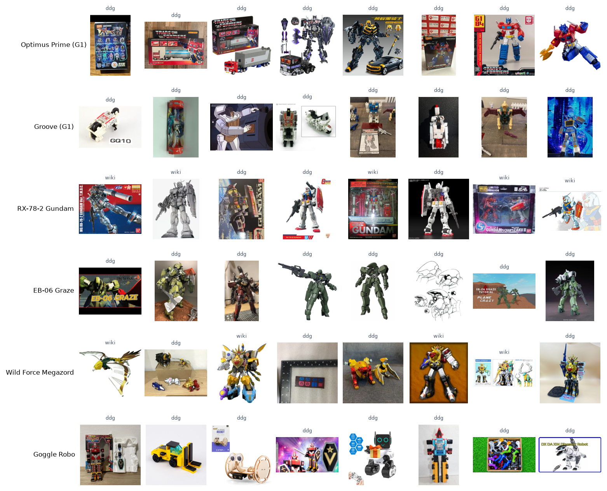

# B02a. Thu thập ảnh: chạy thử

Báo cáo sinh tự động bởi `ml/` (mẫu ở `docs/nhan-dang-robot/00-ke-hoach.md` mục 6). Thời gian chạy: 1.0 giây. Số liệu máy đọc: `ml/reports/B02a/summary.json`.

## 1. Mục tiêu

Thu ảnh thô cho từng lớp của danh mục B1 từ nguồn công khai, đa dạng miền (ảnh chụp đồ chơi và mô hình, ảnh chụp màn hình phim và hoạt hình, ảnh CGI, tranh vẽ). Ảnh thô còn lẫn ảnh sai và trùng; B3 làm sạch và đo chất lượng nhãn. Đóng góp vào RQ1. Đây là lần **chạy thử** trên một số lớp để đo tỉ lệ tải được và kiểm tra nguồn trước khi chạy đủ.

## 2. Đầu vào, đầu ra

- Đầu vào: `ml/data/manifests/robots.json` (230 lớp); chạy trên 6 lớp.
- Đầu ra: ảnh JPEG tại `C:\Users\THINKPAD\WEB_MO_HINH\ml\data\store\images\raw` (không vào git, chỉ dùng cho nghiên cứu); `manifest.csv` mỗi ảnh một dòng (lớp, nguồn, truy vấn, URL ảnh, trang chứa ảnh, sha1 của byte gốc, kích thước gốc); `attempts.csv` mọi lần thử kèm kết quả. Bản nén của manifest: `ml/data/manifests/b02_manifest.csv.gz`.

## 3. Công cụ và môi trường

**Môi trường**

| Mục | Giá trị |
| --- | --- |
| Thời điểm chạy (UTC) | 2026-11-07T13:59:29+00:00 |
| Hệ điều hành | Windows 11 (build 10.0.26200, AMD64) |
| Python | 3.11.9 |
| CPU | 12th Gen Intel(R) Core(TM) i7-12800H (20 luồng) |
| RAM | 31.7 GB |
| GPU (PyTorch) | NVIDIA RTX A2000 Laptop GPU (4.0 GB) |
| CUDA của PyTorch | 12.8 |
| Driver (nvidia-smi) | NVIDIA RTX A2000 Laptop GPU, 4096 MiB, 596.52 |
| Google Colab | không |
| Commit git | c56347e (có thay đổi chưa commit) |

**Phiên bản thư viện**

| Thư viện | Phiên bản |
| --- | --- |
| Pillow | 13.0.0 |
| ddgs | 9.16.1 |
| matplotlib | 3.11.2 |
| mwparserfromhell | 0.7.2 |
| numpy | 2.4.6 |
| pandas | 3.1.1 |
| rapidfuzz | 3.14.6 |
| requests | 2.34.2 |
| scipy | 1.17.1 |
| torch | 2.11.0+cu128 |
| torchvision | 0.26.0+cu128 |

## 4. Phương pháp

- **Nguồn 1, wiki:** ảnh của trang robot (`prop=images`): Gundam lấy từ The Gundam Wiki, Super Sentai / Power Rangers từ RangerWiki (cả hai trang của cặp đã gộp), Transformers từ **Teletraan I** (transformers.fandom.com) vì TFWiki không dùng được (xem dưới); tên trang của B1 được giải theo chuyển hướng của Teletraan I, ví dụ *Optimus Prime (G1)* → *Optimus Prime (Primax)*. Chỉ lấy file jpg, jpeg, png, webp, gif (bỏ video, tài liệu); tối đa 250 ảnh mỗi lớp.
- **Không dùng TFWiki để lấy ảnh:** robots.txt của TFWiki không cho tải thư mục ảnh (lần chạy thử bị chặn 286 URL), và chiều 07/11/2026 máy chủ trả trang *"Access Denied: temporarily blocked due to excessive traffic"* sau khoảng 1.500 yêu cầu API của B1 và lần chạy thử. TFWiki được đưa vào danh sách host không truy cập (`blocked_hosts`); danh mục B1 dùng nội dung đã cache.
- **Nguồn 2, DuckDuckGo Images** (thư viện `ddgs`): mỗi lớp 6–8 mẫu truy vấn theo franchise (bảng 1), 4 trang kết quả mỗi truy vấn (khoảng 35 ảnh mỗi trang), SafeSearch moderate, cách nhau 1.5 giây; tối đa 400 URL mỗi lớp. Kết quả tìm kiếm được cache trên đĩa.
- **Bing Images bị loại** sau khi thử: truy vấn *Optimus Prime transformers G1 toy* trả về ảnh robot Tesla Optimus ở cả trang tìm kiếm lẫn API nội bộ, và tham số lật trang không đổi kết quả (105 kết quả nhưng chỉ 35 URL khác nhau). Dùng nguồn này sẽ gắn nhãn sai hàng loạt. **Flickr** không dùng vì cần khoá API; hai nguồn còn lại đủ số lượng.
- **Thứ tự tải:** xen kẽ wiki và DuckDuckGo, bỏ URL trùng trong lớp; dừng khi có 450 ảnh tải được hoặc đã thử 700 URL. Tải liên tục: luôn giữ 24 yêu cầu đang chạy, lấy URL xen kẽ từ 4 lớp đang mở; một luồng riêng tìm ứng viên của các lớp kế tiếp. (Lần chạy thử đầu tải theo đợt, mỗi đợt chờ ảnh chậm nhất, nên mất 16,7 phút cho 6 lớp.)
- **Tải lịch sự:** 12 luồng; mỗi host cách nhau tối thiểu 1.0 giây (CDN ảnh fandom 0,25 giây); tôn trọng robots.txt; User-Agent ghi rõ mục đích nghiên cứu (`Mozilla/5.0 (compatible; RoboticaThesisResearch/0.1; +https://github.com/ledoankhoi/WEB_MO_HINH)`); thời gian chờ 8 giây kết nối, 15 giây đọc; thử lại 2 lần khi lỗi mạng, HTTP 429 hoặc 5xx (backoff mũ), không thử lại khi hết thời gian; bỏ file quá 20 MB.
- **Chuẩn hoá:** Pillow đọc ảnh, lấy khung đầu của ảnh động, ghép nền trắng cho ảnh trong suốt, chuyển RGB, thu cạnh dài về 512 px (LANCZOS), lưu JPEG chất lượng 90. Tên file là 16 ký tự đầu sha1 của byte gốc. Ảnh có cạnh ngắn dưới 32 px bị bỏ ngay; ngưỡng 128 px của kế hoạch áp ở B3 để phễu lọc đầy đủ.
- **Cùng một URL ở hai lớp:** tải một lần, ghi cho cả hai lớp; B3 loại ảnh có nhãn mâu thuẫn.

**Bảng 1. Ví dụ truy vấn của vài lớp**

| Lớp | Truy vấn DuckDuckGo |
| --- | --- |
| Optimus Prime (G1) | Optimus Prime transformers G1; Optimus Prime transformers G1 toy; Optimus Prime transformers G1 figure; Optimus Prime transformers G1 cartoon; Optimus Prime transformers G1 robot mode; Optimus Prime transformers G1 review |
| Groove (G1) | Groove transformers G1; Groove transformers G1 toy; Groove transformers G1 figure; Groove transformers G1 cartoon; Groove transformers G1 robot mode; Groove transformers G1 review |
| RX-78-2 Gundam | RX-78-2 Gundam; RX-78-2 Gundam gunpla; RX-78-2 Gundam model kit; RX-78-2 Gundam anime; RX-78-2 Gundam mobile suit; RX-78-2 Gundam figure |

## 5. Kết quả

**Bảng 2. Tổng quan**

| Chỉ số | Giá trị |
| --- | --- |
| Số lớp | 6 |
| Ảnh tải được | 2125 |
| Ảnh mỗi lớp: nhỏ nhất | 273 |
| Ảnh mỗi lớp: trung vị | 334 |
| Ảnh mỗi lớp: trung bình ± độ lệch chuẩn | 354.2 ± 76.3 |
| Ảnh mỗi lớp: lớn nhất | 460 |
| Lớp dưới 200 ảnh | 0 |
| Lượt thử | 2949 |
| Thời gian chạy lần này (phút) | 6.8 |
| Dung lượng ảnh (MB) | 95.6 |

**Bảng 3. Kết quả tải theo nguồn**

| Nguồn | URL đã thử | Tải được | Tỉ lệ tải được | HTTP 4xx (bị từ chối, không còn) | HTTP 5xx / 429 (máy chủ lỗi, quá tải) | hết thời gian | lỗi mạng | không phải ảnh | không đọc được ảnh | quá 20 MB | cạnh ngắn < 32 px | robots.txt không cho phép | host trong danh sách không truy cập |
| --- | --- | --- | --- | --- | --- | --- | --- | --- | --- | --- | --- | --- | --- |
| Wiki | 731 | 442 | 60.5% | 0 | 0 | 0 | 0 | 0 | 0 | 0 | 3 | 286 | 0 |
| DuckDuckGo | 2218 | 1683 | 75.9% | 206 | 0 | 11 | 15 | 8 | 0 | 0 | 0 | 295 | 0 |

Tỉ lệ ảnh từ wiki trong mỗi lớp: trung vị 13%, từ 4% tới 54%.

**Bảng 4. Theo franchise**

| Franchise | Số lớp | Ảnh | Trung vị mỗi lớp | Nhỏ nhất | Lớn nhất |
| --- | --- | --- | --- | --- | --- |
| Transformers | 2 | 612 | 306 | 273 | 339 |
| Gundam | 2 | 750 | 375 | 290 | 460 |
| Super Sentai / Power Rangers | 2 | 763 | 381.5 | 329 | 434 |

URL xuất hiện ở hơn một lớp: 9. Ảnh giống hệt (cùng sha1) nằm ở hơn một lớp: 9; B3 sẽ loại các ảnh này vì nhãn mâu thuẫn.



*Hình: Ảnh thô ngẫu nhiên của vài lớp (chưa làm sạch; nhãn nhỏ phía trên là nguồn)*

## 6. Phân tích

- Tổng 2125 ảnh thô cho 6 lớp; trung vị 334.0 ảnh mỗi lớp.
- Wiki: tải được 60.5% số URL; lỗi nhiều nhất là robots.txt không cho phép (286 URL).
- DuckDuckGo: tải được 75.9% số URL; lỗi nhiều nhất là robots.txt không cho phép (295 URL).
- Đạt tiêu chí của kế hoạch (mọi lớp ≥ 200 ảnh thô).

## 7. Hạn chế và rủi ro

- Ảnh thô chưa làm sạch: còn ảnh sai nhân vật, ảnh có nhiều robot, ảnh hộp, biểu tượng, trùng lặp. Số lượng ở đây là cận trên của số ảnh dùng được.
- Kết quả DuckDuckGo phụ thuộc thời điểm và vị trí truy vấn; cache trên đĩa giữ đúng kết quả đã dùng để tái lập.
- Ảnh có bản quyền của chủ sở hữu; chỉ dùng để huấn luyện cho nghiên cứu, không đưa lên web hay git, không phân phối lại. Manifest ghi nguồn từng ảnh.
- Ảnh trên wiki thiên về ảnh chụp màn hình phim và ảnh đồ chơi chính hãng chụp nền trắng; ảnh DuckDuckGo đa dạng hơn nhưng nhiễu hơn.

## 8. Tái lập

| Mục | Giá trị |
| --- | --- |
| Cấu hình | ml/configs/b02_thu_anh.yaml |
| Mã cấu hình | f21369a2d11f |
| Hạt giống | 42 |
| Phiên bản dữ liệu | robots.json sha256 b066decc724a |

```bash
ml/.venv/Scripts/python ml/scripts/b02_thu_anh.py --pilot
```
