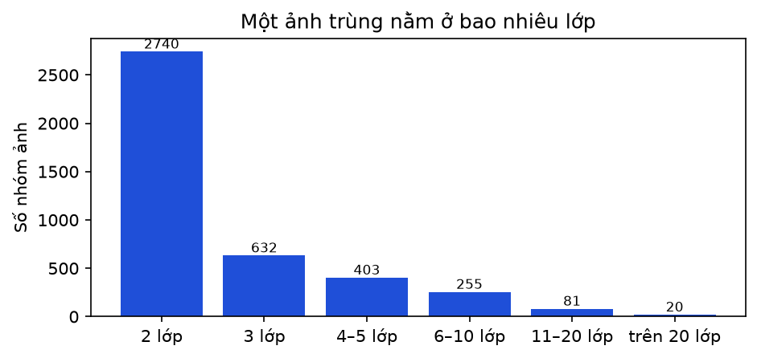
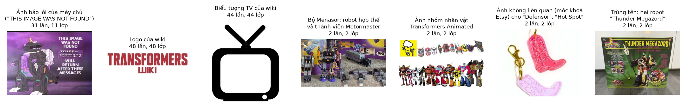

# B02b. Trùng lặp và nhãn mâu thuẫn trong ảnh thô

Báo cáo sinh tự động bởi `ml/` (mẫu ở `docs/nhan-dang-robot/00-ke-hoach.md` mục 6). Thời gian chạy: 0.5 giây. Số liệu máy đọc: `ml/reports/B02b/summary.json`.

## 1. Mục tiêu

Đo mức trùng lặp của 74 nghìn ảnh thô thu ở B02 trước khi làm sạch (B3), và giải thích bằng ví dụ thật hai loại lỗi: **bản trùng hệt** (cùng một file được tải nhiều lần) và **nhãn mâu thuẫn** (cùng một ảnh mang tên nhiều robot khác nhau). Số liệu này cho biết dữ liệu web nhiễu đến đâu và vì sao phải làm sạch; đóng góp vào RQ1.

## 2. Đầu vào, đầu ra

- Đầu vào: `ml/data/manifests/b02_manifest.csv.gz` (75792 dòng, mỗi dòng một ảnh: lớp, nguồn, truy vấn, URL, trang chứa ảnh, sha1, kích thước); ảnh gốc ở `C:\Users\THINKPAD\WEB_MO_HINH\ml\data\store\images\raw` (không vào git).
- Đầu ra: báo cáo này, `ml/reports/B02b/summary.json`, hình `ml/reports/B02b/*.png`. Không xoá hay sửa ảnh nào.

## 3. Công cụ và môi trường

**Môi trường**

| Mục | Giá trị |
| --- | --- |
| Thời điểm chạy (UTC) | 2026-11-11T06:43:18+00:00 |
| Hệ điều hành | Windows 11 (build 10.0.26300, AMD64) |
| Python | 3.11.9 |
| CPU | 12th Gen Intel(R) Core(TM) i7-12800H (20 luồng) |
| RAM | 31.7 GB |
| GPU (PyTorch) | NVIDIA RTX A2000 Laptop GPU (4.0 GB) |
| CUDA của PyTorch | 12.8 |
| Driver (nvidia-smi) | NVIDIA RTX A2000 Laptop GPU, 4096 MiB, 596.52 |
| Google Colab | không |
| Commit git | c56347e (có thay đổi chưa commit) |

**Phiên bản thư viện**

| Thư viện | Phiên bản |
| --- | --- |
| ImageHash | 4.3.2 |
| Pillow | 13.0.0 |
| ddgs | 9.16.1 |
| matplotlib | 3.11.2 |
| mwparserfromhell | 0.7.2 |
| numpy | 2.4.6 |
| open_clip_torch | 4.2.1 |
| pandas | 3.1.1 |
| rapidfuzz | 3.14.6 |
| requests | 2.34.2 |
| scipy | 1.17.1 |
| timm | 1.0.31 |
| torch | 2.11.0+cu128 |
| torchvision | 0.26.0+cu128 |

## 4. Phương pháp

- **Mã sha1:** mã băm 160 bit của toàn bộ byte file ảnh tải về, như "dấu vân tay" của file: hai file cùng mã khi và chỉ khi giống nhau đến từng byte (xác suất hai file khác nhau trùng mã là không đáng kể). Mã được tính lúc tải ở B02, trên byte gốc trước khi thu nhỏ.
- **Bản trùng hệt (bản thừa):** số ảnh trừ số mã sha1 khác nhau. Nếu một file xuất hiện 5 lần thì có 4 bản thừa.
- **Trùng trong cùng lớp:** cùng mã sha1 xuất hiện nhiều lần trong một lớp (nhãn vẫn nhất quán, chỉ thừa).
- **Nhãn mâu thuẫn:** một mã sha1 xuất hiện ở từ hai lớp trở lên; mỗi mã như vậy là một *nhóm*. Đếm cả số nhóm và số dòng ảnh thuộc các nhóm.
- Đây là phép đếm trên toàn bộ tập, không phải mẫu, nên không cần khoảng tin cậy.
- Không đo ảnh **gần trùng** (cùng ảnh nhưng đã cắt, đổi cỡ, nén lại): B3 đo bằng pHash. Vì vậy các tỉ lệ ở đây là **cận dưới** của mức trùng thật.
- Ví dụ minh hoạ được chọn tay sau khi xem các nhóm trùng lan rộng nhất và mở ảnh gốc.

## 5. Kết quả

**Bảng 1. Trùng lặp trên toàn bộ ảnh thô**

| Chỉ số | Số | Tỉ lệ trên tổng ảnh |
| --- | --- | --- |
| Tổng số ảnh tải về | 75792 | 100% |
| Ảnh khác nhau thật sự (số mã sha1) | 66462 | 87,7% |
| Bản trùng hệt (bản thừa) | 9330 | 12,3% |
| — trong đó: thừa ngay trong cùng một lớp | 753 | 1,0% |
| Nhóm ảnh nằm ở ≥ 2 lớp (nhãn mâu thuẫn) | 4131 | — |
| Dòng ảnh thuộc các nhóm nhãn mâu thuẫn | 12822 | 16,9% |
| Nhóm ảnh nằm ở hai franchise khác nhau | 21 | — |

**Bảng 2. Theo nguồn**

| Nguồn | Ảnh | Bản thừa | Tỉ lệ thừa | Ảnh nhãn mâu thuẫn | Tỉ lệ mâu thuẫn |
| --- | --- | --- | --- | --- | --- |
| Wiki người hâm mộ | 9856 | 859 | 8,7% | 1121 | 11,4% |
| Tìm ảnh (ddgs: DuckDuckGo + Bing) | 65936 | 8332 | 12,6% | 11701 | 17,7% |

**Bảng 3. Theo franchise**

| Franchise | Ảnh | Bản thừa | Tỉ lệ thừa | Ảnh nhãn mâu thuẫn | Tỉ lệ mâu thuẫn |
| --- | --- | --- | --- | --- | --- |
| Transformers | 32038 | 5303 | 16,6% | 7058 | 22,0% |
| Gundam | 26358 | 1080 | 4,1% | 1455 | 5,5% |
| Super Sentai / Power Rangers | 17396 | 2925 | 16,8% | 4309 | 24,8% |

**Bảng 4. Nhãn mâu thuẫn: một ảnh nằm ở bao nhiêu lớp**

| Một ảnh nằm ở | Số nhóm |
| --- | --- |
| 2 lớp | 2740 |
| 3 lớp | 632 |
| 4–5 lớp | 403 |
| 6–10 lớp | 255 |
| 11–20 lớp | 81 |
| trên 20 lớp | 20 |



*Hình: Số lớp chứa cùng một ảnh (chỉ tính ảnh nằm ở ≥ 2 lớp)*

**Bảng 5. 12 ảnh nằm ở nhiều lớp nhất**

| Số lớp | Nguồn | Tiêu đề ảnh hoặc trang | Kích thước gốc | Tên miền |
| --- | --- | --- | --- | --- |
| 48 | Wiki người hâm mộ | File:Site-logo.png | 250×65 | transformers.fandom.com |
| 44 | Wiki người hâm mộ | File:Tvicon.png | 512×512 | powerrangers.fandom.com |
| 41 | Tìm ảnh | 10 Transformers the G1 Cartoon Completely Wasted | 1400×700 | www.cbr.com |
| 40 | Tìm ảnh | Transformers Retro G1 Autobot Brawn (Robot mode to Off-Road  | 1280×720 | www.youtube.com |
| 39 | Tìm ảnh | Aurora - Toyworld (2013) - Transformers Toy DB | 300×122 | www.transformers-universe.com |
| 39 | Tìm ảnh | TRANSFORMERS G1 FIGURE PART LOT AS SHOWN AS IS AS FOUND \| eB | 1200×1420 | www.ebay.com |
| 38 | Wiki người hâm mộ | File:Power nav icon.png | 33×61 | powerrangers.fandom.com |
| 36 | Tìm ảnh | TRANSFORMERS G1 FIGURE PART LOT AS SHOWN AS IS AS FOUND \| eB | 1200×1600 | www.ebay.com |
| 36 | Tìm ảnh | TRANSFORMERS G1 FIGURE PART LOT AS SHOWN AS IS AS FOUND \| eB | 1160×1584 | www.ebay.com |
| 34 | Wiki người hâm mộ | File:Icon-crosswiki.png | 228×213 | powerrangers.fandom.com |
| 32 | Wiki người hâm mộ | File:Rad-sm.gif | 93×85 | transformers.fandom.com |
| 31 | Tìm ảnh | TRANSFORMERS G1 FIGURE PART LOT AS SHOWN AS IS AS FOUND \| eB | 470×500 | www.ebay.com |



*Hình: Ví dụ thật về bản trùng và nhãn mâu thuẫn (số dưới mỗi ảnh: số lần xuất hiện, số lớp chứa ảnh)*

**Bảng 6. Các ví dụ trong hình**

| Ví dụ | Số lần xuất hiện | Số lớp | Một số lớp chứa ảnh |
| --- | --- | --- | --- |
| Ảnh báo lỗi của máy chủ ("THIS IMAGE WAS NOT FOUND") | 31 | 11 | transformers-grimlock-g1, transformers-hound-g1, transformers-jazz-g1, transformers-megatron-bw … |
| Logo của wiki | 48 | 48 | transformers-alpha-trion, transformers-arcee-g1, transformers-astrotrain-g1, transformers-blades-g1 … |
| Biểu tượng TV của wiki | 44 | 44 | sentai-astro-megazord, sentai-battleship-crocodaioh, sentai-bull-rider-megazord, sentai-cosmic-dragon-zord … |
| Bộ Menasor: robot hợp thể và thành viên Motormaster | 2 | 2 | transformers-menasor-g1, transformers-motormaster-g1 |
| Ảnh nhóm nhân vật Transformers Animated | 2 | 2 | transformers-bumblebee-animated, transformers-optimus-prime-animated |
| Ảnh không liên quan (móc khoá Etsy) cho "Defensor", "Hot Spot" | 2 | 2 | transformers-defensor-g1, transformers-hot-spot-g1 |
| Trùng tên: hai robot "Thunder Megazord" | 2 | 2 | sentai-thunder-megazord-mighty-morphin, sentai-thunder-megazord-ninja-storm |

### Giải thích bằng lời thường

- **Trùng hệt** là bản photo: hai file giống nhau đến từng byte dù đường dẫn hay tên file khác nhau. Xảy ra khi cùng một ảnh được đăng lại ở nhiều trang, công cụ tìm kiếm trả cùng ảnh cho nhiều truy vấn, hoặc máy chủ trả một ảnh thay thế khi không cho tải trực tiếp. Ví dụ: ở lớp Hound (G1), năm đường dẫn khác tên file trên seibertron.com tải về đều ra đúng một ảnh báo lỗi "THIS IMAGE WAS NOT FOUND": một ảnh rác bị đếm năm lần và mang nhãn Hound.
- **Nhãn mâu thuẫn** giống bộ thẻ học từ vựng mà cùng một tấm hình, thẻ này ghi "chó", thẻ kia ghi "mèo". Nguyên nhân: rác của trang web (logo wiki nằm trên mọi trang), ảnh nhiều robot (banner bài viết, ảnh rao bán cả lô), hai robot thật sự cùng xuất hiện (ảnh bộ Menasor có cả robot hợp thể lẫn thành viên Motormaster), hai robot trùng tên (Thunder Megazord của Mighty Morphin và của Ninja Storm), hoặc ảnh chẳng liên quan mà công cụ tìm kiếm trả cho nhiều truy vấn (một móc khoá hình chiếc ủng rao bán trên Etsy được trả cho cả "Defensor" lẫn "Hot Spot").
- **Vì sao nguy hiểm:** (1) mô hình bị dạy hai đáp án trái ngược cho cùng một ảnh; (2) nếu một bản rơi vào tập huấn luyện, một bản vào tập kiểm tra, mô hình "nhớ đáp án" và độ chính xác đo được cao giả.

## 6. Phân tích

- 12,3% ảnh tải về là bản trùng hệt; chỉ 1,0% là thừa trong cùng lớp, phần lớn còn lại là ảnh nằm ở nhiều lớp.
- 4131 ảnh có nhãn mâu thuẫn, chiếm 12822 dòng (16,9%); đa số chỉ nằm ở 2 lớp (2740 nhóm), nhưng có ảnh nằm ở tới 48 lớp: đều là logo, biểu tượng hoặc banner, không phải ảnh robot.
- Các nhóm lan rộng nhất (bảng 5) là rác của trang web, nên loại cả nhóm vừa đúng vừa không làm mất ảnh robot có ích.
- Nhóm chỉ nằm ở 2 lớp thường là ảnh có thật hai robot hoặc hai robot trùng tên: không tự động biết nhãn nào đúng, nên B3 loại cả nhóm.
- Quyết định cho B3: giữ một bản cho trùng trong cùng lớp; loại toàn bộ nhóm nhãn mâu thuẫn; chia tập theo cụm gần trùng (pHash) để không lọt ảnh giống nhau giữa các tập.

## 7. Hạn chế và rủi ro

- Chỉ đếm trùng hệt theo byte; ảnh gần trùng (đổi cỡ, cắt, nén lại) chưa được tính, nên mức trùng thật cao hơn (B3 đo bằng pHash).
- Loại cả nhóm nhãn mâu thuẫn có thể bỏ cả ảnh mà một nhãn trong nhóm là đúng (ví dụ ảnh bộ Menasor đúng cho lớp Menasor). Chấp nhận vì không có cách tự động phân xử; số ảnh mất được báo ở B3.
- Ảnh báo lỗi của máy chủ chỉ bị bắt ở đây khi trùng nhiều lần; các ảnh báo lỗi xuất hiện một lần sẽ được bộ lọc nội dung ở B3 xử lý.
- Ảnh có bản quyền của chủ sở hữu; hình minh hoạ chỉ dùng trong báo cáo nghiên cứu, không phân phối lại.

## 8. Tái lập

| Mục | Giá trị |
| --- | --- |
| Phiên bản dữ liệu | b02_manifest.csv.gz sha256 72f2ed4c146f |

```bash
ml/.venv/Scripts/python ml/scripts/b02b_trung_lap.py
```
