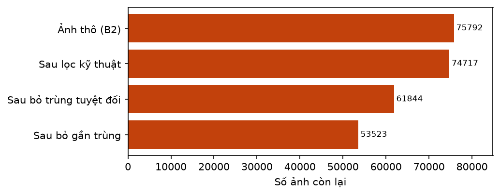
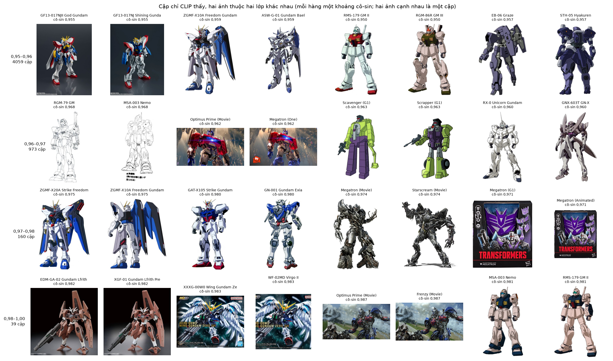
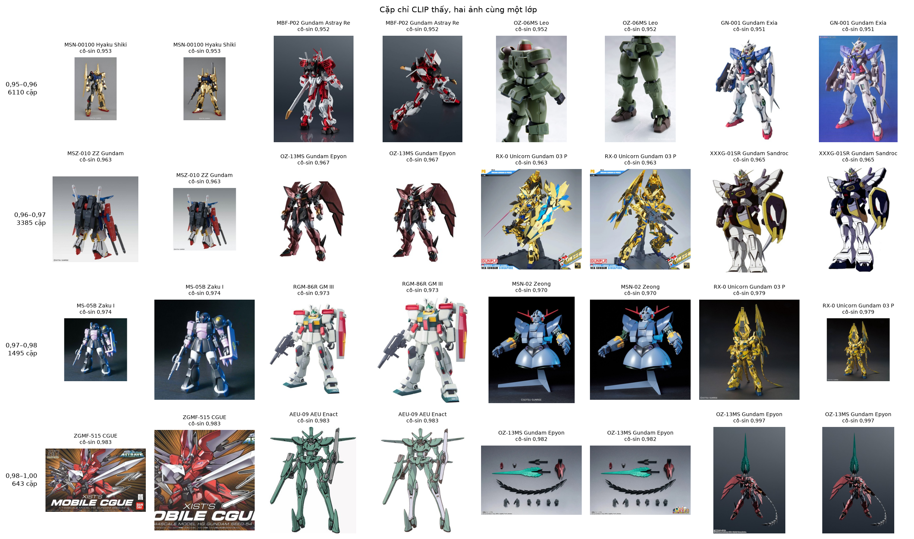
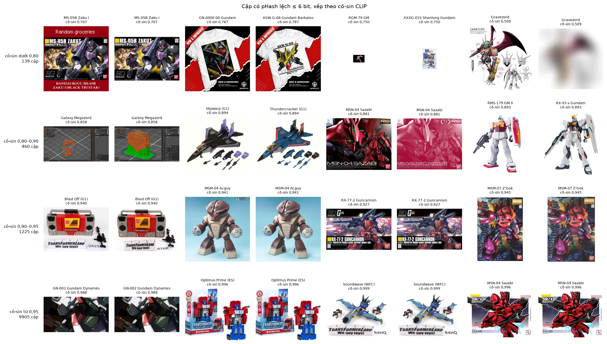
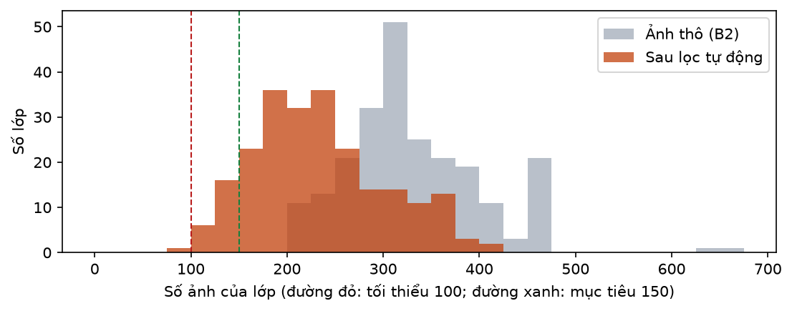
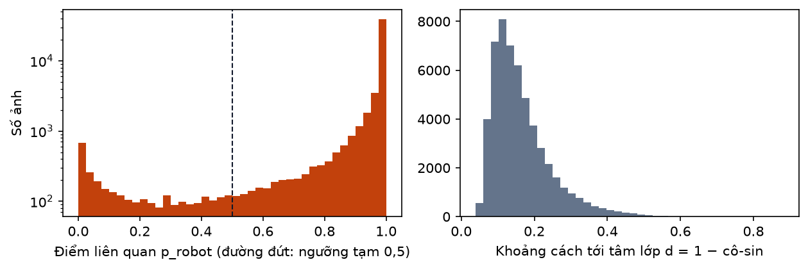
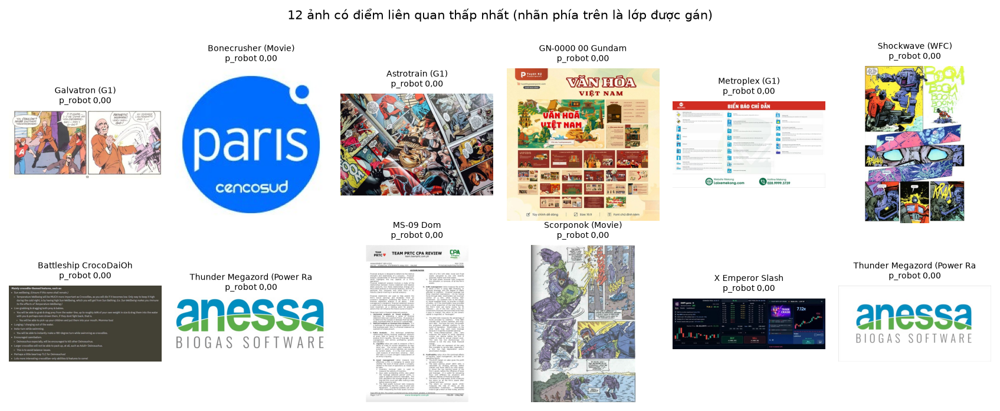
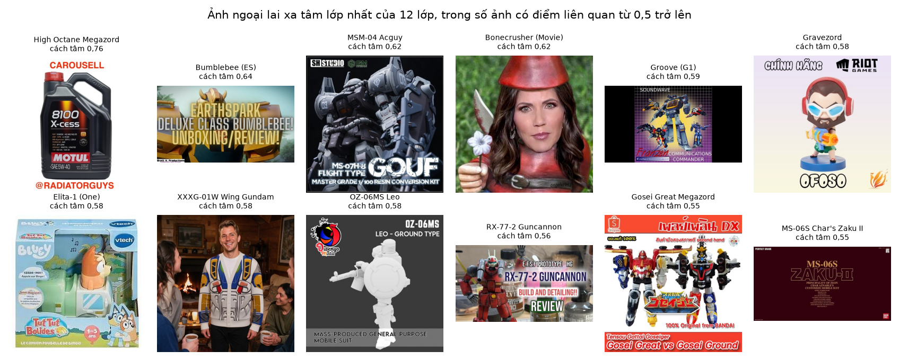
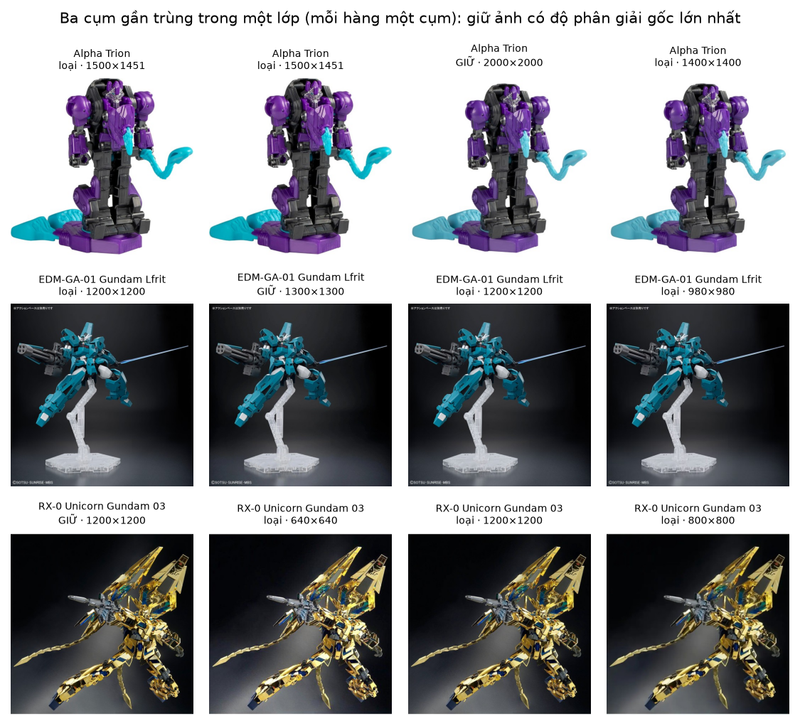
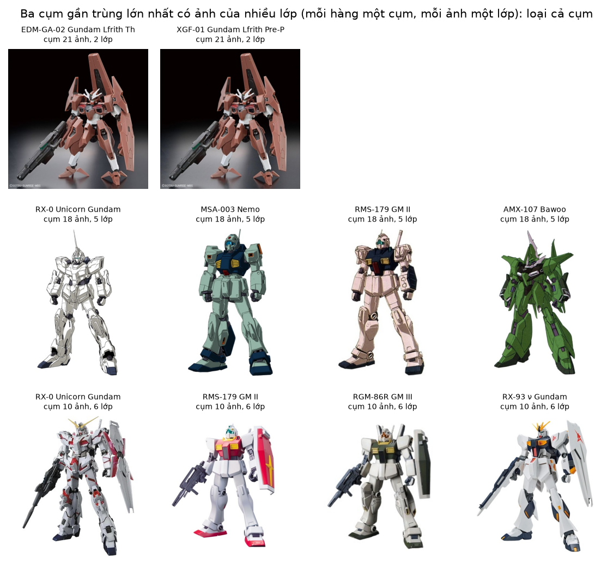

# B03a. Làm sạch tự động ảnh thô (phần máy của B3)

Báo cáo sinh tự động bởi `ml/` (mẫu ở `docs/nhan-dang-robot/00-ke-hoach.md` mục 6). Thời gian chạy: 8.0 giây. Số liệu máy đọc: `ml/reports/B03a/summary.json`.

## 1. Mục tiêu

Lọc bằng máy toàn bộ ảnh thô của B2 trước khi con người kiểm định: bỏ ảnh quá nhỏ hoặc méo, bỏ bản trùng và ảnh gần trùng, loại ảnh có nhãn mâu thuẫn; chấm cho mỗi ảnh còn lại một **điểm liên quan** (có phải ảnh robot không), một cờ **ngoại lai** (có khác hẳn các ảnh cùng lớp không) và một **miền ảnh** (đồ chơi, hoạt hình, CGI, tranh vẽ, hộp). Bước này **chưa** đo độ chính xác nhãn: con số đó chỉ có sau khi chủ dự án chấm tay hai mẫu do bước này sinh ra (báo cáo B03). Đóng góp vào RQ1.

## 2. Đầu vào, đầu ra

- Đầu vào: manifest ảnh thô của B2 (75792 dòng, 230 lớp; bản nén `ml/data/manifests/b02_manifest.csv.gz`), ảnh tại `C:\Users\THINKPAD\WEB_MO_HINH\ml\data\store\images\raw` (không vào git), danh mục `robots.json`.
- Đầu ra (ở `C:\Users\THINKPAD\WEB_MO_HINH\ml\data\store\b03`, không vào git vì gắn với ảnh): `scores.csv` mỗi dòng manifest một dòng (giữ hay loại, lý do, pHash, cụm, điểm liên quan, khoảng cách tới tâm lớp, cờ ngoại lai, miền ảnh, cờ nghi ngờ, tên máy chủ nguồn); `pairs.csv` mọi cặp ảnh gần trùng; `kiem-dinh-truoc-loc.html` (500 ảnh cho chủ dự án chấm) và `duyet-tay.html` (duyệt từng lớp).
- Bản tóm tắt vào git: báo cáo này, `ml/reports/B03a/summary.json`, hình `ml/reports/B03a/*.png`, `ml/data/manifests/b03a_scores.csv.gz` (bản nén của `scores.csv`).
- Không xoá file ảnh nào: "loại" chỉ là đánh dấu trong `scores.csv`.

## 3. Công cụ và môi trường

**Môi trường**

| Mục | Giá trị |
| --- | --- |
| Thời điểm chạy (UTC) | 2026-11-11T07:02:14+00:00 |
| Hệ điều hành | Windows 11 (build 10.0.26300, AMD64) |
| Python | 3.11.9 |
| CPU | 12th Gen Intel(R) Core(TM) i7-12800H (20 luồng) |
| RAM | 31.7 GB |
| GPU (PyTorch) | NVIDIA RTX A2000 Laptop GPU (4.0 GB) |
| CUDA của PyTorch | 12.8 |
| Driver (nvidia-smi) | NVIDIA RTX A2000 Laptop GPU, 4096 MiB, 596.52 |
| Google Colab | không |
| Commit git | c56347e (có thay đổi chưa commit) |

**Phiên bản thư viện**

| Thư viện | Phiên bản |
| --- | --- |
| ImageHash | 4.3.2 |
| Pillow | 13.0.0 |
| ddgs | 9.16.1 |
| matplotlib | 3.11.2 |
| mwparserfromhell | 0.7.2 |
| numpy | 2.4.6 |
| open_clip_torch | 4.2.1 |
| pandas | 3.1.1 |
| rapidfuzz | 3.14.6 |
| requests | 2.34.2 |
| scipy | 1.17.1 |
| timm | 1.0.31 |
| torch | 2.11.0+cu128 |
| torchvision | 0.26.0+cu128 |

Thời gian chạy phần tự động: 13,2 phút cho lần đầu (pHash của 61844 ảnh trên CPU, đặc trưng ViT-L-14/openai trên GPU ở fp16, tìm cặp gần trùng, sinh hai trang duyệt); chạy lại với luật gần trùng đã sửa mất 30 giây vì đặc trưng đã lưu cache.

## 4. Phương pháp

Phễu lọc chạy theo thứ tự dưới đây; ảnh bị loại ở bước trước không vào bước sau.

- **Bước 1, lọc kỹ thuật.** Loại ảnh có cạnh ngắn của ảnh *gốc* dưới 128 px, hoặc tỉ lệ cạnh dài / cạnh ngắn trên 3. Kích thước gốc đã ghi trong manifest lúc tải.
- **Bước 2, trùng tuyệt đối.** Hai file cùng mã sha1 là giống nhau từng byte. Cùng mã trong một lớp: giữ một bản. Cùng mã ở từ hai lớp trở lên: loại hết, vì không biết nhãn nào đúng (báo cáo B02b).
- **Bước 3, gần trùng.** Hai ảnh được nối với nhau khi **cô-sin đặc trưng CLIP ≥ 0,98**, hoặc khi **pHash lệch không quá 6 bit và cô-sin CLIP ≥ 0,90**. Các ảnh nối với nhau (trực tiếp hoặc qua ảnh trung gian) gom thành một cụm bằng cấu trúc union–find. Cụm chỉ gồm ảnh một lớp: giữ ảnh có số điểm ảnh gốc lớn nhất. Cụm có ảnh của từ hai lớp: loại cả cụm (nhãn mâu thuẫn).
- **Luật này khác kế hoạch, có chủ đích.** Kế hoạch ghi "pHash lệch ≤ 6 bit *hoặc* cô-sin ≥ 0,95". Lần chạy đủ đầu tiên theo luật đó gom được một cụm 2701 ảnh của 134 lớp và loại 5392 ảnh vì "gần trùng giữa các lớp". Mở ảnh ra xem (hình "Cặp chỉ CLIP thấy" bên dưới) thì ở mức cô-sin 0,95–0,97 phần lớn cặp là **hai robot khác nhau vẽ cùng phong cách** (tranh hồ sơ Gundam nền trắng, ảnh hộp cùng bố cục), không phải bản sao; ngược lại, cặp có pHash gần mà cô-sin dưới 0,90 là hai ảnh cùng bố cục nhưng khác nội dung (thẻ thông số, bìa hộp). Vì gom cụm theo liên kết đơn, vài cặp nối nhầm đủ để kéo hàng nghìn ảnh thành một cụm. Hai ngưỡng mới được chọn bằng cách xem mẫu cặp ở từng khoảng điểm (bảng 6, bảng 6b và các hình cặp ảnh), chưa phải hiệu chỉnh trên tập cặp có nhãn.
- **pHash (perceptual hash)**: thu ảnh về 32×32 mức xám, biến đổi cô-sin rời rạc (DCT), lấy 8×8 hệ số tần số thấp, mỗi hệ số thành 1 bit (lớn hơn trung vị hay không), được mã 64 bit. Hai ảnh trông giống nhau (đổi cỡ, nén lại, đổi sáng nhẹ) cho hai mã lệch nhau vài bit. Số bit lệch là **khoảng cách Hamming**: d(a, b) = popcount(a XOR b). Để không phải so mọi cặp, 64 bit được chia thành 7 khối: hai mã lệch ≤ 6 bit thì chắc chắn có một khối trùng hẳn (nguyên lý chuồng bồ câu), nên chỉ cần so các ảnh chung khối.
- **Đặc trưng CLIP**: mạng ViT-L-14/openai (open_clip) biến mỗi ảnh thành một vector 768 chiều, chuẩn hoá về độ dài 1. Độ giống của hai ảnh là **cô-sin** = tích vô hướng của hai vector, từ −1 tới 1. pHash bắt được bản sao bị đổi cỡ hay nén lại; CLIP bắt thêm bản bị cắt, thêm viền, thêm chữ, lật màu. Cô-sin của mọi cặp được tính theo khối trên GPU.
- **Bước 4, điểm liên quan.** CLIP so ảnh với hai nhóm câu mô tả bằng tiếng Anh: nhóm dương (8 câu, ví dụ *"a photo of a toy robot"*) và nhóm âm (10 câu, ví dụ *"a screenshot of a website"*). Xác suất của từng câu là softmax(100 · cô-sin(ảnh, câu)); **điểm liên quan p_robot = tổng xác suất các câu dương**. Điểm gần 1: ảnh giống ảnh robot; gần 0: giống người, chữ, logo, phong cảnh. Cách này gọi là phân loại *zero-shot*: không cần huấn luyện thêm.
- **Bước 5, ngoại lai trong lớp.** Với mỗi lớp: tính tâm lớp là trung bình các vector, bỏ 10% ảnh xa tâm nhất rồi tính lại (trung bình cắt bỏ, để ảnh sai không kéo lệch tâm). Khoảng cách của ảnh tới tâm là d = 1 − cô-sin. Ảnh là ngoại lai khi d > Q3 + 1.5 · IQR (quy tắc Tukey; Q1, Q3 là tứ phân vị của d trong lớp, IQR = Q3 − Q1).
- **Bước 6, miền ảnh.** CLIP zero-shot giữa 5 câu mô tả, lấy câu có xác suất cao nhất: ảnh chụp đồ chơi / mô hình; ảnh chụp màn hình hoạt hình / anime; ảnh CGI / phim; tranh vẽ; hộp sản phẩm.
- **Ảnh nghi ngờ** = còn giữ sau bước 1–3 và (p_robot < 0.5 hoặc là ngoại lai). Ở bước này ảnh nghi ngờ **chưa bị loại**: ngưỡng 0.5 chỉ là tạm thời để xếp ảnh cho người duyệt; ngưỡng chính thức t_rel được chọn trên mẫu 500 ảnh có nhãn tay.
- **Mẫu kiểm định trước lọc**: 500 ảnh lấy ngẫu nhiên (hạt giống 2026) từ ảnh còn lại sau bước 1–3, mỗi lớp ít nhất 2 ảnh, phần còn lại lấy ngẫu nhiên trên toàn tập.

### Giải thích bằng lời thường

- **Phễu lọc** giống sàng gạo nhiều tầng: tầng đầu loại hạt quá nhỏ, tầng sau loại hạt trùng, tầng cuối đánh dấu hạt đáng ngờ để người xem lại.
- **pHash** như một bản phác thảo 64 nét của bức ảnh: hai ảnh chụp lại, đổi cỡ của cùng một hình có phác thảo gần như y hệt, dù file khác nhau từng byte.
- **Đặc trưng CLIP** như toạ độ của ảnh trên một tấm bản đồ ý nghĩa: ảnh cùng nội dung nằm gần nhau. Cô-sin 0,95 trở lên nghĩa là gần như cùng một ảnh.
- **Union–find** là cách gom nhóm bạn bè: A giống B, B giống C thì A, B, C chung một nhóm, dù A và C chưa chắc giống nhau trực tiếp.
- **Điểm liên quan** là câu trả lời của CLIP cho câu hỏi "ảnh này giống ảnh robot hay giống thứ khác?", đổi thành số từ 0 tới 1.
- **Ngoại lai** là ảnh đứng tách khỏi đám đông của lớp: nếu hầu hết ảnh của lớp Grimlock là khủng long máy màu xám vàng thì một ảnh ô tô đỏ sẽ nằm xa tâm.
- Vì sao không để máy loại luôn ảnh nghi ngờ: máy có thể sai (ảnh hộp, tranh vẽ, dạng xe của Transformers dễ bị chấm thấp). Luận văn cần **đo** máy đúng bao nhiêu trước khi tin, nên phải có mẫu do người chấm.

## 5. Kết quả

**Bảng 1. Phễu lọc**

| Bước | Còn lại | Bị loại ở bước này | Còn lại so với ảnh thô |
| --- | --- | --- | --- |
| Ảnh thô (B2) | 75792 | — | 100,0% |
| Sau lọc kỹ thuật | 74717 | 1075 | 98,6% |
| Sau bỏ trùng tuyệt đối | 61844 | 12873 | 81,6% |
| Sau bỏ gần trùng | 53523 | 8321 | 70,6% |



*Hình: Số ảnh còn lại sau từng bước lọc*

**Bảng 2. Lý do loại**

| Lý do loại | Số ảnh | Tỉ lệ trên ảnh thô | Giải thích |
| --- | --- | --- | --- |
| ảnh nhỏ (cạnh ngắn < 128 px) | 893 | 1,2% | Ảnh gốc quá nhỏ (biểu tượng, ảnh thu nhỏ): không đủ chi tiết để nhận ra robot |
| tỉ lệ khung > 3 | 182 | 0,2% | Ảnh quá dài hoặc quá dẹt (banner, dải logo) |
| trùng tuyệt đối giữa các lớp | 12234 | 16,1% | Cùng một file nằm ở từ hai lớp trở lên: nhãn mâu thuẫn, loại cả nhóm (báo cáo B02b) |
| trùng tuyệt đối trong lớp | 639 | 0,8% | Cùng một file lặp lại trong một lớp: giữ một bản |
| gần trùng giữa các lớp | 866 | 1,1% | Cụm ảnh gần giống nhau có ảnh của từ hai lớp trở lên: nhãn mâu thuẫn, loại cả cụm |
| gần trùng trong lớp | 7455 | 9,8% | Cụm ảnh gần giống nhau trong một lớp: giữ ảnh có độ phân giải gốc lớn nhất |

**Bảng 3. Theo nguồn ảnh**

| Nhóm | Ảnh thô | Còn lại | Tỉ lệ còn lại | Loại vì trùng tuyệt đối | Loại vì gần trùng | Nghi ngờ (trong ảnh còn lại) | Trung vị điểm liên quan |
| --- | --- | --- | --- | --- | --- | --- | --- |
| Wiki người hâm mộ | 9856 | 8132 | 82,5% | 9,4% | 4,5% | 7,7% | 1,00 |
| Tìm ảnh (ddgs: DuckDuckGo + Bing) | 65936 | 45391 | 68,8% | 18,1% | 11,9% | 7,8% | 1,00 |

**Bảng 4. Theo franchise**

| Nhóm | Ảnh thô | Còn lại | Tỉ lệ còn lại | Loại vì trùng tuyệt đối | Loại vì gần trùng | Nghi ngờ (trong ảnh còn lại) | Trung vị điểm liên quan |
| --- | --- | --- | --- | --- | --- | --- | --- |
| Transformers | 32038 | 21850 | 68,2% | 21,7% | 8,3% | 7,8% | 0,99 |
| Gundam | 26358 | 19983 | 75,8% | 6,4% | 17,0% | 4,8% | 1,00 |
| Super Sentai / Power Rangers | 17396 | 11690 | 67,2% | 24,4% | 6,7% | 12,8% | 0,99 |

**Bảng 5. Cụm ảnh gần trùng**

| Cỡ cụm | Số cụm | Số ảnh trong các cụm | Trong đó cụm có ảnh của ≥ 2 lớp |
| --- | --- | --- | --- |
| 2 ảnh | 4305 | 8610 | 218 |
| 3–5 ảnh | 1187 | 4051 | 86 |
| 6–10 ảnh | 117 | 806 | 14 |
| 11–50 ảnh | 9 | 152 | 2 |
| trên 50 ảnh | 0 | 0 | 0 |
| Tổng | 5618 | 13619 | 320 |

**Bảng 6. Cặp ảnh ứng viên theo khoảng điểm (tỉ lệ khác lớp cao là dấu hiệu nối nhầm)**

| Nhóm cặp ảnh | Số cặp | Cùng lớp | Khác lớp | Tỉ lệ khác lớp | Coi là gần trùng |
| --- | --- | --- | --- | --- | --- |
| pHash lệch ≤ 6 bit, cô-sin ≥ 0,95 | 9905 | 9512 | 393 | 4,0% | có |
| pHash lệch ≤ 6 bit, cô-sin 0,90–0,95 | 1225 | 1117 | 108 | 8,8% | có |
| pHash lệch ≤ 6 bit, cô-sin 0,80–0,90 | 460 | 289 | 171 | 37,2% | không |
| pHash lệch ≤ 6 bit, cô-sin dưới 0,80 | 139 | 29 | 110 | 79,1% | không |
| Chỉ CLIP, cô-sin ≥ 0,99 | 77 | 76 | 1 | 1,3% | có |
| Chỉ CLIP, cô-sin 0,98–0,99 | 605 | 567 | 38 | 6,3% | có |
| Chỉ CLIP, cô-sin 0,97–0,98 | 1655 | 1495 | 160 | 9,7% | không |
| Chỉ CLIP, cô-sin 0,96–0,97 | 4358 | 3385 | 973 | 22,3% | không |
| Chỉ CLIP, cô-sin 0,95–0,96 | 10169 | 6110 | 4059 | 39,9% | không |

**Bảng 6b. Hai luật gần trùng trên cùng dữ liệu**

| Chỉ số | Luật của kế hoạch (pHash ≤ 6 hoặc cô-sin ≥ 0,95) | Luật đã sửa (báo cáo này) |
| --- | --- | --- |
| Số cặp được coi là gần trùng | 38498 | 11766 |
| Số cụm | 6178 | 5618 |
| Cụm lớn nhất (ảnh) | 2701 | 24 |
| Cụm có ảnh của ≥ 2 lớp | 627 | 320 |
| Ảnh loại vì gần trùng giữa các lớp | 5392 | 866 |
| Ảnh loại vì gần trùng trong lớp | 8816 | 7455 |
| Ảnh còn lại sau bước 3 | 47636 | 53523 |

Số cặp ở cột luật của kế hoạch đếm riêng cặp pHash và cặp CLIP nên một cặp thoả cả hai được tính hai lần.



*Hình: Cặp chỉ CLIP thấy, khác lớp: dưới 0,97 hầu hết là hai robot khác nhau cùng phong cách vẽ; từ 0,98 phần lớn là cùng một ảnh, nhưng vẫn còn cặp robot khác nhau dùng chung khung vẽ (ví dụ Nemo và GM II)*



*Hình: Cặp chỉ CLIP thấy, cùng lớp: dưới 0,97 thường là hai ảnh chụp khác nhau của cùng một mô hình (đều có ích cho huấn luyện)*



*Hình: Cặp pHash gần nhau: cô-sin thấp là hai ảnh cùng bố cục nhưng khác nội dung; cô-sin cao là bản sao thật*

**Bảng 7. Số ảnh mỗi lớp sau lọc tự động (trước khi người duyệt)**

| Chỉ số | Giá trị |
| --- | --- |
| Ảnh còn lại (mọi lớp) | 53523 |
| Mỗi lớp: nhỏ nhất | 93 |
| Mỗi lớp: trung vị | 225,0 |
| Mỗi lớp: trung bình ± độ lệch chuẩn | 232,7 ± 67,7 |
| Mỗi lớp: lớn nhất | 406 |
| Tỉ lệ mất cân bằng (lớn nhất / nhỏ nhất) | 4,37 |
| Số lớp dưới 100 ảnh (ngưỡng tối thiểu của kế hoạch) | 1 |
| Số lớp dưới 150 ảnh (mục tiêu của kế hoạch) | 23 |
| Số lớp dưới 100 ảnh nếu bỏ hết ảnh nghi ngờ | 1 |
| Số lớp dưới 150 ảnh nếu bỏ hết ảnh nghi ngờ | 33 |



*Hình: Phân bố số ảnh mỗi lớp trước và sau lọc tự động*

**Bảng 8. Các lớp dưới 150 ảnh sau lọc tự động**

| Lớp | Franchise | Ảnh thô | Còn lại | Trong đó nghi ngờ | Tỉ lệ bị loại |
| --- | --- | --- | --- | --- | --- |
| Ohsama Gattai King-Ohger ZERO | Super Sentai / Power Rangers | 247 | 93 | 4 | 62,3% |
| Zeo Mega Battlezord | Super Sentai / Power Rangers | 201 | 109 | 4 | 45,8% |
| Optimus Prime (WFC) | Transformers | 316 | 116 | 6 | 63,3% |
| Optimus Prime (ES) | Transformers | 217 | 116 | 13 | 46,5% |
| Long Haul (G1) | Transformers | 210 | 123 | 12 | 41,4% |
| DualDrive Megazord | Super Sentai / Power Rangers | 272 | 123 | 11 | 54,8% |
| Optimus Prime (One) | Transformers | 320 | 123 | 7 | 61,6% |
| AEU-09 AEU Enact | Gundam | 203 | 126 | 3 | 37,9% |
| Vortex (G1) | Transformers | 255 | 128 | 5 | 49,8% |
| Bonecrusher (G1) | Transformers | 220 | 132 | 3 | 40,0% |
| Drag Strip (G1) | Transformers | 206 | 135 | 2 | 34,5% |
| First Aid (G1) | Transformers | 230 | 138 | 17 | 40,0% |
| Wildrider (G1) | Transformers | 211 | 140 | 14 | 33,6% |
| Scrapper (G1) | Transformers | 264 | 141 | 8 | 46,6% |
| Breakdown (G1) | Transformers | 270 | 142 | 9 | 47,4% |
| Scavenger (G1) | Transformers | 247 | 143 | 8 | 42,1% |
| Zeo Megazord | Super Sentai / Power Rangers | 316 | 144 | 12 | 54,4% |
| Groove (G1) | Transformers | 273 | 144 | 8 | 47,3% |
| Hook (G1) | Transformers | 267 | 144 | 5 | 46,1% |
| Brawl (G1) | Transformers | 265 | 145 | 5 | 45,3% |
| Super Zeo Megazord | Super Sentai / Power Rangers | 309 | 147 | 17 | 52,4% |
| ZGMF-600 GuAIZ | Gundam | 210 | 148 | 6 | 29,5% |
| Rescue Megazord | Super Sentai / Power Rangers | 347 | 148 | 5 | 57,3% |

**Bảng 9. Ảnh nghi ngờ (chưa loại, chờ người duyệt)**

| Nhóm | Số ảnh | Tỉ lệ |
| --- | --- | --- |
| Ảnh còn lại sau bước 1–3 | 53523 | 100% |
| Điểm liên quan dưới 0,5 | 2959 | 5,5% |
| Ngoại lai trong lớp (Tukey) | 2101 | 3,9% |
| Vừa điểm thấp vừa ngoại lai | 892 | 1,7% |
| Nghi ngờ (ít nhất một trong hai) | 4168 | 7,8% |



*Hình: Phân bố điểm liên quan (trục dọc theo thang log) và khoảng cách tới tâm lớp*

**Bảng 10. Miền ảnh của các ảnh còn lại (chưa kiểm định)**

| Miền ảnh (CLIP gán) | Số ảnh | Tỉ lệ | Trong đó từ wiki | Tỉ lệ nghi ngờ |
| --- | --- | --- | --- | --- |
| ảnh chụp đồ chơi / mô hình | 31763 | 59,3% | 9,3% | 2,2% |
| ảnh chụp màn hình hoạt hình / anime | 7662 | 14,3% | 39,7% | 13,2% |
| ảnh CGI / phim | 6227 | 11,6% | 26,9% | 19,6% |
| tranh vẽ | 734 | 1,4% | 40,2% | 39,0% |
| hộp sản phẩm | 7137 | 13,3% | 2,3% | 13,2% |

**Bảng 11. 15 trang nguồn nhiều ảnh nhất (ảnh tìm kiếm)**

| Trang nguồn | Ảnh thô | Còn lại | Tỉ lệ còn lại | Tỉ lệ nghi ngờ | Trung vị điểm liên quan |
| --- | --- | --- | --- | --- | --- |
| youtube.com | 3860 | 3150 | 81,6% | 12,2% | 0,99 |
| seibertron.com | 2448 | 2167 | 88,5% | 2,6% | 1,00 |
| transformerland.com | 2611 | 2150 | 82,3% | 2,8% | 0,97 |
| ebay.com | 4087 | 2106 | 51,5% | 7,2% | 0,99 |
| deviantart.com | 2738 | 1787 | 65,3% | 3,4% | 1,00 |
| reddit.com | 2000 | 1494 | 74,7% | 5,4% | 1,00 |
| zerochan.net | 1917 | 1336 | 69,7% | 0,3% | 1,00 |
| carousell.sg | 1884 | 1045 | 55,5% | 8,1% | 0,99 |
| picclick.co.uk | 1168 | 872 | 74,7% | 3,0% | 1,00 |
| carousell.com.my | 1195 | 652 | 54,6% | 6,3% | 0,99 |
| shopee.co.th | 582 | 485 | 83,3% | 6,8% | 1,00 |
| cults3d.com | 632 | 473 | 74,8% | 3,4% | 1,00 |
| shopee.com.my | 535 | 472 | 88,2% | 8,3% | 1,00 |
| picclick.fr | 616 | 465 | 75,5% | 2,4% | 1,00 |
| storage.googleapis.com | 607 | 447 | 73,6% | 6,9% | 0,99 |



*Hình: Ảnh có điểm liên quan thấp nhất: phần lớn không phải ảnh robot*



*Hình: Ảnh ngoại lai có điểm liên quan cao: nhiều ảnh không phải robot (đồ chơi khác, can dầu, người) lọt qua điểm liên quan nhưng bị cờ ngoại lai bắt*



*Hình: Ví dụ cụm ảnh gần trùng trong cùng một lớp*



*Hình: Ví dụ cụm ảnh gần trùng nằm ở nhiều lớp*

**Bảng 12. Số ảnh của 230 lớp**

| Lớp | Franchise | Ảnh thô | Còn lại | Trong đó nghi ngờ | Tỉ lệ bị loại |
| --- | --- | --- | --- | --- | --- |
| Arcee (G1) | Transformers | 286 | 200 | 9 | 30,1% |
| Blades (G1) | Transformers | 286 | 155 | 2 | 45,8% |
| Blast Off (G1) | Transformers | 309 | 193 | 31 | 37,5% |
| Bonecrusher (G1) | Transformers | 220 | 132 | 3 | 40,0% |
| Brawl (G1) | Transformers | 265 | 145 | 5 | 45,3% |
| Breakdown (G1) | Transformers | 270 | 142 | 9 | 47,4% |
| Bruticus (G1) | Transformers | 310 | 213 | 15 | 31,3% |
| Bumblebee (G1) | Transformers | 288 | 187 | 17 | 35,1% |
| Cliffjumper (G1) | Transformers | 281 | 214 | 5 | 23,8% |
| Dead End (G1) | Transformers | 275 | 188 | 31 | 31,6% |
| Defensor (G1) | Transformers | 278 | 170 | 15 | 38,8% |
| Devastator (G1) | Transformers | 294 | 215 | 10 | 26,9% |
| Drag Strip (G1) | Transformers | 206 | 135 | 2 | 34,5% |
| First Aid (G1) | Transformers | 230 | 138 | 17 | 40,0% |
| Galvatron (G1) | Transformers | 318 | 245 | 18 | 23,0% |
| Grimlock (G1) | Transformers | 331 | 265 | 28 | 19,9% |
| Groove (G1) | Transformers | 273 | 144 | 8 | 47,3% |
| Hook (G1) | Transformers | 267 | 144 | 5 | 46,1% |
| Hot Spot (G1) | Transformers | 260 | 161 | 16 | 38,1% |
| Hound (G1) | Transformers | 260 | 154 | 11 | 40,8% |
| Ironhide (G1) | Transformers | 297 | 225 | 9 | 24,2% |
| Jazz (G1) | Transformers | 284 | 189 | 13 | 33,5% |
| Jetfire (G1) | Transformers | 300 | 210 | 20 | 30,0% |
| Long Haul (G1) | Transformers | 210 | 123 | 12 | 41,4% |
| Megatron (G1) | Transformers | 331 | 218 | 19 | 34,1% |
| Menasor (G1) | Transformers | 302 | 217 | 18 | 28,1% |
| Mixmaster (G1) | Transformers | 231 | 167 | 8 | 27,7% |
| Motormaster (G1) | Transformers | 284 | 187 | 8 | 34,2% |
| Onslaught (G1) | Transformers | 262 | 165 | 6 | 37,0% |
| Optimus Prime (G1) | Transformers | 339 | 219 | 29 | 35,4% |
| Hot Rod (G1) | Transformers | 279 | 193 | 13 | 30,8% |
| Scavenger (G1) | Transformers | 247 | 143 | 8 | 42,1% |
| Scrapper (G1) | Transformers | 264 | 141 | 8 | 46,6% |
| Shockwave (G1) | Transformers | 298 | 197 | 12 | 33,9% |
| Skywarp (G1) | Transformers | 280 | 188 | 18 | 32,9% |
| Slag (G1) | Transformers | 320 | 229 | 15 | 28,4% |
| Sludge (G1) | Transformers | 252 | 206 | 8 | 18,3% |
| Snarl (G1) | Transformers | 248 | 176 | 11 | 29,0% |
| Soundwave (G1) | Transformers | 338 | 226 | 14 | 33,1% |
| Star Saber (G1) | Transformers | 320 | 229 | 26 | 28,4% |
| Starscream (G1) | Transformers | 295 | 191 | 13 | 35,3% |
| Streetwise (G1) | Transformers | 340 | 270 | 72 | 20,6% |
| Swindle (G1) | Transformers | 275 | 191 | 7 | 30,5% |
| Swoop (G1) | Transformers | 307 | 202 | 10 | 34,2% |
| Thundercracker (G1) | Transformers | 281 | 194 | 12 | 31,0% |
| Ultra Magnus (G1) | Transformers | 304 | 229 | 9 | 24,7% |
| Volcanicus (POTP) | Transformers | 307 | 202 | 19 | 34,2% |
| Vortex (G1) | Transformers | 255 | 128 | 5 | 49,8% |
| Wheeljack (G1) | Transformers | 266 | 187 | 9 | 29,7% |
| Wildrider (G1) | Transformers | 211 | 140 | 14 | 33,6% |
| Scorponok (G1) | Transformers | 208 | 151 | 14 | 27,4% |
| Fortress Maximus (G1) | Transformers | 278 | 227 | 14 | 18,3% |
| Alpha Trion | Transformers | 268 | 203 | 6 | 24,3% |
| Metroplex (G1) | Transformers | 317 | 257 | 39 | 18,9% |
| Trypticon (G1) | Transformers | 306 | 234 | 20 | 23,5% |
| Mirage (G1) | Transformers | 286 | 205 | 14 | 28,3% |
| Astrotrain (G1) | Transformers | 309 | 242 | 14 | 21,7% |
| Rumble (G1) | Transformers | 269 | 187 | 24 | 30,5% |
| Blurr (G1) | Transformers | 227 | 174 | 5 | 23,3% |
| Skids (G1) | Transformers | 302 | 230 | 18 | 23,8% |
| Bumblebee (Movie) | Transformers | 450 | 344 | 81 | 23,6% |
| Megatron (Movie) | Transformers | 317 | 158 | 4 | 50,2% |
| Optimus Prime (Movie) | Transformers | 353 | 185 | 6 | 47,6% |
| Starscream (Movie) | Transformers | 289 | 180 | 8 | 37,7% |
| Ironhide (Movie) | Transformers | 313 | 228 | 8 | 27,2% |
| Ratchet (Movie) | Transformers | 324 | 248 | 19 | 23,5% |
| Barricade (Movie) | Transformers | 316 | 261 | 37 | 17,4% |
| Sideswipe (Movie) | Transformers | 316 | 227 | 15 | 28,2% |
| Jazz (Movie) | Transformers | 292 | 205 | 10 | 29,8% |
| Arcee (Movie) | Transformers | 280 | 183 | 9 | 34,6% |
| Shockwave (Movie) | Transformers | 296 | 161 | 9 | 45,6% |
| Jetfire (Movie) | Transformers | 313 | 197 | 9 | 37,1% |
| Blackout (Movie) | Transformers | 305 | 238 | 9 | 22,0% |
| Brawl (Movie) | Transformers | 241 | 174 | 12 | 27,8% |
| Frenzy (Movie) | Transformers | 262 | 177 | 11 | 32,4% |
| Hound (Movie) | Transformers | 263 | 159 | 11 | 39,5% |
| Scorponok (Movie) | Transformers | 303 | 218 | 15 | 28,1% |
| Bonecrusher (Movie) | Transformers | 318 | 228 | 37 | 28,3% |
| Arcee (WFC) | Transformers | 317 | 231 | 10 | 27,1% |
| Soundwave (WFC) | Transformers | 299 | 220 | 11 | 26,4% |
| Optimus Prime (WFC) | Transformers | 316 | 116 | 6 | 63,3% |
| Megatron (WFC) | Transformers | 301 | 194 | 10 | 35,5% |
| Shockwave (WFC) | Transformers | 312 | 205 | 15 | 34,3% |
| Wheeljack (Prime) | Transformers | 313 | 253 | 16 | 19,2% |
| Breakdown (WFC) | Transformers | 332 | 251 | 15 | 24,4% |
| Smokescreen (Prime) | Transformers | 293 | 228 | 16 | 22,2% |
| Megatron (BW) | Transformers | 309 | 225 | 17 | 27,2% |
| Optimus Primal (BW) | Transformers | 334 | 261 | 24 | 21,9% |
| Waspinator (BW) | Transformers | 307 | 226 | 16 | 26,4% |
| Lio Convoy (BW) | Transformers | 228 | 164 | 22 | 28,1% |
| Blackarachnia (BW) | Transformers | 323 | 251 | 24 | 22,3% |
| Cheetor (BW) | Transformers | 314 | 238 | 17 | 24,2% |
| Tarantulas (BW) | Transformers | 336 | 268 | 15 | 20,2% |
| Rhinox (BW) | Transformers | 318 | 243 | 15 | 23,6% |
| Dinobot (BW) | Transformers | 318 | 251 | 12 | 21,1% |
| Airazor (BW) | Transformers | 271 | 209 | 12 | 22,9% |
| Optimus Prime (Animated) | Transformers | 325 | 167 | 7 | 48,6% |
| Megatron (Animated) | Transformers | 327 | 191 | 10 | 41,6% |
| Bumblebee (Animated) | Transformers | 327 | 211 | 13 | 35,5% |
| Bulkhead (Animated) | Transformers | 299 | 241 | 16 | 19,4% |
| Bumblebee (Cyberverse) | Transformers | 307 | 235 | 10 | 23,5% |
| Optimus Prime (Cyberverse) | Transformers | 313 | 230 | 8 | 26,5% |
| Optimus Prime (ES) | Transformers | 217 | 116 | 13 | 46,5% |
| Bumblebee (ES) | Transformers | 273 | 181 | 41 | 33,7% |
| Twitch | Transformers | 226 | 172 | 56 | 23,9% |
| Bumblebee (One) | Transformers | 306 | 180 | 13 | 41,2% |
| Optimus Prime (One) | Transformers | 320 | 123 | 7 | 61,6% |
| Megatron (One) | Transformers | 325 | 197 | 41 | 39,4% |
| Elita-1 (One) | Transformers | 265 | 199 | 17 | 24,9% |
| Starscream (One) | Transformers | 312 | 170 | 5 | 45,5% |
| MS-06S Char's Zaku II | Gundam | 386 | 330 | 13 | 14,5% |
| MSM-04 Acguy | Gundam | 399 | 305 | 11 | 23,6% |
| MSZ-006 Zeta Gundam | Gundam | 450 | 365 | 10 | 18,9% |
| RX-78-2 Gundam | Gundam | 460 | 406 | 20 | 11,7% |
| MSN-04 Sazabi | Gundam | 450 | 365 | 11 | 18,9% |
| RX-0 Unicorn Gundam | Gundam | 450 | 381 | 19 | 15,3% |
| RX-0 Unicorn Gundam 03 Phenex | Gundam | 406 | 317 | 5 | 21,9% |
| MS-06F Zaku II | Gundam | 450 | 374 | 22 | 16,9% |
| MS-09 Dom | Gundam | 450 | 393 | 46 | 12,7% |
| RGM-79 GM | Gundam | 450 | 375 | 15 | 16,7% |
| MS-14A Gelgoog | Gundam | 395 | 328 | 13 | 17,0% |
| RX-178 Gundam Mk-II | Gundam | 450 | 373 | 13 | 17,1% |
| MSA-003 Nemo | Gundam | 406 | 302 | 20 | 25,6% |
| RMS-108 Marasai | Gundam | 362 | 300 | 9 | 17,1% |
| RMS-179 GM II | Gundam | 373 | 254 | 14 | 31,9% |
| MSM-07 Z'Gok | Gundam | 381 | 334 | 42 | 12,3% |
| RX-75 Guntank | Gundam | 393 | 310 | 7 | 21,1% |
| RX-77-2 Guncannon | Gundam | 423 | 337 | 13 | 20,3% |
| RMS-106 Hizack | Gundam | 415 | 297 | 9 | 28,4% |
| MS-05B Zaku I | Gundam | 386 | 284 | 8 | 26,4% |
| RMS-099 Rick Dias | Gundam | 400 | 322 | 6 | 19,5% |
| MSN-00100 Hyaku Shiki | Gundam | 450 | 333 | 12 | 26,0% |
| MS-07B Gouf | Gundam | 422 | 354 | 20 | 16,1% |
| MSN-02 Zeong | Gundam | 439 | 339 | 9 | 22,8% |
| RGM-86R GM III | Gundam | 285 | 218 | 9 | 23,5% |
| RX-93 ν Gundam | Gundam | 450 | 404 | 17 | 10,2% |
| AMS-119 Geara Doga | Gundam | 387 | 317 | 8 | 18,1% |
| YMS-15 Gyan | Gundam | 358 | 282 | 13 | 21,2% |
| MSZ-010 ΖΖ Gundam | Gundam | 450 | 334 | 19 | 25,8% |
| AMX-107 Bawoo | Gundam | 404 | 284 | 11 | 29,7% |
| RGM-89 Jegan | Gundam | 381 | 294 | 16 | 22,8% |
| RGC-80 GM Cannon | Gundam | 315 | 226 | 14 | 28,3% |
| XXXG-01W Wing Gundam | Gundam | 450 | 366 | 24 | 18,7% |
| XXXG-00W0 Wing Gundam Zero | Gundam | 450 | 352 | 7 | 21,8% |
| OZ-06MS Leo | Gundam | 394 | 322 | 12 | 18,3% |
| XXXG-01S Shenlong Gundam | Gundam | 359 | 242 | 10 | 32,6% |
| WF-02MD Virgo II | Gundam | 208 | 169 | 34 | 18,8% |
| OZ-13MS Gundam Epyon | Gundam | 397 | 274 | 12 | 31,0% |
| XXXG-01SR Gundam Sandrock | Gundam | 356 | 269 | 17 | 24,4% |
| XXXG-01H Gundam Heavyarms | Gundam | 344 | 266 | 7 | 22,7% |
| ZGMF-X20A Strike Freedom Gundam | Gundam | 450 | 362 | 5 | 19,6% |
| ZGMF-1017 GINN | Gundam | 375 | 263 | 10 | 29,9% |
| ZGMF-X10A Freedom Gundam | Gundam | 450 | 367 | 10 | 18,4% |
| GAT-X105 Strike Gundam | Gundam | 450 | 371 | 13 | 17,6% |
| MBF-M1 M1 Astray | Gundam | 250 | 179 | 15 | 28,4% |
| ZGMF-600 GuAIZ | Gundam | 210 | 148 | 6 | 29,5% |
| ZGMF-515 CGUE | Gundam | 256 | 178 | 6 | 30,5% |
| GAT-X102 Duel Gundam | Gundam | 400 | 287 | 6 | 28,2% |
| MBF-P02 Gundam Astray Red Frame | Gundam | 437 | 353 | 30 | 19,2% |
| GAT-X103 Buster Gundam | Gundam | 375 | 272 | 10 | 27,5% |
| GN-001 Gundam Exia | Gundam | 364 | 266 | 5 | 26,9% |
| GN-003 Gundam Kyrios | Gundam | 388 | 281 | 12 | 27,6% |
| GN-002 Gundam Dynames | Gundam | 389 | 293 | 24 | 24,7% |
| GN-0000 00 Gundam | Gundam | 341 | 187 | 12 | 45,2% |
| GN-000 0 Gundam | Gundam | 367 | 212 | 16 | 42,2% |
| GNX-603T GN-X | Gundam | 314 | 219 | 8 | 30,3% |
| AEU-09 AEU Enact | Gundam | 203 | 126 | 3 | 37,9% |
| ASW-G-08 Gundam Barbatos | Gundam | 351 | 278 | 13 | 20,8% |
| EB-06 Graze | Gundam | 290 | 201 | 24 | 30,7% |
| ASW-G-01 Gundam Bael | Gundam | 316 | 234 | 28 | 25,9% |
| UGY-R38 Spinner Rodi | Gundam | 243 | 161 | 9 | 33,7% |
| EB-05s Schwalbe Graze | Gundam | 237 | 162 | 8 | 31,6% |
| STH-05 Hyakuren | Gundam | 237 | 166 | 9 | 30,0% |
| XVX-016 Gundam Aerial | Gundam | 450 | 363 | 15 | 19,3% |
| XGF-01 Gundam Lfrith Pre-Production Model | Gundam | 352 | 198 | 7 | 43,8% |
| EDM-GA-02 Gundam Lfrith Thorn | Gundam | 450 | 187 | 3 | 58,4% |
| EDM-GA-01 Gundam Lfrith Ur | Gundam | 311 | 157 | 6 | 49,5% |
| GF13-017NJII God Gundam | Gundam | 450 | 345 | 21 | 23,3% |
| JDG-00X Devil Gundam | Gundam | 280 | 222 | 26 | 20,7% |
| GF13-017NJ Shining Gundam | Gundam | 338 | 248 | 10 | 26,6% |
| Wild Force Megazord | Super Sentai / Power Rangers | 434 | 360 | 15 | 17,1% |
| Shogun Megazord | Super Sentai / Power Rangers | 343 | 260 | 12 | 24,2% |
| Dino Megazord | Super Sentai / Power Rangers | 450 | 328 | 26 | 27,1% |
| Ninja Megazord | Super Sentai / Power Rangers | 361 | 169 | 11 | 53,2% |
| Legendary Megazord | Super Sentai / Power Rangers | 364 | 228 | 14 | 37,4% |
| Ninja Steel Megazord | Super Sentai / Power Rangers | 423 | 261 | 15 | 38,3% |
| Mega Voyager | Super Sentai / Power Rangers | 379 | 293 | 46 | 22,7% |
| Gosei Great Megazord | Super Sentai / Power Rangers | 389 | 323 | 12 | 17,0% |
| Turbo Megazord | Super Sentai / Power Rangers | 350 | 236 | 26 | 32,6% |
| Rescue Megazord | Super Sentai / Power Rangers | 347 | 148 | 5 | 57,3% |
| Zeo Megazord | Super Sentai / Power Rangers | 316 | 144 | 12 | 54,4% |
| Super Zeo Megazord | Super Sentai / Power Rangers | 309 | 147 | 17 | 52,4% |
| Ninja Blaze Megazord | Super Sentai / Power Rangers | 353 | 200 | 14 | 43,3% |
| Galaxy Megazord | Super Sentai / Power Rangers | 401 | 251 | 20 | 37,4% |
| Samurai Megazord | Super Sentai / Power Rangers | 361 | 274 | 17 | 24,1% |
| DriveMax Megazord | Super Sentai / Power Rangers | 421 | 293 | 46 | 30,4% |
| Delta Squad Megazord | Super Sentai / Power Rangers | 380 | 300 | 21 | 21,1% |
| S.W.A.T. Megazord | Super Sentai / Power Rangers | 328 | 212 | 10 | 35,4% |
| Lightspeed Megazord | Super Sentai / Power Rangers | 354 | 180 | 38 | 49,2% |
| Astro Megazord | Super Sentai / Power Rangers | 365 | 229 | 38 | 37,3% |
| Omega Megazord | Super Sentai / Power Rangers | 327 | 205 | 15 | 37,3% |
| Thunder Ultrazord | Super Sentai / Power Rangers | 329 | 246 | 49 | 25,2% |
| Supertrain Megazord | Super Sentai / Power Rangers | 326 | 196 | 22 | 39,9% |
| BattleFleet Battleship | Super Sentai / Power Rangers | 358 | 311 | 85 | 13,1% |
| Ressha Gattai ToQ-Oh | Super Sentai / Power Rangers | 302 | 255 | 27 | 15,6% |
| Battleship CrocoDaiOh | Super Sentai / Power Rangers | 329 | 285 | 114 | 13,4% |
| Ohsama Gattai King-Ohger | Super Sentai / Power Rangers | 287 | 158 | 23 | 44,9% |
| Zenkai Gattai ZenkaiOh | Super Sentai / Power Rangers | 280 | 233 | 36 | 16,8% |
| Gravezord | Super Sentai / Power Rangers | 362 | 298 | 116 | 17,7% |
| X Emperor Slash | Super Sentai / Power Rangers | 317 | 290 | 55 | 8,5% |
| Cosmic Dragon Megazord | Super Sentai / Power Rangers | 381 | 262 | 14 | 31,2% |
| Ptera Freeze Zord Battle Mode | Super Sentai / Power Rangers | 284 | 213 | 13 | 25,0% |
| Ohsama Gattai King-Ohger ZERO | Super Sentai / Power Rangers | 247 | 93 | 4 | 62,3% |
| DualDrive Megazord | Super Sentai / Power Rangers | 272 | 123 | 11 | 54,8% |
| Dai Gattai Don Onitaijin | Super Sentai / Power Rangers | 236 | 183 | 11 | 22,5% |
| Jungle Master Megazord | Super Sentai / Power Rangers | 311 | 234 | 13 | 24,8% |
| Thunder Megazord (Power Rangers Mighty Morphin 2) | Super Sentai / Power Rangers | 649 | 330 | 131 | 49,2% |
| Storm Megazord | Super Sentai / Power Rangers | 395 | 220 | 26 | 44,3% |
| Kyutama Gattai 01*03*05*07*09 KyurenOh | Super Sentai / Power Rangers | 303 | 238 | 21 | 21,5% |
| Bull Rider Megazord | Super Sentai / Power Rangers | 334 | 220 | 15 | 34,1% |
| Thunder Megazord (Ninpu Sentai Hurricaneger / Power Rangers Ninja Storm) | Super Sentai / Power Rangers | 650 | 301 | 37 | 53,7% |
| Titan Megazord | Super Sentai / Power Rangers | 275 | 192 | 15 | 30,2% |
| Giant God TegaSword | Super Sentai / Power Rangers | 364 | 302 | 34 | 17,0% |
| Doubutsu Gattai Tousai Zyuoh | Super Sentai / Power Rangers | 208 | 179 | 13 | 13,9% |
| Jungle Pride Megazord | Super Sentai / Power Rangers | 320 | 214 | 23 | 33,1% |
| Goggle Robo | Super Sentai / Power Rangers | 329 | 304 | 57 | 7,6% |
| Flash Point Megazord | Super Sentai / Power Rangers | 351 | 198 | 20 | 43,6% |
| ValveMax Megazord | Super Sentai / Power Rangers | 333 | 242 | 31 | 27,3% |
| High Octane Megazord | Super Sentai / Power Rangers | 308 | 220 | 41 | 28,6% |
| Zeo Mega Battlezord | Super Sentai / Power Rangers | 201 | 109 | 4 | 45,8% |

## 6. Phân tích

- Từ 75792 ảnh thô còn 53523 ảnh (70,6%). Trùng tuyệt đối làm mất 17,0%, gần trùng thêm 11,0%, lọc kỹ thuật 1,4%.
- Ảnh bị loại vì nhãn mâu thuẫn (cùng ảnh hoặc ảnh gần giống nằm ở nhiều lớp): 13100 ảnh, 17,3% ảnh thô. Đây là cái giá của luật "không tự phân xử": mất cả những ảnh mà một trong các nhãn là đúng.
- Trong 28593 cặp ứng viên, 11766 cặp được coi là gần trùng: 11130 cặp có cả pHash gần lẫn cô-sin cao, 636 cặp chỉ nhờ cô-sin ≥ 0,98; 16827 cặp bị bỏ qua vì là robot khác nhau cùng phong cách hoặc cùng bố cục khác nội dung (bảng 6).
- Đổi luật gần trùng giữ lại thêm 5887 ảnh so với luật của kế hoạch, và cụm lớn nhất giảm từ 2701 xuống 24 ảnh (bảng 6b). Tỉ lệ khác lớp ở bảng 6 là thước đo gián tiếp: bản sao thật hiếm khi mang hai nhãn, nên nhóm cặp nào có tỉ lệ khác lớp cao bất thường thì nhóm đó nhiều cặp nối nhầm.
- Sau lọc tự động mỗi lớp còn 93–406 ảnh, trung vị 225,0; 1 lớp dưới mức tối thiểu 100 và 23 lớp dưới mục tiêu 150 (bảng 8).
- 4168 ảnh (7,8%) bị đánh dấu nghi ngờ. Đây là **cận trên** của số ảnh người duyệt cần xem kỹ, không phải số ảnh sai: độ đúng của cờ này được đo bằng mẫu 500 ảnh.
- Điểm liên quan và miền ảnh là kết quả của CLIP zero-shot, chưa được kiểm định; không dùng các cột này làm kết luận cho tới khi có nhãn tay.
- Hai cờ nghi ngờ bổ sung cho nhau: điểm liên quan bắt ảnh chữ, logo, trang truyện, giao diện web (hình "điểm thấp nhất"); cờ ngoại lai bắt thêm ảnh mà CLIP vẫn cho là "đồ chơi" nhưng chẳng liên quan tới lớp (can dầu nhớt, đồ chơi trẻ em khác, ảnh người; hình "ngoại lai"). Chỉ 892 ảnh bị cả hai cờ cùng đánh dấu.
- Sau khi sửa luật vẫn còn 866 ảnh (1,1%) bị loại vì gần trùng giữa các lớp. Một phần là bản sao thật mang hai nhãn (ảnh hộp Lfrith ở hai lớp Lfrith), một phần là các robot khác nhau dùng chung khung vẽ (hình "cụm nhiều lớp"). Mất mát này nhỏ và được chấp nhận.
- Lớp ít ảnh nhất sau lọc tự động là Ohsama Gattai King-Ohger ZERO (93 ảnh): dưới mức tối thiểu 100 trước cả khi người duyệt loại thêm. Lớp này cần thu thêm ảnh hoặc bỏ lớp; quyết định sau khi có kết quả duyệt tay.

### Việc của chủ dự án sau bước này

- **Trang 1, kiểm định trước lọc** (`C:\Users\THINKPAD\WEB_MO_HINH\ml\data\store\b03\kiem-dinh-truoc-loc.html`): 500 ảnh, mỗi ảnh chọn một trong ba đáp án (đúng robot này / robot khác / không phải robot), dùng phím 1, 2, 3. Ước tính 40–60 phút. Kết quả cho ra **độ chính xác nhãn của ảnh thô sau khi bỏ trùng** (kèm khoảng tin cậy Wilson 95%) và dùng để chọn ngưỡng t_rel, đo precision và recall của hai cờ nghi ngờ.
- **Trang 2, duyệt tay từng lớp** (`C:\Users\THINKPAD\WEB_MO_HINH\ml\data\store\b03\duyet-tay.html`): mỗi lớp hiện các ảnh nghi ngờ trước (4168 ảnh trên toàn tập), bấm vào ảnh sai để loại. Ước tính 3–5 giờ, có thể làm nhiều buổi vì tiến độ tự lưu trong trình duyệt.
- Cả hai trang mở bằng trình duyệt trên máy này (ảnh nằm ở máy, không đưa lên Drive). Làm xong mỗi trang bấm **Tải kết quả (CSV)** và gửi file lại.
- Sau khi có hai file CSV: chốt ngưỡng, áp danh sách loại, lấy mẫu 1.000 ảnh cuối để đo độ chính xác nhãn của bộ dữ liệu sạch (tiêu chí ≥ 95%), viết báo cáo B03.

## 7. Hạn chế và rủi ro

- Chưa có nhãn tay nên chưa có độ chính xác nhãn, chưa có precision và recall của bộ lọc; ngưỡng t_rel = 0,5 là tạm thời.
- Gom cụm theo liên kết đơn (A giống B, B giống C thì chung cụm) có thể nối dài thành cụm lớn; đây là nguyên nhân của cụm 2.701 ảnh ở lần chạy đầu. Với luật đã sửa cụm lớn nhất còn vài chục ảnh (bảng 5), nhưng rủi ro này vẫn cần theo dõi khi đổi dữ liệu.
- Hai ngưỡng cô-sin (0,98 và 0,90 khi có pHash gần) chọn bằng mắt trên mẫu cặp ở từng khoảng điểm, chưa hiệu chỉnh trên tập cặp có nhãn trùng / không trùng; ảnh gần trùng còn sót (cô-sin 0,95–0,98) sẽ được gom chung nhóm khi chia tập ở B4 để không rò rỉ giữa train và test.
- Các robot cùng khuôn chỉ khác màu (Starscream, Thundercracker, Skywarp) cho ảnh rất giống nhau; ảnh của chúng có thể bị coi là gần trùng giữa các lớp và bị loại.
- Tâm lớp giả định ảnh đúng chiếm đa số trong lớp. Lớp có nhiều ảnh sai (hai robot trùng tên) thì tâm bị lệch và cờ ngoại lai kém tin cậy.
- Robot có hai dạng (xe và robot) tạo hai cụm trong một lớp; ảnh dạng xe dễ bị coi là ngoại lai hoặc bị chấm điểm liên quan thấp.
- CLIP được huấn luyện trên ảnh và chữ tiếng Anh trên mạng nên có thiên lệch riêng; miền ảnh gán tự động sẽ được đo trên 200 ảnh có nhãn tay.
- Ảnh có bản quyền của chủ sở hữu; hình minh hoạ chỉ dùng trong báo cáo nghiên cứu, không phân phối lại.

## 8. Tái lập

| Mục | Giá trị |
| --- | --- |
| Cấu hình | ml/configs/b03_lam_sach.yaml |
| Mã cấu hình | 9cbc7dfee620 |
| Hạt giống | 2026 |
| Phiên bản dữ liệu | b02_manifest.csv.gz sha256 72f2ed4c146f |

```bash
ml/.venv/Scripts/python ml/scripts/b03_lam_sach.py --stage auto
ml/.venv/Scripts/python ml/scripts/b03a_bao_cao.py
```
