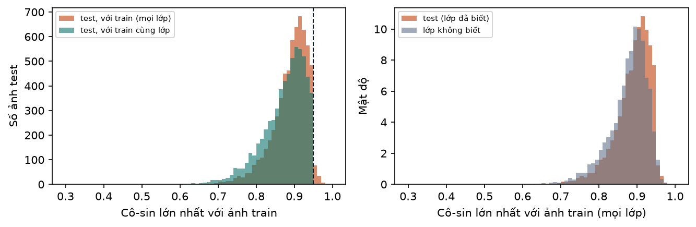
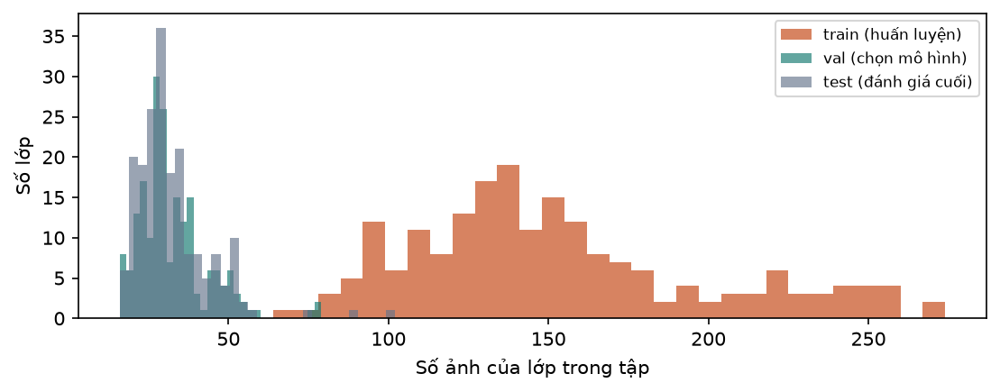

# B04. Chia tập huấn luyện, kiểm tra và lớp "không biết"

Báo cáo sinh tự động bởi `ml/` (mẫu ở `docs/nhan-dang-robot/00-ke-hoach.md` mục 6). Thời gian chạy: 0.6 giây. Số liệu máy đọc: `ml/reports/B04/summary.json`.

## 1. Mục tiêu

Chia bộ ảnh đã làm sạch thành các tập không giao nhau: **train** để huấn luyện, **val** để chọn mô hình và ngưỡng, **test** để lấy số liệu cuối; tách riêng một nhóm **lớp "không biết"** mà mô hình không bao giờ được học, để đo khả năng từ chối robot lạ (RQ5). Kiểm tra không có ảnh gần giống nhau nằm ở hai phía train và test (rò rỉ), vì rò rỉ làm độ chính xác đo được cao giả.

**Bản dữ liệu này là bản tạm.** Chủ dự án chưa chấm tay ở B3, nên ảnh đưa vào chia là ảnh phần máy giữ lại, **bỏ toàn bộ ảnh bị đánh dấu nghi ngờ** (điểm liên quan dưới 0,5 hoặc ngoại lai). Độ chính xác nhãn của bản này **chưa được đo**. Khi có kết quả duyệt tay, chạy lại script này với danh sách loại chính thức; mã phiên bản dữ liệu sẽ đổi và mọi bước sau ghi mã mới.

## 2. Đầu vào, đầu ra

- Đầu vào: `scores.csv` của B03a (75792 dòng; 53523 ảnh còn giữ; 4168 ảnh nghi ngờ bị bỏ ở bản tạm), `pairs.csv` (cặp ảnh có cô-sin ≥ 0,95), đặc trưng CLIP ViT-L/14 đã lưu, `robots.json` (230 lớp).
- Đầu ra: `ml/data/manifests/b04_splits.csv.gz`, 49355 dòng, mỗi ảnh một dòng (lớp, nguồn, file, miền ảnh, nhóm, tập).
- **Mã phiên bản dữ liệu** (`dataset_version`) = sha256 của nội dung `b04_splits.csv`: `dff6fdbb77c0`. Mọi bước sau (B5–B9) ghi mã này.

## 3. Công cụ và môi trường

**Môi trường**

| Mục | Giá trị |
| --- | --- |
| Thời điểm chạy (UTC) | 2026-11-11T14:41:44+00:00 |
| Hệ điều hành | Windows 11 (build 10.0.26300, AMD64) |
| Python | 3.11.9 |
| CPU | 12th Gen Intel(R) Core(TM) i7-12800H (20 luồng) |
| RAM | 31.7 GB |
| GPU (PyTorch) | NVIDIA RTX A2000 Laptop GPU (4.0 GB) |
| CUDA của PyTorch | 12.8 |
| Driver (nvidia-smi) | NVIDIA RTX A2000 Laptop GPU, 4096 MiB, 596.52 |
| Google Colab | không |
| Commit git | c56347e (có thay đổi chưa commit) |

**Phiên bản thư viện**

| Thư viện | Phiên bản |
| --- | --- |
| ImageHash | 4.3.2 |
| Pillow | 13.0.0 |
| ddgs | 9.16.1 |
| matplotlib | 3.11.2 |
| mwparserfromhell | 0.7.2 |
| numpy | 2.4.6 |
| open_clip_torch | 4.2.1 |
| pandas | 3.1.1 |
| rapidfuzz | 3.14.6 |
| requests | 2.34.2 |
| scikit-learn | 1.9.1 |
| scipy | 1.17.1 |
| timm | 1.0.31 |
| torch | 2.11.0+cu128 |
| torchvision | 0.26.0+cu128 |

## 4. Phương pháp

- **Lớp "không biết" (near-OOD).** Lấy 15% số lớp = 35 lớp, chia theo tỉ lệ số lớp của từng franchise (Transformers 17, Gundam 11, Sentai 7), chọn ngẫu nhiên (hạt giống 42) trong các lớp **không phải** robot cửa hàng đang bán, vì web cần nhận ra hàng của cửa hàng. Chia đôi thành lạ-val (chọn ngưỡng từ chối) và lạ-test (đo). Ảnh của các lớp này không bao giờ vào train.
- **Lớp thiếu ảnh.** Lớp có dưới 100 ảnh không đủ để huấn luyện (tiêu chí B3). Thay vì bỏ, lớp đó được đưa vào nhóm lớp "không biết" (chiếm một suất của franchise): ảnh vẫn có ích để đo từ chối, và không cần thu thêm. Lần này: Ohsama Gattai King-Ohger ZERO.
- **Lớp đã biết: train / val / test = 70 / 15 / 15** bằng `StratifiedGroupKFold` của scikit-learn với 20 phần: 3 phần làm test, 3 phần làm val, còn lại làm train. *Stratified*: mỗi phần giữ tỉ lệ các lớp như toàn tập. *Group*: mọi ảnh cùng nhóm nằm chung một phần.
- **Nhóm.** Hai ảnh **cùng lớp** vào chung nhóm khi cô-sin CLIP ≥ 0,95, hoặc pHash lệch ≤ 10 bit, hoặc cùng một trang web nguồn (ví dụ nhiều ảnh của một tin rao bán). Nối bắc cầu bằng union–find. Ảnh wiki không gộp theo trang, vì mọi ảnh wiki của một lớp đều chung một trang.
- **Khác kế hoạch ở hai điểm, có chủ đích.** (1) Kế hoạch ghi nhóm theo "pHash lệch ≤ 10 bit và cùng trang nguồn"; ở đây thêm điều kiện cô-sin ≥ 0,95 để các ảnh gần trùng còn sót sau B3 (cô-sin 0,95–0,98) không nằm ở hai tập. (2) Kế hoạch yêu cầu "không có cặp train–test nào cô-sin ≥ 0,95". B03a đã cho thấy **hai robot khác nhau vẽ cùng phong cách cũng đạt cô-sin ≥ 0,95**, nên yêu cầu đó không thể thoả và cũng không đúng nghĩa rò rỉ. Tiêu chí dùng ở đây: **không có cặp train–val hoặc train–test nào *cùng lớp* có cô-sin ≥ 0,95**; cặp khác lớp được đếm và báo riêng.
- **Kiểm tra rò rỉ.** Với mỗi ảnh val/test: tính cô-sin lớn nhất với mọi ảnh train (bất kỳ lớp nào) và với ảnh train cùng lớp. Với ảnh của lớp "không biết": cô-sin lớn nhất với mọi ảnh train, để biết robot lạ giống robot đã biết tới mức nào.
- **So phân bố miền ảnh giữa các tập** bằng kiểm định χ² độc lập trên bảng tập × miền; kèm hệ số Cramér V = √(χ² / (N · (min(hàng, cột) − 1))) để biết mức khác biệt lớn hay nhỏ (với hàng chục nghìn ảnh, khác biệt rất nhỏ cũng cho p nhỏ).
- **Tập âm** (ảnh không phải robot: COCO và đồ chơi khác) được lập ở bước B04b, không nằm trong file này.

### Giải thích bằng lời thường

- **Train / val / test** giống ôn thi: *train* là sách bài tập để học; *val* là đề thi thử để chọn cách học tốt nhất; *test* là đề thi thật, chỉ mở một lần ở cuối. Nếu dùng đề thi thật để chọn cách học thì điểm thi không còn trung thực.
- **Rò rỉ** là khi một câu trong đề thi thật đã có sẵn trong sách bài tập: học sinh thuộc đáp án chứ không phải hiểu bài. Với ảnh, đó là khi cùng một ảnh (hay bản cắt, bản nén lại của nó) nằm ở cả train lẫn test.
- **Chia theo nhóm**: các ảnh gần giống nhau được buộc thành một bó, cả bó đi về một tập. Vì vậy không ảnh nào trong test có "anh em sinh đôi" trong train.
- **Phân tầng**: mỗi tập đều có đủ mọi lớp theo cùng tỉ lệ, để không tập nào thiếu hẳn một robot.
- **Lớp "không biết"**: khách có thể gửi ảnh một robot mà mô hình chưa từng học. Mô hình tốt phải nói "không nhận ra" chứ không đoán bừa. Muốn đo điều đó thì phải giấu hẳn một số robot khỏi lúc huấn luyện, rồi đưa ảnh của chúng ra hỏi.

## 5. Kết quả

**Bảng 1. Kích thước các tập**

| Tập | Số ảnh | Tỉ lệ | Số lớp | Ảnh mỗi lớp: nhỏ nhất | trung vị | lớn nhất | Tỉ lệ ảnh wiki |
| --- | --- | --- | --- | --- | --- | --- | --- |
| train (huấn luyện) | 29513 | 59,8% | 195 | 64 | 141,0 | 274 | 15,6% |
| val (chọn mô hình) | 6325 | 12,8% | 195 | 16 | 30,0 | 79 | 14,9% |
| test (đánh giá cuối) | 6310 | 12,8% | 195 | 16 | 30,0 | 102 | 16,9% |
| lạ-val (lớp không biết) | 3794 | 7,7% | 18 | 89 | 212,0 | 358 | 13,0% |
| lạ-test (lớp không biết) | 3413 | 6,9% | 17 | 103 | 212,0 | 302 | 11,8% |
| Tổng | 49355 | 100% | 230 |  |  |  | 15,2% |

Trong các lớp đã biết: train 70,0%, val 15,0%, test 15,0% (mục tiêu 70 / 15 / 15).

**Bảng 2. Số ảnh từng tập theo franchise**

| Franchise | train | val | test | lạ-val | lạ-test | Lớp đã biết | Lớp không biết |
| --- | --- | --- | --- | --- | --- | --- | --- |
| Transformers | 11848 | 2542 | 2526 | 1797 | 1427 | 93 | 17 |
| Gundam | 11337 | 2440 | 2432 | 1601 | 1206 | 59 | 11 |
| Super Sentai / Power Rangers | 6328 | 1343 | 1352 | 396 | 780 | 43 | 7 |

**Bảng 3. 35 lớp "không biết"**

| Lớp | Franchise | Tập | Số ảnh | Lý do chọn |
| --- | --- | --- | --- | --- |
| ASW-G-08 Gundam Barbatos | Gundam | lạ-test | 265 | ngẫu nhiên |
| RMS-106 Hizack | Gundam | lạ-test | 288 | ngẫu nhiên |
| UGY-R38 Spinner Rodi | Gundam | lạ-test | 152 | ngẫu nhiên |
| XXXG-01S Shenlong Gundam | Gundam | lạ-test | 232 | ngẫu nhiên |
| YMS-15 Gyan | Gundam | lạ-test | 269 | ngẫu nhiên |
| Dino Megazord | Super Sentai / Power Rangers | lạ-test | 302 | ngẫu nhiên |
| Gravezord | Super Sentai / Power Rangers | lạ-test | 182 | ngẫu nhiên |
| Jungle Pride Megazord | Super Sentai / Power Rangers | lạ-test | 191 | ngẫu nhiên |
| Zeo Mega Battlezord | Super Sentai / Power Rangers | lạ-test | 105 | ngẫu nhiên |
| Blackout (Movie) | Transformers | lạ-test | 229 | ngẫu nhiên |
| Ironhide (Movie) | Transformers | lạ-test | 220 | ngẫu nhiên |
| Optimus Prime (Animated) | Transformers | lạ-test | 160 | ngẫu nhiên |
| Optimus Prime (Cyberverse) | Transformers | lạ-test | 222 | ngẫu nhiên |
| Optimus Prime (ES) | Transformers | lạ-test | 103 | ngẫu nhiên |
| Optimus Prime (One) | Transformers | lạ-test | 116 | ngẫu nhiên |
| Sideswipe (Movie) | Transformers | lạ-test | 212 | ngẫu nhiên |
| Starscream (One) | Transformers | lạ-test | 165 | ngẫu nhiên |
| EB-05s Schwalbe Graze | Gundam | lạ-val | 154 | ngẫu nhiên |
| GAT-X105 Strike Gundam | Gundam | lạ-val | 358 | ngẫu nhiên |
| MS-05B Zaku I | Gundam | lạ-val | 276 | ngẫu nhiên |
| OZ-06MS Leo | Gundam | lạ-val | 310 | ngẫu nhiên |
| RGC-80 GM Cannon | Gundam | lạ-val | 212 | ngẫu nhiên |
| RMS-108 Marasai | Gundam | lạ-val | 291 | ngẫu nhiên |
| Ohsama Gattai King-Ohger ZERO | Super Sentai / Power Rangers | lạ-val | 89 | thiếu ảnh (dưới mức tối thiểu) |
| Super Zeo Megazord | Super Sentai / Power Rangers | lạ-val | 130 | ngẫu nhiên |
| Titan Megazord | Super Sentai / Power Rangers | lạ-val | 177 | ngẫu nhiên |
| Arcee (Movie) | Transformers | lạ-val | 174 | ngẫu nhiên |
| Astrotrain (G1) | Transformers | lạ-val | 228 | ngẫu nhiên |
| Bulkhead (Animated) | Transformers | lạ-val | 225 | ngẫu nhiên |
| Cheetor (BW) | Transformers | lạ-val | 221 | ngẫu nhiên |
| Frenzy (Movie) | Transformers | lạ-val | 166 | ngẫu nhiên |
| Megatron (Animated) | Transformers | lạ-val | 181 | ngẫu nhiên |
| Scorponok (G1) | Transformers | lạ-val | 137 | ngẫu nhiên |
| Skids (G1) | Transformers | lạ-val | 212 | ngẫu nhiên |
| Tarantulas (BW) | Transformers | lạ-val | 253 | ngẫu nhiên |

**Bảng 4. Nhóm ảnh dùng khi chia (số cạnh tính trên toàn bộ ảnh, kể cả lớp không biết)**

| Chỉ số | Giá trị |
| --- | --- |
| Số ảnh của lớp đã biết | 42148 |
| Số nhóm | 29949 |
| Nhóm chỉ có 1 ảnh | 25181 |
| Nhóm có từ 2 ảnh | 4768 |
| Ảnh nằm trong nhóm từ 2 ảnh | 16967 (40,3%) |
| Nhóm lớn nhất (ảnh) | 95 |
| Cạnh nối do cô-sin ≥ 0,95 (cùng lớp) | 5035 |
| Cạnh nối do pHash lệch ≤ 10 bit (cùng lớp) | 1511 |
| Cạnh nối do cùng trang nguồn | 10635 |

**Bảng 5. Kiểm tra rò rỉ**

| Tập | Số ảnh | Cô-sin lớn nhất với train: trung vị | phân vị 95% | lớn nhất | Ảnh có cô-sin ≥ 0,95 với train (mọi lớp) | ≥ 0,98 (mọi lớp) | Lớn nhất với train cùng lớp | Ảnh có cô-sin ≥ 0,95 với train cùng lớp |
| --- | --- | --- | --- | --- | --- | --- | --- | --- |
| val (chọn mô hình) | 6325 | 0,899 | 0,945 | 0,978 | 114 (1,80%) | 0 | 0,9500 | 0 |
| test (đánh giá cuối) | 6310 | 0,899 | 0,945 | 0,979 | 118 (1,87%) | 0 | 0,9500 | 0 |
| lạ-val (lớp không biết) | 3794 | 0,885 | 0,939 | 0,974 | 61 (1,61%) | 0 | — | — |
| lạ-test (lớp không biết) | 3413 | 0,891 | 0,944 | 0,975 | 87 (2,55%) | 0 | — | — |



*Hình: Trái: độ giống của ảnh test với ảnh train gần nhất (đường đứt: 0,95). Phải: ảnh của lớp không biết chỉ hơi ít giống ảnh train hơn ảnh test*

**Bảng 6. Miền ảnh (CLIP gán, chưa kiểm định) trong từng tập của lớp đã biết**

| Tập | hộp sản phẩm | tranh vẽ | ảnh CGI / phim | ảnh chụp màn hình hoạt hình / anime | ảnh chụp đồ chơi / mô hình |
| --- | --- | --- | --- | --- | --- |
| train (huấn luyện) | 3742 (12,7%) | 250 (0,8%) | 2996 (10,2%) | 4013 (13,6%) | 18512 (62,7%) |
| val (chọn mô hình) | 822 (13,0%) | 70 (1,1%) | 618 (9,8%) | 847 (13,4%) | 3968 (62,7%) |
| test (đánh giá cuối) | 802 (12,7%) | 51 (0,8%) | 625 (9,9%) | 844 (13,4%) | 3988 (63,2%) |

Kiểm định χ² độc lập: χ² = 6,25, bậc tự do 8, p = 0,619; Cramér V = 0,0086.

Nguồn ảnh (wiki / tìm kiếm) giữa ba tập: tỉ lệ ảnh wiki là 15,6% / 14,9% / 16,9%; χ² = 9,96, bậc tự do 2, p = 0,007; Cramér V = 0,0154.



*Hình: Phân bố số ảnh mỗi lớp trong train, val, test*

**Bảng 7. Số ảnh từng tập của 230 lớp**

| Lớp | Franchise | Vai trò | train | val | test | lạ-val | lạ-test |
| --- | --- | --- | --- | --- | --- | --- | --- |
| Arcee (G1) | Transformers | đã biết | 129 | 28 | 34 | 0 | 0 |
| Blades (G1) | Transformers | đã biết | 109 | 22 | 22 | 0 | 0 |
| Blast Off (G1) | Transformers | đã biết | 111 | 28 | 23 | 0 | 0 |
| Bonecrusher (G1) | Transformers | đã biết | 90 | 20 | 19 | 0 | 0 |
| Brawl (G1) | Transformers | đã biết | 98 | 21 | 21 | 0 | 0 |
| Breakdown (G1) | Transformers | đã biết | 92 | 22 | 19 | 0 | 0 |
| Bruticus (G1) | Transformers | đã biết | 147 | 25 | 26 | 0 | 0 |
| Bumblebee (G1) | Transformers | đã biết | 116 | 25 | 29 | 0 | 0 |
| Cliffjumper (G1) | Transformers | đã biết | 148 | 30 | 31 | 0 | 0 |
| Dead End (G1) | Transformers | đã biết | 111 | 24 | 22 | 0 | 0 |
| Defensor (G1) | Transformers | đã biết | 97 | 38 | 20 | 0 | 0 |
| Devastator (G1) | Transformers | đã biết | 141 | 34 | 30 | 0 | 0 |
| Drag Strip (G1) | Transformers | đã biết | 94 | 20 | 19 | 0 | 0 |
| First Aid (G1) | Transformers | đã biết | 85 | 18 | 18 | 0 | 0 |
| Galvatron (G1) | Transformers | đã biết | 158 | 33 | 36 | 0 | 0 |
| Grimlock (G1) | Transformers | đã biết | 165 | 37 | 35 | 0 | 0 |
| Groove (G1) | Transformers | đã biết | 94 | 23 | 19 | 0 | 0 |
| Hook (G1) | Transformers | đã biết | 98 | 21 | 20 | 0 | 0 |
| Hot Spot (G1) | Transformers | đã biết | 103 | 21 | 21 | 0 | 0 |
| Hound (G1) | Transformers | đã biết | 99 | 23 | 21 | 0 | 0 |
| Ironhide (G1) | Transformers | đã biết | 151 | 33 | 32 | 0 | 0 |
| Jazz (G1) | Transformers | đã biết | 125 | 25 | 26 | 0 | 0 |
| Jetfire (G1) | Transformers | đã biết | 136 | 27 | 27 | 0 | 0 |
| Long Haul (G1) | Transformers | đã biết | 78 | 17 | 16 | 0 | 0 |
| Megatron (G1) | Transformers | đã biết | 139 | 30 | 30 | 0 | 0 |
| Menasor (G1) | Transformers | đã biết | 131 | 27 | 41 | 0 | 0 |
| Mixmaster (G1) | Transformers | đã biết | 111 | 24 | 24 | 0 | 0 |
| Motormaster (G1) | Transformers | đã biết | 125 | 27 | 27 | 0 | 0 |
| Onslaught (G1) | Transformers | đã biết | 106 | 24 | 29 | 0 | 0 |
| Optimus Prime (G1) | Transformers | đã biết | 133 | 28 | 29 | 0 | 0 |
| Hot Rod (G1) | Transformers | đã biết | 127 | 27 | 26 | 0 | 0 |
| Scavenger (G1) | Transformers | đã biết | 92 | 20 | 23 | 0 | 0 |
| Scrapper (G1) | Transformers | đã biết | 93 | 19 | 21 | 0 | 0 |
| Shockwave (G1) | Transformers | đã biết | 129 | 28 | 28 | 0 | 0 |
| Skywarp (G1) | Transformers | đã biết | 108 | 39 | 23 | 0 | 0 |
| Slag (G1) | Transformers | đã biết | 153 | 30 | 31 | 0 | 0 |
| Sludge (G1) | Transformers | đã biết | 128 | 42 | 28 | 0 | 0 |
| Snarl (G1) | Transformers | đã biết | 123 | 21 | 21 | 0 | 0 |
| Soundwave (G1) | Transformers | đã biết | 150 | 30 | 32 | 0 | 0 |
| Star Saber (G1) | Transformers | đã biết | 148 | 28 | 27 | 0 | 0 |
| Starscream (G1) | Transformers | đã biết | 124 | 27 | 27 | 0 | 0 |
| Streetwise (G1) | Transformers | đã biết | 139 | 29 | 30 | 0 | 0 |
| Swindle (G1) | Transformers | đã biết | 128 | 27 | 29 | 0 | 0 |
| Swoop (G1) | Transformers | đã biết | 136 | 27 | 29 | 0 | 0 |
| Thundercracker (G1) | Transformers | đã biết | 130 | 26 | 26 | 0 | 0 |
| Ultra Magnus (G1) | Transformers | đã biết | 154 | 33 | 33 | 0 | 0 |
| Volcanicus (POTP) | Transformers | đã biết | 128 | 27 | 28 | 0 | 0 |
| Vortex (G1) | Transformers | đã biết | 90 | 16 | 17 | 0 | 0 |
| Wheeljack (G1) | Transformers | đã biết | 129 | 24 | 25 | 0 | 0 |
| Wildrider (G1) | Transformers | đã biết | 89 | 18 | 19 | 0 | 0 |
| Scorponok (G1) | Transformers | không biết | 0 | 0 | 0 | 137 | 0 |
| Fortress Maximus (G1) | Transformers | đã biết | 159 | 27 | 27 | 0 | 0 |
| Alpha Trion | Transformers | đã biết | 139 | 30 | 28 | 0 | 0 |
| Metroplex (G1) | Transformers | đã biết | 157 | 30 | 31 | 0 | 0 |
| Trypticon (G1) | Transformers | đã biết | 154 | 30 | 30 | 0 | 0 |
| Mirage (G1) | Transformers | đã biết | 134 | 28 | 29 | 0 | 0 |
| Astrotrain (G1) | Transformers | không biết | 0 | 0 | 0 | 228 | 0 |
| Rumble (G1) | Transformers | đã biết | 114 | 24 | 25 | 0 | 0 |
| Blurr (G1) | Transformers | đã biết | 125 | 22 | 22 | 0 | 0 |
| Skids (G1) | Transformers | không biết | 0 | 0 | 0 | 212 | 0 |
| Bumblebee (Movie) | Transformers | đã biết | 184 | 40 | 39 | 0 | 0 |
| Megatron (Movie) | Transformers | đã biết | 109 | 23 | 22 | 0 | 0 |
| Optimus Prime (Movie) | Transformers | đã biết | 126 | 27 | 26 | 0 | 0 |
| Starscream (Movie) | Transformers | đã biết | 122 | 24 | 26 | 0 | 0 |
| Ironhide (Movie) | Transformers | không biết | 0 | 0 | 0 | 0 | 220 |
| Ratchet (Movie) | Transformers | đã biết | 160 | 34 | 35 | 0 | 0 |
| Barricade (Movie) | Transformers | đã biết | 155 | 35 | 34 | 0 | 0 |
| Sideswipe (Movie) | Transformers | không biết | 0 | 0 | 0 | 0 | 212 |
| Jazz (Movie) | Transformers | đã biết | 137 | 30 | 28 | 0 | 0 |
| Arcee (Movie) | Transformers | không biết | 0 | 0 | 0 | 174 | 0 |
| Shockwave (Movie) | Transformers | đã biết | 106 | 23 | 23 | 0 | 0 |
| Jetfire (Movie) | Transformers | đã biết | 134 | 27 | 27 | 0 | 0 |
| Blackout (Movie) | Transformers | không biết | 0 | 0 | 0 | 0 | 229 |
| Brawl (Movie) | Transformers | đã biết | 114 | 24 | 24 | 0 | 0 |
| Frenzy (Movie) | Transformers | không biết | 0 | 0 | 0 | 166 | 0 |
| Hound (Movie) | Transformers | đã biết | 100 | 21 | 27 | 0 | 0 |
| Scorponok (Movie) | Transformers | đã biết | 143 | 30 | 30 | 0 | 0 |
| Bonecrusher (Movie) | Transformers | đã biết | 133 | 28 | 30 | 0 | 0 |
| Arcee (WFC) | Transformers | đã biết | 152 | 37 | 32 | 0 | 0 |
| Soundwave (WFC) | Transformers | đã biết | 146 | 31 | 32 | 0 | 0 |
| Optimus Prime (WFC) | Transformers | đã biết | 77 | 16 | 17 | 0 | 0 |
| Megatron (WFC) | Transformers | đã biết | 129 | 27 | 28 | 0 | 0 |
| Shockwave (WFC) | Transformers | đã biết | 132 | 29 | 29 | 0 | 0 |
| Wheeljack (Prime) | Transformers | đã biết | 166 | 36 | 35 | 0 | 0 |
| Breakdown (WFC) | Transformers | đã biết | 169 | 34 | 33 | 0 | 0 |
| Smokescreen (Prime) | Transformers | đã biết | 134 | 39 | 39 | 0 | 0 |
| Megatron (BW) | Transformers | đã biết | 146 | 31 | 31 | 0 | 0 |
| Optimus Primal (BW) | Transformers | đã biết | 163 | 34 | 40 | 0 | 0 |
| Waspinator (BW) | Transformers | đã biết | 148 | 30 | 32 | 0 | 0 |
| Lio Convoy (BW) | Transformers | đã biết | 100 | 21 | 21 | 0 | 0 |
| Blackarachnia (BW) | Transformers | đã biết | 158 | 35 | 34 | 0 | 0 |
| Cheetor (BW) | Transformers | không biết | 0 | 0 | 0 | 221 | 0 |
| Tarantulas (BW) | Transformers | không biết | 0 | 0 | 0 | 253 | 0 |
| Rhinox (BW) | Transformers | đã biết | 161 | 33 | 34 | 0 | 0 |
| Dinobot (BW) | Transformers | đã biết | 167 | 36 | 36 | 0 | 0 |
| Airazor (BW) | Transformers | đã biết | 139 | 29 | 29 | 0 | 0 |
| Optimus Prime (Animated) | Transformers | không biết | 0 | 0 | 0 | 0 | 160 |
| Megatron (Animated) | Transformers | không biết | 0 | 0 | 0 | 181 | 0 |
| Bumblebee (Animated) | Transformers | đã biết | 143 | 28 | 27 | 0 | 0 |
| Bulkhead (Animated) | Transformers | không biết | 0 | 0 | 0 | 225 | 0 |
| Bumblebee (Cyberverse) | Transformers | đã biết | 159 | 33 | 33 | 0 | 0 |
| Optimus Prime (Cyberverse) | Transformers | không biết | 0 | 0 | 0 | 0 | 222 |
| Optimus Prime (ES) | Transformers | không biết | 0 | 0 | 0 | 0 | 103 |
| Bumblebee (ES) | Transformers | đã biết | 98 | 21 | 21 | 0 | 0 |
| Twitch | Transformers | đã biết | 81 | 17 | 18 | 0 | 0 |
| Bumblebee (One) | Transformers | đã biết | 118 | 25 | 24 | 0 | 0 |
| Optimus Prime (One) | Transformers | không biết | 0 | 0 | 0 | 0 | 116 |
| Megatron (One) | Transformers | đã biết | 111 | 23 | 22 | 0 | 0 |
| Elita-1 (One) | Transformers | đã biết | 128 | 27 | 27 | 0 | 0 |
| Starscream (One) | Transformers | không biết | 0 | 0 | 0 | 0 | 165 |
| MS-06S Char's Zaku II | Gundam | đã biết | 222 | 47 | 48 | 0 | 0 |
| MSM-04 Acguy | Gundam | đã biết | 207 | 44 | 43 | 0 | 0 |
| MSZ-006 Zeta Gundam | Gundam | đã biết | 249 | 54 | 52 | 0 | 0 |
| RX-78-2 Gundam | Gundam | đã biết | 274 | 57 | 55 | 0 | 0 |
| MSN-04 Sazabi | Gundam | đã biết | 251 | 51 | 52 | 0 | 0 |
| RX-0 Unicorn Gundam | Gundam | đã biết | 257 | 53 | 52 | 0 | 0 |
| RX-0 Unicorn Gundam 03 Phenex | Gundam | đã biết | 222 | 45 | 45 | 0 | 0 |
| MS-06F Zaku II | Gundam | đã biết | 250 | 51 | 51 | 0 | 0 |
| MS-09 Dom | Gundam | đã biết | 244 | 52 | 51 | 0 | 0 |
| RGM-79 GM | Gundam | đã biết | 252 | 54 | 54 | 0 | 0 |
| MS-14A Gelgoog | Gundam | đã biết | 221 | 47 | 47 | 0 | 0 |
| RX-178 Gundam Mk-II | Gundam | đã biết | 255 | 53 | 52 | 0 | 0 |
| MSA-003 Nemo | Gundam | đã biết | 205 | 38 | 39 | 0 | 0 |
| RMS-108 Marasai | Gundam | không biết | 0 | 0 | 0 | 291 | 0 |
| RMS-179 GM II | Gundam | đã biết | 179 | 30 | 31 | 0 | 0 |
| MSM-07 Z'Gok | Gundam | đã biết | 205 | 44 | 43 | 0 | 0 |
| RX-75 Guntank | Gundam | đã biết | 215 | 44 | 44 | 0 | 0 |
| RX-77-2 Guncannon | Gundam | đã biết | 228 | 48 | 48 | 0 | 0 |
| RMS-106 Hizack | Gundam | không biết | 0 | 0 | 0 | 0 | 288 |
| MS-05B Zaku I | Gundam | không biết | 0 | 0 | 0 | 276 | 0 |
| RMS-099 Rick Dias | Gundam | đã biết | 221 | 48 | 47 | 0 | 0 |
| MSN-00100 Hyaku Shiki | Gundam | đã biết | 182 | 37 | 102 | 0 | 0 |
| MS-07B Gouf | Gundam | đã biết | 212 | 79 | 43 | 0 | 0 |
| MSN-02 Zeong | Gundam | đã biết | 233 | 49 | 48 | 0 | 0 |
| RGM-86R GM III | Gundam | đã biết | 147 | 32 | 30 | 0 | 0 |
| RX-93 ν Gundam | Gundam | đã biết | 270 | 60 | 57 | 0 | 0 |
| AMS-119 Geara Doga | Gundam | đã biết | 218 | 46 | 45 | 0 | 0 |
| YMS-15 Gyan | Gundam | không biết | 0 | 0 | 0 | 0 | 269 |
| MSZ-010 ΖΖ Gundam | Gundam | đã biết | 237 | 40 | 38 | 0 | 0 |
| AMX-107 Bawoo | Gundam | đã biết | 225 | 26 | 22 | 0 | 0 |
| RGM-89 Jegan | Gundam | đã biết | 169 | 76 | 33 | 0 | 0 |
| RGC-80 GM Cannon | Gundam | không biết | 0 | 0 | 0 | 212 | 0 |
| XXXG-01W Wing Gundam | Gundam | đã biết | 240 | 51 | 51 | 0 | 0 |
| XXXG-00W0 Wing Gundam Zero | Gundam | đã biết | 242 | 51 | 52 | 0 | 0 |
| OZ-06MS Leo | Gundam | không biết | 0 | 0 | 0 | 310 | 0 |
| XXXG-01S Shenlong Gundam | Gundam | không biết | 0 | 0 | 0 | 0 | 232 |
| WF-02MD Virgo II | Gundam | đã biết | 94 | 21 | 20 | 0 | 0 |
| OZ-13MS Gundam Epyon | Gundam | đã biết | 192 | 36 | 34 | 0 | 0 |
| XXXG-01SR Gundam Sandrock | Gundam | đã biết | 178 | 37 | 37 | 0 | 0 |
| XXXG-01H Gundam Heavyarms | Gundam | đã biết | 182 | 39 | 38 | 0 | 0 |
| ZGMF-X20A Strike Freedom Gundam | Gundam | đã biết | 258 | 49 | 50 | 0 | 0 |
| ZGMF-1017 GINN | Gundam | đã biết | 170 | 36 | 47 | 0 | 0 |
| ZGMF-X10A Freedom Gundam | Gundam | đã biết | 256 | 50 | 51 | 0 | 0 |
| GAT-X105 Strike Gundam | Gundam | không biết | 0 | 0 | 0 | 358 | 0 |
| MBF-M1 M1 Astray | Gundam | đã biết | 118 | 23 | 23 | 0 | 0 |
| ZGMF-600 GuAIZ | Gundam | đã biết | 91 | 31 | 20 | 0 | 0 |
| ZGMF-515 CGUE | Gundam | đã biết | 122 | 28 | 22 | 0 | 0 |
| GAT-X102 Duel Gundam | Gundam | đã biết | 203 | 39 | 39 | 0 | 0 |
| MBF-P02 Gundam Astray Red Frame | Gundam | đã biết | 230 | 47 | 46 | 0 | 0 |
| GAT-X103 Buster Gundam | Gundam | đã biết | 192 | 35 | 35 | 0 | 0 |
| GN-001 Gundam Exia | Gundam | đã biết | 153 | 32 | 76 | 0 | 0 |
| GN-003 Gundam Kyrios | Gundam | đã biết | 195 | 37 | 37 | 0 | 0 |
| GN-002 Gundam Dynames | Gundam | đã biết | 161 | 77 | 31 | 0 | 0 |
| GN-0000 00 Gundam | Gundam | đã biết | 124 | 25 | 26 | 0 | 0 |
| GN-000 0 Gundam | Gundam | đã biết | 138 | 29 | 29 | 0 | 0 |
| GNX-603T GN-X | Gundam | đã biết | 158 | 27 | 26 | 0 | 0 |
| AEU-09 AEU Enact | Gundam | đã biết | 64 | 31 | 28 | 0 | 0 |
| ASW-G-08 Gundam Barbatos | Gundam | không biết | 0 | 0 | 0 | 0 | 265 |
| EB-06 Graze | Gundam | đã biết | 128 | 25 | 24 | 0 | 0 |
| ASW-G-01 Gundam Bael | Gundam | đã biết | 147 | 29 | 30 | 0 | 0 |
| UGY-R38 Spinner Rodi | Gundam | không biết | 0 | 0 | 0 | 0 | 152 |
| EB-05s Schwalbe Graze | Gundam | không biết | 0 | 0 | 0 | 154 | 0 |
| STH-05 Hyakuren | Gundam | đã biết | 119 | 18 | 20 | 0 | 0 |
| XVX-016 Gundam Aerial | Gundam | đã biết | 213 | 47 | 88 | 0 | 0 |
| XGF-01 Gundam Lfrith Pre-Production Model | Gundam | đã biết | 135 | 28 | 28 | 0 | 0 |
| EDM-GA-02 Gundam Lfrith Thorn | Gundam | đã biết | 135 | 24 | 25 | 0 | 0 |
| EDM-GA-01 Gundam Lfrith Ur | Gundam | đã biết | 107 | 23 | 21 | 0 | 0 |
| GF13-017NJII God Gundam | Gundam | đã biết | 236 | 45 | 43 | 0 | 0 |
| JDG-00X Devil Gundam | Gundam | đã biết | 138 | 30 | 28 | 0 | 0 |
| GF13-017NJ Shining Gundam | Gundam | đã biết | 168 | 35 | 35 | 0 | 0 |
| Wild Force Megazord | Super Sentai / Power Rangers | đã biết | 242 | 51 | 52 | 0 | 0 |
| Shogun Megazord | Super Sentai / Power Rangers | đã biết | 173 | 38 | 37 | 0 | 0 |
| Dino Megazord | Super Sentai / Power Rangers | không biết | 0 | 0 | 0 | 0 | 302 |
| Ninja Megazord | Super Sentai / Power Rangers | đã biết | 110 | 24 | 24 | 0 | 0 |
| Legendary Megazord | Super Sentai / Power Rangers | đã biết | 149 | 32 | 33 | 0 | 0 |
| Ninja Steel Megazord | Super Sentai / Power Rangers | đã biết | 173 | 36 | 37 | 0 | 0 |
| Mega Voyager | Super Sentai / Power Rangers | đã biết | 174 | 36 | 37 | 0 | 0 |
| Gosei Great Megazord | Super Sentai / Power Rangers | đã biết | 219 | 45 | 47 | 0 | 0 |
| Turbo Megazord | Super Sentai / Power Rangers | đã biết | 149 | 30 | 31 | 0 | 0 |
| Rescue Megazord | Super Sentai / Power Rangers | đã biết | 99 | 21 | 23 | 0 | 0 |
| Zeo Megazord | Super Sentai / Power Rangers | đã biết | 93 | 20 | 19 | 0 | 0 |
| Super Zeo Megazord | Super Sentai / Power Rangers | không biết | 0 | 0 | 0 | 130 | 0 |
| Ninja Blaze Megazord | Super Sentai / Power Rangers | đã biết | 131 | 27 | 28 | 0 | 0 |
| Galaxy Megazord | Super Sentai / Power Rangers | đã biết | 163 | 33 | 35 | 0 | 0 |
| Samurai Megazord | Super Sentai / Power Rangers | đã biết | 179 | 39 | 39 | 0 | 0 |
| DriveMax Megazord | Super Sentai / Power Rangers | đã biết | 178 | 34 | 35 | 0 | 0 |
| Delta Squad Megazord | Super Sentai / Power Rangers | đã biết | 197 | 41 | 41 | 0 | 0 |
| S.W.A.T. Megazord | Super Sentai / Power Rangers | đã biết | 142 | 30 | 30 | 0 | 0 |
| Lightspeed Megazord | Super Sentai / Power Rangers | đã biết | 99 | 21 | 22 | 0 | 0 |
| Astro Megazord | Super Sentai / Power Rangers | đã biết | 133 | 29 | 29 | 0 | 0 |
| Omega Megazord | Super Sentai / Power Rangers | đã biết | 135 | 27 | 28 | 0 | 0 |
| Thunder Ultrazord | Super Sentai / Power Rangers | đã biết | 138 | 30 | 29 | 0 | 0 |
| Supertrain Megazord | Super Sentai / Power Rangers | đã biết | 121 | 26 | 27 | 0 | 0 |
| BattleFleet Battleship | Super Sentai / Power Rangers | đã biết | 158 | 34 | 34 | 0 | 0 |
| Ressha Gattai ToQ-Oh | Super Sentai / Power Rangers | đã biết | 160 | 34 | 34 | 0 | 0 |
| Battleship CrocoDaiOh | Super Sentai / Power Rangers | đã biết | 119 | 27 | 25 | 0 | 0 |
| Ohsama Gattai King-Ohger | Super Sentai / Power Rangers | đã biết | 95 | 20 | 20 | 0 | 0 |
| Zenkai Gattai ZenkaiOh | Super Sentai / Power Rangers | đã biết | 138 | 30 | 29 | 0 | 0 |
| Gravezord | Super Sentai / Power Rangers | không biết | 0 | 0 | 0 | 0 | 182 |
| X Emperor Slash | Super Sentai / Power Rangers | đã biết | 165 | 36 | 34 | 0 | 0 |
| Cosmic Dragon Megazord | Super Sentai / Power Rangers | đã biết | 166 | 47 | 35 | 0 | 0 |
| Ptera Freeze Zord Battle Mode | Super Sentai / Power Rangers | đã biết | 141 | 30 | 29 | 0 | 0 |
| Ohsama Gattai King-Ohger ZERO | Super Sentai / Power Rangers | không biết | 0 | 0 | 0 | 89 | 0 |
| DualDrive Megazord | Super Sentai / Power Rangers | đã biết | 79 | 16 | 17 | 0 | 0 |
| Dai Gattai Don Onitaijin | Super Sentai / Power Rangers | đã biết | 122 | 24 | 26 | 0 | 0 |
| Jungle Master Megazord | Super Sentai / Power Rangers | đã biết | 154 | 33 | 34 | 0 | 0 |
| Thunder Megazord (Power Rangers Mighty Morphin 2) | Super Sentai / Power Rangers | đã biết | 139 | 30 | 30 | 0 | 0 |
| Storm Megazord | Super Sentai / Power Rangers | đã biết | 136 | 29 | 29 | 0 | 0 |
| Kyutama Gattai 01*03*05*07*09 KyurenOh | Super Sentai / Power Rangers | đã biết | 148 | 33 | 36 | 0 | 0 |
| Bull Rider Megazord | Super Sentai / Power Rangers | đã biết | 144 | 30 | 31 | 0 | 0 |
| Thunder Megazord (Ninpu Sentai Hurricaneger / Power Rangers Ninja Storm) | Super Sentai / Power Rangers | đã biết | 193 | 36 | 35 | 0 | 0 |
| Titan Megazord | Super Sentai / Power Rangers | không biết | 0 | 0 | 0 | 177 | 0 |
| Giant God TegaSword | Super Sentai / Power Rangers | đã biết | 184 | 39 | 45 | 0 | 0 |
| Doubutsu Gattai Tousai Zyuoh | Super Sentai / Power Rangers | đã biết | 115 | 26 | 25 | 0 | 0 |
| Jungle Pride Megazord | Super Sentai / Power Rangers | không biết | 0 | 0 | 0 | 0 | 191 |
| Goggle Robo | Super Sentai / Power Rangers | đã biết | 173 | 37 | 37 | 0 | 0 |
| Flash Point Megazord | Super Sentai / Power Rangers | đã biết | 124 | 27 | 27 | 0 | 0 |
| ValveMax Megazord | Super Sentai / Power Rangers | đã biết | 153 | 28 | 30 | 0 | 0 |
| High Octane Megazord | Super Sentai / Power Rangers | đã biết | 125 | 27 | 27 | 0 | 0 |
| Zeo Mega Battlezord | Super Sentai / Power Rangers | không biết | 0 | 0 | 0 | 0 | 105 |

## 6. Phân tích

- 49355 ảnh, 195 lớp đã biết và 35 lớp không biết. Tỉ lệ thật của train / val / test là 70,0% / 15,0% / 15,0%; lệch nhỏ so với 70 / 15 / 15 vì phải giữ nguyên từng nhóm.
- Lớp ít ảnh nhất có 64 ảnh train, 16 ảnh val, 16 ảnh test. Số ảnh test mỗi lớp nhỏ nên độ chính xác **từng lớp** sẽ có khoảng tin cậy rộng; số liệu chính là trên toàn tập test.
- **Rò rỉ cùng lớp: 0 ảnh** val/test có cô-sin ≥ 0,95 với ảnh train cùng lớp (đạt tiêu chí).
- Có 114 ảnh val và 118 ảnh test đạt cô-sin ≥ 0,95 với một ảnh train **khác lớp**. Đây không phải rò rỉ nhãn: đó là các robot khác nhau vẽ cùng phong cách hoặc cùng khuôn (B03a). Chúng là những ca khó, đáng theo dõi riêng ở B8 (ma trận nhầm lẫn).
- Ảnh của lớp không biết có cô-sin lớn nhất với train chỉ hơi thấp hơn ảnh test (trung vị 0,891 so với 0,899; hình bên phải) và hai phân bố gần như chồng lên nhau: với đặc trưng CLIP chưa tinh chỉnh, robot lạ trông giống robot đã biết gần bằng chính robot đã biết. Từ chối robot lạ sẽ là phần khó của RQ5.
- Miền ảnh giữa ba tập: p = 0,619, Cramér V = 0,0086 (không có khác biệt có ý nghĩa ở mức 0,05; đạt tiêu chí).
- Tỉ lệ ảnh wiki giữa ba tập khác nhau có ý nghĩa thống kê (p = 0,007) nhưng mức khác biệt rất nhỏ: 15,6%, 14,9%, 16,9%, Cramér V = 0,0154. Một cách giải thích (chưa kiểm chứng): ảnh tìm kiếm bị buộc theo trang nguồn nên đi theo bó, ảnh wiki thì không. Với cỡ mẫu hơn 40 nghìn ảnh, chênh 2 điểm phần trăm đã đủ cho p nhỏ; mức này không đáng lo nhưng được ghi lại để B8 báo kết quả tách theo nguồn.

## 7. Hạn chế và rủi ro

- Bản dữ liệu tạm: chưa có nhãn tay, độ chính xác nhãn chưa đo; ảnh sai nhãn còn sót sẽ nằm ở cả train lẫn test. Số liệu của B5–B8 trên bản này là số liệu tạm.
- Bỏ hết ảnh nghi ngờ làm mất cả ảnh đúng mà máy chấm nhầm (dạng xe của Transformers, tranh vẽ), nên bản tạm thiên về ảnh "dễ".
- Miền ảnh do CLIP gán, chưa kiểm định; kiểm định χ² vì thế chỉ có giá trị tham khảo.
- Lớp thiếu ảnh bị ép vào nhóm không biết nên nhóm này không hoàn toàn ngẫu nhiên.
- Nhóm chỉ nối ảnh cùng lớp; hai ảnh gần giống nhau ở hai lớp khác nhau (robot cùng khuôn khác màu) vẫn có thể nằm ở hai tập. Đó là đặc điểm của bài toán, không phải rò rỉ nhãn.
- Tập test lấy từ cùng nguồn với train (web), nên vẫn cùng phân bố; con số trung thực nhất là thử nghiệm thực địa ở B13 với ảnh tự chụp.

## 8. Tái lập

| Mục | Giá trị |
| --- | --- |
| Cấu hình | ml/configs/b04_chia_tap.yaml |
| Mã cấu hình | 93fd90d1b6dd |
| Hạt giống | 42 |
| Phiên bản dữ liệu | b04_splits.csv sha256 dff6fdbb77c0 (đầu vào: b03a_scores.csv.gz sha256 5360d1704bfa) |

```bash
ml/.venv/Scripts/python ml/scripts/b04_chia_tap.py
```
