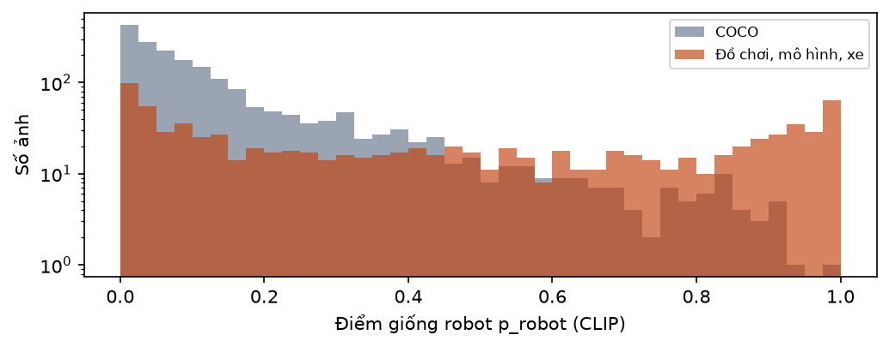
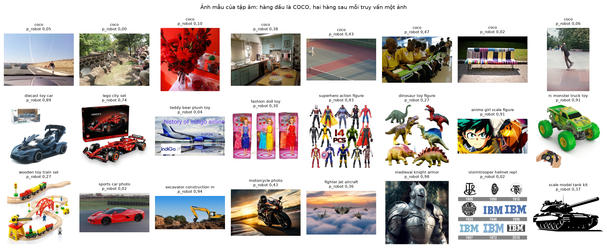
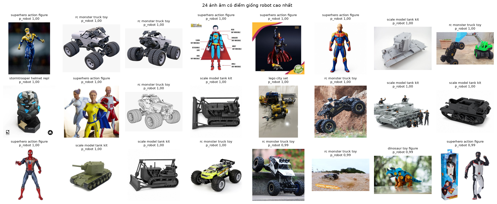

# B04b. Tập âm: ảnh không phải robot

Báo cáo sinh tự động bởi `ml/` (mẫu ở `docs/nhan-dang-robot/00-ke-hoach.md` mục 6). Thời gian chạy: 2.3 giây. Số liệu máy đọc: `ml/reports/B04b/summary.json`.

## 1. Mục tiêu

Lập bộ ảnh **không phải robot** để đo mô hình có biết nói "không nhận ra" khi khách gửi ảnh chẳng liên quan hay không (RQ5, đánh giá ở B8). Bộ này bổ sung cho các lớp "không biết" của B04: lớp không biết là *robot lạ* (near-OOD, khó), còn tập âm là *vật không phải robot* (far-OOD).

## 2. Đầu vào, đầu ra

- Đầu vào: file chú thích `instances_val2017.json` của COCO; kết quả tìm ảnh của 16 truy vấn đồ chơi và xe; manifest B2 (để loại ảnh trùng với bộ robot).
- Đầu ra: `ml/data/manifests/b04b_negatives.csv.gz` (2898 ảnh; mã phiên bản sha256 `488bd3a0c832`), ảnh tại `C:\Users\THINKPAD\WEB_MO_HINH\ml\data\store\images\negatives` (không vào git).

## 3. Công cụ và môi trường

**Môi trường**

| Mục | Giá trị |
| --- | --- |
| Thời điểm chạy (UTC) | 2026-11-11T14:41:25+00:00 |
| Hệ điều hành | Windows 11 (build 10.0.26300, AMD64) |
| Python | 3.11.9 |
| CPU | 12th Gen Intel(R) Core(TM) i7-12800H (20 luồng) |
| RAM | 31.7 GB |
| GPU (PyTorch) | NVIDIA RTX A2000 Laptop GPU (4.0 GB) |
| CUDA của PyTorch | 12.8 |
| Driver (nvidia-smi) | NVIDIA RTX A2000 Laptop GPU, 4096 MiB, 596.52 |
| Google Colab | không |
| Commit git | c56347e (có thay đổi chưa commit) |

**Phiên bản thư viện**

| Thư viện | Phiên bản |
| --- | --- |
| ImageHash | 4.3.2 |
| Pillow | 13.0.0 |
| ddgs | 9.16.1 |
| matplotlib | 3.11.2 |
| mwparserfromhell | 0.7.2 |
| numpy | 2.4.6 |
| open_clip_torch | 4.2.1 |
| pandas | 3.1.1 |
| rapidfuzz | 3.14.6 |
| requests | 2.34.2 |
| scikit-learn | 1.9.1 |
| scipy | 1.17.1 |
| timm | 1.0.31 |
| torch | 2.11.0+cu128 |
| torchvision | 0.26.0+cu128 |

## 4. Phương pháp

- **Nhóm COCO** (2000 ảnh): lấy ngẫu nhiên (hạt giống 42) trong 5.000 ảnh của COCO val2017, bộ ảnh đời thường chuẩn của ngành (người, xe, động vật, đồ vật trong nhà). Mỗi ảnh có giấy phép Creative Commons ghi trong file chú thích; cột `license` của manifest giữ thông tin này.
- **Nhóm đồ chơi, mô hình, xe** (tối đa 70 ảnh mỗi truy vấn, 16 truy vấn): tìm qua `ddgs` như B2. Đây là ảnh âm **khó**: cùng kiểu chụp sản phẩm, cùng nền trắng, có cả thứ trông hơi giống robot (áo giáp, mũ lính, mô hình xe tăng, tượng nhân vật).
- Truy vấn: *diecast toy car*; *lego city set*; *teddy bear plush toy*; *fashion doll toy*; *superhero action figure*; *dinosaur toy figure*; *anime girl scale figure*; *rc monster truck toy*; *wooden toy train set*; *sports car photo*; *excavator construction machine*; *motorcycle photo*; *fighter jet aircraft*; *medieval knight armor*; *stormtrooper helmet replica*; *scale model tank kit*.
- **Tải và chuẩn hoá** như B2: tôn trọng robots.txt, mỗi host cách nhau 1 giây, thu cạnh dài về 512 px, JPEG chất lượng 90, tên file theo sha1.
- **Làm sạch**: bỏ ảnh trùng sha1, bỏ ảnh có sha1 nằm trong bộ ảnh robot của B2, bỏ ảnh có cạnh ngắn dưới 128 px.
- **Điểm giống robot**: cùng phép tính p_robot như B3 (CLIP ViT-L/14, cùng các câu mô tả). Ảnh âm có p_robot cao là ảnh dễ làm mô hình nhầm.
- **Chia tập**: âm-train 50% (chỉ dùng cho thí nghiệm outlier exposure E7), âm-val 25% (chọn ngưỡng từ chối), âm-test 25% (đo). Chia riêng trong từng truy vấn; các ảnh cùng một trang web nguồn đi chung một tập.
- **Khác kế hoạch**: kế hoạch ghi 1.000 ảnh COCO và 500 ảnh đồ chơi, chia đôi val/test. Ở đây lấy gấp đôi để có thêm phần âm-train cho thí nghiệm E7 (kế hoạch B8 cần "ảnh âm của tập train" nhưng B4 chưa dành phần này). Phần val và test vẫn đúng cỡ kế hoạch.

### Giải thích bằng lời thường

- Mô hình phân loại luôn chọn một trong các đáp án nó biết. Đưa ảnh con mèo, nó vẫn sẽ trả lời tên một robot nào đó, trừ khi ta dạy nó cách từ chối.
- **Tập âm** là bộ đề "bẫy": toàn ảnh mà câu trả lời đúng là "không phải robot nào cả". Đếm xem mô hình sập bẫy bao nhiêu lần.
- Ảnh COCO là bẫy dễ (phong cảnh, bữa ăn, đường phố). Ảnh đồ chơi và xe là bẫy khó: trông giống ảnh sản phẩm robot.

## 5. Kết quả

**Bảng 1. Kích thước tập âm**

| Nhóm | Số ảnh | âm-train | âm-val | âm-test | Trung vị p_robot | Ảnh có p_robot ≥ 0,5 |
| --- | --- | --- | --- | --- | --- | --- |
| COCO val2017 | 2000 | 1000 | 500 | 500 | 0,084 | 6,0% |
| Đồ chơi, mô hình, xe | 898 | 451 | 223 | 224 | 0,422 | 43,7% |
| Tổng | 2898 | 1451 | 723 | 724 | 0,117 | 17,7% |

**Bảng 2. Làm sạch tập âm**

| Bước | Số ảnh |
| --- | --- |
| Ảnh tải được | 2941 |
| Bỏ: trùng trong tập âm | 1 |
| Bỏ: cạnh ngắn < 128 px | 7 |
| Vượt hạn mức mỗi nhóm hoặc không đọc được | 35 |
| Còn lại | 2898 |

**Bảng 3. Nhóm đồ chơi, mô hình, xe theo truy vấn**

| Truy vấn | Số ảnh | âm-train | âm-val | âm-test | Trung vị p_robot | Ảnh có p_robot ≥ 0,5 |
| --- | --- | --- | --- | --- | --- | --- |
| diecast toy car | 70 | 34 | 18 | 18 | 0,093 | 8,6% |
| lego city set | 70 | 36 | 17 | 17 | 0,278 | 22,9% |
| teddy bear plush toy | 70 | 35 | 17 | 18 | 0,338 | 30,0% |
| fashion doll toy | 31 | 14 | 10 | 7 | 0,698 | 67,7% |
| superhero action figure | 32 | 16 | 7 | 9 | 0,932 | 93,8% |
| dinosaur toy figure | 70 | 37 | 16 | 17 | 0,418 | 45,7% |
| anime girl scale figure | 25 | 12 | 7 | 6 | 0,259 | 36,0% |
| rc monster truck toy | 70 | 39 | 15 | 16 | 0,955 | 90,0% |
| wooden toy train set | 60 | 30 | 12 | 18 | 0,135 | 10,0% |
| sports car photo | 70 | 34 | 20 | 16 | 0,025 | 1,4% |
| excavator construction machine | 64 | 33 | 16 | 15 | 0,641 | 62,5% |
| motorcycle photo | 21 | 11 | 5 | 5 | 0,317 | 9,5% |
| fighter jet aircraft | 52 | 25 | 15 | 12 | 0,516 | 51,9% |
| medieval knight armor | 70 | 35 | 16 | 19 | 0,643 | 71,4% |
| stormtrooper helmet replica | 54 | 25 | 17 | 12 | 0,362 | 44,4% |
| scale model tank kit | 69 | 35 | 15 | 19 | 0,740 | 63,8% |

**Bảng 4. Giấy phép của ảnh COCO**

| Giấy phép (COCO) | Số ảnh |
| --- | --- |
| Attribution-NonCommercial-ShareAlike License | 580 |
| Attribution-NonCommercial-NoDerivs License | 566 |
| Attribution License | 351 |
| Attribution-NonCommercial License | 250 |
| Attribution-ShareAlike License | 159 |
| Attribution-NoDerivs License | 92 |
| No known copyright restrictions | 2 |



*Hình: Điểm giống robot của ảnh âm (trục dọc thang log): ảnh đồ chơi bị CLIP coi là giống robot nhiều hơn hẳn ảnh COCO*



*Hình: Ảnh mẫu của tập âm*



*Hình: Ảnh âm bị CLIP chấm giống robot nhất: cần xem có lẫn robot thật không*

## 6. Phân tích

- Tập âm có 2898 ảnh: 2000 ảnh COCO và 898 ảnh đồ chơi, mô hình, xe.
- CLIP coi 6,0% ảnh COCO và 43,7% ảnh đồ chơi là "giống robot" (p_robot ≥ 0,5). Nghĩa là bộ lọc "điểm liên quan" của B3 chỉ loại được ảnh đời thường, không loại được đồ chơi khác: phân biệt robot với đồ chơi khác là việc của mô hình và ngưỡng từ chối ở B8.
- Đã mở xem 24 ảnh âm có điểm giống robot cao nhất (hình "giống robot nhất"): xe địa hình, xe tăng mô hình, tượng siêu anh hùng, mũ giáp, không có robot nào của danh mục. Phần còn lại của nhóm đồ chơi chưa được người duyệt từng ảnh, nên vẫn có thể lẫn vài ảnh robot.

## 7. Hạn chế và rủi ro

- Nhóm đồ chơi lấy từ tìm kiếm nên có nhiễu và chưa duyệt tay (kế hoạch yêu cầu duyệt tay); nếu lẫn ảnh robot thì tỉ lệ "chấp nhận nhầm" đo ở B8 sẽ cao giả.
- 16 truy vấn không đại diện cho mọi thứ khách có thể gửi (ảnh chụp màn hình, giấy tờ, ảnh tự sướng). COCO bù một phần.
- Giấy phép ảnh đồ chơi không rõ; chỉ dùng cho nghiên cứu, không phân phối lại. Ảnh COCO có giấy phép Creative Commons ghi theo từng ảnh.

## 8. Tái lập

| Mục | Giá trị |
| --- | --- |
| Cấu hình | ml/configs/b04b_tap_am.yaml |
| Mã cấu hình | 72ebf4865cbf |
| Hạt giống | 42 |
| Phiên bản dữ liệu | b04b_negatives.csv sha256 488bd3a0c832 |

```bash
ml/.venv/Scripts/python ml/scripts/b04b_tap_am.py
```
