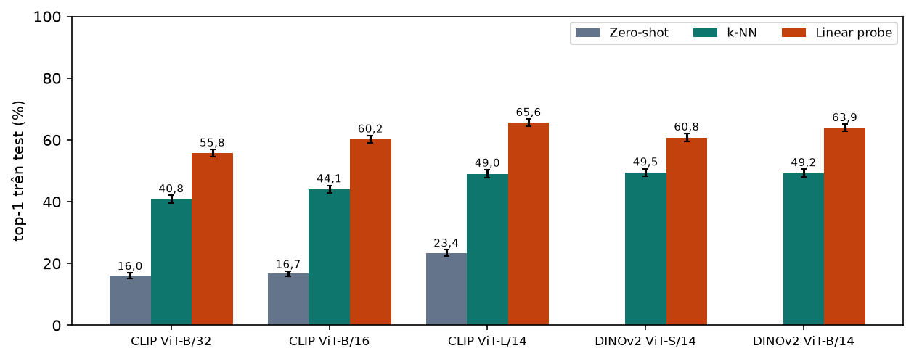
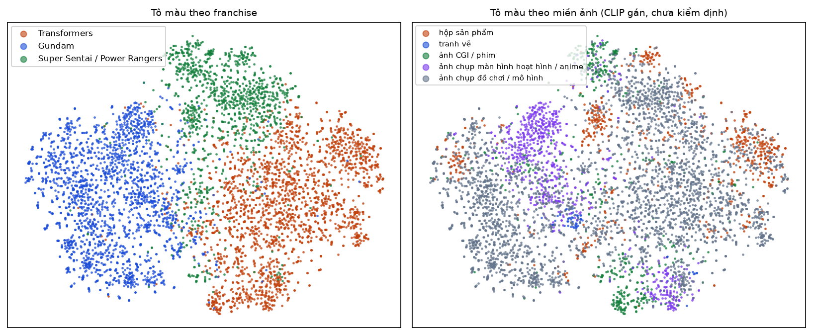

# B05. Mô hình nền trên đặc trưng đóng băng (thí nghiệm E1)

Báo cáo sinh tự động bởi `ml/` (mẫu ở `docs/nhan-dang-robot/00-ke-hoach.md` mục 6). Thời gian chạy: 10.5 giây. Số liệu máy đọc: `ml/reports/B05/summary.json`.

## 1. Mục tiêu

Đặt **mốc so sánh** trước khi huấn luyện: nếu không tinh chỉnh mạng nào, chỉ lấy đặc trưng của các mạng đã huấn luyện sẵn (đóng băng) rồi phân loại bằng phương pháp đơn giản, thì nhận dạng 195 robot đạt bao nhiêu? Con số này trả lời nửa đầu của RQ2; nửa sau (tinh chỉnh tốt hơn bao nhiêu) có ở B6 và B8. Bước này cũng cho biết bộ đặc trưng nào hợp với bài toán, làm căn cứ chọn kiến trúc ở B6.

**Số liệu tạm**: chạy trên bản dữ liệu tạm `dff6fdbb77c0` của B4 (chưa có nhãn tay của B3).

## 2. Đầu vào, đầu ra

- Đầu vào: `b04_splits.csv.gz` (mã `dff6fdbb77c0`): train 29513, val 6325, test 6310 ảnh của 195 lớp đã biết.
- Đầu ra: báo cáo này, `ml/reports/B05/summary.json`; đặc trưng, trọng số linear probe và dự đoán từng ảnh ở `ROBOTREC_DATA/b05/` (không vào git; dùng lại ở B8 để so với mô hình tinh chỉnh).
- Lớp không biết và tập âm đã được trích đặc trưng nhưng chưa dùng ở bước này (để dành cho B8).

## 3. Công cụ và môi trường

**Môi trường**

| Mục | Giá trị |
| --- | --- |
| Thời điểm chạy (UTC) | 2026-11-11T18:04:55+00:00 |
| Hệ điều hành | Windows 11 (build 10.0.26300, AMD64) |
| Python | 3.11.9 |
| CPU | 12th Gen Intel(R) Core(TM) i7-12800H (20 luồng) |
| RAM | 31.7 GB |
| GPU (PyTorch) | NVIDIA RTX A2000 Laptop GPU (4.0 GB) |
| CUDA của PyTorch | 12.8 |
| Driver (nvidia-smi) | NVIDIA RTX A2000 Laptop GPU, 4096 MiB, 596.52 |
| Google Colab | không |
| Commit git | c56347e (có thay đổi chưa commit) |

**Phiên bản thư viện**

| Thư viện | Phiên bản |
| --- | --- |
| ImageHash | 4.3.2 |
| Pillow | 13.0.0 |
| ddgs | 9.16.1 |
| matplotlib | 3.11.2 |
| mwparserfromhell | 0.7.2 |
| numpy | 2.4.6 |
| open_clip_torch | 4.2.1 |
| pandas | 3.1.1 |
| rapidfuzz | 3.14.6 |
| requests | 2.34.2 |
| scikit-learn | 1.9.1 |
| scipy | 1.17.1 |
| timm | 1.0.31 |
| torch | 2.11.0+cu128 |
| torchvision | 0.26.0+cu128 |

## 4. Phương pháp

- **Đặc trưng đóng băng.** Mỗi ảnh đi qua mạng một lần, lấy vector đầu ra, chuẩn hoá L2 (độ dài 1). Trọng số mạng không đổi. CLIP (Radford et al., 2021) học từ 400 triệu cặp ảnh và chữ; DINOv2 (Oquab et al., 2023) tự học từ 142 triệu ảnh, không dùng chữ. Ảnh vào 224×224: CLIP dùng tiền xử lý của open_clip; DINOv2 thu cạnh ngắn về 256 (bicubic), cắt giữa 224, chuẩn hoá theo ImageNet, lấy vector CLS.
- **(a) Zero-shot (chỉ CLIP).** Không dùng ảnh huấn luyện nào. Mỗi lớp được mô tả bằng 5 câu tiếng Anh, ví dụ *"a photo of {name}, a robot from {series}"*; *"a toy figure of {name} from {series}"*. Lấy trung bình 5 vector văn bản, chuẩn hoá L2. Ảnh được gán cho lớp có cô-sin lớn nhất: ŷ = argmax_c cos(f(x), t_c).
- **(b) Linear probe.** Hồi quy logistic đa lớp trên đặc trưng: p(c | x) = softmax(W·f(x) + b). Tìm W, b làm nhỏ nhất Σᵢ −log p(yᵢ | xᵢ) + ‖W‖² / (2C) bằng thuật toán L-BFGS (tối đa 2000 vòng). C là độ mạnh điều chuẩn: C nhỏ ép W nhỏ (chống quá khớp), C lớn cho mô hình tự do hơn. Chọn C trong {0.001, 0.01, 0.1, 1, 10, 100} bằng **5-fold cross-validation** trên train, rồi huấn luyện lại trên toàn bộ train với C tốt nhất.
- **(c) k-NN cô-sin.** Với mỗi ảnh cần đoán, tìm k ảnh train giống nhất (cô-sin lớn nhất); mỗi ảnh láng giềng bỏ phiếu cho lớp của nó với trọng số bằng độ giống; lớp nhiều điểm nhất thắng. k ∈ {1, 5, 10}. Không có bước huấn luyện.
- **Chỉ số.** top-1, top-5, macro-F1 (kế hoạch mục 7.2) trên val và test. Khoảng tin cậy 95% bằng bootstrap 1000 lần theo phân vị: lấy mẫu lại có hoàn lại các ảnh của tập đánh giá. Mô hình và C được chọn **chỉ bằng CV và val**; test không tham gia lựa chọn nào.
- **So sánh hai phương pháp** trên cùng tập test: kiểm định McNemar trên các ảnh mà hai phương pháp đúng/sai khác nhau, hiệu top-1 kèm khoảng tin cậy bootstrap ghép cặp, giá trị p hiệu chỉnh Holm–Bonferroni vì so nhiều cặp.
- **Khác kế hoạch ở ba điểm.** (1) Hồi quy logistic viết bằng PyTorch chạy trên GPU thay cho scikit-learn (cùng hàm mục tiêu, cùng L-BFGS) vì nhanh hơn nhiều lần; đã so khớp với scikit-learn (bảng 7 và test tự động). (2) CV chia theo **nhóm** ảnh gần trùng của B4 (`StratifiedGroupKFold`) thay cho chia phân tầng thường, để hai ảnh gần giống nhau không nằm ở hai phần; nếu không, CV sẽ ưu ái mô hình ít điều chuẩn. (3) Khi C tốt nhất nằm ở mép trên của lưới thì thử tiếp C × 10 (tới 100000), vì đặc trưng đã chuẩn hoá về độ dài 1 cần C lớn.

### Giải thích bằng lời thường

- **Đặc trưng** là bản tóm tắt bằng số của bức ảnh do một mạng đã học sẵn viết ra, như một người sành sỏi mô tả ảnh bằng vài trăm con số. Ở bước này ta không dạy lại người đó.
- **Zero-shot**: đưa cho CLIP tên robot bằng chữ và hỏi ảnh giống tên nào nhất. Không cần ảnh mẫu nào, nhưng CLIP phải tự biết robot đó trông thế nào.
- **k-NN**: "ảnh này giống những ảnh nào đã có nhãn?" rồi lấy theo số đông. Giống tra cứu album ảnh.
- **Linear probe**: kẻ các đường thẳng (mặt phẳng) chia không gian đặc trưng thành vùng của từng robot. Chỉ học lớp cuối, rất nhanh.
- **Cross-validation**: chia train thành 5 phần, lần lượt giấu một phần để chấm thử, lấy trung bình 5 lần. Dùng để chọn C mà không phải đụng tới val hay test.
- **top-1 / top-5**: đáp án đúng là lựa chọn số một, hay nằm trong năm lựa chọn đầu. **macro-F1**: điểm trung bình tính đều cho mọi robot, robot ít ảnh cũng nặng như robot nhiều ảnh.
- **Mốc đoán mò**: chọn bừa một trong 195 lớp thì đúng 0,51%.

## 5. Kết quả

**Bảng 1. Bộ trích đặc trưng (GPU RTX A2000 4 GB, fp16, gồm cả thời gian đọc ảnh)**

| Bộ trích đặc trưng | Số chiều | Tham số phần ảnh (triệu) | Số ảnh đã trích | Thời gian (giây) | Ảnh/giây |
| --- | --- | --- | --- | --- | --- |
| CLIP ViT-B/32 | 512 | 87,8 | 52253 | 68 | 767 |
| CLIP ViT-B/16 | 512 | 86,2 | 52253 | 180 | 290 |
| CLIP ViT-L/14 | 768 | 304,0 | 52253 | 647 | 81 |
| DINOv2 ViT-S/14 | 384 | 21,6 | 52253 | 104 | 500 |
| DINOv2 ViT-B/14 | 768 | 85,7 | 52253 | 236 | 221 |

**Bảng 2. Linear probe: top-1 của 5-fold CV trên train (%, trung bình ± độ lệch chuẩn qua các fold; in đậm: C được chọn)**

| Bộ đặc trưng | C = 0.001 | C = 0.01 | C = 0.1 | C = 1 | C = 10 | C = 100 | C = 1000 | top-1 trên train với C chọn (%) | Thời gian CV + huấn luyện (giây) |
| --- | --- | --- | --- | --- | --- | --- | --- | --- | --- |
| CLIP ViT-B/32 | 0,9 ± 0,0 | 2,9 ± 0,3 | 15,5 ± 0,5 | 40,2 ± 0,6 | **53,5 ± 0,8** | 52,6 ± 0,6 | — | 74,1 | 50 |
| CLIP ViT-B/16 | 0,9 ± 0,0 | 3,0 ± 0,2 | 16,6 ± 0,7 | 43,8 ± 0,5 | **58,0 ± 0,5** | 57,2 ± 0,6 | — | 76,9 | 64 |
| CLIP ViT-L/14 | 0,9 ± 0,0 | 3,8 ± 0,3 | 23,5 ± 0,8 | 52,2 ± 0,7 | **64,1 ± 0,6** | 62,8 ± 0,5 | — | 82,9 | 94 |
| DINOv2 ViT-S/14 | 1,1 ± 0,1 | 4,6 ± 0,3 | 22,3 ± 0,5 | 48,8 ± 0,2 | **58,6 ± 0,7** | 55,4 ± 0,8 | — | 79,5 | 44 |
| DINOv2 ViT-B/14 | 0,9 ± 0,0 | 3,3 ± 0,1 | 19,0 ± 0,8 | 45,7 ± 0,7 | 61,5 ± 0,6 | **62,3 ± 0,7** | 60,9 ± 0,7 | 97,9 | 115 |

**Bảng 3. Kết quả trên val (6325 ảnh)**

| Bộ đặc trưng | Phương pháp | Tham số | top-1 % [KTC 95%] | top-5 % [KTC 95%] | macro-F1 % [KTC 95%] |
| --- | --- | --- | --- | --- | --- |
| CLIP ViT-B/32 | Zero-shot | — | 14,7 [13,8; 15,6] | 34,4 [33,2; 35,5] | 11,8 [11,0; 12,4] |
| CLIP ViT-B/32 | Linear probe | C = 10 | 55,9 [54,6; 57,1] | 77,9 [76,8; 78,8] | 53,3 [51,6; 54,2] |
| CLIP ViT-B/32 | k-NN | k = 1 | 38,0 [36,7; 39,2] | 39,3 [38,1; 40,5] | 36,8 [35,2; 37,7] |
| CLIP ViT-B/32 | k-NN | k = 5 | 39,9 [38,7; 41,1] | 61,3 [60,2; 62,4] | 38,4 [36,7; 39,1] |
| CLIP ViT-B/32 | k-NN | k = 10 | 40,9 [39,7; 42,0] | 64,6 [63,4; 65,8] | 39,2 [37,6; 40,0] |
| CLIP ViT-B/16 | Zero-shot | — | 17,1 [16,2; 17,9] | 36,6 [35,4; 37,8] | 14,4 [13,4; 15,0] |
| CLIP ViT-B/16 | Linear probe | C = 10 | 59,9 [58,8; 61,1] | 81,2 [80,3; 82,2] | 56,7 [55,0; 57,6] |
| CLIP ViT-B/16 | k-NN | k = 1 | 40,7 [39,5; 41,9] | 42,0 [40,7; 43,1] | 39,7 [38,1; 40,5] |
| CLIP ViT-B/16 | k-NN | k = 5 | 42,6 [41,5; 43,8] | 63,4 [62,2; 64,5] | 41,4 [39,8; 42,2] |
| CLIP ViT-B/16 | k-NN | k = 10 | 42,9 [41,7; 44,1] | 67,3 [66,2; 68,3] | 41,4 [39,7; 42,2] |
| CLIP ViT-L/14 | Zero-shot | — | 22,7 [21,7; 23,6] | 45,2 [44,0; 46,3] | 19,5 [18,4; 20,1] |
| CLIP ViT-L/14 | Linear probe | C = 10 | 65,5 [64,3; 66,7] | 84,5 [83,7; 85,5] | 62,9 [61,2; 63,7] |
| CLIP ViT-L/14 | k-NN | k = 1 | 46,7 [45,6; 48,0] | 47,9 [46,7; 49,2] | 45,2 [43,6; 46,1] |
| CLIP ViT-L/14 | k-NN | k = 5 | 49,0 [47,8; 50,2] | 68,9 [67,7; 70,1] | 47,3 [45,6; 48,1] |
| CLIP ViT-L/14 | k-NN | k = 10 | 48,9 [47,7; 50,2] | 73,0 [71,9; 74,2] | 46,9 [45,2; 47,8] |
| DINOv2 ViT-S/14 | Linear probe | C = 10 | 59,9 [58,6; 61,0] | 78,9 [77,8; 79,9] | 57,9 [56,2; 58,8] |
| DINOv2 ViT-S/14 | k-NN | k = 1 | 47,7 [46,5; 48,9] | 48,6 [47,5; 49,9] | 46,9 [45,3; 47,8] |
| DINOv2 ViT-S/14 | k-NN | k = 5 | 48,2 [46,9; 49,4] | 65,4 [64,3; 66,7] | 47,3 [45,6; 48,1] |
| DINOv2 ViT-S/14 | k-NN | k = 10 | 46,4 [45,2; 47,7] | 67,9 [66,8; 69,2] | 45,6 [44,0; 46,5] |
| DINOv2 ViT-B/14 | Linear probe | C = 100 | 63,5 [62,4; 64,7] | 81,0 [80,0; 82,1] | 61,6 [60,0; 62,4] |
| DINOv2 ViT-B/14 | k-NN | k = 1 | 48,4 [47,2; 49,7] | 49,5 [48,3; 50,8] | 48,0 [46,4; 48,9] |
| DINOv2 ViT-B/14 | k-NN | k = 5 | 47,9 [46,6; 49,2] | 66,2 [64,9; 67,4] | 47,4 [45,7; 48,3] |
| DINOv2 ViT-B/14 | k-NN | k = 10 | 47,5 [46,3; 48,8] | 68,5 [67,3; 69,7] | 47,0 [45,3; 47,8] |

**Bảng 4. Kết quả trên test (6310 ảnh)**

| Bộ đặc trưng | Phương pháp | Tham số | top-1 % [KTC 95%] | top-5 % [KTC 95%] | macro-F1 % [KTC 95%] |
| --- | --- | --- | --- | --- | --- |
| CLIP ViT-B/32 | Zero-shot | — | 16,0 [15,2; 16,9] | 34,8 [33,6; 36,0] | 12,9 [12,0; 13,5] |
| CLIP ViT-B/32 | Linear probe | C = 10 | 55,8 [54,6; 56,9] | 77,2 [76,2; 78,2] | 53,4 [51,7; 54,2] |
| CLIP ViT-B/32 | k-NN | k = 1 | 38,7 [37,5; 40,0] | 39,8 [38,5; 41,1] | 37,4 [35,8; 38,4] |
| CLIP ViT-B/32 | k-NN | k = 5 | 40,6 [39,4; 41,9] | 60,9 [59,8; 62,1] | 39,2 [37,6; 40,1] |
| CLIP ViT-B/32 | k-NN | k = 10 | 40,8 [39,6; 42,0] | 64,2 [63,1; 65,4] | 39,7 [38,1; 40,5] |
| CLIP ViT-B/16 | Zero-shot | — | 16,7 [15,8; 17,5] | 36,7 [35,5; 37,8] | 14,5 [13,5; 15,1] |
| CLIP ViT-B/16 | Linear probe | C = 10 | 60,2 [59,0; 61,4] | 80,5 [79,5; 81,4] | 57,6 [55,9; 58,4] |
| CLIP ViT-B/16 | k-NN | k = 1 | 42,1 [40,9; 43,4] | 43,1 [41,9; 44,4] | 40,8 [39,1; 41,7] |
| CLIP ViT-B/16 | k-NN | k = 5 | 43,5 [42,3; 44,8] | 64,1 [62,9; 65,4] | 42,1 [40,5; 42,9] |
| CLIP ViT-B/16 | k-NN | k = 10 | 44,1 [42,8; 45,3] | 67,5 [66,3; 68,6] | 42,4 [40,9; 43,3] |
| CLIP ViT-L/14 | Zero-shot | — | 23,4 [22,3; 24,4] | 45,2 [44,1; 46,4] | 20,4 [19,3; 21,1] |
| CLIP ViT-L/14 | Linear probe | C = 10 | 65,6 [64,5; 66,8] | 84,6 [83,7; 85,5] | 63,5 [61,9; 64,3] |
| CLIP ViT-L/14 | k-NN | k = 1 | 47,4 [46,2; 48,8] | 48,4 [47,2; 49,7] | 46,1 [44,4; 46,9] |
| CLIP ViT-L/14 | k-NN | k = 5 | 49,0 [47,7; 50,3] | 68,7 [67,5; 69,8] | 47,6 [45,9; 48,5] |
| CLIP ViT-L/14 | k-NN | k = 10 | 49,5 [48,4; 50,8] | 72,4 [71,2; 73,4] | 48,0 [46,3; 48,9] |
| DINOv2 ViT-S/14 | Linear probe | C = 10 | 60,8 [59,6; 62,1] | 78,9 [77,9; 79,8] | 58,6 [56,9; 59,5] |
| DINOv2 ViT-S/14 | k-NN | k = 1 | 48,8 [47,6; 50,0] | 49,8 [48,5; 51,0] | 47,9 [46,2; 48,7] |
| DINOv2 ViT-S/14 | k-NN | k = 5 | 49,5 [48,2; 50,7] | 66,2 [65,0; 67,3] | 48,6 [46,9; 49,4] |
| DINOv2 ViT-S/14 | k-NN | k = 10 | 48,1 [46,8; 49,2] | 68,6 [67,4; 69,7] | 47,2 [45,5; 48,1] |
| DINOv2 ViT-B/14 | Linear probe | C = 100 | 63,9 [62,8; 65,1] | 80,9 [79,9; 81,9] | 61,9 [60,3; 62,6] |
| DINOv2 ViT-B/14 | k-NN | k = 1 | 49,2 [48,0; 50,5] | 50,1 [48,9; 51,4] | 48,8 [47,2; 49,7] |
| DINOv2 ViT-B/14 | k-NN | k = 5 | 49,1 [47,9; 50,4] | 66,8 [65,6; 67,8] | 48,9 [47,2; 49,7] |
| DINOv2 ViT-B/14 | k-NN | k = 10 | 47,2 [46,0; 48,4] | 69,3 [68,1; 70,3] | 46,9 [45,2; 47,7] |

Với k-NN k = 1 chỉ một lớp có điểm nên top-5 bằng top-1; top-5 của k-NN chỉ tính trên các lớp xuất hiện trong k láng giềng.



*Hình: top-1 trên test của từng bộ đặc trưng và phương pháp (k-NN lấy k tốt nhất trên val; thanh sai số: khoảng tin cậy 95%)*

**Bảng 5. So sánh từng cặp trên test**

| So sánh (A so với B) | Hiệu top-1, điểm % [KTC 95%] | A đúng, B sai | A sai, B đúng | p (McNemar) | p sau Holm |
| --- | --- | --- | --- | --- | --- |
| CLIP ViT-B/32: linear probe so với zero-shot | 39,7 [38,5; 41,1] | 2694 | 186 | < 0,001 | < 0,001 |
| CLIP ViT-B/32: linear probe so với k-NN tốt nhất | 15,0 [13,7; 16,2] | 1334 | 390 | < 0,001 | < 0,001 |
| CLIP ViT-B/16: linear probe so với zero-shot | 43,5 [42,2; 44,9] | 2886 | 138 | < 0,001 | < 0,001 |
| CLIP ViT-B/16: linear probe so với k-NN tốt nhất | 16,1 [14,9; 17,3] | 1367 | 348 | < 0,001 | < 0,001 |
| CLIP ViT-L/14: linear probe so với zero-shot | 42,2 [40,9; 43,5] | 2800 | 136 | < 0,001 | < 0,001 |
| CLIP ViT-L/14: linear probe so với k-NN tốt nhất | 16,6 [15,4; 17,9] | 1402 | 353 | < 0,001 | < 0,001 |
| DINOv2 ViT-S/14: linear probe so với k-NN tốt nhất | 11,3 [10,1; 12,6] | 1148 | 436 | < 0,001 | < 0,001 |
| DINOv2 ViT-B/14: linear probe so với k-NN tốt nhất | 14,7 [13,4; 15,9] | 1351 | 424 | < 0,001 | < 0,001 |
| Linear probe: CLIP ViT-L/14 so với DINOv2 ViT-B/14 | 1,8 [0,6; 2,9] | 764 | 652 | 0,003 | 0,003 |

**Bảng 6. Cấu hình tốt nhất (CLIP ViT-L/14, linear probe) trên test theo franchise và theo nguồn ảnh**

| Nhóm | Ảnh test | Số lớp | top-1 (%) |
| --- | --- | --- | --- |
| Transformers | 2526 | 93 | 66,0 |
| Gundam | 2432 | 59 | 69,3 |
| Super Sentai / Power Rangers | 1352 | 43 | 58,4 |
| Wiki người hâm mộ | 1065 |  | 60,8 |
| Tìm ảnh | 5245 |  | 66,6 |

**Bảng 6b. 10 lớp khó nhất của cấu hình tốt nhất (mỗi lớp ít ảnh test nên con số dao động mạnh)**

| Lớp | Franchise | Ảnh test | top-1 (%) |
| --- | --- | --- | --- |
| Optimus Prime (WFC) | Transformers | 17 | 5,9 |
| GN-0000 00 Gundam | Gundam | 26 | 23,1 |
| X Emperor Slash | Super Sentai / Power Rangers | 34 | 23,5 |
| DualDrive Megazord | Super Sentai / Power Rangers | 17 | 23,5 |
| GN-000 0 Gundam | Gundam | 29 | 24,1 |
| Bonecrusher (G1) | Transformers | 19 | 26,3 |
| WF-02MD Virgo II | Gundam | 20 | 30,0 |
| Rescue Megazord | Super Sentai / Power Rangers | 23 | 30,4 |
| Thunder Ultrazord | Super Sentai / Power Rangers | 29 | 31,0 |
| Long Haul (G1) | Transformers | 16 | 31,2 |

**Bảng 7. Kiểm chứng hồi quy logistic tự viết so với scikit-learn**

| Mục | Giá trị |
| --- | --- |
| Cấu hình | CLIP ViT-B/32, C = 1, 29513 ảnh train |
| top-1 trên val: bản PyTorch (GPU) | 44,03% |
| top-1 trên val: scikit-learn (CPU) | 44,19% |
| Tỉ lệ ảnh val hai bản dự đoán giống nhau | 98,28% |
| Thời gian huấn luyện: PyTorch / scikit-learn (giây) | 1,0 / 37,0 |

**Bảng 7b. Bản fp32 đã hội tụ chưa? So với bản fp64 chạy tới hội tụ (CLIP ViT-L/14, toàn bộ train)**

| C | Hàm mục tiêu: fp32 (bản dùng) | fp64 tới hội tụ | Chênh lệch tương đối | top-1 val %: fp32 | fp64 | Số lần tính hàm: fp32 | fp64 | Giây: fp32 | fp64 |
| --- | --- | --- | --- | --- | --- | --- | --- | --- | --- |
| 1 | 95183,20 | 95183,11 | 0,00009% | 55,21 | 55,19 | 98 | 508 | 1,4 | 103,5 |
| 10 | 47047,33 | 47047,00 | 0,00071% | 65,45 | 65,47 | 198 | 3526 | 2,8 | 719,7 |
| 100 | 18427,16 | 18426,96 | 0,00107% | 63,92 | 63,87 | 454 | 5823 | 6,4 | 6163,3 |



*Hình: t-SNE của đặc trưng CLIP ViT-L/14 trên 6000 ảnh val: mỗi chấm một ảnh, chấm gần nhau là ảnh có đặc trưng giống nhau*

## 6. Phân tích

- **Mốc tốt nhất: CLIP ViT-L/14 + linear probe (C = 10)**: top-1 trên test 65,6 [64,5; 66,8]%, top-5 84,6 [83,7; 85,5]%, macro-F1 63,5 [61,9; 64,3]%. Mô hình tinh chỉnh ở B6 phải vượt con số này thì việc huấn luyện mới có ý nghĩa (RQ2).
- Zero-shot tốt nhất (CLIP ViT-L/14) đạt top-1 23,4 [22,3; 24,4]%; k-NN tốt nhất (CLIP ViT-L/14, k = 5) đạt 49,0 [47,7; 50,3]%. So với mốc đoán mò 0,51%, CLIP đã nhận ra một phần robot chỉ qua tên; nhưng có ảnh mẫu thì tốt hơn hẳn.
- Cả 9 so sánh ở bảng 5 đều có ý nghĩa thống kê (9 cặp có p sau Holm dưới 0,05). Linear probe hơn k-NN tốt nhất từ 11 tới 17 điểm và hơn zero-shot khoảng 40 điểm, trên mọi bộ đặc trưng. Giữa hai họ mạng, linear probe của CLIP ViT-L/14 hơn DINOv2 ViT-B/14 1,8 [0,6; 2,9] điểm: có ý nghĩa nhưng nhỏ, trong khi DINOv2 ViT-B/14 nhẹ hơn 3,5 lần.
- **DINOv2 tốt hơn CLIP ở k-NN nhưng kém hơn ở linear probe.** Với k = 1, DINOv2 ViT-B/14 đạt 49,2% so với 47,4% của CLIP ViT-L/14: láng giềng gần nhất trong không gian DINOv2 thường cùng robot hơn, còn đặc trưng CLIP lại dễ tách bằng mặt phẳng hơn khi có nhãn (nguyên nhân chưa được kiểm chứng ở đây). DINOv2 ViT-S/14 chỉ 21,6 triệu tham số mà ngang CLIP ViT-B/16 (86 triệu).
- **Theo franchise** (bảng 6): Gundam 69,3%, Transformers 66,0%, Super Sentai 58,4%. **Theo nguồn**: ảnh wiki khó hơn ảnh tìm kiếm (60,8% so với 66,6%), trái với dự đoán rằng ảnh wiki "sạch" hơn; một cách giải thích (chưa kiểm chứng) là trang wiki chứa nhiều ảnh cảnh phim, ảnh chi tiết, ảnh robot khác cùng trang, còn ảnh tìm kiếm phần lớn là ảnh sản phẩm chụp chính diện.
- **Lớp khó nhất** (bảng 6b) trùng với những vấn đề đã ghi ở các bước trước: *X Emperor Slash* và *Thunder Ultrazord* là hai trong bốn lớp có tên lệch với trang wiki (nhật ký 11/11); *Optimus Prime (WFC)*, *00 Gundam* và *0 Gundam* là các lớp trùng tên hoặc gần tên với lớp khác nên ảnh tìm kiếm dễ lẫn. Đây là bằng chứng gián tiếp rằng nhãn của các lớp này còn nhiễu.
- Linear probe của cấu hình tốt nhất đúng 82,9% trên train và 65,6% trên test: chênh 17,3 điểm. Khoảng chênh này là dấu hiệu quá khớp của lớp phân loại tuyến tính trên đặc trưng cố định; tinh chỉnh toàn mạng kèm tăng cường dữ liệu (B6) nhằm thu hẹp nó.
- Kết quả val và test gần nhau ở mọi cấu hình (bảng 3, 4), phù hợp với việc hai tập cùng phân bố (B04).
- Với mọi bộ đặc trưng, C tốt nhất nằm bên trong lưới đã thử (bảng 2), nên việc chọn C không bị chặn bởi mép lưới.
- Bản hồi quy logistic trên GPU và scikit-learn dự đoán giống nhau trên 98,28% ảnh val, top-1 lệch 0,16 điểm (bảng 7). Phần lệch nhiều khả năng đến từ điều kiện dừng (scikit-learn mặc định tol = 10⁻⁴). Bảng 7b cho thấy bản fp32 đang dùng đã hội tụ: hàm mục tiêu chỉ cao hơn bản fp64 chạy tới hội tụ dưới 0,002%, top-1 trên val lệch không quá 0,05 điểm, trong khi nhanh hơn từ 70 tới gần 1.000 lần.

## 7. Hạn chế và rủi ro

- Số liệu trên bản dữ liệu tạm: nhãn chưa được người kiểm định, ảnh sai nhãn còn sót làm giảm độ chính xác đo được của mọi phương pháp.
- Bản tạm đã bỏ ảnh "nghi ngờ" theo điểm của **CLIP ViT-L/14**, nên dữ liệu thiên về ảnh mà CLIP ViT-L/14 thấy dễ; kết quả của chính bộ đặc trưng này có thể được lợi.
- Mỗi lớp chỉ có khoảng 16–100 ảnh test, nên số liệu từng lớp (bảng 6b) dao động mạnh; chỉ số trên toàn tập mới đáng tin.
- Bootstrap chỉ đo dao động do tập test hữu hạn; không đo dao động do cách chia tập (chỉ có một lần chia) hay do nhãn sai.
- Zero-shot phụ thuộc cách viết câu mô tả; 5 mẫu câu ở đây chưa được tối ưu, nên đây là cận dưới của zero-shot.
- Tập test cùng nguồn web với train; ảnh khách tự chụp có thể khó hơn (đo ở B13).
- t-SNE chỉ để nhìn, không dùng để kết luận: khoảng cách trên hình không bảo toàn khoảng cách thật.

## 8. Tái lập

| Mục | Giá trị |
| --- | --- |
| Cấu hình | ml/configs/b05_mo_hinh_nen.yaml |
| Mã cấu hình | 1313dc16176a |
| Hạt giống | 42 |
| Phiên bản dữ liệu | b04_splits.csv sha256 dff6fdbb77c0 |

```bash
ml/.venv/Scripts/python ml/scripts/b05_dac_trung.py
ml/.venv/Scripts/python ml/scripts/b05_mo_hinh_nen.py --recompute
```
