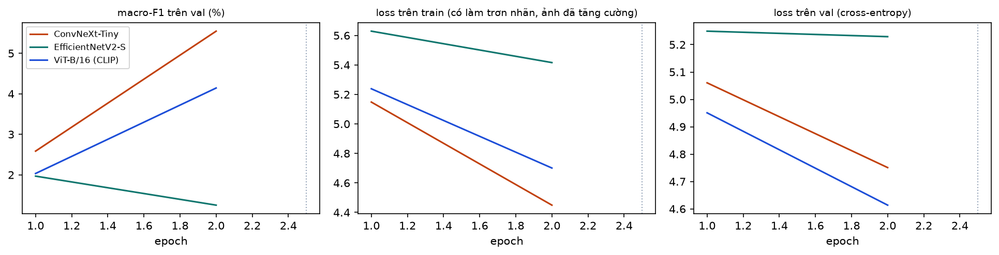

# B06-chay-thu. Huấn luyện chính: tinh chỉnh ba kiến trúc (thí nghiệm E2) — chạy thử

Báo cáo sinh tự động bởi `ml/` (mẫu ở `docs/nhan-dang-robot/00-ke-hoach.md` mục 6). Thời gian chạy: 3.1 giây. Số liệu máy đọc: `ml/reports/B06-chay-thu/summary.json`.

## 1. Mục tiêu

Tinh chỉnh toàn bộ ba mạng đã huấn luyện sẵn (hai CNN và một Transformer) trên tập train của B4 để nhận dạng các lớp robot đã biết; mỗi kiến trúc chạy 3 lần với 3 hạt giống để đo độ dao động. So sánh kiến trúc trên **val** (độ chính xác, kích thước, số phép tính) để chọn mô hình chính (RQ3), và so với mốc linear probe của B5 (RQ2, bản cuối trên test ở B8).

**Đây là lần chạy thử** trên một phần nhỏ dữ liệu và 2 epoch, chỉ để kiểm tra đường ống và đo tốc độ; các con số không có ý nghĩa về độ chính xác.

**Số liệu tạm**: dữ liệu là bản tạm `dff6fdbb77c0` của B4 (chưa có nhãn tay của B3).

## 2. Đầu vào, đầu ra

- Đầu vào: `b04_splits.csv.gz` (mã `dff6fdbb77c0`), tập train (1536 ảnh) và val (512 ảnh) của 195 lớp đã biết.
- Đầu ra của mỗi lần chạy (ở `C:\Users\THINKPAD\WEB_MO_HINH\ml\data\store\runs\b06-chay-thu`, không vào git): `best.pt` (trọng số tốt nhất, fp16), `history.csv` (số liệu từng epoch), `val_logits.npy`, `config.json`, `result.json`.
- Bản tóm tắt vào git: báo cáo này, `ml/reports/B06/summary.json`, hình `ml/reports/B06/*.png`.

## 3. Công cụ và môi trường

**Môi trường**

| Mục | Giá trị |
| --- | --- |
| Thời điểm chạy (UTC) | 2026-11-11T19:57:55+00:00 |
| Hệ điều hành | Windows 11 (build 10.0.26300, AMD64) |
| Python | 3.11.9 |
| CPU | 12th Gen Intel(R) Core(TM) i7-12800H (20 luồng) |
| RAM | 31.7 GB |
| GPU (PyTorch) | NVIDIA RTX A2000 Laptop GPU (4.0 GB) |
| CUDA của PyTorch | 12.8 |
| Driver (nvidia-smi) | NVIDIA RTX A2000 Laptop GPU, 4096 MiB, 596.52 |
| Google Colab | không |
| Commit git | b38c213 (có thay đổi chưa commit) |

**Phiên bản thư viện**

| Thư viện | Phiên bản |
| --- | --- |
| ImageHash | 4.3.2 |
| Pillow | 13.0.0 |
| ddgs | 9.16.1 |
| matplotlib | 3.11.2 |
| mwparserfromhell | 0.7.2 |
| numpy | 2.4.6 |
| open_clip_torch | 4.2.1 |
| pandas | 3.1.1 |
| rapidfuzz | 3.14.6 |
| requests | 2.34.2 |
| scikit-learn | 1.9.1 |
| scipy | 1.17.1 |
| timm | 1.0.31 |
| torch | 2.11.0+cu128 |
| torchvision | 0.26.0+cu128 |

GPU của các lần chạy: NVIDIA RTX A2000 Laptop GPU. Bảng môi trường ở trên là của máy sinh báo cáo.

## 4. Phương pháp

- **Kiến trúc** (trọng số của `timm`): ConvNeXt-Tiny (`convnext_tiny.fb_in22k_ft_in1k`); EfficientNetV2-S (`tf_efficientnetv2_s.in21k_ft_in1k`); ViT-B/16 (CLIP) (`vit_base_patch16_clip_224.openai`). Đầu phân loại mới (một tầng tuyến tính, số đầu ra bằng số lớp) thay cho đầu cũ.
- **Ảnh vào khi huấn luyện**: RandomResizedCrop 224 (tỉ lệ diện tích 0,35–1), lật ngang, RandAugment (2 phép, cường độ 9), ColorJitter 0,3 (độ sáng, tương phản, bão hoà), RandomErasing (p = 0,25); chuẩn hoá theo mean/std của trọng số gốc. **Val**: thu cạnh ngắn về 256 bằng song tuyến, cắt giữa 224 (giống cách trình duyệt sẽ làm ở B11).
- **Hàm mất mát**: cross-entropy có làm trơn nhãn ε = 0.1: nhãn đúng nhận 1 − ε + ε/C, mỗi lớp khác ε/C.
- **Lấy mẫu cân bằng lớp**: mỗi epoch rút 1536 ảnh có hoàn lại, lớp c được chọn với xác suất tỉ lệ n_c^0.5 (trọng số mỗi ảnh n_c^−0,5), để lớp đông ảnh không lấn át.
- **Hai pha.** Pha 1 (2 epoch): thân mạng đóng băng, chỉ học đầu phân loại, AdamW tốc độ học 0.001. Pha 2: tinh chỉnh toàn mạng, AdamW (β = 0.9, 0.999; weight decay 0.05, không áp cho bias và tham số chuẩn hoá), tốc độ học ConvNeXt-Tiny 0.0001; EfficientNetV2-S 0.0001; ViT-B/16 (CLIP) 3e-05 với suy giảm theo tầng 0.75. Khởi động tuyến tính 1 epoch rồi giảm theo cosine tới epoch 30.
- **Suy giảm theo tầng** (ViT): tầng thứ i tính từ đầu ra có tốc độ học lr · 0,75^i, nên tầng gần ảnh (đã học tốt từ CLIP) thay đổi ít, tầng gần đầu ra thay đổi nhiều.
- **Khác**: mỗi bước tối ưu 64 ảnh; GPU dưới 10 GB thì chia thành 2 micro-batch 32 ảnh và cộng dồn gradient. fp16 (AMP), cắt gradient theo chuẩn 1.0, cuDNN tất định. Tối đa 30 epoch; **dừng sớm** khi macro-F1 trên val không tăng 5 epoch liền; giữ trọng số của epoch có macro-F1 val cao nhất.
- **Hạt giống**: 42, 43, 44. Hạt giống quyết định khởi tạo đầu phân loại, thứ tự lấy mẫu và tăng cường dữ liệu.
- **Độ phức tạp**: số tham số; GFLOPs của một ảnh 224×224 đếm bằng `torch.utils.flop_counter` (1 phép nhân-cộng = 2 FLOP; tài liệu gốc của các mạng thường ghi số phép nhân-cộng, bằng một nửa); số tầng có trọng số (Conv2d và Linear).
- **So sánh**: trung bình ± độ lệch chuẩn qua 3 hạt giống; kiểm định McNemar giữa hai kiến trúc tốt nhất trên cùng ảnh val, từng cặp cùng hạt giống, p hiệu chỉnh Holm.
- **Khác kế hoạch**: (1) GFLOPs đếm bằng `torch.utils.flop_counter` có sẵn trong PyTorch thay cho `fvcore` (không cần cài thêm); (2) cộng dồn gradient khi GPU nhỏ; với EfficientNetV2-S (có BatchNorm) thống kê chuẩn hoá vì thế tính trên 32 ảnh thay vì 64.

### Giải thích bằng lời thường

- **Tinh chỉnh** (fine-tuning): lấy một mạng đã học nhận biết hàng triệu ảnh đời thường, rồi dạy thêm cho nó phân biệt các robot. Giống một người đã biết vẽ, giờ học thêm vẽ robot.
- **Epoch**: một lượt mô hình xem hết tập train. **Đường học**: điểm trên val sau mỗi epoch; đi lên rồi chững lại là bình thường, đi xuống là mô hình bắt đầu học thuộc lòng (quá khớp).
- **Hai pha**: lúc đầu chỉ học lớp cuối để không làm hỏng phần đã học sẵn, sau đó mới cho cả mạng học với tốc độ nhỏ.
- **Tăng cường dữ liệu**: mỗi lần xem, ảnh bị cắt, lật, đổi màu, che một mảng ngẫu nhiên, để mô hình nhận ra robot dù chụp kiểu gì chứ không thuộc lòng từng ảnh.
- **Làm trơn nhãn**: không bắt mô hình chắc chắn 100%, giúp độ tin nó báo ra sát thực tế hơn.
- **Ba hạt giống**: chạy lại ba lần với ba cách xáo trộn khác nhau; nếu kết quả gần nhau thì kết luận đáng tin, nếu lệch nhiều thì chênh lệch nhỏ giữa hai kiến trúc chưa nói lên gì.

## 5. Kết quả

**Bảng 1. Các lần chạy**

| Kiến trúc | Hạt giống | Trạng thái | Số epoch đã chạy | Epoch tốt nhất | macro-F1 val tốt nhất (%) | Giờ GPU | Dừng sớm |
| --- | --- | --- | --- | --- | --- | --- | --- |
| ConvNeXt-Tiny | 42 | xong | 2 | 2 | 5,55 | 0,02 | không |
| ConvNeXt-Tiny | 43 | chưa chạy | — | — | — | — | — |
| ConvNeXt-Tiny | 44 | chưa chạy | — | — | — | — | — |
| EfficientNetV2-S | 42 | xong | 2 | 1 | 1,97 | 0,02 | không |
| EfficientNetV2-S | 43 | chưa chạy | — | — | — | — | — |
| EfficientNetV2-S | 44 | chưa chạy | — | — | — | — | — |
| ViT-B/16 (CLIP) | 42 | xong | 2 | 2 | 4,14 | 0,03 | không |
| ViT-B/16 (CLIP) | 43 | chưa chạy | — | — | — | — | — |
| ViT-B/16 (CLIP) | 44 | chưa chạy | — | — | — | — | — |

Tổng thời gian huấn luyện (cả đánh giá val mỗi epoch): 0,06 giờ GPU.

**Bảng 2. So sánh kiến trúc trên val (trung bình ± độ lệch chuẩn qua các hạt giống)**

| Kiến trúc | Số lần chạy xong | top-1 val (%) | top-5 val (%) | macro-F1 val (%) | Tham số (triệu) | GFLOPs / ảnh | Số tầng có trọng số | Epoch tốt nhất (TB) |
| --- | --- | --- | --- | --- | --- | --- | --- | --- |
| ConvNeXt-Tiny | 1 | 8,40 (1 lần chạy) | 19,73 (1 lần chạy) | 5,55 (1 lần chạy) | 28,0 | 8,91 | 59 | 2,0 |
| EfficientNetV2-S | 1 | 2,54 (1 lần chạy) | 8,98 (1 lần chạy) | 2,07 (1 lần chạy) | 20,4 | 5,70 | 171 | 1,0 |
| ViT-B/16 (CLIP) | 1 | 6,05 (1 lần chạy) | 22,27 (1 lần chạy) | 4,15 (1 lần chạy) | 85,9 | 33,70 | 50 | 2,0 |

**Bảng 3. Từng lần chạy (trọng số của epoch tốt nhất)**

| Kiến trúc | Hạt giống | top-1 val (%) | top-5 val (%) | macro-F1 val (%) | Epoch tốt nhất |
| --- | --- | --- | --- | --- | --- |
| ConvNeXt-Tiny | 42 | 8,40 | 19,73 | 5,55 | 2 |
| EfficientNetV2-S | 42 | 2,54 | 8,98 | 2,07 | 1 |
| ViT-B/16 (CLIP) | 42 | 6,05 | 22,27 | 4,15 | 2 |



*Hình: Đường học: đường là trung bình qua các hạt giống, dải là ± 1 độ lệch chuẩn; vạch chấm: hết pha 1 (chỉ học đầu phân loại)*

**Bảng 4. So sánh có kiểm định trên val**

| So sánh trên val (A so với B) | Hiệu top-1, điểm % [KTC 95%] | A đúng, B sai | A sai, B đúng | p (McNemar) | p sau Holm |
| --- | --- | --- | --- | --- | --- |
| ConvNeXt-Tiny so với ViT-B/16 (CLIP), hạt giống 42 | 2,3 [-0,2; 5,1] | 32 | 20 | 0,127 | 0,127 |

**Mô hình chính đề xuất: ConvNeXt-Tiny** (macro-F1 trung bình trên val cao nhất). Luật chọn: lấy kiến trúc có macro-F1 val trung bình cao nhất; nếu kiến trúc đứng thứ hai nhẹ hơn và không kém có ý nghĩa thống kê ở mọi cặp cùng hạt giống thì chọn kiến trúc nhẹ hơn, vì mô hình chạy trong trình duyệt (RQ3). Quyết định cuối do chủ dự án duyệt.

## 6. Phân tích

- Đã xong 3/9 lần chạy, tổng 0,06 giờ GPU.
- ConvNeXt-Tiny: macro-F1 val 5,55 (1 lần chạy)%, top-1 8,40 (1 lần chạy)%; 28,0 triệu tham số, 8,91 GFLOPs.
- ViT-B/16 (CLIP): macro-F1 val 4,15 (1 lần chạy)%, top-1 6,05 (1 lần chạy)%; 85,9 triệu tham số, 33,70 GFLOPs.
- EfficientNetV2-S: macro-F1 val 2,07 (1 lần chạy)%, top-1 2,54 (1 lần chạy)%; 20,4 triệu tham số, 5,70 GFLOPs.
- ConvNeXt-Tiny: top-1 trên ảnh train đã tăng cường trừ top-1 val ở epoch tốt nhất = 12,2 điểm (dương lớn là dấu hiệu quá khớp; ảnh train bị tăng cường nên khó hơn ảnh val, khoảng này thường nhỏ hơn khoảng thật).
- EfficientNetV2-S: top-1 trên ảnh train đã tăng cường trừ top-1 val ở epoch tốt nhất = 0,5 điểm (dương lớn là dấu hiệu quá khớp; ảnh train bị tăng cường nên khó hơn ảnh val, khoảng này thường nhỏ hơn khoảng thật).
- ViT-B/16 (CLIP): top-1 trên ảnh train đã tăng cường trừ top-1 val ở epoch tốt nhất = 5,1 điểm (dương lớn là dấu hiệu quá khớp; ảnh train bị tăng cường nên khó hơn ảnh val, khoảng này thường nhỏ hơn khoảng thật).

## 7. Hạn chế và rủi ro

- Số liệu trên bản dữ liệu tạm; ảnh sai nhãn còn sót trong cả train lẫn val.
- Mô hình và epoch được chọn theo val nên con số val hơi lạc quan; con số để báo cáo là trên test ở B8 (chỉ chạy một lần).
- 3 hạt giống là ít để ước lượng độ lệch chuẩn; khoảng dao động thật có thể lớn hơn.
- Các siêu tham số (tốc độ học, số epoch, tăng cường) lấy theo kế hoạch, chưa dò; mỗi kiến trúc có thể chưa ở điểm tốt nhất của nó. Ảnh hưởng của từng yếu tố đo ở B7.
- Thời gian huấn luyện phụ thuộc GPU (máy này hay Colab) nên chỉ so được giữa các lần chạy trên cùng GPU.

## 8. Tái lập

| Mục | Giá trị |
| --- | --- |
| Cấu hình | ml/configs/b06_huan_luyen.yaml |
| Mã cấu hình | 4ef894b1f549 |
| Phiên bản dữ liệu | b04_splits.csv sha256 dff6fdbb77c0 |

```bash
ml/.venv/Scripts/python ml/scripts/b06_huan_luyen.py --all --smoke
ml/.venv/Scripts/python ml/scripts/b06_bao_cao.py --smoke
```
