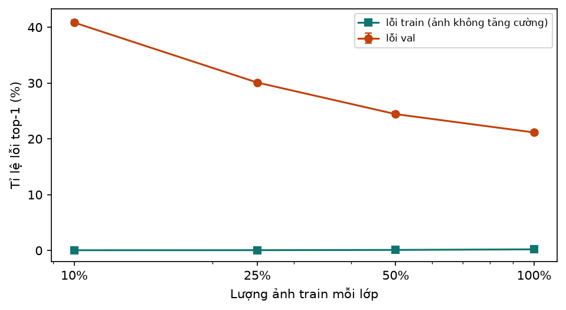
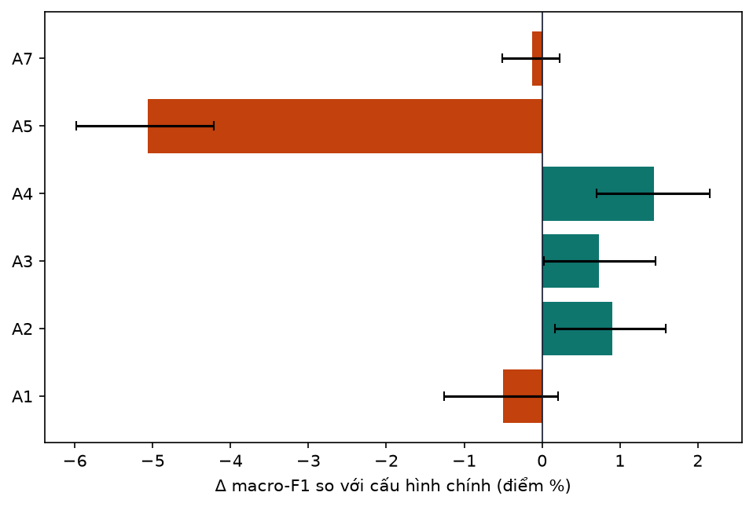

# B07. Thí nghiệm phụ trên ViT-B/16 (CLIP) (thí nghiệm E3, E4)

Báo cáo sinh tự động bởi `ml/` (mẫu ở `docs/nhan-dang-robot/00-ke-hoach.md` mục 6). Thời gian chạy: 2.8 giây. Số liệu máy đọc: `ml/reports/B07/summary.json`.

## 1. Mục tiêu

Đo đóng góp của từng kỹ thuật trong công thức huấn luyện của B6 (RQ4) bằng cách bỏ hoặc đổi **một** yếu tố mỗi lần, và đo mô hình đang thiếu dữ liệu hay thiếu sức chứa bằng đường học theo lượng dữ liệu (độ lệch và phương sai).

**Số liệu tạm**: dữ liệu là bản tạm `dff6fdbb77c0` của B4. Mọi so sánh trên **val**; test để dành cho B8.

## 2. Đầu vào, đầu ra

- Cấu hình chính: các lần chạy vit_b16_clip-s42/43/44 của B6. Thí nghiệm: `<ROBOTREC_RUNS>/b07/`.
- Đầu ra: báo cáo này, `ml/reports/B07/summary.json`, hình `ml/reports/B07/*.png`.

## 3. Công cụ và môi trường

**Môi trường**

| Mục | Giá trị |
| --- | --- |
| Thời điểm chạy (UTC) | 2026-11-15T01:01:29+00:00 |
| Hệ điều hành | Windows 11 (build 10.0.26300, AMD64) |
| Python | 3.11.9 |
| CPU | 12th Gen Intel(R) Core(TM) i7-12800H (20 luồng) |
| RAM | 31.7 GB |
| GPU (PyTorch) | NVIDIA RTX A2000 Laptop GPU (4.0 GB) |
| CUDA của PyTorch | 12.8 |
| Driver (nvidia-smi) | NVIDIA RTX A2000 Laptop GPU, 4096 MiB, 596.52 |
| Google Colab | không |
| Kaggle | không |
| Commit git | 2a1973c (có thay đổi chưa commit) |

**Phiên bản thư viện**

| Thư viện | Phiên bản |
| --- | --- |
| ImageHash | 4.3.2 |
| Pillow | 13.0.0 |
| ddgs | 9.16.1 |
| matplotlib | 3.11.2 |
| mwparserfromhell | 0.7.2 |
| numpy | 2.4.6 |
| onnx | 1.23.2 |
| onnxruntime | 1.31.1 |
| open_clip_torch | 4.2.1 |
| pandas | 3.1.1 |
| rapidfuzz | 3.14.6 |
| requests | 2.34.2 |
| scikit-learn | 1.9.1 |
| scipy | 1.17.1 |
| timm | 1.0.31 |
| torch | 2.11.0+cu128 |
| torchvision | 0.26.0+cu128 |

## 4. Phương pháp

**Bảng 1. Các thí nghiệm**

| Mã | Thay đổi so với cấu hình chính | Số hạt giống |
| --- | --- | --- |
| A1 | Tăng cường cơ bản (chỉ cắt + lật) | 1 (42) |
| A2 | Lấy mẫu thường (không cân bằng lớp) | 1 (42) |
| A3 | Không làm trơn nhãn (ε = 0) | 1 (42) |
| A4 | Thêm Mixup (α = 0,2) và CutMix (α = 1,0) | 1 (42) |
| A5 | Khởi tạo ImageNet-21k thay cho CLIP (chỉ ViT) | 1 (42) |
| A6 | Lượng dữ liệu: 10%, 25%, 50% ảnh mỗi lớp (100% là cấu hình chính của B6) | 3 (42, 43, 44) |
| A7 | Suy luận thêm ảnh lật ngang rồi lấy trung bình logits (TTA), trên checkpoint của B6 | 3 (42, 43, 44) |

- Mọi thứ khác giữ nguyên như B6 (kiến trúc, tốc độ học, số epoch tối đa, dừng sớm, chọn epoch theo macro-F1 val).
- **So sánh**: mỗi thí nghiệm với cấu hình chính cùng hạt giống 42 trên cùng ảnh val: hiệu top-1 và hiệu macro-F1 kèm khoảng tin cậy bootstrap ghép cặp (1.000 lần lấy mẫu lại ảnh val, tính cả hai mô hình trên cùng mẫu); kiểm định McNemar cho top-1; p hiệu chỉnh Holm–Bonferroni trên A1–A5 và A7.
- **A6**: giữ ⌈f · n_c⌉ ảnh ngẫu nhiên của mỗi lớp (f = 10%, 25%, 50%); val giữ nguyên. Lỗi trên train đo trên chính các ảnh train của lần chạy, không tăng cường, tiền xử lý như val. Khoảng cách lỗi val − lỗi train lớn và giảm khi thêm dữ liệu: mô hình thiếu dữ liệu (phương sai cao); lỗi train cũng cao: thiếu sức chứa (độ lệch cao).
- **A7**: logits = trung bình logits của ảnh và ảnh lật ngang; đo thêm thời gian suy luận trên GPU.
- Hạn chế đã biết của thiết kế: A1–A5 chỉ một hạt giống nên chênh lệch nhỏ hơn độ dao động giữa các hạt giống (đo được ở cấu hình chính và A6) không nên kết luận.

### Giải thích bằng lời thường

- **Ablation** (thí nghiệm bỏ bớt) giống thử nấu món ăn bỏ từng gia vị: bỏ gia vị nào mà món dở hẳn thì gia vị đó quan trọng.
- **Đường học theo lượng dữ liệu**: cho mô hình học 10%, 25%, 50%, 100% số ảnh. Nếu điểm vẫn còn tăng rõ khi thêm ảnh thì thu thêm ảnh sẽ có ích.
- **TTA**: cho mô hình xem cả ảnh gốc lẫn ảnh soi gương rồi lấy trung bình; thường đúng hơn một chút nhưng chậm gấp đôi.

## 5. Kết quả

Cấu hình chính (ViT-B/16 (CLIP), hạt giống 42): top-1 val 78,40%. Qua 3 hạt giống: top-1 78,85 ± 0,39%, macro-F1 76,64 ± 0,43%.

**Bảng 2. Mỗi thí nghiệm so với cấu hình chính (Δ âm: bỏ kỹ thuật đó làm kết quả kém đi)**

| Mã | Thay đổi | top-1 val (%) | Δ top-1, điểm % [KTC 95%] | Δ macro-F1, điểm % [KTC 95%] | p (McNemar) | p sau Holm | Epoch tốt nhất |
| --- | --- | --- | --- | --- | --- | --- | --- |
| A1 | Tăng cường cơ bản (chỉ cắt + lật) | 77,96 | -0,44 [-1,11; 0,22] | -0,50 [-1,26; 0,20] | 0,220 | 0,439 | 26 |
| A2 | Lấy mẫu thường (không cân bằng lớp) | 79,10 | 0,70 [0,03; 1,31] | 0,90 [0,17; 1,59] | 0,043 | 0,172 | 24 |
| A3 | Không làm trơn nhãn (ε = 0) | 79,07 | 0,66 [0,05; 1,31] | 0,73 [0,02; 1,45] | 0,050 | 0,172 | 24 |
| A4 | Thêm Mixup (α = 0,2) và CutMix (α = 1,0) | 79,75 | 1,34 [0,66; 1,96] | 1,43 [0,70; 2,15] | < 0,001 | < 0,001 | 26 |
| A5 | Khởi tạo ImageNet-21k thay cho CLIP (chỉ ViT) | 73,57 | -4,84 [-5,68; -4,03] | -5,06 [-5,98; -4,21] | < 0,001 | < 0,001 | 26 |
| A7 | TTA lật ngang (hạt giống 42; chậm 1,53 lần) | 78,32 | -0,09 [-0,38; 0,21] | -0,13 [-0,51; 0,23] | 0,594 | 0,594 | — |

**Bảng 3. A7: TTA trên cả ba hạt giống của cấu hình chính**

| Hạt giống | Δ top-1 của TTA, điểm % | Δ macro-F1 | p (McNemar) | Thời gian suy luận (lần) |
| --- | --- | --- | --- | --- |
| 42 | -0,09 [-0,38; 0,21] | -0,13 | 0,594 | 1,53 |
| 43 | 0,09 [-0,17; 0,36] | 0,18 | 0,571 | 1,51 |
| 44 | -0,08 [-0,33; 0,19] | -0,09 | 0,653 | 1,60 |

**Bảng 4. A6: đường học theo lượng dữ liệu**

| Lượng dữ liệu | Ảnh train | Số hạt giống | Lỗi val (%) | Lỗi train (%) | Khoảng cách val − train (điểm %) |
| --- | --- | --- | --- | --- | --- |
| 10% | 3036 | 3 | 40,83 ± 0,40 | 0,04 | 40,79 |
| 25% | 7457 | 3 | 30,09 ± 0,22 | 0,05 | 30,04 |
| 50% | 14806 | 3 | 24,43 ± 0,42 | 0,10 | 24,33 |
| 100% | 29513 | 3 | 21,15 ± 0,39 | 0,20 | 20,95 |



*Hình: Đường học theo lượng dữ liệu (thanh sai số: ± 1 độ lệch chuẩn qua 3 hạt giống)*



*Hình: Δ macro-F1 của từng thí nghiệm so với cấu hình chính, kèm khoảng tin cậy 95%*

## 6. Phân tích

- A1 (Tăng cường cơ bản (chỉ cắt + lật)): Δ top-1 -0,44 điểm, Δ macro-F1 -0,50 điểm; chưa có ý nghĩa thống kê (p sau Holm 0,439).
- A2 (Lấy mẫu thường (không cân bằng lớp)): Δ top-1 0,70 điểm, Δ macro-F1 0,90 điểm; chưa có ý nghĩa thống kê (p sau Holm 0,172).
- A3 (Không làm trơn nhãn (ε = 0)): Δ top-1 0,66 điểm, Δ macro-F1 0,73 điểm; chưa có ý nghĩa thống kê (p sau Holm 0,172).
- A4 (Thêm Mixup (α = 0,2) và CutMix (α = 1,0)): Δ top-1 1,34 điểm, Δ macro-F1 1,43 điểm; có ý nghĩa thống kê (p sau Holm < 0,001).
- A5 (Khởi tạo ImageNet-21k thay cho CLIP (chỉ ViT)): Δ top-1 -4,84 điểm, Δ macro-F1 -5,06 điểm; có ý nghĩa thống kê (p sau Holm < 0,001).
- A7 (TTA): trung bình qua 3 hạt giống Δ top-1 -0,03 điểm, thời gian suy luận gấp 1,55 lần.
- Độ lệch chuẩn top-1 giữa 3 hạt giống của cấu hình chính là 0,39 điểm: các Δ của A1–A5 (một hạt giống) nhỏ hơn mức này chỉ nên coi là gợi ý.
- Từ 50% lên 100% dữ liệu, lỗi val giảm 3,28 điểm: mô hình vẫn còn hưởng lợi khi thêm ảnh, thu thêm dữ liệu có ích.

## 7. Hạn chế và rủi ro

- A1–A5 một hạt giống; chênh lệch nhỏ không đủ để kết luận.
- Mọi so sánh trên val, cùng tập dùng để chọn epoch, nên các con số hơi lạc quan như nhau.
- Dữ liệu tạm: kết luận về lượng dữ liệu có thể đổi khi nhãn sạch hơn.

## 8. Tái lập

| Mục | Giá trị |
| --- | --- |
| Cấu hình | ml/configs/b07_thi_nghiem_phu.yaml |
| Mã cấu hình | c6662846717e |
| Hạt giống | 0 |
| Phiên bản dữ liệu | b04_splits.csv sha256 dff6fdbb77c0 |

```bash
ml/.venv/Scripts/python ml/scripts/b07_thi_nghiem_phu.py --arch vit_b16_clip --all
ml/.venv/Scripts/python ml/scripts/b07_bao_cao.py --arch vit_b16_clip
```
