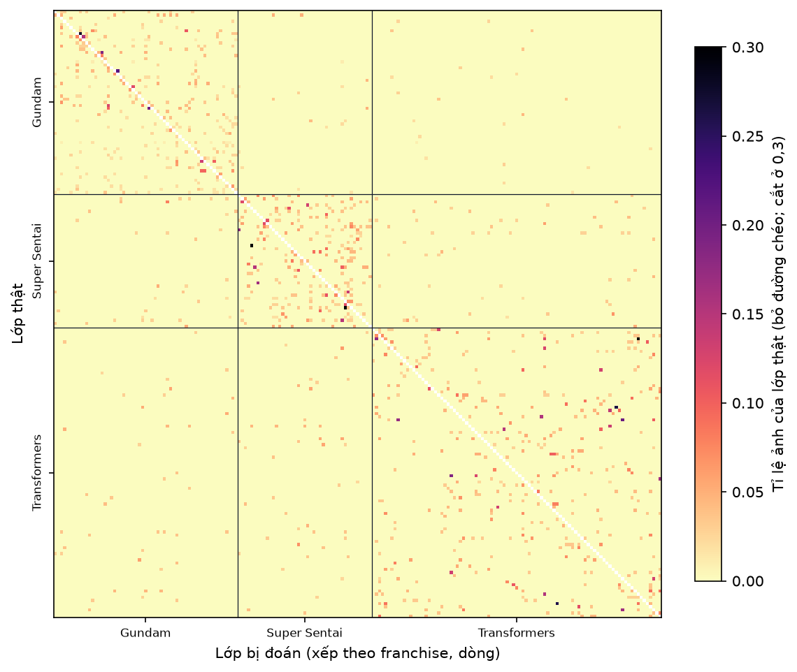
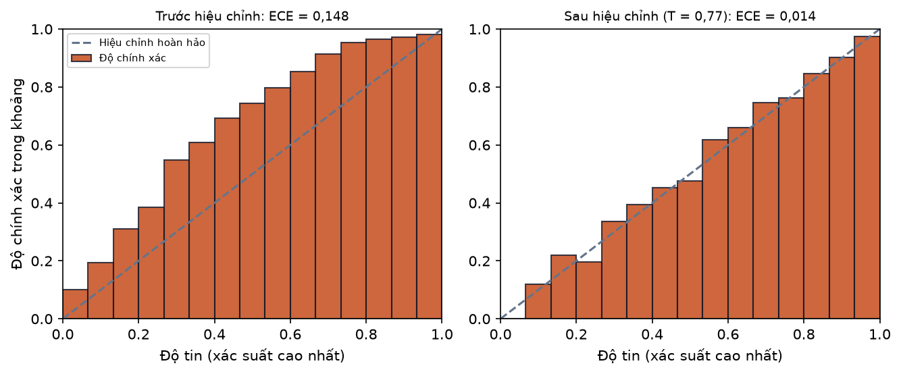
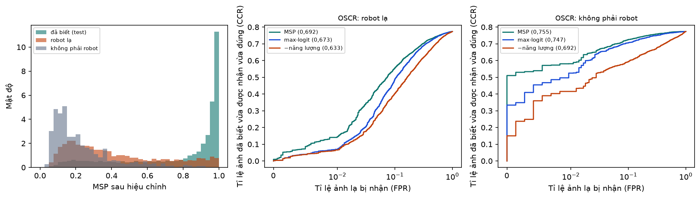
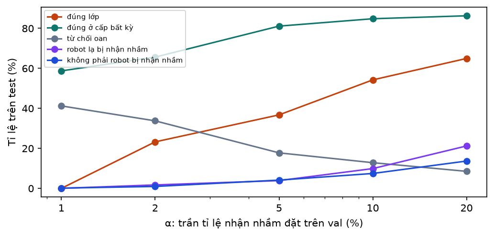
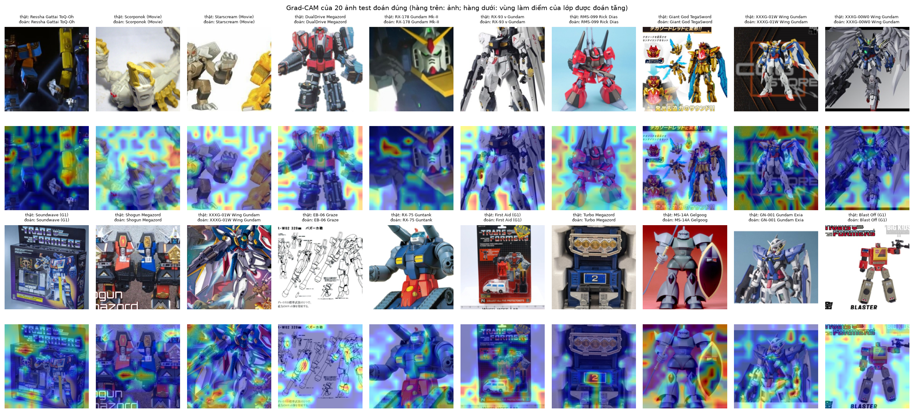
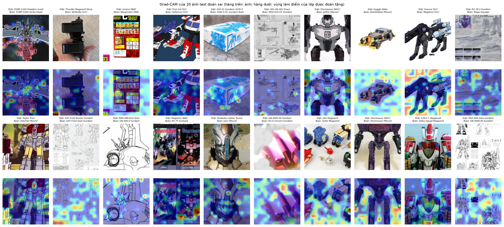
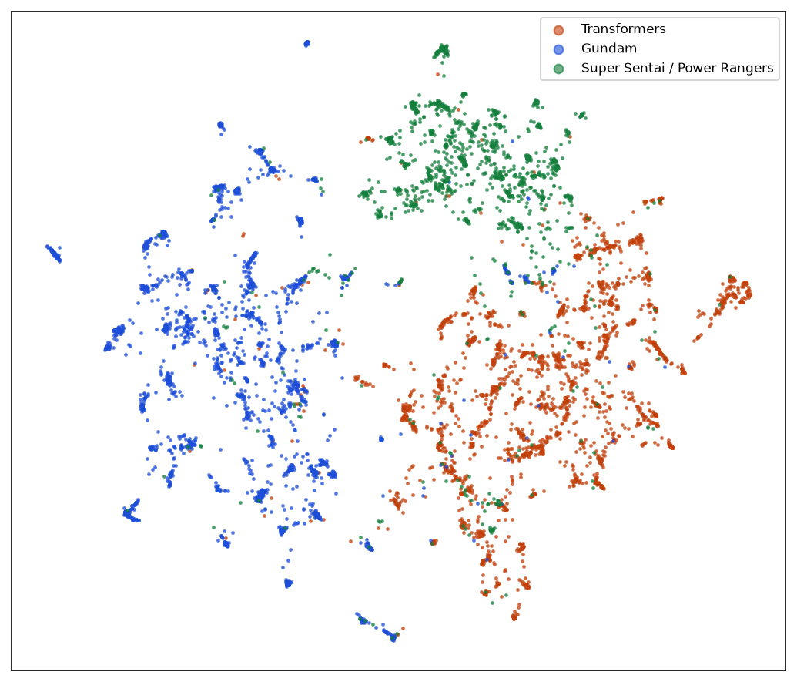

# B08b. Đánh giá toàn diện mô hình chính của B6 (ViT-B/16 (CLIP))

Báo cáo sinh tự động bởi `ml/` (mẫu ở `docs/nhan-dang-robot/00-ke-hoach.md` mục 6). Thời gian chạy: 209.1 giây. Số liệu máy đọc: `ml/reports/B08b/summary.json`.

## 1. Mục tiêu

Đo đủ các mặt của một mô hình nhận dạng theo kế hoạch B8: độ chính xác trên ảnh của lớp đã biết (tổng thể, từng lớp, theo cấp nhân vật và franchise, theo miền ảnh), độ tin mô hình báo ra có khớp thực tế không (hiệu chỉnh), khả năng nhận ra **robot lạ** (lớp không biết) và **ảnh không phải robot** (tập âm), và luật trả lời theo cấp sẽ dùng trên web. Trả lời RQ2 và RQ5.

Báo cáo này chạy trên mô hình chính của **B6**, trước khi B7 cho thấy Mixup/CutMix cải tiến có ý nghĩa. Mô hình cuối (B6 + Mixup/CutMix) đánh giá ở báo cáo B08.

**Số liệu tạm**: dữ liệu là bản tạm `dff6fdbb77c0` của B4 (chưa có nhãn tay của B3).

## 2. Đầu vào, đầu ra

**Bảng 1. Các tập dùng trong đánh giá**

| Nhóm ảnh | val (chọn ngưỡng, nhiệt độ) | test (báo số liệu) | Ghi chú |
| --- | --- | --- | --- |
| Đã biết (195 lớp) | 6325 | 6310 | Ảnh của lớp mô hình đã học |
| Lớp không biết (robot lạ) | 3794 | 3413 | 35 robot bị giấu khỏi lúc huấn luyện (B4) |
| Tập âm (không phải robot) | 723 | 724 | COCO val2017 và ảnh đồ chơi, mô hình, xe (B4b) |

Mô hình: ViT-B/16 (CLIP) (hạt giống 42), ViT-B/16 (CLIP) (hạt giống 43), ViT-B/16 (CLIP) (hạt giống 44).

## 3. Công cụ và môi trường

**Môi trường**

| Mục | Giá trị |
| --- | --- |
| Thời điểm chạy (UTC) | 2026-11-15T10:04:46+00:00 |
| Hệ điều hành | Windows 11 (build 10.0.26300, AMD64) |
| Python | 3.11.9 |
| CPU | 12th Gen Intel(R) Core(TM) i7-12800H (20 luồng) |
| RAM | 31.7 GB |
| GPU (PyTorch) | NVIDIA RTX A2000 Laptop GPU (4.0 GB) |
| CUDA của PyTorch | 12.8 |
| Driver (nvidia-smi) | NVIDIA RTX A2000 Laptop GPU, 4096 MiB, 596.52 |
| Google Colab | không |
| Kaggle | không |
| Commit git | 729c6ae (có thay đổi chưa commit) |

**Phiên bản thư viện**

| Thư viện | Phiên bản |
| --- | --- |
| ImageHash | 4.3.2 |
| Pillow | 13.0.0 |
| ddgs | 9.16.1 |
| matplotlib | 3.11.2 |
| mwparserfromhell | 0.7.2 |
| numpy | 2.4.6 |
| onnx | 1.23.2 |
| onnxruntime | 1.31.1 |
| open_clip_torch | 4.2.1 |
| pandas | 3.1.1 |
| rapidfuzz | 3.14.6 |
| requests | 2.34.2 |
| scikit-learn | 1.9.1 |
| scipy | 1.17.1 |
| timm | 1.0.31 |
| torch | 2.11.0+cu128 |
| torchvision | 0.26.0+cu128 |

## 4. Phương pháp

- **Tập đóng** (ảnh test của lớp đã biết): top-1, top-5, macro-F1 kèm khoảng tin cậy bootstrap 95% (1.000 lần lấy mẫu lại ảnh test); balanced accuracy (trung bình recall các lớp); precision, recall, F1 trung bình đều (macro) và trung bình theo số ảnh (weighted).
- **Theo cấp**: xác suất của một nhân vật = tổng xác suất các lớp cùng nhân vật (ví dụ Optimus Prime G1 + phim + ...), của một franchise = tổng các lớp của franchise; độ chính xác cấp nhân vật (franchise) = tỉ lệ ảnh có nhân vật (franchise) xác suất cao nhất là đúng. **Mức nghiêm trọng của lỗi**: trong các ảnh đoán sai lớp, sai đúng nhân vật nhưng khác dòng / sai nhân vật cùng franchise / sai franchise.
- **Theo miền ảnh và nguồn**: top-1 trên từng nhóm kèm khoảng Wilson 95%. Miền ảnh do CLIP gán ở B3, chưa kiểm định.
- **Hiệu chỉnh độ tin** (temperature scaling): p = softmax(z / T), chọn T > 0 làm nhỏ nhất NLL trên **val**; báo ECE (15 khoảng độ tin chia đều), MCE, NLL, Brier trên test trước và sau hiệu chỉnh. ECE = Σ_b (|B_b| / N) · |độ chính xác của B_b − độ tin trung bình của B_b|.
- **Tập mở**: ba điểm "đã biết": MSP = max softmax, max-logit, −năng lượng = log Σ exp(z) (T = 1), thêm MSP sau hiệu chỉnh. Tách ảnh test đã biết với lạ-test (robot lạ) và với âm-test (không phải robot; tách thêm COCO và đồ chơi): AUROC, AUPR-In, AUPR-Out, FPR@95%TPR (tỉ lệ ảnh lạ bị nhận khi ngưỡng giữ 95% ảnh đã biết), diện tích dưới đường OSCR (tỉ lệ vừa được nhận vừa đúng lớp, theo tỉ lệ ảnh lạ bị nhận). Khoảng tin cậy của AUROC và FPR@95 bằng bootstrap 1.000 lần, lấy mẫu lại riêng ảnh đã biết và ảnh lạ.
- **Luật trả lời theo cấp** (xác suất sau hiệu chỉnh): p(lớp) ≥ t₁ → trả lời lớp; ngược lại p(nhân vật) ≥ t₂ → nhân vật; ngược lại p(franchise) ≥ t₃ → franchise; còn lại → "không nhận ra". Với ảnh đã biết, **lợi ích** = số cấp nói đúng / 3 (đúng lớp 1; đúng nhân vật 2/3; đúng franchise 1/3; sai hoặc từ chối 0). Với robot lạ, trả lời một lớp luôn là nhận nhầm; trả lời đúng nhân vật (khi nhân vật có trong danh mục, ví dụ Optimus Prime của dòng bị giấu) hoặc đúng franchise, hoặc từ chối, là đúng. Với ảnh không phải robot chỉ từ chối là đúng.
- **Chọn ngưỡng trên val**: vét lưới t₁, t₂, t₃ ∈ {0; 0,02; …; 1} ∪ {1,01 = không bao giờ}, lấy bộ có lợi ích trung bình trên ảnh val đã biết lớn nhất với ràng buộc tỉ lệ nhận nhầm trên lạ-val ≤ α **và** trên âm-val ≤ α. Kế hoạch dùng α = 5%; báo thêm α = 1%, 2%, 10%, 20% để thấy đánh đổi. Kết quả trên test kèm khoảng Wilson 95%.
- **Khác kế hoạch**: (1) kế hoạch không định nghĩa "trả lời đúng nhiều nhất" khi các cấp có giá trị khác nhau; ở đây dùng lợi ích theo số cấp nói đúng để luật không chọn trả lời ở cấp franchise cho mọi ảnh. (2) Chưa đánh giá riêng ảnh dạng biến hình (`mode = alt`) vì bộ dữ liệu chưa có nhãn dạng.

### Giải thích bằng lời thường

- **Hiệu chỉnh độ tin**: nếu mô hình nói "chắc 90%" thì trong 100 lần nói vậy phải đúng khoảng 90 lần. ECE đo độ lệch trung bình giữa "nói chắc bao nhiêu" và "đúng bao nhiêu"; ECE nhỏ là độ tin đáng tin. Temperature scaling chỉ "vặn" độ tin cao lên hay thấp xuống bằng một con số T, không đổi câu trả lời.
- **AUROC**: lấy ngẫu nhiên một ảnh đã biết và một ảnh lạ, AUROC là xác suất ảnh đã biết được chấm điểm "quen" cao hơn. 0,5 là đoán mò, 1 là tách hoàn hảo.
- **FPR@95%TPR**: đặt ngưỡng sao cho 95% ảnh đã biết được nhận, rồi đếm bao nhiêu phần trăm ảnh lạ cũng lọt qua. Càng thấp càng tốt.
- **Luật theo cấp**: khi không chắc robot nào, web vẫn có thể nói "đây có vẻ là Optimus Prime" hoặc "đây có vẻ là robot Gundam" thay vì đoán bừa; khi chẳng chắc gì thì nói "không nhận ra". Ngưỡng được chọn sao cho ảnh lạ hiếm khi bị nhận nhầm.

## 5. Kết quả

**Bảng 2. Tập đóng: ảnh test của 195 lớp đã biết**

| Chỉ số trên test | Giá trị (TB ± ĐLC qua hạt giống) | Khoảng tin cậy 95% (ViT-B/16 (CLIP) (hạt giống 42)) |
| --- | --- | --- |
| top-1 (%) | 78,29 ± 0,80 | 77,37 [76,35; 78,34] |
| top-5 (%) | 89,06 ± 0,21 | 88,83 [88,05; 89,62] |
| macro-F1 (%) | 76,42 ± 0,72 | 75,59 [74,22; 76,41] |
| balanced accuracy (%) | 76,37 ± 0,77 | — |
| precision, macro (%) | 77,54 ± 0,49 | — |
| recall, macro (%) | 76,37 ± 0,77 | — |
| precision, weighted (%) | 78,90 ± 0,49 | — |
| recall, weighted (%) | 78,29 ± 0,80 | — |
| F1, weighted (%) | 78,14 ± 0,73 | — |

**Bảng 3. Độ chính xác theo cấp (xác suất cộng theo cây nhãn)**

| Cấp | top-1 trên test (%) |
| --- | --- |
| Lớp (nhân vật + dòng) | 78,29 ± 0,80 |
| Nhân vật | 80,29 ± 0,66 |
| Franchise | 97,41 ± 0,09 |

**Bảng 4. Mức nghiêm trọng của lỗi (ViT-B/16 (CLIP) (hạt giống 42))**

| Loại lỗi | Số ảnh | Tỉ lệ trong các lỗi |
| --- | --- | --- |
| Đúng nhân vật, sai dòng (ví dụ Optimus Prime G1 thành Optimus Prime phim) | 131 | 9,2% |
| Sai nhân vật, cùng franchise | 1075 | 75,3% |
| Sai franchise | 222 | 15,5% |
| Tổng số ảnh đoán sai lớp | 1428 | 100% |

**Bảng 5. top-1 theo nhóm ảnh (ViT-B/16 (CLIP) (hạt giống 42))**

| Nhóm | Giá trị | Ảnh test | top-1 % [Wilson 95%] |
| --- | --- | --- | --- |
| Franchise | Transformers | 2526 | 76,2 [74,5; 77,8] |
| Franchise | Gundam | 2432 | 82,5 [81,0; 84,0] |
| Franchise | Super Sentai / Power Rangers | 1352 | 70,3 [67,9; 72,7] |
| Nguồn | Wiki người hâm mộ | 1065 | 76,7 [74,1; 79,2] |
| Nguồn | Tìm ảnh (ddgs) | 5245 | 77,5 [76,4; 78,6] |
| Miền ảnh (CLIP gán) | hộp sản phẩm | 802 | 72,8 [69,6; 75,8] |
| Miền ảnh (CLIP gán) | tranh vẽ | 51 | 52,9 [39,5; 65,9] |
| Miền ảnh (CLIP gán) | ảnh CGI / phim | 625 | 72,8 [69,2; 76,1] |
| Miền ảnh (CLIP gán) | ảnh chụp màn hình hoạt hình / anime | 844 | 70,3 [67,1; 73,2] |
| Miền ảnh (CLIP gán) | ảnh chụp đồ chơi / mô hình | 3988 | 80,8 [79,6; 82,0] |

**Bảng 6. 20 lớp kém nhất theo F1 (ViT-B/16 (CLIP) (hạt giống 42))**

| Lớp | Franchise | Ảnh test | Precision (%) | Recall (%) | F1 (%) |
| --- | --- | --- | --- | --- | --- |
| Optimus Prime (WFC) | Transformers | 17 | 42,9 | 17,6 | 25,0 |
| Thunder Ultrazord | Super Sentai / Power Rangers | 29 | 38,7 | 41,4 | 40,0 |
| GN-0000 00 Gundam | Gundam | 26 | 39,5 | 57,7 | 46,9 |
| Bonecrusher (G1) | Transformers | 19 | 47,4 | 47,4 | 47,4 |
| Megatron (Movie) | Transformers | 22 | 52,6 | 45,5 | 48,8 |
| X Emperor Slash | Super Sentai / Power Rangers | 34 | 80,0 | 35,3 | 49,0 |
| Ohsama Gattai King-Ohger | Super Sentai / Power Rangers | 20 | 45,8 | 55,0 | 50,0 |
| Megatron (One) | Transformers | 22 | 43,3 | 59,1 | 50,0 |
| Bumblebee (One) | Transformers | 24 | 43,8 | 58,3 | 50,0 |
| Bumblebee (G1) | Transformers | 29 | 61,9 | 44,8 | 52,0 |
| GN-000 0 Gundam | Gundam | 29 | 51,6 | 55,2 | 53,3 |
| Battleship CrocoDaiOh | Super Sentai / Power Rangers | 25 | 63,2 | 48,0 | 54,5 |
| Flash Point Megazord | Super Sentai / Power Rangers | 27 | 84,6 | 40,7 | 55,0 |
| Megatron (WFC) | Transformers | 28 | 55,2 | 57,1 | 56,1 |
| Arcee (G1) | Transformers | 34 | 69,6 | 47,1 | 56,1 |
| Thunder Megazord (Power Rangers Mighty Morphin 2) | Super Sentai / Power Rangers | 30 | 45,8 | 73,3 | 56,4 |
| S.W.A.T. Megazord | Super Sentai / Power Rangers | 30 | 50,0 | 66,7 | 57,1 |
| Shockwave (Movie) | Transformers | 23 | 73,3 | 47,8 | 57,9 |
| Goggle Robo | Super Sentai / Power Rangers | 37 | 64,5 | 54,1 | 58,8 |
| MBF-M1 M1 Astray | Gundam | 23 | 60,9 | 60,9 | 60,9 |

**Bảng 7. 20 cặp nhầm nhiều nhất (ViT-B/16 (CLIP) (hạt giống 42))**

| Lớp thật | Bị đoán thành | Số ảnh | Tỉ lệ trong ảnh của lớp thật | Quan hệ |
| --- | --- | --- | --- | --- |
| Kyutama Gattai 01*03*05*07*09 KyurenOh | Cosmic Dragon Megazord | 11 | 30,6% | cùng franchise |
| Thunder Ultrazord | Thunder Megazord (Power Rangers Mighty Morphin 2) | 10 | 34,5% | cùng franchise |
| GN-000 0 Gundam | GN-0000 00 Gundam | 8 | 27,6% | cùng franchise |
| Optimus Prime (WFC) | Optimus Prime (Movie) | 7 | 41,2% | cùng nhân vật |
| Bumblebee (G1) | Bumblebee (Movie) | 6 | 20,7% | cùng nhân vật |
| Shockwave (Movie) | Shockwave (G1) | 6 | 26,1% | cùng nhân vật |
| ZGMF-X10A Freedom Gundam | ZGMF-X20A Strike Freedom Gundam | 6 | 11,8% | cùng franchise |
| Galaxy Megazord | Astro Megazord | 6 | 17,1% | cùng franchise |
| Bonecrusher (G1) | Bonecrusher (Movie) | 5 | 26,3% | cùng nhân vật |
| Bumblebee (G1) | Bumblebee (Animated) | 5 | 17,2% | cùng nhân vật |
| Megatron (G1) | Megatron (One) | 5 | 16,7% | cùng nhân vật |
| Bumblebee (Movie) | Bumblebee (One) | 5 | 12,8% | cùng nhân vật |
| MBF-M1 M1 Astray | MBF-P02 Gundam Astray Red Frame | 5 | 21,7% | cùng franchise |
| GN-001 Gundam Exia | GN-0000 00 Gundam | 5 | 6,6% | cùng franchise |
| S.W.A.T. Megazord | Delta Squad Megazord | 5 | 16,7% | cùng franchise |
| X Emperor Slash | Giant God TegaSword | 5 | 14,7% | cùng franchise |
| Bruticus (G1) | Onslaught (G1) | 4 | 15,4% | cùng franchise |
| Optimus Prime (Movie) | Optimus Prime (G1) | 4 | 15,4% | cùng nhân vật |
| Bonecrusher (Movie) | Bonecrusher (G1) | 4 | 13,3% | cùng nhân vật |
| Arcee (WFC) | Arcee (G1) | 4 | 12,5% | cùng nhân vật |



*Hình: Ma trận nhầm lẫn chuẩn hoá theo hàng, bỏ đường chéo (ViT-B/16 (CLIP) (hạt giống 42)); đường kẻ chia ba franchise*

**Bảng 8. Hiệu chỉnh độ tin (càng nhỏ càng tốt)**

| Chỉ số trên test | Trước hiệu chỉnh (T = 1) | Sau hiệu chỉnh |
| --- | --- | --- |
| ECE | 0,1556 ± 0,0067 | 0,0147 ± 0,0024 |
| MCE | 0,3025 ± 0,0417 | 0,0754 ± 0,0155 |
| NLL | 1,1986 ± 0,0145 | 1,0840 ± 0,0255 |
| Brier | 0,3362 ± 0,0081 | 0,3019 ± 0,0102 |
| Nhiệt độ T (chọn trên val) | 1 | 0,761 ± 0,009 |



*Hình: Biểu đồ độ tin cậy trên test (ViT-B/16 (CLIP) (hạt giống 42)): cột thấp hơn đường chéo là mô hình tự tin quá mức*

**Bảng 9. Tách ảnh đã biết (test) với ảnh lạ**

| Ảnh lạ | Điểm | AUROC | AUPR-In | AUPR-Out | FPR@95%TPR (%) | Diện tích OSCR |
| --- | --- | --- | --- | --- | --- | --- |
| Robot lạ (lạ-test) | MSP | 0,822 ± 0,009 | 0,896 ± 0,006 | 0,656 ± 0,012 | 76,7 ± 1,4 | 0,706 ± 0,012 |
| Robot lạ (lạ-test) | max-logit | 0,817 ± 0,015 | 0,882 ± 0,011 | 0,674 ± 0,020 | 72,5 ± 1,9 | 0,693 ± 0,018 |
| Robot lạ (lạ-test) | −năng lượng | 0,795 ± 0,024 | 0,866 ± 0,016 | 0,660 ± 0,034 | 71,7 ± 3,8 | 0,661 ± 0,025 |
| Robot lạ (lạ-test) | MSP sau hiệu chỉnh | 0,820 ± 0,008 | 0,897 ± 0,006 | 0,651 ± 0,011 | 77,7 ± 1,4 | 0,708 ± 0,012 |
| Không phải robot (âm-test) | MSP | 0,929 ± 0,002 | 0,991 ± 0,000 | 0,568 ± 0,019 | 44,4 ± 0,3 | 0,764 ± 0,008 |
| Không phải robot (âm-test) | max-logit | 0,919 ± 0,002 | 0,990 ± 0,000 | 0,494 ± 0,026 | 51,2 ± 2,5 | 0,756 ± 0,008 |
| Không phải robot (âm-test) | −năng lượng | 0,841 ± 0,008 | 0,980 ± 0,001 | 0,284 ± 0,020 | 82,3 ± 2,2 | 0,700 ± 0,007 |
| Không phải robot (âm-test) | MSP sau hiệu chỉnh | 0,924 ± 0,001 | 0,991 ± 0,000 | 0,551 ± 0,017 | 47,0 ± 0,4 | 0,762 ± 0,008 |
|    trong đó COCO | MSP | 0,941 ± 0,002 | 0,995 ± 0,000 | 0,541 ± 0,022 | 37,2 ± 1,0 | 0,768 ± 0,009 |
|    trong đó COCO | max-logit | 0,925 ± 0,002 | 0,994 ± 0,000 | 0,429 ± 0,031 | 47,7 ± 2,9 | 0,759 ± 0,009 |
|    trong đó COCO | −năng lượng | 0,829 ± 0,010 | 0,985 ± 0,001 | 0,192 ± 0,017 | 87,3 ± 2,2 | 0,693 ± 0,005 |
|    trong đó COCO | MSP sau hiệu chỉnh | 0,936 ± 0,002 | 0,995 ± 0,000 | 0,522 ± 0,021 | 40,1 ± 1,5 | 0,767 ± 0,009 |
|    trong đó đồ chơi, xe | MSP | 0,902 ± 0,006 | 0,996 ± 0,000 | 0,203 ± 0,019 | 60,6 ± 2,9 | 0,754 ± 0,006 |
|    trong đó đồ chơi, xe | max-logit | 0,904 ± 0,006 | 0,996 ± 0,000 | 0,205 ± 0,021 | 59,1 ± 4,2 | 0,750 ± 0,007 |
|    trong đó đồ chơi, xe | −năng lượng | 0,866 ± 0,008 | 0,994 ± 0,000 | 0,153 ± 0,017 | 71,0 ± 3,1 | 0,713 ± 0,012 |
|    trong đó đồ chơi, xe | MSP sau hiệu chỉnh | 0,897 ± 0,006 | 0,996 ± 0,000 | 0,195 ± 0,018 | 62,5 ± 2,0 | 0,753 ± 0,007 |



*Hình: Trái: phân bố độ tin của ba nhóm ảnh. Giữa, phải: đường OSCR (trục ngang thang log gần 0; trong ngoặc là diện tích) (ViT-B/16 (CLIP) (hạt giống 42))*

**Bảng 10. Luật trả lời theo cấp: ngưỡng chọn trên val, kết quả trên test [Wilson 95%] (ViT-B/16 (CLIP) (hạt giống 42))**

| α (trần nhận nhầm trên val) | t₁; t₂; t₃ | Lợi ích trên val (%) | Đã biết: đúng lớp % | đúng nhân vật % | đúng franchise % | trả lời sai % | từ chối oan % | Robot lạ: nhận nhầm % | Không phải robot: nhận nhầm % |
| --- | --- | --- | --- | --- | --- | --- | --- | --- | --- |
| 1% | 1,00; 1,00; 0,96 | 19,7 | 0,0 [0,0; 0,1] | 0,0 [0,0; 0,1] | 58,7 [57,5; 60,0] | 0,0 [0,0; 0,1] | 41,2 [40,0; 42,5] | 0,0 [0,0; 0,2] | 0,1 [0,0; 0,8] |
| 2% | 0,98; 0,98; 0,94 | 37,9 | 23,2 [22,2; 24,3] | 0,7 [0,5; 1,0] | 41,7 [40,5; 42,9] | 0,6 [0,4; 0,8] | 33,8 [32,6; 34,9] | 1,7 [1,3; 2,2] | 1,0 [0,5; 2,0] |
| 5% | 0,96; 0,96; 0,84 | 52,2 | 36,8 [35,6; 37,9] | 0,9 [0,7; 1,2] | 43,4 [42,2; 44,7] | 1,1 [0,9; 1,4] | 17,8 [16,8; 18,7] | 3,9 [3,3; 4,6] | 4,1 [2,9; 5,9] |
| 10% | 0,88; 0,88; 0,78 | 65,0 | 54,2 [53,0; 55,5] | 1,4 [1,1; 1,7] | 29,2 [28,1; 30,3] | 2,3 [2,0; 2,7] | 12,9 [12,0; 13,7] | 9,9 [8,9; 11,0] | 7,5 [5,8; 9,6] |
| 20% | 0,70; 0,70; 0,70 | 73,2 | 65,0 [63,8; 66,1] | 1,4 [1,1; 1,7] | 20,0 [19,0; 21,0] | 5,2 [4,7; 5,8] | 8,5 [7,9; 9,2] | 21,2 [19,9; 22,6] | 13,7 [11,4; 16,4] |

**Bảng 11. Robot lạ dưới luật α = 5%: hệ thống có nói được "đây là Optimus Prime" khi gặp một dòng Optimus chưa học không?**

| Nhóm robot lạ (test) | Số ảnh | Trả lời đúng nhân vật % | Trả lời franchise % | Từ chối % | Nhận nhầm % |
| --- | --- | --- | --- | --- | --- |
| Robot lạ có nhân vật trong danh mục (ví dụ Optimus Prime dòng bị giấu) | 986 | 1,2 [0,7; 2,1] | 65,6 [62,6; 68,5] | 27,6 [24,9; 30,5] | 5,8 [4,5; 7,4] |
| Robot lạ có nhân vật không có trong danh mục | 2427 | — | 33,1 [31,3; 35,0] | 63,7 [61,8; 65,6] | 3,1 [2,5; 3,9] |



*Hình: Đánh đổi của luật trả lời theo cấp: nới trần nhận nhầm thì trả lời được nhiều hơn nhưng nhận nhầm ảnh lạ nhiều hơn*

**Bảng 12. Mô hình tinh chỉnh so với mốc B5 (RQ2)**

| So sánh trên test | Hiệu top-1, điểm % [KTC 95%] | A đúng, B sai | A sai, B đúng | p (McNemar) | p sau Holm |
| --- | --- | --- | --- | --- | --- |
| ViT-B/16 (CLIP) (hạt giống 42) so với linear probe B5 | 11,7 [10,6; 12,7] | 991 | 251 | < 0,001 | < 0,001 |
| ViT-B/16 (CLIP) (hạt giống 43) so với linear probe B5 | 13,2 [12,2; 14,2] | 1021 | 189 | < 0,001 | < 0,001 |
| ViT-B/16 (CLIP) (hạt giống 44) so với linear probe B5 | 13,0 [12,0; 14,0] | 1007 | 184 | < 0,001 | < 0,001 |

### Giải thích mô hình và phân tích lỗi



*Hình: Grad-CAM, ảnh đoán đúng (ViT-B/16 (CLIP), hạt giống 42)*



*Hình: Grad-CAM, ảnh đoán sai (ViT-B/16 (CLIP), hạt giống 42)*



*Hình: UMAP của đặc trưng tầng áp chót trên 6325 ảnh val (ViT-B/16 (CLIP), hạt giống 42); mỗi chấm một ảnh*

Trang để chủ dự án phân loại nguyên nhân của 100 ảnh đoán sai (nhãn sai, hai robot giống nhau, ảnh khó, sai dòng, kiểu ảnh lạ): `C:\Users\THINKPAD\WEB_MO_HINH\ml\data\store\b08\phan-tich-loi.html`. Tỉ lệ từng nguyên nhân sẽ được thêm vào báo cáo khi có kết quả.

### Outlier exposure (E7)

Huấn luyện lại một lần (hạt giống 42, cùng công thức B6) có thêm lớp thứ 196 "không phải robot" gồm ảnh âm-train của B4b; ảnh âm-val vào val. Lúc dùng, 195 lớp đầu cho câu trả lời, xác suất của lớp thêm là một điểm "lạ" mới. Robot lạ **không** có trong dữ liệu huấn luyện của E7.

**Bảng 13. Outlier exposure so với mô hình chính cùng hạt giống (E7). Ảnh đã biết bị E7 xếp vào "không phải robot": 0,3%**

| Mô hình, điểm | Top-1 test (%) | AUROC robot lạ [KTC 95%] | FPR@95 robot lạ (%) | AUROC không phải robot [KTC 95%] | FPR@95 không phải robot (%) |
| --- | --- | --- | --- | --- | --- |
| Mô hình chính (hạt giống 42), MSP | 77,4 | 0,812 [0,803; 0,821] | 78,3 | 0,931 [0,923; 0,939] | 44,1 |
| Mô hình chính (hạt giống 42), −năng lượng | 77,4 | 0,770 [0,761; 0,779] | 75,9 | 0,848 [0,836; 0,859] | 79,8 |
| E7, MSP trên 195 lớp | 79,3 | 0,834 [0,826; 0,842] | 77,1 | 0,994 [0,992; 0,996] | 3,9 |
| E7, 1 − p(không phải robot) | 79,3 | 0,692 [0,682; 0,701] | 90,5 | 0,999 [0,999; 1,000] | 0,1 |
| E7, −năng lượng trên 195 lớp | 79,3 | 0,824 [0,815; 0,833] | 70,9 | 0,973 [0,968; 0,977] | 15,5 |

## 6. Phân tích

Các số dưới đây là của **ViT-B/16 (CLIP) (hạt giống 42)** (mô hình đầu, có khoảng tin cậy); trung bình ± độ lệch chuẩn qua 3 hạt giống ở các bảng trên.

- Tập đóng: top-1 77,4 [76,4; 78,3]%, top-5 88,8 [88,1; 89,6]%. Ở cấp nhân vật đúng 79,5%, cấp franchise 97,4%. Trong 1428 ảnh đoán sai lớp, 9,2% là đúng nhân vật sai dòng và 15,5% là sai cả franchise: phần lớn lỗi là nhầm giữa các robot gần nhau.
- Hiệu chỉnh: T = 0,77 (mô hình thiếu tự tin, cần nâng độ tin). ECE trên test từ 0,148 xuống 0,014, NLL từ 1,214 xuống 1,112. Mục tiêu tham khảo của kế hoạch là ECE sau hiệu chỉnh ≤ 0,05: đạt.
- Robot lạ: điểm tốt nhất là MSP, AUROC 0,812, FPR@95 78,3%. Mục tiêu tham khảo AUROC ≥ 0,85: chưa đạt. Robot lạ là phần khó nhất vì chúng giống robot đã biết.
- Không phải robot: MSP đạt AUROC 0,931 (COCO 0,942, đồ chơi và xe 0,907). Ảnh đời thường dễ tách hơn hẳn ảnh đồ chơi chụp kiểu sản phẩm.
- Luật trả lời theo cấp với α = 5% (ngưỡng 0,96, 0,96, 0,84): trên test trả lời đúng lớp 36,8% ảnh đã biết, đúng ở một cấp nào đó 81,1%, trả lời sai 1,1%, từ chối oan 17,8%; nhận nhầm 3,9% robot lạ và 4,1% ảnh không phải robot. Tỉ lệ nhận nhầm trên test có thể vượt 5% một chút vì ngưỡng chọn trên val.
- Outlier exposure (bảng 13): ảnh không phải robot AUROC 0,931 → 0,999 (E7, 1 − p(không phải robot)); robot lạ 0,812 → 0,834; top-1 77,4% → 79,3%. Khoảng tin cậy chồng nhau thì chưa coi là khác biệt thật.
- So với mốc B5 (bảng 12): ViT-B/16 (CLIP) (hạt giống 42): 11,7 [10,6; 12,7] điểm, p sau Holm < 0,001; ViT-B/16 (CLIP) (hạt giống 43): 13,2 [12,2; 14,2] điểm, p sau Holm < 0,001; ViT-B/16 (CLIP) (hạt giống 44): 13,0 [12,0; 14,0] điểm, p sau Holm < 0,001.

## 7. Hạn chế và rủi ro

- Số liệu trên bản dữ liệu tạm; nhãn sai còn sót trong test làm các chỉ số thấp hơn thật một chút (ảnh đúng mà nhãn sai bị tính là lỗi).
- Lớp không biết và tập âm cùng nguồn web với dữ liệu huấn luyện; robot lạ hay ảnh khách gửi ngoài đời có thể khác (thử nghiệm thực địa ở B13).
- Nhóm đồ chơi của tập âm chưa duyệt tay từng ảnh nên có thể lẫn vài ảnh robot, làm tỉ lệ nhận nhầm trên nhóm này cao hơn thật.
- Ngưỡng chọn trên một lưới bước 0,02 và trên cỡ mẫu val hữu hạn; tỉ lệ nhận nhầm trên test dao động quanh α.
- Chưa đánh giá ảnh dạng biến hình (xe, thú) riêng vì chưa có nhãn dạng.
- Miền ảnh do CLIP gán, chưa kiểm định; bảng theo miền chỉ để tham khảo.

## 8. Tái lập

| Mục | Giá trị |
| --- | --- |
| Hạt giống | 0 |
| Phiên bản dữ liệu | b04_splits.csv sha256 dff6fdbb77c0 |

```bash
ml/.venv/Scripts/python ml/scripts/b08_danh_gia.py --source b06 --arch vit_b16_clip
```
