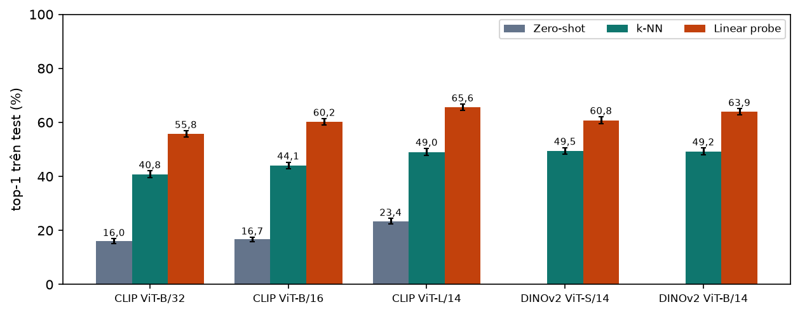

# Giải thích bước B5: mô hình nền trên đặc trưng đóng băng

Ghi ngày 15/11/2026. Tài liệu giải thích bằng lời thường cho báo cáo `bao-cao/B05-mo-hinh-nen.md` (thí nghiệm E1). Số liệu chạy trên bản dữ liệu tạm `dff6fdbb77c0` (chưa có nhãn chấm tay của B3).

## 1. B5 để làm gì?

**Câu hỏi B5 trả lời:** nếu **không huấn luyện lại mạng nào**, chỉ dùng các mạng nổi tiếng có sẵn kèm vài cách phân loại đơn giản, thì nhận dạng được bao nhiêu phần trăm trong 195 robot?

Câu hỏi này cần trả lời trước khi huấn luyện, vì ba lý do:

1. **Đặt mốc so sánh.** Huấn luyện (B6) tốn khoảng 20 giờ GPU. Nếu tinh chỉnh không vượt được cách đơn giản thì công đó vô ích. Con số của B5 là vạch xuất phát mà B6 phải vượt. Đây là nửa đầu của câu hỏi nghiên cứu **RQ2**: tinh chỉnh tốt hơn dùng đặc trưng đóng băng bao nhiêu, và chênh lệch có ý nghĩa thống kê không.
2. **Chọn kiến trúc cho B6.** Thử 5 mạng có sẵn để xem họ mạng nào (CLIP hay DINOv2, cỡ nhỏ hay lớn) hợp với ảnh robot. Kết quả B5 cho thấy CLIP mạnh nhất, nên ở B6 dự án tinh chỉnh ViT-B/16 khởi tạo từ CLIP.
3. **Kiểm tra dữ liệu.** Nếu chính những mạng này nhận dạng tệ ở một số lớp cụ thể, thì nhãn của các lớp đó có thể đang có vấn đề.

So sánh dễ hiểu:
- B5 giống như đưa ảnh cho một người đã xem rất nhiều ảnh trên mạng nhưng **chưa được dạy riêng** về robot, rồi xem người đó đoán đúng bao nhiêu.
- B6 là **dạy riêng** người đó về 195 robot, rồi đo lại.

**Mốc đoán mò:** chọn bừa một trong 195 lớp thì chỉ đúng **0,51%**. Mọi kết quả dưới đây đều cần so với con số này.

## 2. Đầu vào và đầu ra

### 2.1. Đầu vào

| Đầu vào | Nội dung |
|---|---|
| Danh sách chia tập của B4 (`b04_splits.csv.gz`) | Mỗi dòng là một ảnh, gồm tên file, nhãn (robot nào) và tập (train, val, test) |
| Ảnh | train 29.513, val 6.325, test 6.310 ảnh của 195 lớp đã biết |
| 5 mạng có sẵn | CLIP ViT-B/32, CLIP ViT-B/16, CLIP ViT-L/14 (OpenAI); DINOv2 ViT-S/14, DINOv2 ViT-B/14 (Meta) |
| Tên robot (chỉ cho zero-shot) | Tên lớp và tên dòng phim, ví dụ "Optimus Prime", "G1" |

Mỗi ảnh được chuẩn hoá về **224 × 224 điểm ảnh** trước khi đưa vào mạng.

### 2.2. Đầu ra

| Đầu ra | Nội dung |
|---|---|
| Với mỗi ảnh | Một **danh sách 195 điểm số**, mỗi robot một điểm. Robot có điểm cao nhất là câu trả lời; 5 robot đầu dùng để tính top-5 |
| Đặc trưng của mọi ảnh | Mỗi ảnh thành một vector 384–768 số; lưu lại để dùng ở B8 |
| Bộ phân loại đã học | Trọng số của linear probe, dùng lại ở B8 để so với mô hình tinh chỉnh |
| Báo cáo B05 | 9 bảng, 2 hình, kiểm định thống kê |

Lớp "không biết" và tập ảnh không phải robot cũng đã được trích đặc trưng, nhưng để dành cho B8.

### 2.3. Sơ đồ luồng

```
Ảnh 224×224 ──► Mạng có sẵn (ĐÓNG BĂNG, không sửa) ──► Đặc trưng (vector 384–768 số, độ dài 1)
                                                             │
          ┌──────────────────────────────────────────────────┼───────────────────────────┐
          ▼                                                  ▼                           ▼
   (a) Zero-shot                                      (b) Linear probe              (c) k-NN
   so với vector của câu chữ                     học một lớp phân loại           so với ảnh train
   "a photo of Optimus Prime..."                 tuyến tính trên train            giống nhất
          │                                                  │                           │
          └──────────────────────────► 195 điểm số ◄─────────┴───────────────────────────┘
                                         │
                               robot điểm cao nhất = câu trả lời
```

## 3. Khái niệm then chốt: đặc trưng đóng băng

- **Đặc trưng** là bản tóm tắt bằng số của bức ảnh. Mạng có sẵn đọc ảnh rồi viết ra một dãy vài trăm con số. Hai ảnh có nội dung giống nhau sẽ có hai dãy số gần nhau.
- **Đóng băng** nghĩa là **không thay đổi trọng số** của mạng. Mỗi ảnh chỉ cần đi qua mạng **một lần**, nên rất nhanh: trích đặc trưng cho cả 52.253 ảnh mất từ 1 đến 11 phút tuỳ mạng.
- **Chuẩn hoá L2:** mọi vector được đưa về độ dài 1. Khi đó, hai ảnh giống nhau đến đâu được đo bằng **cô-sin** của góc giữa hai vector: bằng 1 là giống hệt, gần 0 là không liên quan.

## 4. Chi tiết 5 mạng có sẵn

### 4.1. Họ CLIP (OpenAI, 2021)

- **Cách học:** học trên khoảng **400 triệu cặp ảnh và câu chú thích** lấy từ Internet.
- **Cấu tạo:** hai phần.
  - Phần đọc ảnh: một Vision Transformer.
  - Phần đọc chữ: một Transformer văn bản.
- **Mục tiêu khi học:** vector của ảnh phải nằm gần vector của đúng câu mô tả ảnh đó, và xa các câu khác. Đây gọi là học tương phản (contrastive learning).
- **Hệ quả:** CLIP đặt được ảnh và chữ vào **cùng một không gian**, nên so trực tiếp được ảnh với câu "a photo of Optimus Prime". Chỉ họ CLIP mới làm được zero-shot.
- **Cách đọc tên mô hình,** ví dụ ViT-B/32:
  - **ViT:** Vision Transformer.
  - **B, L:** cỡ Base (vừa) hoặc Large (lớn).
  - **Số sau dấu "/":** kích thước ô cắt ảnh. Ảnh 224 × 224 cắt ô 32 × 32 được 7 × 7 = 49 ô; ô 16 × 16 được 196 ô; ô 14 × 14 được 256 ô. Ô càng nhỏ thì mạng nhìn càng kỹ, nhưng càng chậm.

| Mạng | Tham số phần ảnh | Số chiều đặc trưng | Số ô | Tốc độ trích (ảnh/giây) | Ghi chú |
|---|---|---|---|---|---|
| CLIP ViT-B/32 | 87,8 triệu | 512 | 49 | 767 | Nhanh nhất, kém chi tiết. Đây là mô hình của cách tìm bằng ảnh cũ trên web |
| CLIP ViT-B/16 | 86,2 triệu | 512 | 196 | 290 | Cùng cỡ với B/32 nhưng ô nhỏ hơn |
| CLIP ViT-L/14 | 304,0 triệu | 768 | 256 | 81 | Lớn nhất, mạnh nhất, chậm nhất |

### 4.2. Họ DINOv2 (Meta, 2023)

- **Cách học:** **tự giám sát** trên 142 triệu ảnh đã chọn lọc, **không dùng chữ, không dùng nhãn**.
- **Cơ chế "thầy và trò":**
  - Hai bản cắt khác nhau của cùng một ảnh (một bản to, một bản nhỏ, đổi màu khác nhau) đưa vào hai mạng: "trò" và "thầy".
  - Trò phải cho ra đặc trưng giống thầy. "Thầy" là bản trung bình trượt của chính trò qua thời gian.
  - Ngoài ra, mạng phải đoán phần ảnh bị che.
- **Hệ quả:** đặc trưng của DINOv2 rất giỏi mô tả **hình dạng và chi tiết hình học**. Nhưng DINOv2 không hiểu chữ, nên không làm được zero-shot.
- **Cách lấy đặc trưng:** thu cạnh ngắn của ảnh về 256, cắt phần giữa 224 × 224, chuẩn hoá màu theo ImageNet, rồi lấy vector của token `[CLS]`.

| Mạng | Tham số | Số chiều đặc trưng | Số ô | Tốc độ trích (ảnh/giây) | Ghi chú |
|---|---|---|---|---|---|
| DINOv2 ViT-S/14 | 21,6 triệu | 384 | 256 | 500 | Nhỏ nhất, nhẹ gấp 4 lần CLIP ViT-B |
| DINOv2 ViT-B/14 | 85,7 triệu | 768 | 256 | 221 | |

## 5. Chi tiết 3 cách phân loại trên đặc trưng

### 5.1. Zero-shot (chỉ làm được với CLIP)

- **Ý tưởng:** không dùng ảnh huấn luyện nào. Chỉ đưa cho CLIP **tên robot bằng chữ**, rồi hỏi ảnh giống tên nào nhất.
- **Cách làm:**
  1. Mỗi lớp được mô tả bằng 5 câu tiếng Anh, ví dụ *"a photo of {tên}, a robot from {dòng}"*, *"a toy figure of {tên} from {dòng}"*.
  2. Phần đọc chữ của CLIP biến 5 câu thành 5 vector; lấy trung bình được một vector đại diện cho lớp.
  3. Với mỗi ảnh, tính cô-sin giữa vector ảnh và vector của từng lớp. Lớp có cô-sin cao nhất là câu trả lời.
- **Công thức:** ŷ = argmax_c cos(f(x), t_c), trong đó f(x) là vector của ảnh và t_c là vector chữ của lớp c.
- **Ưu điểm:** không cần ảnh mẫu nào.
- **Nhược điểm:** CLIP phải tự biết robot đó trông thế nào. Với robot ít nổi tiếng, CLIP không biết.

### 5.2. k-NN, k láng giềng gần nhất

- **Ý tưởng:** "ảnh này giống những ảnh đã có nhãn nào nhất?", rồi lấy theo số đông. Giống tra cứu một cuốn album ảnh có ghi tên.
- **Cách làm:**
  1. Với mỗi ảnh cần đoán, tìm k ảnh trong tập train có cô-sin cao nhất.
  2. Mỗi ảnh láng giềng bỏ phiếu cho lớp của nó, với trọng số bằng độ giống.
  3. Lớp được nhiều điểm nhất thắng.
- **Giá trị k đã thử:** 1, 5, 10. Giá trị k được chọn bằng tập val.
- **Không có bước huấn luyện:** chỉ cần lưu đặc trưng của ảnh train.
- **Nhược điểm:** một ảnh train sai nhãn hoặc trùng tên có thể kéo sai cả kết quả.

### 5.3. Linear probe (thăm dò tuyến tính)

- **Ý tưởng:** học **một lớp phân loại tuyến tính duy nhất** trên đặc trưng, còn thân mạng giữ nguyên. Hình dung là kẻ các mặt phẳng chia không gian đặc trưng thành 195 vùng, mỗi vùng là một robot.
- **Mô hình:** hồi quy logistic đa lớp, p(c | x) = softmax(W·f(x) + b).
  - W là ma trận 195 × (số chiều đặc trưng), b là 195 số.
  - softmax biến 195 điểm thành 195 xác suất có tổng bằng 1.
- **Cách học:** tìm W và b sao cho tổng −log p(nhãn đúng) trên toàn tập train nhỏ nhất, cộng một khoản phạt ‖W‖² / (2C). Thuật toán tối ưu là L-BFGS, tối đa 2.000 vòng, chạy trên GPU.
- **Tham số C (độ mạnh điều chuẩn):**
  - C nhỏ ép W nhỏ, chống học thuộc lòng nhưng dễ học thiếu.
  - C lớn cho mô hình tự do hơn.
  - C được chọn trong {0,001; 0,01; 0,1; 1; 10; 100} bằng **cross-validation 5 phần**: chia train thành 5 phần, lần lượt giấu một phần để chấm thử, lấy trung bình. Phần chia theo **nhóm ảnh gần trùng**, để hai ảnh gần giống nhau không rơi vào hai phần khác nhau.
  - Chọn xong C thì học lại trên toàn bộ train.
- **Kiểm chứng:** mã tự viết bằng PyTorch được so với scikit-learn. Hai bên dự đoán giống nhau trên 98,3% ảnh. Bản đang dùng đã được chứng minh là hội tụ (so với bản tính chính xác gấp đôi, fp64).

### 5.4. Nguyên tắc công bằng

- Mạng và tham số (C, k) **chỉ được chọn bằng cross-validation và tập val**.
- Tập test chỉ dùng **một lần ở cuối** để báo kết quả.

## 6. Cách đo kết quả

- **top-1:** tỉ lệ ảnh có đáp án đúng ở vị trí số một.
- **top-5:** tỉ lệ ảnh có đáp án đúng nằm trong 5 lựa chọn đầu.
- **macro-F1:** tính điểm F1 (kết hợp độ chính xác và độ phủ) cho từng robot, rồi lấy trung bình đều. Robot ít ảnh cũng nặng ngang robot nhiều ảnh.
- **Khoảng tin cậy 95% (KTC):** lấy mẫu lại có hoàn lại 1.000 lần từ tập test (bootstrap) để biết con số dao động bao nhiêu chỉ vì tập test có hạn.
- **Kiểm định McNemar:** so hai phương pháp trên cùng các ảnh test. Chỉ xét các ảnh mà một bên đúng còn bên kia sai, rồi xem chênh lệch có phải do ngẫu nhiên không. Giá trị p được hiệu chỉnh **Holm–Bonferroni**, vì so nhiều cặp cùng lúc.

## 7. Kết quả trên tập test (6.310 ảnh)

Bảng dưới lấy cấu hình tốt nhất của mỗi tổ hợp. Với k-NN, k được chọn bằng val.

| Mạng | Zero-shot top-1 | k-NN tốt nhất top-1 | Linear probe top-1 | Linear probe top-5 | Linear probe macro-F1 |
|---|---|---|---|---|---|
| CLIP ViT-B/32 | 16,0% | 40,8% (k = 10) | 55,8% [54,6; 56,9] | 77,2% | 53,4% |
| CLIP ViT-B/16 | 16,7% | 44,1% (k = 10) | 60,2% [59,0; 61,4] | 80,5% | 57,6% |
| **CLIP ViT-L/14** | **23,4%** | 49,0% (k = 5) | **65,6% [64,5; 66,8]** | **84,6%** | **63,5%** |
| DINOv2 ViT-S/14 | không làm được | 49,5% (k = 5) | 60,8% [59,6; 62,1] | 78,9% | 58,6% |
| DINOv2 ViT-B/14 | không làm được | 49,2% (k = 1) | 63,9% [62,8; 65,1] | 80,9% | 61,9% |



**Theo nhóm** (cấu hình tốt nhất là CLIP ViT-L/14 + linear probe):

| Nhóm | Ảnh test | Số lớp | top-1 |
|---|---|---|---|
| Transformers | 2.526 | 93 | 66,0% |
| Gundam | 2.432 | 59 | 69,3% |
| Super Sentai / Power Rangers | 1.352 | 43 | 58,4% |
| Ảnh từ wiki người hâm mộ | 1.065 | | 60,8% |
| Ảnh từ công cụ tìm ảnh | 5.245 | | 66,6% |

## 8. Đọc kết quả thế nào

1. **Mốc tốt nhất là CLIP ViT-L/14 + linear probe: 65,6% trên test.** Cấu hình này đúng gấp khoảng 130 lần đoán mò. Đây là con số mô hình tinh chỉnh ở B6 phải vượt.
2. **Có ảnh mẫu thì tốt hơn hẳn chỉ có tên.**
   - Linear probe hơn zero-shot khoảng 40 điểm.
   - Linear probe hơn k-NN từ 11 đến 17 điểm, trên mọi mạng.
   - Cả 9 phép so sánh đều có ý nghĩa thống kê (p < 0,001).
3. **Mạng lớn hơn và ô nhỏ hơn thì tốt hơn.** Trong họ CLIP: B/32 đạt 55,8%, B/16 đạt 60,2%, L/14 đạt 65,6%.
4. **DINOv2 rất hiệu quả so với cỡ của nó.**
   - DINOv2 ViT-S/14 chỉ 21,6 triệu tham số mà ngang CLIP ViT-B/16 (86 triệu).
   - Với k-NN, DINOv2 còn nhỉnh hơn CLIP: láng giềng gần nhất trong không gian DINOv2 thường đúng là cùng robot hơn.
   - Với linear probe, CLIP ViT-L/14 hơn DINOv2 ViT-B/14 1,8 điểm. Chênh lệch có ý nghĩa thống kê nhưng nhỏ.
5. **Super Sentai khó nhất** (58,4%), vì nhiều robot hợp thể trông rất giống nhau. Ảnh wiki lại khó hơn ảnh tìm kiếm, có lẽ vì trang wiki chứa nhiều cảnh phim và ảnh chi tiết, còn ảnh tìm kiếm phần lớn là ảnh sản phẩm chụp chính diện.
6. **Dấu hiệu học thuộc:** linear probe tốt nhất đúng 82,9% trên train nhưng chỉ 65,6% trên test, chênh 17,3 điểm. Tinh chỉnh toàn mạng kèm tăng cường dữ liệu ở B6 nhằm thu hẹp khoảng chênh này.
7. **Các lớp khó nhất** trùng với những lớp đã biết là có vấn đề nhãn, như tên lệch với wiki hoặc trùng tên với lớp khác. Đây là thêm một lý do cần chấm tay ở B3.

## 9. B5 dẫn tới bước sau thế nào

- **Chọn kiến trúc cho B6:** vì CLIP thắng, B6 tinh chỉnh **ViT-B/16 khởi tạo từ CLIP**, so với hai CNN là ConvNeXt-Tiny và EfficientNetV2-S. Không tinh chỉnh ViT-L/14 vì GPU của máy chỉ có 4 GB và mô hình sẽ quá nặng để chạy trong trình duyệt.
- **Kết quả B6:** ViT-B/16 (CLIP) tinh chỉnh đạt 78,29% trên test, **hơn mốc B5 khoảng 13 điểm**, với mô hình nhỏ hơn ViT-L/14 khoảng 3,5 lần. Điều này trả lời RQ2: tinh chỉnh có lợi rõ ràng.
- **Dùng lại ở B8:** đặc trưng và bộ phân loại của B5 được dùng lại để so với mô hình tinh chỉnh, cả ở khả năng từ chối robot lạ và ảnh không phải robot (báo cáo B08a).

## 10. Hạn chế

- **Dữ liệu tạm:** nhãn chưa được người kiểm định, nên ảnh sai nhãn còn sót làm giảm điểm của mọi phương pháp.
- **Có thể thiên vị CLIP ViT-L/14:** bản dữ liệu tạm đã bỏ các ảnh "nghi ngờ" theo điểm của chính CLIP ViT-L/14, nên mạng này có thể được lợi.
- **Zero-shot là cận dưới:** zero-shot phụ thuộc cách viết câu mô tả, và 5 mẫu câu chưa được tối ưu.
- **Chưa phải ảnh thật của khách:** tập test cùng nguồn web với train. Ảnh khách tự chụp có thể khó hơn; phần này sẽ đo ở B13.
