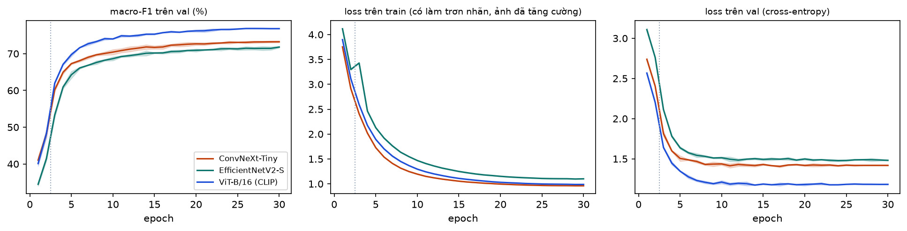

# Giải thích bước B6: huấn luyện chính (tinh chỉnh ba kiến trúc)

Ghi ngày 15/11/2026. Tài liệu này giải thích bằng lời thường cho báo cáo `bao-cao/B06-huan-luyen.md` (thí nghiệm E2). Số liệu chạy trên bản dữ liệu tạm `dff6fdbb77c0`, tức chưa có nhãn chấm tay của B3.

## 1. B6 để làm gì?

B5 cho thấy: nếu chỉ dùng mạng có sẵn mà không dạy lại, kết quả tốt nhất là **65,6%** trên tập test. B6 làm bước tiếp theo là **dạy lại toàn bộ mạng** bằng ảnh robot, gọi là tinh chỉnh (fine-tuning). Bước này trả lời hai câu hỏi nghiên cứu:

- **RQ2:** tinh chỉnh tốt hơn hẳn cách dùng mạng đóng băng ở B5 không, hơn bao nhiêu, và chênh lệch đó có ý nghĩa thống kê không.
- **RQ3:** kiến trúc nào cân bằng tốt nhất giữa độ chính xác, kích thước và tốc độ khi chạy trong trình duyệt. Ba ứng viên là hai mạng tích chập (CNN) và một Transformer, cỡ nhỏ và vừa.

Kết quả của B6 là **mô hình chính** của đề tài. Mô hình này được đánh giá kỹ ở B8, xuất ra file chạy trên web ở B9, rồi đưa lên trang web.

So sánh dễ hiểu:
- B5 giống một người đã xem rất nhiều ảnh trên mạng, đoán robot mà chưa được dạy riêng.
- B6 là **cho người đó đi học một khoá** về 195 robot. Người đó không học lại từ đầu: họ đã biết nhìn hình dạng, màu sắc, chất liệu, giờ chỉ học thêm cách phân biệt từng robot.

## 2. Đầu vào và đầu ra

### 2.1. Đầu vào

| Đầu vào | Nội dung |
|---|---|
| Tập train của B4 | 29.513 ảnh có nhãn của 195 lớp. Mô hình học từ tập này |
| Tập val của B4 | 6.325 ảnh. Dùng để chấm sau mỗi epoch, chọn epoch tốt nhất, dừng sớm, chọn kiến trúc |
| Ba mạng huấn luyện sẵn | ConvNeXt-Tiny, EfficientNetV2-S, ViT-B/16 (CLIP), lấy từ thư viện `timm` |
| Cấu hình | Tốc độ học, số epoch, tăng cường dữ liệu... ghi trong `ml/configs/b06_huan_luyen.yaml` |
| Ba hạt giống | 42, 43, 44 |

**Tập test (6.310 ảnh) không được dùng ở B6.** Tập này giữ kín, đến B8 mới mở ra một lần.

### 2.2. Đầu ra

| Đầu ra | Nội dung |
|---|---|
| `best.pt` của mỗi lần chạy | Trọng số của mô hình ở epoch tốt nhất, tức "bộ não" đã học xong |
| `history.csv` | Số liệu từng epoch: độ mất mát, top-1, top-5, macro-F1, tốc độ học, thời gian |
| `val_logits.npy` | Điểm số 195 lớp cho từng ảnh val, dùng cho kiểm định thống kê và cho B8 |
| Báo cáo B06 | Bảng so sánh, đường học, kiểm định, đề xuất kiến trúc chính |

Mô hình sau khi học nhận vào **một ảnh 224 × 224** và trả ra **195 xác suất**, mỗi xác suất ứng với một robot. Robot có xác suất cao nhất là câu trả lời.

### 2.3. Sơ đồ

```
3 kiến trúc × 3 hạt giống = 9 lần chạy, mỗi lần:

Mạng huấn luyện sẵn ──► thay đầu phân loại 1.000 lớp bằng đầu mới 195 lớp
        │
        ▼
Pha 1 (2 epoch): thân đóng băng, chỉ học đầu phân loại
        │
        ▼
Pha 2 (tới epoch 30): học toàn bộ mạng, tốc độ học nhỏ, giảm dần
        │          sau mỗi epoch: chấm trên val; lưu bản có macro-F1 val cao nhất
        │          macro-F1 val không tăng 5 epoch liền → dừng sớm
        ▼
best.pt ──► so sánh 3 kiến trúc trên val ──► chọn mô hình chính ──► B7, B8, B9
```

## 3. Huấn luyện là gì: một bước học diễn ra thế nào

Mỗi **bước** xử lý 64 ảnh và gồm bốn việc:

1. **Đoán (lan truyền xuôi).** Đưa 64 ảnh vào mạng, nhận 64 bộ 195 xác suất.
2. **Chấm điểm sai (hàm mất mát).** Đo mô hình đoán sai đến đâu bằng **cross-entropy**: lấy −log của xác suất mô hình gán cho đáp án đúng.
   - Gán 90% cho đáp án đúng thì mất mát nhỏ (0,1).
   - Gán 1% thì mất mát lớn (4,6).
3. **Tìm hướng sửa (lan truyền ngược).** Tính xem mỗi tham số trong hàng chục triệu tham số cần tăng hay giảm, và bao nhiêu, để mất mát giảm. Kết quả gọi là **gradient**.
4. **Sửa (bộ tối ưu).** Dịch mỗi tham số một chút theo hướng đó. Độ dài bước dịch do **tốc độ học** quyết định.

Một **epoch** là một lượt xem hết tập train, khoảng 460 bước. Mỗi lần chạy có tối đa 30 epoch.

## 4. Ba kiến trúc được tinh chỉnh

| | ConvNeXt-Tiny | EfficientNetV2-S | ViT-B/16 (CLIP) |
|---|---|---|---|
| Họ | CNN hiện đại | CNN tối ưu tốc độ | Transformer |
| Tác giả | Meta, 2022 | Google, 2021 | Google (kiến trúc, 2021); OpenAI (trọng số CLIP) |
| Trọng số khởi đầu | ImageNet-21k → ImageNet-1k | ImageNet-21k → ImageNet-1k | Phần đọc ảnh của CLIP (400 triệu cặp ảnh và chữ) |
| Tham số | 28,0 triệu | 20,4 triệu | 85,9 triệu |
| Phép tính mỗi ảnh | 8,9 GFLOPs | 5,7 GFLOPs | 33,7 GFLOPs |
| Tốc độ học pha 2 | 10⁻⁴ | 10⁻⁴ | 3·10⁻⁵, có suy giảm theo tầng 0,75 |
| Vai trò | CNN cỡ vừa | Mô hình nhẹ nhất | Đại diện Transformer, khởi đầu từ họ thắng ở B5 |

**Cách mỗi kiến trúc nhìn ảnh:**

- **ConvNeXt-Tiny.** Quét ảnh bằng cửa sổ 7 × 7 trượt khắp ảnh, qua 4 tầng. Mỗi tầng thu nhỏ ảnh và nhìn được vùng rộng hơn: từ nét, đến chi tiết, đến bộ phận, rồi đến toàn thân robot.
- **EfficientNetV2-S.** Cũng quét bằng cửa sổ trượt. Khối cấu tạo được máy tự tìm để tốn ít phép tính nhất. Có cơ chế Squeeze-and-Excitation để tự quyết kênh đặc trưng nào quan trọng với từng ảnh.
- **ViT-B/16.** Cắt ảnh thành 196 ô 16 × 16 điểm ảnh, coi mỗi ô như một "từ". Qua 12 khối Transformer, mỗi ô chú ý tới mọi ô khác, nên nắm được quan hệ giữa các phần nằm xa nhau, ví dụ kiểu đầu đi với hoa văn ngực.

Hai CNN dùng cùng kiểu trọng số khởi đầu (ImageNet-21k rồi 1k), để so sánh giữa chúng công bằng. ViT dùng trọng số CLIP, vì B5 cho thấy CLIP hiểu ảnh robot tốt nhất.

## 5. Công thức huấn luyện, từng thành phần

### 5.1. Đầu phân loại mới

Mạng gốc có đầu ra 1.000 lớp của ImageNet. Đầu này được bỏ đi và thay bằng **một tầng tuyến tính mới có 195 đầu ra**, khởi tạo ngẫu nhiên.

### 5.2. Hai pha

- **Pha 1 (2 epoch).** Đóng băng thân mạng, chỉ học đầu mới, tốc độ học 10⁻³.
  - Lý do: đầu mới còn ngẫu nhiên, nên gradient của nó rất "ồn". Nếu cho cả mạng học ngay, gradient ồn đó sẽ phá kiến thức quý của thân mạng.
- **Pha 2 (tới epoch 30).** Học toàn bộ mạng với tốc độ học nhỏ hơn 10–30 lần.

### 5.3. Bộ tối ưu và lịch tốc độ học

- **AdamW.** Mỗi tham số tự điều chỉnh bước đi theo lịch sử gradient của chính nó.
- **Weight decay 0,05.** Mỗi bước kéo trọng số về gần 0 một chút, để mô hình không dựa quá nhiều vào vài chi tiết, tức chống học thuộc lòng. Không áp cho bias và tham số chuẩn hoá.
- **Lịch tốc độ học:**
  - khởi động tuyến tính 1 epoch, tốc độ học tăng dần từ gần 0 lên mức đặt;
  - sau đó giảm theo **đường cosine** về gần 0 ở epoch 30.
  - Lúc đầu bước lớn để học nhanh, cuối bước nhỏ để tinh chỉnh mịn.
- **Suy giảm theo tầng (chỉ ViT).** Tầng thứ i, tính từ đầu ra, có tốc độ học bằng lr · 0,75^i.
  - Tầng gần ảnh, nơi chứa kiến thức chung của CLIP, gần như giữ nguyên.
  - Tầng gần đầu ra được sửa nhiều nhất.

### 5.4. Tăng cường dữ liệu

Mỗi lần mô hình xem một ảnh train, ảnh được biến đổi ngẫu nhiên. Nhờ vậy cùng một ảnh trông khác nhau ở mỗi epoch, và mô hình phải học **hình dạng robot** chứ không thuộc lòng từng bức ảnh.

| Phép biến đổi | Thiết lập | Mô phỏng tình huống |
|---|---|---|
| Cắt ngẫu nhiên rồi phóng về 224 × 224 | Giữ 35–100% diện tích ảnh | Robot chụp gần, xa, lệch khung |
| Lật ngang | Xác suất 50% | Robot quay trái hay quay phải |
| RandAugment | 2 phép ngẫu nhiên mỗi ảnh, cường độ 9/30 (xoay, nghiêng, đổi độ sắc nét, độ tương phản...) | Góc chụp, chất lượng máy ảnh khác nhau |
| Đổi màu | Độ sáng, tương phản, bão hoà ±30% | Ánh sáng phòng khác nhau |
| Xoá ngẫu nhiên một mảng | Xác suất 25% | Robot bị che một phần |

Ảnh val **không** bị biến đổi. Ảnh val chỉ được thu cạnh ngắn về 256 rồi cắt phần giữa 224 × 224, đúng như cách trình duyệt sẽ làm với ảnh của khách.

### 5.5. Làm trơn nhãn (ε = 0,1)

- **Bình thường:** nhãn đúng là 1, mọi nhãn khác là 0.
- **Có làm trơn:** nhãn đúng là 0,9 + 0,1/195 ≈ 0,9005, mỗi lớp khác nhận 0,1/195 ≈ 0,0005.
- **Tác dụng:** mô hình không bị ép phải tin chắc 100%. Nhờ đó độ tin nó báo ra sát thực tế hơn, và nó ít học thuộc những ảnh có nhãn sai.

### 5.6. Lấy mẫu cân bằng lớp

- **Vấn đề:** lớp nhiều ảnh nhất có gấp vài lần lớp ít ảnh nhất. Nếu lấy ảnh đều, mô hình sẽ thiên về các robot nhiều ảnh.
- **Cách làm:** mỗi epoch rút 29.513 ảnh có hoàn lại, với lớp có n ảnh được chọn theo tỉ lệ √n.
- **Ví dụ:** lớp 400 ảnh được chọn gấp 2 lần lớp 100 ảnh, thay vì gấp 4 lần như khi lấy đều. Đây là mức giữa "không cân bằng" (theo n) và "cân bằng hoàn toàn" (mọi lớp như nhau).

### 5.7. Dừng sớm và chọn epoch tốt nhất

- Sau mỗi epoch, mô hình được chấm trên val.
- Bản có **macro-F1 val cao nhất** được lưu lại thành `best.pt`.
- Nếu macro-F1 val không tăng 5 epoch liền thì dừng, vì học thêm chỉ khiến mô hình thuộc lòng tập train.
- Chọn theo macro-F1 chứ không theo top-1, vì macro-F1 coi mọi robot nặng như nhau, kể cả robot ít ảnh.

### 5.8. Các thiết lập kỹ thuật

| Thiết lập | Lý do |
|---|---|
| Tính bằng số 16 bit (AMP) | Nhanh gấp 8–16 lần và vừa bộ nhớ GPU 4 GB (đo ở B0) |
| Cộng dồn gradient: 2 lần × 32 ảnh = 64 ảnh | GPU 4 GB không chứa nổi 64 ảnh một lúc. Về toán học thì như nhau, trừ EfficientNetV2-S vì mạng này dùng BatchNorm |
| Cắt gradient theo chuẩn 1,0 | Chặn những bước nhảy quá lớn làm hỏng mô hình |
| cuDNN tất định | Chạy lại cùng hạt giống cho cùng kết quả |
| 3 hạt giống | Hạt giống quyết định khởi tạo đầu phân loại, thứ tự ảnh và phép tăng cường. Chạy 3 lần để đo độ dao động |
| Chạy tiếp được sau khi bị ngắt | Mỗi epoch lưu một checkpoint. Máy ngủ hoặc Colab ngắt thì chạy lại sẽ tiếp tục đúng chỗ, cho trọng số y hệt chạy liền |

## 6. Chạy ở đâu, mất bao lâu

- **9 lần chạy, tổng 20,1 giờ GPU.**
- **Nơi chạy:**
  - máy nhà (RTX A2000 Laptop, 4 GB);
  - hai lần chạy ViT trên **Kaggle (GPU T4, 16 GB)** để rút ngắn thời gian.
  - Mọi lần chạy dùng cùng mã, cùng cấu hình, cùng thứ tự dữ liệu theo hạt giống.
- **Thời gian đồng hồ là 37,2 giờ**, dài hơn thời gian GPU vì máy nhà nhiều lần vào chế độ ngủ giữa các epoch. Máy ngủ chỉ làm chậm, không đổi kết quả.

## 7. Cách đo kết quả

- **top-1:** tỉ lệ ảnh mà đáp án đúng đứng đầu.
- **top-5:** tỉ lệ ảnh mà đáp án đúng nằm trong 5 lựa chọn đầu.
- **macro-F1:** điểm F1 trung bình đều của 195 robot.
- **Trung bình ± độ lệch chuẩn** qua 3 hạt giống. Độ lệch chuẩn nhỏ nghĩa là kết quả ổn định, không phụ thuộc may rủi.
- **Kiểm định McNemar:** so hai mô hình trên cùng các ảnh val, xét những ảnh mà một bên đúng còn bên kia sai. Giá trị p được hiệu chỉnh Holm vì so nhiều cặp cùng lúc.

## 8. Kết quả

### 8.1. So sánh ba kiến trúc trên val (trung bình ± độ lệch chuẩn của 3 hạt giống)

| Kiến trúc | top-1 val | top-5 val | macro-F1 val | Tham số | GFLOPs | Epoch tốt nhất (trung bình) |
|---|---|---|---|---|---|---|
| EfficientNetV2-S | 74,01 ± 0,38% | 85,53 ± 0,10% | 71,59 ± 0,42% | 20,4 triệu | 5,7 | 27,3 |
| ConvNeXt-Tiny | 75,65 ± 0,14% | 86,28 ± 0,10% | 73,25 ± 0,23% | 28,0 triệu | 8,9 | 29,7 |
| **ViT-B/16 (CLIP)** | **78,85 ± 0,39%** | **89,29 ± 0,45%** | **76,64 ± 0,43%** | 85,9 triệu | 33,7 | 24,0 |
| *Mốc B5 (CLIP ViT-L/14 + linear probe)* | *65,45%* | | | *304 triệu (đóng băng)* | | |

### 8.2. Từng lần chạy

| Kiến trúc | Hạt giống | top-1 val | macro-F1 val | Epoch tốt nhất | Dừng sớm |
|---|---|---|---|---|---|
| ConvNeXt-Tiny | 42 / 43 / 44 | 75,73 / 75,73 / 75,49% | 73,44 / 73,32 / 73,00% | 29 / 30 / 30 | không |
| EfficientNetV2-S | 42 / 43 / 44 | 74,34 / 74,09 / 73,60% | 71,96 / 71,67 / 71,13% | 28 / 30 / 24 | lần chạy 44 có |
| ViT-B/16 (CLIP) | 42 / 43 / 44 | 78,40 / 79,04 / 79,11% | 76,15 / 76,90 / 76,88% | 17 / 27 / 28 | lần chạy 42 có |

Ba lần chạy của cùng một kiến trúc chỉ chênh nhau dưới 1 điểm, trong khi khoảng cách giữa các kiến trúc là 2–5 điểm. Vì vậy thứ hạng giữa các kiến trúc không phải do may rủi.



*Đường học: điểm trên val sau từng epoch. Đường là trung bình 3 hạt giống, dải mờ là ± 1 độ lệch chuẩn, vạch chấm là lúc hết pha 1.*

### 8.3. Kiểm định

| So sánh trên val | Hiệu top-1 [KTC 95%] | p sau Holm |
|---|---|---|
| ViT-B/16 so với ConvNeXt-Tiny, hạt giống 42 / 43 / 44 | +2,7 / +3,3 / +3,6 điểm | < 0,001 cả ba |
| ViT-B/16 so với mốc B5, hạt giống 42 / 43 / 44 | +12,9 / +13,6 / +13,7 điểm | < 0,001 cả ba |

## 9. Đọc kết quả thế nào

1. **Tinh chỉnh tốt hơn hẳn mạng đóng băng (trả lời RQ2).**
   - Cả ba kiến trúc đều vượt mốc B5 từ 8,5 đến 13,4 điểm top-1 val.
   - Mô hình tốt nhất hơn mốc khoảng 13 điểm, có ý nghĩa thống kê. Nó làm được điều đó với ít hơn 3,5 lần tham số so với CLIP ViT-L/14 của mốc.
2. **Transformer khởi đầu từ CLIP thắng (dữ liệu cho RQ3).**
   - ViT-B/16 (CLIP) hơn ConvNeXt-Tiny 2,7–3,6 điểm, và hơn ở cả 3 cặp cùng hạt giống.
   - Nhiều khả năng do trọng số CLIP đã thấy nhiều ảnh đồ chơi, phim, anime trên mạng.
   - B7 kiểm chứng điều này: cùng kiến trúc ViT nhưng khởi đầu từ ImageNet-21k thì kém 4,84 điểm.
3. **CNN nhẹ hơn nhiều nhưng kém hơn.** EfficientNetV2-S tốn phép tính ít gấp 6 lần ViT nhưng kém gần 5 điểm. Đây là đánh đổi cần nêu khi trả lời RQ3.
4. **Đường học** đi lên nhanh ở pha 1 (chỉ học đầu phân loại), nhảy vọt khi sang pha 2, rồi chững lại. ViT đạt đỉnh sớm hơn (epoch 24 trung bình) và có lần chạy dừng sớm. Hai CNN vẫn còn nhích lên tới epoch 30, nên có thể còn chút dư địa nếu cho học lâu hơn.
5. **Vẫn còn học thuộc.**
   - Khoảng chênh giữa điểm trên ảnh train (đã tăng cường) và điểm val là 19–24 điểm.
   - ViT chênh ít nhất (19,3 điểm), tức tổng quát hoá tốt nhất.
   - Thu hẹp khoảng chênh này là mục tiêu của B7 (Mixup/CutMix).

## 10. Quyết định và các bước sau

- **Luật chọn kiến trúc (đặt trước khi chạy):**
  - lấy kiến trúc có macro-F1 val trung bình cao nhất;
  - nhưng nếu kiến trúc đứng thứ hai nhẹ hơn và **không kém có ý nghĩa thống kê**, thì chọn kiến trúc nhẹ hơn, vì mô hình phải chạy trong trình duyệt.
- **Áp dụng luật:** ConvNeXt kém ViT có ý nghĩa ở cả 3 cặp, nên **chọn ViT-B/16 (CLIP)**.
- **B7 (thí nghiệm phụ, 14 lần chạy trên ViT):**
  - Chỉ Mixup/CutMix giúp có ý nghĩa: +1,34 điểm.
  - Mô hình cuối được huấn luyện lại với cấu hình B6 cộng Mixup/CutMix.
- **B8 (đánh giá trên test):**
  - top-1 78,29 ± 0,80%; con số test sát với val, chứng tỏ val không bị chọn quá đà;
  - độ tin sau hiệu chỉnh khớp thực tế (ECE 0,015);
  - phân biệt robot lạ (AUROC 0,822) và ảnh không phải robot (AUROC 0,929).
- **B9 (xuất ONNX):** bản fp16 nặng 164 MB, khớp PyTorch 99,94%. Đây là cái giá kích thước của ViT. Nếu chọn ConvNeXt-Tiny thì chỉ khoảng 54 MB, nhưng kém khoảng 3 điểm.

## 11. Hạn chế

- **Dữ liệu tạm:** ảnh sai nhãn còn sót trong cả train lẫn val. Khi có nhãn chấm tay của B3, bước này cần chạy lại để có số liệu chính thức.
- **Con số val hơi lạc quan,** vì epoch và kiến trúc đều được chọn theo val. Con số để báo cáo là trên test, ở B8.
- **3 hạt giống là ít** để ước lượng độ lệch chuẩn; dao động thật có thể lớn hơn.
- **Siêu tham số chưa được dò** (tốc độ học, số epoch, mức tăng cường), mà lấy theo kế hoạch. Mỗi kiến trúc có thể chưa ở điểm tốt nhất của nó. Một phần được kiểm tra ở B7.
- **Giờ GPU không so trực tiếp được giữa các máy:** máy nhà và Kaggle có GPU khác nhau.
